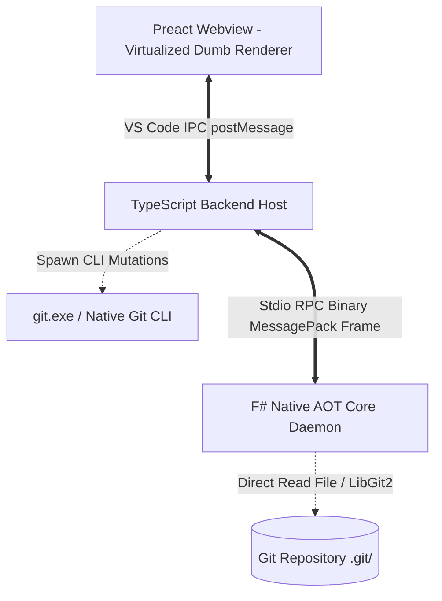

<div align="center">
  
  <samp>
    <h1>F-GitGraph: Reborn</h1>
    <h3>Next-generation Git Client & History Visualizer for VS Code, powered by an F# Native AOT core and Cyber-Lab Design System.</h3>
  </samp>
</div>

<p align="center">
  <a href="./LICENSE"></a>
  <a href="https://github.com/thatislg/f-gitgraph/releases"></a>
  
  
</p>

<p>&nbsp;</p>

## Overview: The Reborn Era

**F-GitGraph** is an ultra-fast, feature-rich Git Client UI and interactive DAG history visualizer built directly into VS Code.

Originally forked from the popular MIT-licensed **Git Graph** (via **Neo-Git-Graph**), the project has undergone a complete transformation in the **Reborn Era**:

1. **Engine Rebirth**: Replacing legacy single-threaded JavaScript `git log` regex parsing with a standalone, blazing-fast **F# Native AOT Core Engine** (`f-gitgraph-core`) that communicates via a binary MessagePack streaming IPC daemon (<5ms cold start, zero-allocation memory-mapped file access).
2. **Visual Rebirth**: Introducing the **Neo-Brutalist Cyber-Lab** visual identity — inspired by LMO Lab's high-precision blueprint framing with **corner crosshair rivets (`+`)**, high-tech **Hexagon SVG commit nodes**, clip-path avatars, ambient neon gradients, and a clean, uncluttered layout that delivers deep visual appeal without the chaotic overcrowding found in tools like GitLens.
3. **Workspace Rebirth**: Evolving from a pure commit-history viewer into a comprehensive **3-Pane Git Client Workspace** with native Staging, a specialized Commit Composer, full Stash Inspector, Visual Interactive Rebase, and In-Flight Conflict Resolution.

Maintained and published by **[LMO-LAB](https://github.com/thatislg)**.

---

## Key Highlights & Core Pillars

- ⚡ **F# Native AOT Core Engine** — Pure machine code compiled directly for target platforms (`win-x64`, `linux-x64`, `osx-arm64`). Runs on the bare metal with zero dependencies on the .NET SDK or runtime.
- 🚀 **Memory-Mapped Direct Git Access** — Reads the binary `.git/objects/info/commit-graph` via memory-mapped files and in-process LibGit2 C bindings. Parses repositories with 50,000 – 100,000+ commits in milliseconds.
- 🧬 **Parallel DAG Layout Solver** — Computes topological commit order, left-compact lane pools, and SVG Bézier curves in parallel across multi-core CPUs.
- 📐 **Neo-Brutalist Cyber-Lab Aesthetic** — Technical blueprint panel framing punctuated by signature **corner crosshair rivets (`+`)**, providing a focused, structured, and aesthetic experience.
- 💎 **Hexagon Nodes & Avatar Micro-Interactions** — SVG Hexagon commit nodes with clip-path avatars, smooth **Micro Hover Zoom (1.15×)**, and **Click Deep Zoom (5.0× Top-Layer)** with HD profile previews.
- 🎨 **Neon Ambient Gradient & Flameshot Purple Border** — Shimmering branch-colored neon ambient glow fanning from commit avatars, coupled with signature Flameshot purple selection highlights.
- 🛡️ **100% Signature-Safe Mutations** — Every mutating operation (`commit`, `branch`, `tag`, `merge`, `rebase`, `cherry-pick`, `revert`, `reset`, `stash`, `push`, `pull`) is strictly delegated to the user's native `git.exe` CLI, ensuring 100% data integrity, GPG/SSH commit signing, Git Credential Manager authentication, and git hooks execution.
- 🌗 **Seamless Dark & Light Harmony** — Deep integration with VS Code's active theme variables (`--vscode-*`), featuring calibrated neon accents for dark mode and soft, non-glare blueprint contrast for light mode.

---

## 3-Pane Workspace Architecture

F-GitGraph organizes your repository into an intuitive, responsive, and non-cluttered 3-pane layout:

```
+──────────────────────────────────────────────────────────────────────────────────────────+
│ [↻ Fetch]  [↓ Pull 2]  [↑ Push 1]  [📦 Stash]  │  [ 🔍 Filter commits... (Ctrl+F) ]      │
+─────────────────────────+──────────────────────────────────────+─────────────────────────+
│ 📁 LEFT SIDEBAR         │ 📊 CENTER DAG GRAPH CANVAS           │ 📝 RIGHT INSPECTOR PANE │
│                         │                                      │                         │
│  ▼ WORKING TREE         │   ●─── [main] Commit message 1       │  ▼ STAGING AREA         │
│     Changes (3)         │   │ ●─ [feat] Add new button         │     Staged (1) [-]      │
│                         │   ● │  Merge pull request #42        │     Changes (2) [+]     │
│  ▼ LOCAL BRANCHES       │   │ │                                │                         │
│   • main (HEAD)         │   ... (Virtualized Windowing DAG)    │  ▼ COMMIT COMPOSER      │
│   • feature-reborn      │                                      │  ┌────────────────────┐ │
│                         │ ──────────────────────────────────── │  │ Summary (42/50)    │ │
│  ▼ REMOTES (origin)     │ [Commit Details Overlay Inspector]   │  ├────────────────────┤ │
│     main, dev           │ Full message, author, file changes,  │  │ Extended desc...   │ │
│                         │ side-by-side diff via vscode.diff.   │  └────────────────────┘ │
│  ▼ TAGS & STASHES       │                                      │  [x] Amend  [x] Sign    │
│     v1.0.0, stash@{0}   │                                      │  [ Button: Commit (1) ] │
+─────────────────────────+──────────────────────────────────────+─────────────────────────+
```

1. **Top Global Toolbar**: Quick access to `Fetch`, `Pull` (with ahead/behind badges), `Push`, `Stash`, and instant `Ctrl+F` commit search.
2. **Left Sidebar Navigator**: Clean hierarchical tree of Working Tree status, Local Branches, Remote tracking branches, Tags, and Stashes with double-click checkout and right-click context menus.
3. **Center DAG Graph Canvas**: Virtualized infinite scrolling commit table rendering hexagon nodes, branch curves, author avatars, and rich dwell hover popovers without dropping frames.
4. **Right / Bottom Inspector Pane**:
   - **Working Tree Mode**: Staging Area (Unstaged vs Staged files, file & hunk staging, discard changes) and Commit Composer (50-char counter, body description, amend toggle, GPG sign toggle).
   - **Commit History Mode**: Overlay Commit Details drawer displaying author metadata, changed files, and integrated `vscode.diff`.

---

## Technical Architecture & Performance Comparison

Traditional Git extensions shell out to `git log` with regular expressions and compute layout graphs in a single JavaScript thread, causing severe UI freezes and high RAM consumption on large repositories.

F-GitGraph decouples the system into a **Hybrid High-Performance Pipeline**:



| Concern                  | Legacy Single-Threaded JS                      | F-GitGraph Reborn (F# Native AOT)                          |
| :----------------------- | :--------------------------------------------- | :--------------------------------------------------------- |
| **Commit & Ref Access**  | `git log` spawn process + regex string split   | Direct memory-mapped `commit-graph` + in-process LibGit2   |
| **Memory Allocation**    | Tens of thousands of JS objects (GC thrashing) | Zero-allocation `Span<byte>` binary slices                 |
| **DAG Topological Sort** | Single-threaded JavaScript                     | Multi-threaded parallel topological graph solver           |
| **SVG Path Generation**  | Render-time JavaScript path math               | Pre-computed Bézier curves via `Array.Parallel`            |
| **IPC Communication**    | Large JSON stringify/parse                     | Binary MessagePack framing over Stdio streaming            |
| **Mutation Safety**      | Library-based Git mutations                    | 100% Native Git CLI delegation (GPG, SSH, Hooks preserved) |

---

## Project Evolution & Roadmap

The development of F-GitGraph is organized into milestone phases:

- **Phase 1: F# Core Foundation** _(Completed & Packaged)_:
  - F# Native AOT independent engine (`win-x64`, cold-start <5ms).
  - Parallel DAG layout solver & memory-mapped commit-graph reader.
  - Hexagon SVG nodes, clip-path avatars, 1.15× micro hover zoom, and 5.0× click deep zoom.
  - Rich hover panel (550ms dwell timer) and non-breaking commit details overlay inspector.
  - Topological and Date commit ordering toggle.
- **Phase 3: Reborn — Full Git Client App UI** _(Active Development)_:
  - **[Milestone 3.1: Staging Area & Commit Composer](docs/03_progess/phase3/001_phase3_1_staging_and_composer.md)**: Staged/Unstaged file lists, file staging, commit composer with 50-char counter, amend, and GPG signing.
  - **[Milestone 3.2: 3-Pane Workspace & Remote Synchronization](docs/03_progess/phase3/002_phase3_2_3pane_workspace.md)**: Left sidebar navigator, global toolbar with ahead/behind counters (`↑ahead` / `↓behind`), search & filter bar.
  - **[Milestone 3.3: Stash Management & Multi-Commit Diff](docs/03_progess/phase3/003_phase3_3_stash_and_multi_diff.md)**: Stash preview drawer, cross-commit comparison (`Ctrl` select 2 nodes), partial hunk staging.
  - **[Milestone 3.4: Visual Interactive Rebase & Conflict Resolver](docs/03_progess/phase3/004_phase3_4_rebase_and_conflict.md)**: Drag-and-drop commit reordering, visual squash/fixup/reword/drop buttons, and 3-way in-flight conflict resolver.

Comprehensive technical design specifications and investigation reports can be found in the [`docs/`](docs/) directory:

- [Phase 3 Reborn Overview & Taxonomy](docs/phase3_Reborn/README.md)
- [Design System & Cyber-Lab Visual Identity](docs/phase3_Reborn/004_Design_System_And_Visual_Identity.md)
- [Phase 3 Worklogs & Milestone Progress](docs/03_progess/phase3/README.md)

---

## Configuration Settings

All settings are prefixed with `f-gitgraph` and can be customized via VS Code Settings:

| Setting                                  |     Default     | Description                                                                 |
| :--------------------------------------- | :-------------: | :-------------------------------------------------------------------------- |
| `f-gitgraph.autoCenterCommitDetailsView` |     `true`      | Automatically center the selected commit details view in viewport.          |
| `f-gitgraph.dateFormat`                  | `"Date & Time"` | Timestamp display format (`"Date & Time"`, `"Date Only"`, or `"Relative"`). |
| `f-gitgraph.dateType`                    | `"Author Date"` | Source date for commits (`"Author Date"` or `"Commit Date"`).               |
| `f-gitgraph.graphColours`                |   12 defaults   | Curated neon & pastel palette for branch graph lanes.                       |
| `f-gitgraph.graphStyle`                  |   `"rounded"`   | Visual curve style for branch lanes (`"rounded"` or `"angular"`).           |
| `f-gitgraph.initialLoadCommits`          |      `300`      | Number of initial commits loaded on open.                                   |
| `f-gitgraph.loadMoreCommits`             |      `100`      | Chunk size of commits to load during virtual scrolling.                     |
| `f-gitgraph.maxDepthOfRepoSearch`        |       `0`       | Subdirectory depth for scanning repositories in workspace.                  |
| `f-gitgraph.showCurrentBranchByDefault`  |     `false`     | Filter to only current checked out branch on view launch.                   |
| `f-gitgraph.showUncommittedChanges`      |     `true`      | Display the uncommitted changes row at the top of the graph.                |
| `f-gitgraph.tabIconColourTheme`          |   `"colour"`    | Icon appearance theme in tab bar (`"colour"` or `"grey"`).                  |

---

## Contributing & Community

Contributions, suggestions, and issue reports are warmly welcomed!

- File bug reports and feature requests via [GitHub Issues](https://github.com/thatislg/f-gitgraph/issues).
- Check the [Phase 3 Roadmap](docs/phase3_Reborn/003_Gap_Analysis_And_Evolution_Blueprint.md) for planned features and technical specifications.

---

## License & Copyright Attributions

F-GitGraph is open-source software licensed under the **[MIT License](LICENSE)**.

```text
MIT License

Copyright (c) 2019 mhutchie. Fork (c) 2026-present LMO-LAB
```

### Historical Acknowledgments & Ancestry

- **Original Foundation**: Built upon the MIT-licensed **Git Graph** extension created by **[mhutchie](https://github.com/mhutchie/vscode-git-graph)**. We honor mhutchie's pioneering work in bringing interactive commit graphs to VS Code.
- **Neo-Git-Graph Fork**: Inherits early modernization refactoring from the **Neo-Git-Graph** project ([asispts/neo-git-graph](https://github.com/asispts/neo-git-graph)).
- **F-GitGraph Reborn**: Conceived, architected with an F# Native AOT parallel computing engine, designed under the Cyber-Lab aesthetic, and actively developed by **[LMO-LAB](https://github.com/thatislg)**.
