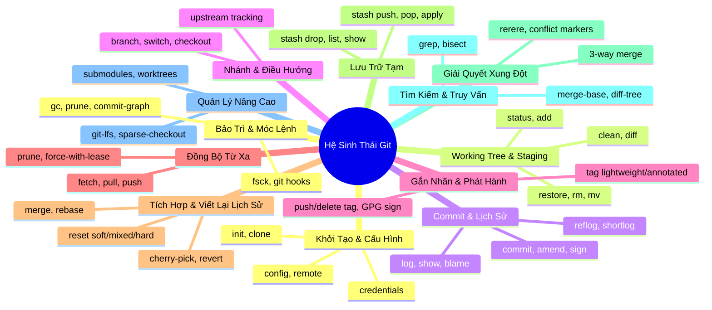

# 001. Khảo Sát Toàn Diện Hệ Sinh Thái Tính Năng Git (Git Features Taxonomy)

Tài liệu này hệ thống hóa toàn bộ các tính năng, khái niệm cốt lõi của hệ thống quản lý phiên bản Git (Git Core CLI) và các chuẩn mực thiết kế của những ứng dụng Git Client UI hàng đầu thế giới (Fork, GitKraken, Sublime Merge, Tower, GitLens), làm cơ sở tham chiếu chuẩn mực cho kế hoạch phát triển Phase 3 của F-GitGraph.

---

## 1. Bản Đồ Tính Năng Git CLI Tiêu Chuẩn (12 Trụ Cột Chức Năng)

Git là một hệ thống quản lý phiên bản phân tán (DVCS) có tập lệnh phong phú với hơn 150 lệnh con. Dưới góc độ xây dựng một ứng dụng Git Client hoàn chỉnh, toàn bộ tính năng của Git được phân loại thành 12 trụ cột chức năng sau:



---

### 1.1. Khởi Tạo, Nhân Bản & Cấu Hình Kho (Repository & Configuration)

- **`git init`**: Khởi tạo kho chứa mới (standard repo hoặc bare repo).
- **`git clone [--depth=N] [--branch=B] [--recurse-submodules]`**: Nhân bản kho từ xa về máy cục bộ. Hỗ trợ clone nông (shallow clone), clone một nhánh duy nhất, clone kèm submodule.
- **`git config [--global | --local | --system]`**: Đọc/ghi thiết lập danh tính (`user.name`, `user.email`), cấu hình ký số (`user.signingkey`), cấu hình merge tool, alias, và cấu hình core (`core.autocrlf`, `core.ignorecase`).
- **`git remote`**:
  - `add <name> <url>`: Thêm remote mới (origin, upstream, fork).
  - `rename <old> <new>`: Đổi tên remote.
  - `remove <name>`: Xóa remote.
  - `get-url / set-url`: Quản lý đường dẫn remote (HTTPS/SSH).
  - `prune <name>`: Dọn dẹp các nhánh remote không còn tồn tại trên server.
- **Git Credential Management**: Xác thực thông qua SSH Key, GPG Key, Personal Access Token (PAT), OAuth2 (GitHub/GitLab), và Git Credential Manager (GCM).

---

### 1.2. Vùng Làm Việc, Chỉ Mục & Staging (Working Tree, Index & Staging)

Đây là "trái tim" của chu trình làm việc hàng ngày của lập trình viên:

- **`git status [--porcelain=v2]`**: Truy vấn trạng thái các tệp tin trong working tree và staging index:
  - Untracked: Tệp mới chưa được Git theo dõi.
  - Modified: Tệp đã thay đổi nhưng chưa stage.
  - Staged: Tệp đã được đưa vào Index sẵn sàng commit.
  - Deleted: Tệp đã bị xóa.
  - Renamed: Tệp được đổi tên hoặc chuyển thư mục.
- **`git add <path>`**: Đưa tệp vào Staging Index.
  - Hỗ trợ `git add -p` (Interactive Patch / Hunk Staging): Chọn lọc từng đoạn code (hunk) hoặc từng dòng code (line staging) để đưa vào commit mà không commit toàn bộ tệp.
- **`git restore [--staged] <path>`**:
  - `restore --staged <path>`: Unstage tệp hoặc đoạn code (rút khỏi index về working tree).
  - `restore <path>`: Discard (hủy bỏ) toàn bộ thay đổi của tệp trong working tree về trạng thái commit gần nhất.
- **`git rm / git mv`**: Xóa hoặc di chuyển/đổi tên tệp có ghi nhận vào index.
- **`git clean [-fd]`**: Dọn sạch các tệp untracked hoặc thư mục thừa không thuộc phạm vi theo dõi.
- **`git diff`**: So sánh vi sai:
  - Working Tree vs Index: `git diff`
  - Index vs HEAD (Staged diff): `git diff --cached`
  - Working Tree vs HEAD: `git diff HEAD`

---

### 1.3. Đóng Gói Lịch Sử (Committing & History Recording)

- **`git commit`**:
  - `-m "<message>"`: Commit với thông điệp.
  - `--amend`: Sửa đổi commit gần nhất (thay đổi message hoặc bổ sung thêm tệp đã stage vào commit hiện tại mà không tạo commit mới).
  - `-S` / `--gpg-sign`: Ký số mật mã (GPG / SSH commit signing).
  - `--author="<name> <email>"`: Ghi đè thông tin tác giả commit.
  - `--no-verify`: Bỏ qua các git hooks (`pre-commit`, `commit-msg`).
- **`git log`**: Truy vấn lịch sử commit (topological, date-order, reverse, oneline, graph, patch).
- **`git show <hash>`**: Xem chi tiết siêu dữ liệu của một commit và toàn bộ diff của commit đó.
- **`git blame [-L start,end] <file>`**: Truy vấn ai đã viết từng dòng code trong tệp, tại commit nào, vào thời điểm nào.
- **`git reflog`**: Nhật ký tham chiếu ghi lại mọi bước di chuyển của HEAD và các nhánh cục bộ (là "phao cứu sinh" tối thượng để khôi phục các commit bị mất sau khi rebase hoặc reset nhầm).

---

### 1.4. Quản Lý Nhánh & Điều Hướng (Branching & Navigation)

- **`git branch`**:
  - `branch <name> [start-point]`: Tạo nhánh mới tại commit chỉ định.
  - `branch -d <name>`: Xóa an toàn (chỉ xóa khi nhánh đã được merge).
  - `branch -D <name>`: Ép buộc xóa nhánh (force delete).
  - `branch -m <old> <new>`: Đổi tên nhánh.
  - `branch -u <upstream>`: Thiết lập liên kết theo dõi (upstream tracking) giữa nhánh cục bộ và nhánh từ xa.
- **`git switch <name>` / `git checkout <name>`**:
  - Chuyển đổi qua lại giữa các nhánh làm việc.
  - Tạo và chuyển nhánh ngay lập tức: `git switch -c <name>`.
  - Detached HEAD State: Checkout trực tiếp một commit hash cụ thể để thử nghiệm hoặc kiểm tra mà không gắn với tên nhánh nào.

---

### 1.5. Gắn Nhãn Phiên Bản (Tagging & Releases)

- **`git tag`**:
  - **Lightweight Tag**: Nhãn nhẹ, chỉ đơn thuần là con trỏ chỉ vào một commit hash cụ thể (`git tag v1.0.0 <hash>`).
  - **Annotated Tag**: Nhãn chú thích đầy đủ, là một đối tượng Git độc lập chứa thông tin người tạo nhãn (tagger), ngày tạo, thông điệp tag, và chữ ký số GPG (`git tag -a v1.0.0 -m "Release v1.0.0"`).
- **`git tag -d <name>`**: Xóa tag cục bộ.
- **`git push <remote> <tag>`**: Đẩy một tag cụ thể lên server.
- **`git push <remote> --tags`**: Đẩy toàn bộ tag cục bộ lên server.
- **`git push <remote> --delete <tag>`**: Xóa tag trên server từ xa.

---

### 1.6. Đồng Bộ Hóa Từ Xa & Mạng (Synchronization & Network)

- **`git fetch [--prune] [--all]`**: Tải toàn bộ commits, branches, tags mới từ remote về kho cục bộ nhưng không can thiệp hay thay đổi mã nguồn trong working tree.
- **`git pull [--rebase] [--ff-only]`**:
  - Fetch dữ liệu mới và tích hợp vào nhánh hiện tại.
  - `pull` mặc định: Fetch + `git merge`.
  - `pull --rebase`: Fetch + `git rebase` (giữ lịch sử tuyến tính gọn gàng).
  - `pull --ff-only`: Chỉ chấp nhận fast-forward, báo lỗi nếu có phân nhánh.
- **`git push`**:
  - `push <remote> <branch>`: Đẩy commit cục bộ lên server từ xa.
  - `push -u <remote> <branch>`: Đẩy và thiết lập tracking.
  - `push --force-with-lease`: Ép đẩy có kiểm tra an toàn (bảo vệ lịch sử khỏi việc vô tình ghi đè commit của đồng nghiệp).
  - `push <remote> --delete <branch>`: Xóa nhánh trên remote repository.

---

### 1.7. Tích Hợp Nhánh & Viết Lại Lịch Sử (Integration & History Rewriting)

Đây là các thao tác phức tạp nhất đòi hỏi giao diện trực quan hỗ trợ:

- **`git merge`**:
  - Fast-forward merge (FF): Chỉ cần di chuyển con trỏ nhánh nếu không có xung đột rẽ nhánh.
  - No Fast-forward (`--no-ff`): Luôn tạo một merge commit mới với 2 commit cha để lưu dấu vết phân nhánh và tích hợp.
  - Squash merge (`--squash`): Gom toàn bộ các commit của nhánh tính năng thành 1 thay đổi duy nhất trên working tree trước khi commit vào nhánh chính.
- **`git rebase`**:
  - Rebase cơ bản: Đưa gốc của nhánh tính năng lên đỉnh của nhánh đích.
  - **Interactive Rebase (`git rebase -i <base>`)**: Công cụ tái cấu trúc lịch sử tối thượng:
    - `pick`: Giữ nguyên commit.
    - `reword`: Giữ commit nhưng sửa lại commit message.
    - `edit`: Dừng lại để sửa mã nguồn hoặc tách commit.
    - `squash`: Gộp commit vào commit liền trước và ghép thông điệp.
    - `fixup`: Gộp commit vào commit liền trước nhưng bỏ qua thông điệp.
    - `drop`: Xóa bỏ commit khỏi lịch sử.
    - Sắp xếp lại thứ tự các commit bằng cách đổi thứ tự dòng.
  - Điều khiển rebase: `rebase --continue`, `rebase --skip`, `rebase --abort`.
- **`git cherry-pick <commit>`**: Áp dụng thay đổi của một commit cụ thể ở nhánh khác vào nhánh hiện tại.
- **`git revert <commit>`**: Tạo một commit mới đảo ngược hoàn toàn những gì commit chỉ định đã làm (an toàn cho các nhánh đã push lên remote).
- **`git reset`**:
  - `reset --soft <commit>`: Di chuyển con trỏ nhánh về commit cũ, giữ nguyên trạng thái Staging Index và Working Tree.
  - `reset --mixed <commit>` (mặc định): Di chuyển con trỏ nhánh, đưa các thay đổi về Working Tree (unstage), không mất code.
  - `reset --hard <commit>`: Hủy bỏ hoàn toàn mọi thay đổi, đưa cả Working Tree và Index về đúng trạng thái của commit chỉ định (rủi ro cao).

---

### 1.8. Lưu Trữ Thay Đổi Tạm Thời (Stashing & Shelving)

- **`git stash` / `git stash push [-m "msg"] [-u] [--keep-index]`**: Cất giữ toàn bộ thay đổi chưa commit vào ngăn xếp tạm để chuyển sang làm việc khác trên một working tree sạch.
  - `-u` / `--include-untracked`: Cất cả các tệp untracked.
  - `--keep-index`: Cất thay đổi nhưng giữ nguyên những tệp đã stage.
- **`git stash list`**: Xem danh sách các bản lưu trữ trong ngăn xếp (`stash@{0}`, `stash@{1}`).
- **`git stash pop [stash@{n}]`**: Áp dụng thay đổi từ stash và xóa khỏi danh sách.
- **`git stash apply [stash@{n}]`**: Áp dụng thay đổi từ stash nhưng vẫn giữ lại trong danh sách.
- **`git stash drop [stash@{n}]`**: Xóa một bản stash cụ thể.
- **`git stash show -p [stash@{n}]`**: Xem nội dung chi tiết diff bên trong bản stash.
- **`git stash branch <branchname> [stash@{n}]`**: Tạo nhánh mới từ bản stash và áp dụng thay đổi vào nhánh đó.

---

### 1.9. Xử Lý Xung Đột (Merge Conflict Resolution)

Khi 2 luồng phát triển cùng sửa đổi một vùng mã nguồn:

- Phát hiện xung đột (Conflict State / In-Flight state): `.git/MERGE_HEAD`, `.git/rebase-merge/`, `.git/CHERRY_PICK_HEAD`.
- Cấu trúc 3 chiều (3-Way Merge):
  - **Base (Ancestor)**: Trạng thái chung gần nhất trước khi rẽ nhánh.
  - **Ours (Local / Current)**: Trạng thái mã nguồn của nhánh hiện tại.
  - **Theirs (Incoming / Remote)**: Trạng thái mã nguồn từ nhánh đang kéo vào.
- Dấu hiệu xung đột trong tệp (`<<<<<<<`, `=======`, `>>>>>>>`).
- **`git rerere` (Reuse Recorded Resolution)**: Tự động ghi nhớ và tái sử dụng cách giải quyết xung đột cho các lần merge sau.

---

### 1.10. Truy Vấn & Tìm Kiếm Lịch Sử (Search, Inspection & Bisect)

- **`git grep <pattern>`**: Tìm kiếm văn bản siêu tốc trong toàn bộ cây mã nguồn hoặc trong lịch sử commit.
- **`git bisect`**: Thuật toán tìm kiếm nhị phân (Binary Search) giúp tự động tìm ra commit gây ra bug giữa một commit tốt (good) và một commit xấu (bad).
- **`git merge-base A B`**: Tìm commit tổ tiên chung gần nhất của 2 nhánh.
- **`git diff-tree`**: Kiểm tra cây đối tượng vi sai giữa 2 cây snapshot.

---

### 1.11. Quản Lý Kho Mở Rộng & Dự Án Lớn (Submodules, Worktrees & Large Files)

- **`git submodule`**: Quản lý các repository con lồng bên trong repository cha (`init`, `update`, `sync`, `status`).
- **`git worktree`**: Cho phép checkout đồng thời nhiều nhánh khác nhau trên cùng một repository ra nhiều thư mục làm việc riêng biệt mà không cần clone lại toàn bộ repository.
- **Git LFS (Large File Storage)**: Quản lý các tệp nhị phân dung lượng lớn (audio, video, models, datasets) bằng con trỏ metadata nhẹ.
- **Sparse-checkout**: Chỉ tải về một thư mục con của dự án khổng lồ để tiết kiệm ổ đĩa và RAM.

---

### 1.12. Bảo Trì, Tối Ưu Hóa & Móc Lệnh (Maintenance & Hooks)

- **`git gc [--aggressive] [--prune]`**: Thu gom rác, nén các loose objects thành packfiles.
- **`git commit-graph write`**: Sinh file đồ thị nhị phân nén giúp tăng tốc độ đọc DAG gấp hàng chục lần (chính là tệp mà nhân F# Core Engine của chúng ta đọc trực tiếp).
- **`git fsck`**: Kiểm tra tính toàn vẹn của cơ sở dữ liệu đối tượng Git.
- **Git Hooks**: Các đoạn mã tự động kích hoạt tại các mốc thời gian (`pre-commit`, `commit-msg`, `pre-push`, `post-merge`).

---

## 2. Khảo Sát Các Ứng Dụng Git GUI Hàng Đầu Thế Giới

Để xây dựng một ứng dụng Git UI hoàn chỉnh, chúng ta cần khảo sát các chuẩn mực giao diện và tính năng đã được kiểm nghiệm qua hàng triệu người dùng trên các sản phẩm nổi tiếng nhất hiện nay:

```
┌──────────────────────────────────────────────────────────────────────────────────┐
│                             CÁC ỨNG DỤNG GIT GUI TIÊU BIỂU                       │
├─────────────────────┬───────────────────┬───────────────────┬────────────────────┤
│ Fork                │ GitKraken         │ Sublime Merge     │ GitLens (VS Code)  │
├─────────────────────┼───────────────────┼───────────────────┼────────────────────┤
│ • Cực nhanh (Native)│ • Đồ họa đẹp mắt  │ • Cực kỳ tốc độ   │ • Tích hợp sâu IDE │
│ • 3-Pane hoàn hảo   │ • Rich graph visual│ • Bàn phím linh hoạt│ • Line Blame đỉnh cao│
│ • Interactive rebase│ • PR / Issue sync │ • 3-way merge tool│ • Visual file graph│
│ • Conflict resolver │ • Workspace team  │ • Search regex    │ • SCM view mở rộng │
└─────────────────────┴───────────────────┴───────────────────┴────────────────────┘
```

---

### 2.1. Cấu Trúc Bố Cục Không Gian Làm Việc Chuẩn (The 3-Pane Architecture)

Hầu hết tất cả các ứng dụng Git Client chuyên nghiệp (Fork, SourceTree, Tower, GitKraken) đều hội tụ về một cấu trúc bố cục không gian làm việc chuẩn mực gồm 3 vùng chính:

```
┌────────────────────────────────────────────────────────────────────────────────────────────────────┐
│ [Top Toolbar]: Fetch | Pull (↓2) | Push (↑1) | Stash | Pop | Branch | Terminal | Settings          │
├───────────────────────┬──────────────────────────────────────────┬─────────────────────────────────┤
│ [Left Sidebar]        │ [Center View: DAG Graph & Commit History]│ [Right / Bottom Inspector Pane] │
│                       │                                          │                                 │
│ 📁 WORKING TREE       │  ●─── [main] Commit message 1 (Author)   │ 📝 STAGING AREA                 │
│  ├─ Changes (3)       │  │ ●─ [feature] Add new button           │  ├─ Staged Changes (1)          │
│  └─ Staged (1)        │  ● │  Merge pull request #12             │  │   └─ [M] src/App.tsx         │
│                       │  │ │                                     │  ├─ Unstaged Changes (2)        │
│ 🌿 LOCAL BRANCHES     │  ... (Infinite Scroll Virtualized DAG)   │  │   ├─ [A] src/NewComponent.tsx│
│  ├─ main (↑1)         │                                          │  │   └─ [D] src/OldFile.ts      │
│  └─ feature-login     │                                          │                                 │
│                       ├──────────────────────────────────────────┤ ✍️ COMMIT COMPOSER              │
│ 🌐 REMOTES            │ [Commit Details / Diff Preview]          │  ┌────────────────────────────┐ │
│  └─ origin            │ Author: John Doe <john@example.com>      │  │ Commit summary message...   │ │
│     ├─ main           │ Hash: abc1234 (Date: 2 hours ago)        │  │ Description (optional)...   │ │
│     └─ dev            │                                          │  └────────────────────────────┘ │
│                       │ Changed Files:                           │  [x] Amend  [x] Sign Commit     │
│ 🏷️ TAGS (v1.0.0, ...) │ ├─ [M] src/App.tsx                       │  [ Button: Commit Changes (1) ] │
│ 📦 STASHES (stash@{0})│ └─ [A] src/Button.tsx                    │  [ Button: Commit & Push      ] │
└───────────────────────┴──────────────────────────────────────────┴─────────────────────────────────┘
```

1. **Top Global Toolbar (Thanh công cụ đỉnh)**:
   - Các nút tác vụ nhanh toàn cục: `Fetch`, `Pull`, `Push`, `Stash`, `Pop`, mở Terminal ngoài, làm mới kho.
   - Hiển thị huy hiệu số lượng commit chưa đồng bộ (`↑ ahead` cần push, `↓ behind` cần pull).
2. **Left Sidebar Navigator (Cây điều hướng bên trái)**:
   - Cung cấp cái nhìn bao quát về toàn bộ kho: Trạng thái Working Tree, danh sách nhánh cục bộ (kèm icon nhánh đang checkout), nhánh remote, danh sách Tag, danh sách Stash, Submodules.
   - Thao tác nhanh qua chuột phải: Double click để checkout, chuột phải để merge, rebase, rename, delete.
3. **Center Graph & Commit Table (Bảng đồ thị commit trung tâm)**:
   - Đây chính là thế mạnh hiện tại của F-GitGraph: Hiển thị các lane rẽ nhánh, node commit lục giác, avatar tác giả, vầng neon highlight, thông tin ngày tháng, hash.
   - Hỗ trợ thanh tìm kiếm và bộ lọc commit (Filter by Branch, Author, Date, Text).
4. **Right/Bottom Inspector & Staging Area (Khu vực Staging & Soạn thảo Commit)**:
   - Khi chọn "Changes" trên Sidebar: Hiển thị giao diện Staging (Unstaged list, Staged list, nút Stage/Unstage từng tệp hoặc từng hunk, và hộp thoại viết commit message).
   - Khi chọn một commit trên đồ thị: Hiển thị chi tiết commit, danh sách tệp thay đổi và khung xem trước diff.

---

### 2.2. Chi Tiết Tính Năng "Phải Có" Của Một Git GUI Hoàn Chỉnh

Dưới đây là các tính năng bắt buộc phải có trên một Git GUI app chuyên nghiệp mà người dùng luôn kỳ vọng:

#### A. Quy Trình Staging & Soạn Thảo Commit (Staging & Commit Composer)

- **Tách bạch 2 danh sách**: Unstaged Files và Staged Files.
- **Thao tác nhanh**: Nút "Stage All", "Unstage All", hoặc click vào icon mũi tên cạnh từng tệp.
- **Stage từng phần (Partial / Hunk / Line Staging)**: Khi xem diff của một tệp, người dùng có thể bôi đen vài dòng code hoặc bấm vào từng khối (hunk) để "Stage Hunk" hoặc "Discard Hunk".
- **Discard thay đổi an toàn**: Cho phép người dùng hủy bỏ thay đổi của một tệp hoặc toàn bộ tệp với cảnh báo xác nhận.
- **Commit Message Box**:
  - Dòng 1: Tiêu đề commit (Summary, khuyến nghị < 50 ký tự kèm bộ đếm).
  - Khung văn bản mở rộng: Mô tả chi tiết (Description).
  - Tùy chọn Amend: Checkbox "Amend commit gần nhất" (tự động load message của commit trước đó lên để sửa).
  - Tùy chọn Ký số: Checkbox "GPG Sign".
  - Nút bấm: "Commit", "Commit & Push".

#### B. Thao Tác Kéo & Thả Trực Quan (Drag & Drop Operations)

- Kéo một nhánh thả vào một nhánh khác: Hiện popup lựa chọn (Merge into, Rebase onto).
- Kéo một commit thả vào nhánh hiện tại: Thực hiện Cherry-pick.
- Kéo một commit thả vào một commit khác: Kích hoạt Squash hoặc Fixup.

#### C. Trình Tái Cấu Trúc Lịch Sử Trực Quan (Visual Interactive Rebase)

- Thay vì phải mở file text qua terminal với `git rebase -i`, ứng dụng cung cấp một bảng giao diện trực quan:
  - Danh sách các commit cần rebase.
  - Kéo thả để đổi thứ tự commit.
  - Click chuột chuyển đổi trạng thái từng commit: `Pick` $\rightarrow$ `Squash` $\rightarrow$ `Fixup` $\rightarrow$ `Reword` $\rightarrow$ `Drop`.
  - Nút "Start Rebase" và các thanh điều khiển khi gặp conflict (`Continue`, `Abort`).

#### D. Trình Giải Quyết Xung Đột Trực Tiếp (Interactive Conflict Resolver)

- Khi phát hiện trạng thái xung đột (In-Flight Conflict):
  - Hiển thị danh sách các tệp bị conflict (`[!] Conflict`).
  - Giao diện 3-Way Merge: Cột trái (Ours), Cột giữa (Result), Cột phải (Theirs).
  - Nút nhanh: "Accept Ours", "Accept Theirs", "Accept Both".
  - Sau khi resolve xong, tự động stage tệp và mở khóa nút `Continue Rebase` / `Commit Merge`.

#### E. Trình Xem Vi Sai (Diff Viewer) Mạnh Mẽ

- Hiển thị Side-by-side (2 cột song song) hoặc Inline (liên tục theo dòng).
- Đánh dấu từ vi sai (Word-level diff highlight): Tô đậm chính xác từ ngữ hoặc ký tự bị thay đổi bên trong dòng code.
- Ẩn/hiện khoảng trắng (Ignore whitespace changes).
- So sánh giữa 2 commit bất kỳ: Cho phép người dùng giữ phím `Ctrl`/`Shift` chọn 2 commit trên đồ thị để xem toàn bộ diff giữa 2 mốc lịch sử đó.

#### F. Quản Lý Ngăn Xếp Tạm (Stash Inspector)

- Danh sách Stash hiển thị rõ ràng thông điệp, nhánh tạo stash và thời gian.
- Click vào stash xem ngay danh sách tệp và diff bên trong mà không cần pop ra ngoài.
- Nút tác vụ trực tiếp: Apply, Pop, Drop.

---

## 3. Bộ Tiêu Chuẩn Vàng Của Một "Complete Git App UI"

Dựa trên khảo sát toàn diện, một ứng dụng được công nhận là **"Complete Git App UI"** khi và chỉ khi thỏa mãn đầy đủ **5 Trục Năng Lực (5 Core Pillars)**:

```
                    ┌──────────────────────────────────────────────┐
                    │      5 TRỤC NĂNG LỰC CỦA GIT CLIENT APP      │
                    └──────────────────────┬───────────────────────┘
                                           │
         ┌──────────────────┬──────────────┼──────────────┬──────────────────┐
         ▼                  ▼              ▼              ▼                  ▼
   1. VISUALIZE        2. WORKSPACE   3. MUTATE      4. REWRITE         5. RESOLVE
      & INSPECT          & STAGING       & SYNC         & REFINE           & RECOVER
   • Virtualized DAG   • Unstaged list • Safe CLI     • Visual Rebase    • In-Flight Detect
   • Hexagon Nodes     • Staged list   • Fetch/Pull   • Drag & Drop      • 3-Way Resolver
   • Fast commit graph • Line staging  • Push (lease) • Squash/Fixup     • Merge/Rebase Abort
   • 2-way/3-way Diff  • Commit box    • Branch/Tag   • Interactive drop • Reflog Recovery
```

1. **Visualize & Inspect (Trực quan hóa & Khảo sát)**:
   - Hiển thị đồ thị commit siêu tốc, mượt mà trên các repo hàng trăm nghìn commits.
   - Xem chi tiết commit, cây tệp thay đổi, avatar tác giả, nhãn nhánh/tag rực rỡ.
   - So sánh vi sai giữa các commit bất kỳ.
2. **Workspace & Staging (Không gian làm việc & Chuẩn bị commit)**:
   - Quản lý trạng thái working tree theo thời gian thực (real-time file watching).
   - Cho phép Stage / Unstage / Discard linh hoạt từ cấp độ tệp đến cấp độ hunk/line.
   - Trình soạn thảo commit đầy đủ tính năng (Title, Body, Amend, Sign).
3. **Mutate & Sync (Biến đổi & Đồng bộ dữ liệu)**:
   - Tạo, đổi tên, xóa, checkout nhánh và tag an toàn tuyệt đối qua Git CLI gốc.
   - Đồng bộ từ xa: Fetch, Pull, Push kèm bộ đếm Ahead/Behind.
4. **Rewrite & Refine (Tái cấu trúc lịch sử)**:
   - Interactive Rebase trực quan bằng giao diện đồ họa.
   - Cherry-pick, Revert, Reset linh hoạt.
5. **Resolve & Recover (Giải quyết xung đột & Cứu hộ)**:
   - Nhận diện và hiển thị rõ ràng các trạng thái dở dang (Rebase in progress, Merge in progress).
   - Trình giải quyết xung đột (Conflict Resolver) dễ hiểu, tiện lợi.
   - Hỗ trợ xem Reflog để cứu dữ liệu khi thao tác nhầm.

---

*Tài liệu tiếp theo: [002. Kiểm Toán Chi Tiết Năng Lực Hiện Có Của FpGitGraph](002_Fpgitgraph_Current_Capabilities_Audit.md)*
