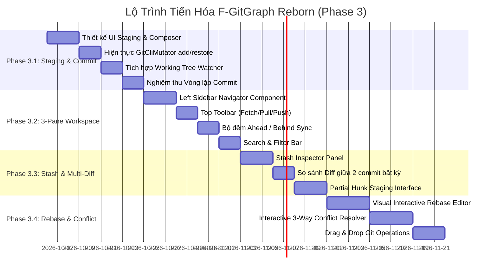

# 003. Phân Tích Độ Lệch & Bản Thiết Kế Tiến Hóa Lên Full Git App (Gap Analysis & Evolution Blueprint)

Tài liệu này tổng hợp ma trận phân tích độ lệch (Gap Analysis) giữa chuẩn mực của một Git GUI Client hoàn chỉnh và năng lực hiện có của F-GitGraph, đồng thời đề xuất kiến trúc không gian làm việc mới và lộ trình triển khai 4 giai đoạn cụ thể để biến F-GitGraph thành một **Full-Featured Git Client App UI**.

---

## 1. Ma Trận Phân Tích Độ Lệch (Gap Matrix)

Bảng phân tích độ lệch dưới đây đánh giá mức độ cấp thiết và độ phức tạp kỹ thuật của các tính năng còn thiếu, từ đó xác lập thứ tự ưu tiên cho lộ trình Phase 3:

| STT | Trụ Cột Năng Lực | Tính Năng Còn Thiếu Trong F-GitGraph | Tác Động Trải Nghiệm (Impact) | Độ Phức Tạp (Complexity) | Mức Độ Ưu Tiên |
| :---: | :--- | :--- | :---: | :---: | :---: |
| **1** | **Workspace & Staging** | **Khu vực Staging (Danh sách Unstaged / Staged)** | 🔴 **Cực kỳ cao** (Chặn vòng lặp dev) | 🟡 Vừa phải | 🔥 **P0 (Bắt buộc số 1)** |
| **2** | **Workspace & Staging** | **Khung soạn thảo Commit (Composer: Title, Body, Amend, Sign)** | 🔴 **Cực kỳ cao** (Không thể commit trên UI) | 🟢 Thấp - Vừa | 🔥 **P0 (Bắt buộc số 1)** |
| **3** | **Workspace & Staging** | **Stage / Unstage / Discard tệp** | 🔴 **Cực kỳ cao** | 🟢 Thấp - Vừa | 🔥 **P0 (Bắt buộc số 1)** |
| **4** | **Mutate & Sync** | **Thanh công cụ đỉnh: Fetch, Pull, Push kèm số đếm `↑` / `↓`** | 🔴 **Rất cao** (Thao tác lặp đi lặp lại) | 🟢 Thấp - Vừa | 🚀 **P1 (Ưu tiên cao)** |
| **5** | **Navigation** | **Cây điều hướng Left Sidebar (Working Tree, Branches, Tags, Stashes)** | 🔴 **Rất cao** (Bao quát toàn bộ kho) | 🟡 Vừa phải | 🚀 **P1 (Ưu tiên cao)** |
| **6** | **Search & Filter** | **Thanh tìm kiếm & lọc commit (Message, Author, Hash)** | 🟡 Cao (Duyệt lịch sử chuyên nghiệp) | 🟡 Vừa phải | 🚀 **P1 (Ưu tiên cao)** |
| **7** | **Workspace & Staging** | **Stage / Discard từng đoạn code (Partial Hunk Staging)** | 🟡 Cao (Dành cho dev chuyên nghiệp) | 🔴 Cao | ⚡ **P2 (Nâng cao)** |
| **8** | **Inspect** | **So sánh vi sai giữa 2 commit bất kỳ (Diff A ↔ B)** | 🟡 Cao | 🟢 Thấp - Vừa | ⚡ **P2 (Nâng cao)** |
| **9** | **Shelving** | **Quản lý Stash (Stash Save, Pop, Apply, Drop, List Diff)** | 🟡 Cao | 🟢 Thấp - Vừa | ⚡ **P2 (Nâng cao)** |
| **10** | **Rewrite** | **Trình tái cấu trúc lịch sử trực quan (Visual Interactive Rebase)** | 🟣 Điểm sáng cạnh tranh (Killer Feature) | 🔴 Cao | 💎 **P3 (Đột phá)** |
| **11** | **Resolve** | **Trình giải quyết xung đột trực quan (In-Flight Conflict Resolver)** | 🟣 Điểm sáng cạnh tranh | 🔴 Cao | 💎 **P3 (Đột phá)** |
| **12** | **Interactions** | **Kéo & thả trực quan (Drag & Drop to merge/rebase/cherry-pick)** | 🟣 Tăng cường UX | 🟡 Vừa phải | 💎 **P3 (Đột phá)** |

---

## 2. Kiến Trúc Không Gian Làm Việc Mới (The 3-Pane Workspace Layout)

Để chuyển đổi từ một "Tab đồ thị đơn thuần" thành một "Ứng dụng Git UI hoàn chỉnh", giao diện của F-GitGraph trong Webview sẽ được tái cấu trúc thành **Mô hình Không gian Làm việc Ba Phân Vùng (3-Pane Workspace)** có khả năng co giãn linh hoạt:

```
┌────────────────────────────────────────────────────────────────────────────────────────────────────────────────────────┐
│ [TOP TOOLBAR]: [Fetch] | [Pull ↓2] | [Push ↑1] | [Stash 📦] | [Pop] | [Search 🔍: Commit/Author/Hash] | [Settings ⚙️] │
├─────────────────────────┬──────────────────────────────────────────────────────────┬───────────────────────────────────┤
│ [LEFT SIDEBAR]          │ [CENTER PANE: DAG GRAPH CANVAS]                          │ [RIGHT / BOTTOM INSPECTOR PANE]   │
│ (Collapsible, W: 220px) │ (Infinite Virtualized Table)                             │ (Collapsible, W: 360px hoặc Dock) │
│                         │                                                          │                                   │
│ 📁 WORKING TREE         │ ┌──────────────────────────────────────────────────────┐ │ 📝 STAGING AREA                   │
│  ├─ Changes (3) ★       │ │ Graph │ Description │ Date │ Author │ Commit Hash      │ │  ├─ Staged Changes (1) [Unstage All]│
│  └─ Staged (1)          │ ├───────┼─────────────┼──────┼────────┼──────────────────┤ │  │   └─ [M] src/App.tsx            │
│                         │ │  ●─── │ [main] Comm…│ 2h a…│ Nam N… │ a1b2c3d          │ │  └─ Unstaged Changes (2) [Stage All]│
│ 🌿 LOCAL BRANCHES (4)   │ │  │ ●─ │ [feat] Impl…│ 3h a…│ Linh … │ e4f5g6h          │ │      ├─ [A] src/NewComponent.tsx  │
│  ├─ main (↑1)           │ │  ● │  │ Merge PR #42│ 1d a…│ Nam N… │ j7k8l9m          │ │      └─ [D] src/LegacyCode.ts      │
│  ├─ feat-reborn (HEAD)  │ │  │ │  │ ...         │ ...  │ ...    │ ...              │ │                                   │
│  └─ fix-avatar-zoom     │ └──────────────────────────────────────────────────────┘ │ ✍️ COMMIT COMPOSER               │
│                         │                                                          │ ┌───────────────────────────────┐ │
│ 🌐 REMOTES (origin)     │ ──────────────────────────────────────────────────────── │ │ Summary (50 chars max)        │ │
│  ├─ main                │ [COMMIT DETAILS OVERLAY - When Commit Selected]          │ ├───────────────────────────────┤ │
│  └─ feat-reborn         │ Hash: a1b2c3d | Author: Nam Nguyen <nam@example.com>     │ │ Description (optional)...     │ │
│                         │ Changed Files (4):                                       │ │                               │ │
│ 🏷️ TAGS (v1.0.0, ...)   │ ├─ [M] src/webview/App.tsx                               │ └───────────────────────────────┘ │
│                         │ └─ [A] src/core-engine/Storage.fs                        │ [x] Amend commit  [x] Sign (GPG)│
│ 📦 STASHES (2)          │                                                          │ [ Commit (1 file) ] [ Commit&Push]│
└─────────────────────────┴──────────────────────────────────────────────────────────┴───────────────────────────────────┘
```

### Các Đặc Điểm Bố Cục Đáng Chú Ý:
1. **Khả năng co giãn và thu gọn (Responsive & Collapsible)**:
   - Sidebar bên trái có thể thu gọn lại thành thanh icon mini (như VS Code Activity Bar) để nhường toàn bộ không gian cho Đồ thị khi cần xem DAG diện rộng.
   - Inspector bên phải có thể chuyển đổi linh hoạt giữa dạng **Right Pane (cột bên phải)** cho màn hình ngang rộng hoặc **Bottom Dock (ngăn kéo bên dưới)** cho màn hình nhỏ.
2. **Hai chế độ tương tác chính của Inspector**:
   - **Chế độ Working Tree**: Khi click chọn dòng `Changes` hoặc `Uncommitted Changes` $\rightarrow$ Inspector hiển thị khu vực **Staging Area** và **Commit Composer**.
   - **Chế độ Commit History**: Khi click chọn một commit trong đồ thị $\rightarrow$ Inspector hiển thị **Commit Metadata**, **File Changes**, và **Diff Preview** giữa commit đó với commit cha.

---

## 3. Phân Định Ranh Giới Kỹ Thuật (Architecture Boundary)

Tiếp tục phát huy thế mạnh đã được khẳng định ở Phase 2, kiến trúc Phase 3 tuân thủ nghiêm ngặt nguyên tắc **phân định quyền hạn**:

```
┌──────────────────────────────────────────────────────────────────────────────────────┐
│                              NGUYÊN TẮC PHÂN ĐỊNH RANH GIỚI                          │
├──────────────────────────────────────────┬───────────────────────────────────────────┤
│      F# NATIVE AOT CORE ENGINE           │         NATIVE GIT CLI MUTATOR            │
│       (ĐỌC & TÍNH TOÁN HIỆU NĂNG CAO)    │        (THỰC THI GHI AN TOÀN TUYỆT ĐỐI)   │
├──────────────────────────────────────────┼───────────────────────────────────────────┤
│ • Truy vấn trạng thái Working Tree nhanh │ • git add, git restore, git rm, git mv    │
│ • Đếm số commit chưa sync (Ahead/Behind) │ • git commit (kèm GPG sign, amend, author)│
│ • Đọc danh sách Stash & Commit vi sai    │ • git push (kèm --force-with-lease)       │
│ • Giải thuật đồ thị DAG song song        │ • git pull, git fetch, git remote prune   │
│ • Sinh lệnh vẽ SVG Bézier Curves         │ • git merge, git rebase, git cherry-pick  │
│ • Kiểm tra trạng thái In-Flight conflicts│ • git stash push, git stash pop/apply/drop│
└──────────────────────────────────────────┴───────────────────────────────────────────┘
```

---

## 4. Lộ Trình Phát Triển Phase 3 (Phase 3 Evolution Roadmap)

Kế hoạch tiến hóa được chia làm 4 giai đoạn con (Sub-milestones) liên hoàn:



---

### 🚀 Giai Đoạn 3.1: Khu Vực Staging & Bộ Soạn Thảo Commit (Vòng Lặp Dev Cốt Lõi)
*Mục tiêu: Đảm bảo lập trình viên có thể thực hiện trọn vẹn chu trình làm việc hàng ngày (Xem file đổi $\rightarrow$ Stage $\rightarrow$ Viết commit $\rightarrow$ Commit) ngay trên F-GitGraph mà không cần mở tab SCM mặc định của VS Code.*

- **Đầu việc 3.1.1: Bảng điều khiển Staging Area (Unstaged vs Staged Files)**:
  - Hiển thị danh sách các tệp thay đổi phân thành 2 nhóm: "Staged Changes" và "Changes (Unstaged)".
  - Hiển thị badge trạng thái màu sắc rực rỡ chuẩn phong cách F-GitGraph: `A` (Xanh lục neon), `M` (Vàng neon), `D` (Đỏ neon), `R` (Tím neon).
  - Nút bấm tác vụ nhanh: `Stage All` (`+`), `Unstage All` (`-`), nút `+`/`-` trên từng tệp, nút `Discard Changes` (Hoàn tác thay đổi tệp có dialog xác nhận).
- **Đầu việc 3.1.2: Bộ soạn thảo Commit (Commit Composer Component)**:
  - Hộp nhập tiêu đề Commit (Subject) với bộ đếm ký tự (cảnh báo vàng khi > 50 ký tự, đỏ khi > 72 ký tự).
  - Hộp nhập mô tả chi tiết mở rộng (Body Description) tự động dãn chiều cao.
  - Tùy chọn Checkbox "Amend last commit" (Tự động nạp message của commit gần nhất lên để sửa).
  - Tùy chọn Checkbox "Sign commit (GPG/SSH)".
  - Nút hành động chính: `Commit` và `Commit & Push`.
- **Đầu việc 3.1.3: Mở rộng Backend GitCliMutator & RPC**:
  - Bổ sung lệnh: `stageFile`, `unstageFile`, `stageAll`, `unstageAll`, `discardFileChanges`.
  - Mở rộng hàm `commit` hỗ trợ amend và ký số an toàn.
  - Bổ sung RPC `workspace.status` trả về danh sách tệp biến động theo định dạng tối ưu.

---

### 🚀 Giai Đoạn 3.2: Kiến Trúc 3-Pane Workspace & Thanh Công Cụ Đồng Bộ
*Mục tiêu: Xây dựng không gian làm việc chuyên nghiệp, bao quát toàn bộ tài nguyên của kho và cung cấp các nút đồng bộ từ xa có bộ đếm trực quan.*

- **Đầu việc 3.2.1: Cây điều hướng Left Sidebar Navigator**:
  - Nhóm `Working Tree`: Hiển thị số lượng tệp đang thay đổi.
  - Nhóm `Branches`: Cây phân cấp các nhánh cục bộ, đánh dấu nổi bật nhánh đang checkout (`HEAD`), hiển thị mũi tên đồng bộ `↑ahead` / `↓behind`.
  - Nhóm `Remotes`: Danh sách các server từ xa (`origin`, `upstream`) và các nhánh trên remote.
  - Nhóm `Tags`: Danh sách các phiên bản phát hành.
  - Nhóm `Stashes`: Danh sách các bản lưu trữ tạm.
  - Cho phép click đúp để checkout nhanh, chuột phải mở context menu tương ứng.
- **Đầu việc 3.2.2: Thanh công cụ đỉnh (Top Global Toolbar)**:
  - Nút `Fetch All`: Tải dữ liệu mới nhất từ remote.
  - Nút `Pull`: Kéo code về nhánh hiện tại (kèm dropdown chọn `Pull --rebase`).
  - Nút `Push`: Đẩy code lên server (kèm dropdown chọn `Push with Lease`).
  - Huy hiệu số đếm trực quan trên nút: Ví dụ `Pull ↓ 2` (có 2 commit mới trên server), `Push ↑ 1` (có 1 commit cục bộ cần đẩy).
- **Đầu việc 3.2.3: Thanh tìm kiếm & lọc commit nâng cao (Search & Filter Bar)**:
  - Tìm kiếm tức thời theo: Commit Message, Tên tác giả (Author), hoặc Commit Hash.
  - Highlight các kết quả tìm thấy ngay trên bảng đồ thị DAG.

---

### 🚀 Giai Đoạn 3.3: Quản Lý Stash & So Sánh Vi Sai Đa Commit
*Mục tiêu: Mở rộng các công cụ khảo sát nâng cao và quản lý mã nguồn tạm thời.*

- **Đầu việc 3.3.1: Bảng quản lý Stash chuyên sâu (Stash Inspector)**:
  - Xem danh sách các bản stash kèm thông điệp, ngày tạo và nhánh nguồn.
  - Xem chi tiết danh sách tệp và diff bên trong bản stash mà không cần pop ra ngoài.
  - Các nút tác vụ: `Apply Stash`, `Pop Stash`, `Drop Stash`, `Stash to New Branch`.
- **Đầu việc 3.3.2: So sánh vi sai giữa 2 commit bất kỳ (Multi-Commit Diff)**:
  - Cho phép người dùng giữ phím `Ctrl` hoặc `Shift` để chọn 2 commit bất kỳ trên đồ thị.
  - Hiển thị bảng tổng hợp toàn bộ các tệp thay đổi giữa 2 snapshot lịch sử đó (`git diff commitA..commitB`).
- **Đầu việc 3.3.3: Giao diện Stage từng khối mã (Partial Hunk Staging)**:
  - Khi xem diff tệp trong Staging Area, cho phép bấm nút "Stage Hunk" hoặc "Discard Hunk" trên từng khối code.

---

### 🚀 Giai Đoạn 3.4: Tái Cấu Trúc Lịch Sử & Xử Lý Xung Đột Trực Quan
*Mục tiêu: Đưa F-GitGraph vươn lên nhóm các công cụ Git cao cấp nhất thế giới với các tính năng "Killer Features".*

- **Đầu việc 3.4.1: Trình tái cấu trúc lịch sử trực quan (Visual Interactive Rebase Editor)**:
  - Khi kích hoạt rebase từ một commit cha: Hiển thị bảng danh sách các commit cần thao tác.
  - Cho phép kéo thả chuột để hoán đổi vị trí các commit.
  - Chuyển đổi trạng thái trực quan: `Pick`, `Squash`, `Fixup`, `Reword`, `Drop` bằng nút bấm có màu sắc sinh động.
  - Tự động sinh script và thực thi rebase an toàn qua Native Git CLI.
- **Đầu việc 3.4.2: Trình giải quyết xung đột trực quan (In-Flight Conflict Resolver)**:
  - Tự động nhận diện khi kho rơi vào trạng thái conflict (`InFlightState.fs`).
  - Hiển thị banner cảnh báo rực rỡ đầu trang: "Merge/Rebase in Progress - 2 conflicts detected".
  - Bảng giải quyết xung đột 3 cột: `Current (Ours)` ↔ `Result` ↔ `Incoming (Theirs)`.
  - Nút bấm nhanh: "Accept Current", "Accept Incoming", "Accept Both".
  - Nút điều khiển luồng: "Continue", "Skip", "Abort Merge/Rebase".
- **Đầu việc 3.4.3: Tương tác kéo & thả trực quan (Drag & Drop Git Operations)**:
  - Kéo một branch thả vào branch khác $\rightarrow$ Menu: Merge hoặc Rebase.
  - Kéo một commit thả vào branch $\rightarrow$ Cherry-pick commit.

---

## 5. Kết Luận & Định Hướng Bắt Đầu

Hồ sơ điều tra Phase 3 đã xác lập một bức tranh toàn cảnh rõ ràng:
1. **F-GitGraph đã có một nền tảng nhân F# Core Engine cực mạnh** về tốc độ tính toán đồ thị, đọc nhị phân và thẩm mỹ hiển thị.
2. **Khoảng cách lớn nhất** ngăn cản ứng dụng trở thành một Git App hoàn chỉnh chính là sự thiếu vắng của **Khu vực Staging & Bộ soạn thảo Commit (Phase 3.1)** và **Kiến trúc Không gian Làm việc 3-Pane (Phase 3.2)**.
3. Việc tập trung triển khai **Phase 3.1 ngay lập tức** sẽ mang lại bước nhảy vọt lớn nhất về giá trị sử dụng cho người dùng, hoàn thiện vòng lặp làm việc cốt lõi của lập trình viên ngay trên F-GitGraph.
