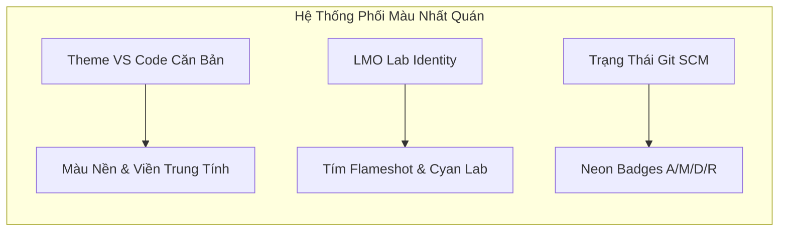

# 004. Hệ Thống Thiết Kế & Nhận Diện Hình Ảnh (Design System & Visual Identity)

> **Dự án**: F-GitGraph Reborn  
> **Ngôn ngữ phong cách**: **"Neo-Brutalist Cyber-Lab"** — Sự giao thoa giữa _Phòng thí nghiệm Công nghệ cao (LMO Lab Identity)_, _Giao diện Tối giản Thoáng đãng (Clean Minimalist UI)_ và _Các nét chấm phá Neon độc bản_.  
> **Trạng thái**: Bản thảo thiết kế ban đầu (Initial Draft) — Được tinh chỉnh và hoàn thiện dần trong quá trình thực thi Phase 3.

---

## 1. Triết Lý Thiết Kế Cốt Lõi: Đơn Giản, Không Ôm Đồm Nhưng Phải Bắt Mắt

### 1.1. Bài Học Thị Giác Từ GitLens: "Đẹp Nhưng Rối Mắt"

GitLens là một công cụ rất mạnh mẽ với màu sắc trau chuốt, tuy nhiên nhược điểm lớn nhất được cộng đồng và lập trình viên ghi nhận là: **quá ôm đồm và gây rối mắt**.

- Quá nhiều icon, badge, nhãn tag, chỉ báo trạng thái và popover xuất hiện dày đặc trên từng pixel.
- Giao diện bị phân mảnh thị giác (visual clutter), khiến não bộ người dùng phải liên tục lọc thông tin thừa thay vì tập trung vào luồng tư duy công việc.

### 1.2. Tuyên Ngôn Thiết Kế F-GitGraph Reborn: "Simple in Form, Striking in Soul"

F-GitGraph lựa chọn một con đường khác biệt:

```
┌────────────────────────────────────────────────────────────────────────────────────────┐
│                        3 NGUYÊN TẮC THIẾT KẾ NỀN TẢNG                                  │
├──────────────────────────┬───────────────────────────┬─────────────────────────────────┤
│ 1. SIMPLE & BREATHEABLE  │ 2. CYBER-LAB BLUEPRINT    │ 3. STRIKING NEON ACCENTS        │
│    (Gọn gàng, thoáng mắt)│    (Khung đinh tán góc +) │    (Bắt mắt nhưng không lố)     │
├──────────────────────────┼───────────────────────────┼─────────────────────────────────┤
│ • Không nhồi nhét icon   │ • Đinh tán chữ thập (+)   │ • Nút commit lục giác Hexagon   │
│ • Khoảng cách đệm thoáng │   tại 4 góc các khung việc│ • Avatar Zoom 1.15x / 5.0x      │
│ • Hover-to-reveal actions│ • Viền mảnh kỹ thuật số   │ • Neon Ambient Gradient dịu mắt │
│ • Giảm tải nhận thức     │ • Cảm giác phòng lab đo đạc│ • Viền tím Flameshot tinh tế   │
└──────────────────────────┴───────────────────────────┴─────────────────────────────────┘
```

1. **Simple UI (Giao diện Tối giản, Dễ thở)**:
   - Cắt bỏ triệt để các trang trí thừa thãi.
   - Các nút tác vụ phụ trên từng dòng commit hoặc từng tệp staged sẽ **chỉ xuất hiện khi rê chuột (Hover-to-Reveal)**, giữ cho bề mặt danh sách luôn tĩnh lặng, phẳng phiu và sạch sẽ.
2. **Cyber-Lab Blueprint (Khung kỹ thuật với Đinh tán chữ thập `+`)**:
   - Lấy cảm hứng trực tiếp từ phong cách nhận diện của **LMO Lab**: Mỗi phân vùng làm việc (Top Toolbar, Sidebar, Staging Area, Commit Composer, Inspector) được đóng khung với đường kẻ viền mảnh kỹ thuật số và **4 đinh tán chữ thập (`+` crosshairs)** định vị tại 4 góc.
   - Mang lại cảm giác đo đạc chuẩn xác, tinh xảo như một bản thiết kế vi mạch (blueprint).
3. **Striking Neon Accents (Điểm nhấn Neon bắt mắt)**:
   - Giữ trọn vẹn "linh hồn" đã làm nên tên tuổi của F-GitGraph: Hexagon SVG Nodes, ClipPath avatar không góc đen, Micro Hover Zoom (1.15x), Click Deep Zoom (5.0x), và dải Neon Ambient tỏa sáng theo màu nhánh.

---

### 1.3. Cam Kết Bất Biến 100%: Bảo Toàn Hexagon Node & Hệ Thống Đồ Thị Hiện Tại

> [!CAUTION]
> **NGUYÊN TẮC BẤT KHẢ XÂM PHẠM (NON-NEGOTIABLE IMMUTABILITY)**:
> Mọi cải tiến giao diện và mở rộng không gian làm việc ở Phase 3 **TUYỆT ĐỐI KHÔNG ĐƯỢC THAY ĐỔI** những thành tựu cốt lõi đã đạt được ở Phase 1 và Phase 2:
>
> 1. **Nút Lục Giác Hexagon Node (`HexagonNode.tsx`)**: Giữ nguyên vẹn 100% hình học SVG lục giác, kích thước $R=10\text{px}$, đường cắt SVG `clipPath` bo avatar triệt tiêu góc đen, và 4 biểu tượng trạng thái (Regular, Merge, Root, Uncommitted Changes).
> 2. **Tương Tác Avatar Độc Bản**: Giữ nguyên vẹn 100% cơ chế **Micro Hover Zoom (1.15x)** khi rê chuột và **Click Deep Zoom (5.0x Top-Layer)** khi nhấp chuột vào icon avatar.
> 3. **Hiệu Ứng Neon Ambient & Viền Flameshot**: Giữ nguyên vẹn 100% vệt sáng Neon Ambient Gradient fanning tỏa ra từ tâm nửa phải avatar và viền tím Flameshot bao quanh dòng commit được chọn.
> 4. **Nhân Tính Toán F# Core Engine**: Giữ nguyên vẹn 100% thuật toán phân làn đồ thị song song đa luồng CPU (`Graph.fs`), bộ đọc nhị phân `commit-graph`, và định dạng streaming Stdio MessagePack.
> 5. **Bảng Đồ Thị Ảo Hóa (`CommitTable.tsx`)**: Toàn bộ các phân vùng mới (Sidebar, Toolbar, Staging Area, Commit Composer) được xây dựng dưới dạng **các module bao bọc bên ngoài (Wrapper Modules)** hoặc **bảng điều khiển mở rộng song song**, tuyệt đối không can thiệp làm xô lệch tọa độ hình học SVG của đồ thị DAG.

---

## 2. Đặc Tả Khung Kỹ Thuật & Đinh Tán Chữ Thập Góc (The `+` Corner Crosshairs)

Dấu đinh tán chữ thập góc (`+`) là chi tiết nhận diện thương hiệu đặc trưng của LMO Lab, biến một khung hình chữ nhật đơn điệu thành một bảng module công nghệ cao.

```
+──────────────────────────────────────────────────────────+
│ [TOP TOOLBAR / WORKSPACE PANEL]                          │
│                                                          │
│                     Nội dung hiển thị                     │
│                                                          │
+──────────────────────────────────────────────────────────+
```

### 2.1. Tọa Độ & Hình Học

- Mỗi khung container (Panel, Modal, Card) sẽ có 4 đinh tán tại 4 góc:
  - Góc trên-trái (`top-left`): Căn đúng tâm giao điểm góc viền.
  - Góc trên-phải (`top-right`): Căn đúng tâm giao điểm góc viền.
  - Góc dưới-trái (`bottom-left`): Căn đúng tâm giao điểm góc viền.
  - Góc dưới-phải (`bottom-right`): Căn đúng tâm giao điểm góc viền.
- Kích thước ký hiệu: Ký tự `+` chuẩn font monospace hoặc SVG crosshair thanh mảnh có kích thước $10\text{px} \times 10\text{px}$, độ dày nét $1.25\text{px}$.

### 2.2. Trạng Thái Màu Sắc & Tương Tác

- **Trạng thái Tĩnh (Default / Idle)**:
  - Màu đinh tán cùng màu với đường viền mờ (`border-line` với độ trong suốt 50-70%), hòa quyện nhẹ nhàng vào giao diện, không gây chói.
- **Trạng thái Kích Hoạt / Hover (Active / Hover / Focused)**:
  - Khi người dùng click vào phân vùng làm việc đó (ví dụ: đang gõ commit trong Composer hoặc đang duyệt Staged files), 4 đinh tán góc sẽ sáng rực lên với sắc tím Neon (`#a855f7`) hoặc xanh Cyan (`#06b6d4`), tạo hiệu ứng định vị vùng làm việc trực quan.

---

## 3. Hệ Thống Bảng Màu Toàn Diện (Dark Theme & Light Theme Palette)

Hệ màu của F-GitGraph Reborn được thiết kế để tương thích tự nhiên với mọi Theme của VS Code thông qua các CSS Variables (`--vscode-*`), đồng thời phủ lên lớp màu thương hiệu tinh tế của LMO Lab:



---

### 3.1. Bảng Màu Chế Độ Tối (Dark Theme - Trọng Tâm Trải Nghiệm)

Chế độ Dark Theme được thiết kế theo phong cách phòng thí nghiệm đêm (Midnight Cyber-Lab), tối ưu hóa độ tương phản để làm việc liên tục 8-12 tiếng không mỏi mắt:

| Tên Token / Thành Phần       | Mã Màu Đại Diện / CSS Variable                                      | Mô Tả & Vị Trí Ứng Dụng                                   |
| :--------------------------- | :------------------------------------------------------------------ | :-------------------------------------------------------- |
| **Canvas Background**        | `var(--vscode-editor-background, #0d1117)`                          | Nền tổng thể của toàn bộ Webview                          |
| **Panel Surface**            | `rgba(22, 27, 34, 0.75)` / `--vscode-sideBar-background`            | Nền của Sidebar, Staging Area, Inspector (hơi mờ nhẹ)     |
| **Grid / Frame Border**      | `rgba(255, 255, 255, 0.10)`                                         | Đường viền kỹ thuật mỏng 1px của các panel                |
| **Corner Cross Rivet (`+`)** | `#8b949e` (Mặc định) $\rightarrow$ `#a855f7` (Active)               | Đinh tán chữ thập tại 4 góc khung                         |
| **Primary Accent (Brand)**   | `#a855f7` (Purple Neon / Flameshot)                                 | Viền dòng commit được chọn, nút bấm chính, tiêu đề active |
| **Secondary Accent**         | `#06b6d4` (Cyan Lab)                                                | Nhánh HEAD, mũi tên đồng bộ `↑ahead`, highlight tìm kiếm  |
| **Text Primary**             | `var(--vscode-foreground, #e6edf3)`                                 | Tiêu đề commit, tên tệp tin, nhãn chính                   |
| **Text Muted**               | `#8b949e`                                                           | Ngày tháng, mã hash, đường dẫn thư mục phụ, placeholder   |
| **Badge: Added (`A`)**       | `#10b981` (Emerald Neon)                                            | Nhãn tệp thêm mới                                         |
| **Badge: Modified (`M`)**    | `#f59e0b` (Amber Neon)                                              | Nhãn tệp sửa đổi                                          |
| **Badge: Deleted (`D`)**     | `#ef4444` (Rose Neon)                                               | Nhãn tệp đã xóa                                           |
| **Badge: Renamed (`R`)**     | `#a855f7` (Violet Neon)                                             | Nhãn tệp đổi tên / chuyển thư mục                         |
| **Selected Row Neon Glow**   | `linear-gradient(90deg, rgba(168,85,247,0.25) 0%, transparent 60%)` | Vầng sáng tỏa từ tâm nửa phải avatar                      |

---

### 3.2. Bảng Màu Chế Độ Sáng (Light Theme - Sáng Trong, Tinh Tế, Không Gắt)

Khác với các giao diện Light thông thường dễ bị trắng lóa mắt, Light Theme của F-GitGraph sử dụng tông màu giấy kỹ thuật (Engineering Blueprint Cream) với độ tương phản mềm mại:

| Tên Token / Thành Phần       | Mã Màu Đại Diện / CSS Variable                                      | Mô Tả & Vị Trí Ứng Dụng                               |
| :--------------------------- | :------------------------------------------------------------------ | :---------------------------------------------------- |
| **Canvas Background**        | `var(--vscode-editor-background, #f8fafc)`                          | Nền trắng ngà kỹ thuật, không lóa mắt                 |
| **Panel Surface**            | `#ffffff` / `--vscode-sideBar-background`                           | Nền các vùng panel làm việc                           |
| **Grid / Frame Border**      | `rgba(0, 0, 0, 0.08)` / `#e2e8f0`                                   | Đường viền xám tro mỏng 1px phân định không gian      |
| **Corner Cross Rivet (`+`)** | `#94a3b8` (Mặc định) $\rightarrow$ `#7c3aed` (Active)               | Đinh tán chữ thập màu chì kỹ thuật                    |
| **Primary Accent (Brand)**   | `#7c3aed` (Deep Violet)                                             | Viền dòng chọn, nút bấm chính (tông đậm cho nền sáng) |
| **Secondary Accent**         | `#0891b2` (Deep Cyan)                                               | Nhánh HEAD, highlight tìm kiếm                        |
| **Text Primary**             | `var(--vscode-foreground, #1e293b)`                                 | Màu chữ đen xám đậm dễ đọc                            |
| **Text Muted**               | `#64748b`                                                           | Thông tin phụ mờ vừa phải                             |
| **Badge: Added (`A`)**       | `#059669` (Forest Green)                                            | Nhãn tệp thêm mới (bão hòa sâu)                       |
| **Badge: Modified (`M`)**    | `#d97706` (Warm Ochre)                                              | Nhãn tệp sửa đổi                                      |
| **Badge: Deleted (`D`)**     | `#dc2626` (Crimson)                                                 | Nhãn tệp đã xóa                                       |
| **Badge: Renamed (`R`)**     | `#7c3aed` (Deep Purple)                                             | Nhãn tệp đổi tên                                      |
| **Selected Row Ambient**     | `linear-gradient(90deg, rgba(124,58,237,0.12) 0%, transparent 60%)` | Vệt sáng tím mờ nhẹ nhàng                             |

---

## 4. Ứng Dụng Thiết Kế Vào Các Vùng Làm Việc Phase 3

### 4.1. Thanh Công Cụ Đỉnh (Top Global Toolbar)

- **Thiết kế**: Một thanh ngang mảnh ($36\text{px}$ – $40\text{px}$) đóng khung viền với 4 đinh tán `+` ở 4 góc cực.
- **Phong cách nút**:
  - Không dùng các nút đổ bóng 3D cồng kềnh.
  - Nút bấm dạng phẳng (Flat Ghost Button): Icon Codicons mảnh + nhãn chữ ngắn gọn.
  - Khi hover: Nền hơi sáng nhẹ lên kèm viền tím neon mảnh.
  - Nút đồng bộ: Nút `Fetch`, nút `Pull` (có số đếm `↓2` màu vàng nhạt khi có commit mới), nút `Push` (có số đếm `↑1` màu xanh cyan khi có commit cần đẩy).
  - Khung tìm kiếm `Ctrl+F`: Nằm gọn gàng bên phải, ô input bo góc nhẹ với đinh tán mini ở 2 đầu.

```
+──────────────────────────────────────────────────────────────────────────────────────────+
│ [↻ Fetch]  [↓ Pull 2]  [↑ Push 1]  [📦 Stash]  │  [ 🔍 Filter commits... (Ctrl+F) ]      │
+──────────────────────────────────────────────────────────────────────────────────────────+
```

---

### 4.2. Cây Điều Hướng Bên Trái (Left Sidebar Navigator)

- **Thiết kế**:
  - Khung viền dọc bên trái với 4 đinh tán góc.
  - Phân vùng thành các cụm đề mục rõ ràng: `WORKING TREE`, `BRANCHES`, `REMOTES`, `TAGS`, `STASHES`.
  - Tiêu đề cụm dùng chữ in hoa nhỏ (Uppercase 11px, `letter-spacing: 0.05em`) màu muted.
- **Tương tác**:
  - Nhánh đang checkout (`HEAD`): Có icon mũi tên tím neon và chữ in đậm.
  - Nút tác vụ nhanh: Khi rê chuột vào dòng nhánh mới hiện icon checkout hoặc delete, bình thường để trống cho đỡ rối mắt.

---

### 4.3. Bảng Staging Area & Bộ Soạn Thảo Commit (Right / Bottom Inspector)

Đây là khu vực thể hiện rõ nhất ngôn ngữ thiết kế **LMO Lab Cyber-Blueprint**:

```
+─────────────────────────────────────────────────────────────────────────+
│ 📝 STAGING AREA                                        [- Unstage All]  │
│  ├─ [M] src/webview/App.tsx                            [ - | ↺ ]        │
│  └─ [A] src/core-engine/Storage.fs                     [ - | ↺ ]        │
│                                                                         │
│ 📁 CHANGES (UNSTAGED)                                  [+ Stage All]    │
│  ├─ [M] src/extension/mutator.ts                       [ + | 🗑 ]        │
│  └─ [D] src/old-code.ts                                [ + | 🗑 ]        │
+─────────────────────────────────────────────────────────────────────────+
│ ✍️ COMMIT COMPOSER                                                      │
│ ┌─────────────────────────────────────────────────────────┐             │
│ │ Summary message...                               (42/50)│             │
│ ├─────────────────────────────────────────────────────────┤             │
│ │ Extended description (optional)...                      │             │
│ └─────────────────────────────────────────────────────────┘             │
│ [x] Amend previous commit        [x] Sign commit (GPG)                  │
│                                                                         │
│ [ Button: Commit 2 files (Ctrl+Enter) ]        [ Button: Commit & Push] │
+─────────────────────────────────────────────────────────────────────────+
```

- **Khung Staging**:
  - Mỗi mục tệp hiển thị badge chữ cái (`A`, `M`, `D`, `R`) màu neon sắc nét trong khối vuông nhỏ $18\text{px} \times 18\text{px}$.
  - Nút Stage (`+`) hoặc Unstage (`-`) chỉ hiện khi hover chuột vào tệp.
- **Khung Soạn thảo Commit**:
  - Ô nhập tiêu đề có bộ đếm ký tự nhỏ ở góc phải: Khi quá 50 ký tự sẽ chuyển sang màu cam, quá 72 ký tự chuyển sang màu đỏ.
  - Nút bấm `Commit`: Nền tím neon đặc trưng (`#a855f7`), chữ trắng, hiệu ứng chuyển màu rực rỡ khi hover nhưng không chói mắt.

---

### 4.4. Đồ Thị DAG Trung Tâm (Center DAG Canvas)

- **Kế thừa 100% bản sắc Phase 1**:
  - Commit Node lục giác (Hexagon SVG) viền sắc nét, clip-path avatar tác giả mượt mà.
  - Micro Hover Zoom (1.15x) và Click Deep Zoom (5.0x Top-Layer).
  - Vệt Neon Ambient tỏa sáng theo màu nhánh dọc theo dòng đang chọn.
  - Viền tím Flameshot bao quanh dòng đang được kích hoạt.

---

## 5. Đoạn Mã Mẫu Thành Phần Đinh Tán Chữ Thập (Draft Component Snippets)

Dưới đây là component mẫu và utility CSS dùng để tạo khung viền đinh tán chữ thập góc trong Webview Preact/TailwindCSS:

### 5.1. Component Khung Viền `CornerCrossFrame.tsx`

```tsx
import type { ComponentChildren } from "preact";

type CornerCrossFrameProps = {
  children: ComponentChildren;
  class?: string;
  active?: boolean;
};

export function CornerCrossFrame({ children, class = "", active = false }: CornerCrossFrameProps) {
  const crossColor = active
    ? "text-purple-400 opacity-100"
    : "text-zinc-500 opacity-50 group-hover:opacity-80 transition-opacity";

  return (
    <div class={`relative border border-zinc-700/60 bg-zinc-900/40 p-3 ${class}`}>
      {/* 4 Đinh tán chữ thập góc (+) */}
      <span class={`absolute -top-1.5 -left-1.5 text-xs font-mono select-none pointer-events-none leading-none ${crossColor}`}>+</span>
      <span class={`absolute -top-1.5 -right-1.5 text-xs font-mono select-none pointer-events-none leading-none ${crossColor}`}>+</span>
      <span class={`absolute -bottom-1.5 -left-1.5 text-xs font-mono select-none pointer-events-none leading-none ${crossColor}`}>+</span>
      <span class={`absolute -bottom-1.5 -right-1.5 text-xs font-mono select-none pointer-events-none leading-none ${crossColor}`}>+</span>

      {children}
    </div>
  );
}
```

### 5.2. Utility CSS cho Border & Hover-Reveal Actions

```css
/* Đường viền kỹ thuật LMO Lab */
.lab-blueprint-border {
  border: 1px solid var(--vscode-editorGroup-border, rgba(255, 255, 255, 0.1));
  position: relative;
}

/* Ẩn các nút hành động, chỉ hiện khi rê chuột lên dòng (chống rối mắt) */
.row-actions-container {
  opacity: 0;
  transition: opacity 0.15s ease-in-out;
}

tr:hover .row-actions-container,
.file-item:hover .row-actions-container {
  opacity: 1;
}
```

---

## 6. Lộ Trình Triển Khai & Hoàn Thiện Dần (Iterative Execution Plan)

Tài liệu thiết kế này đóng vai trò là "kim chỉ nam thị giác" (visual guideline). Khi thực thi từng chặng con của Phase 3:

1. **Chặng 3.1**: Áp dụng khung đinh tán `+` và bảng màu tối giản vào `StagingPanel.tsx` và `CommitComposer.tsx`.
2. **Chặng 3.2**: Áp dụng vào thanh công cụ đỉnh `GlobalToolbar.tsx` và cây điều hướng `SidebarNavigator.tsx`.
3. **Chặng 3.3 & 3.4**: Hoàn thiện tiếp cho bảng Stash và trình giải quyết xung đột 3-Way Merge.
4. Mọi thông số về độ mờ viền, kích thước đinh tán, độ tỏa neon sẽ được tinh chỉnh trực quan trên giao diện thực tế để đạt sự cân bằng tối ưu giữa **"Simple"** và **"Catchy"**.
