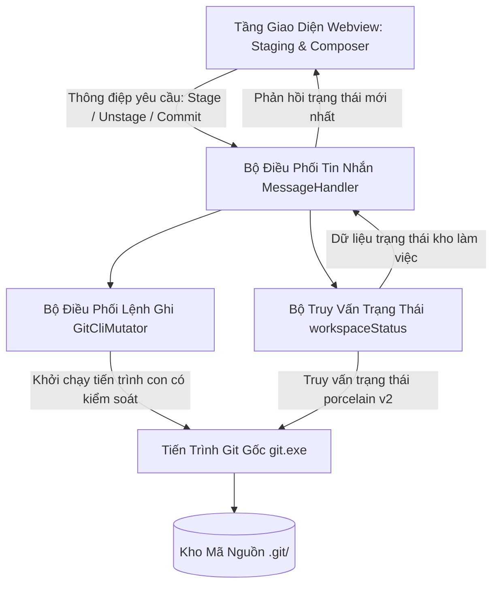

# 01. Thiết Kế Tầng Backend & Mutator Cho Staging (Backend & Mutator Architecture Specification)

Tài liệu này đặc tả chi tiết kiến trúc tầng Backend, các thao tác biến đổi trạng thái kho mã nguồn trong bộ điều phối Mutator, thuật toán phân tích cú pháp trạng thái kho từ lệnh trạng thái chuẩn của Git, và hệ thống từ điển dữ liệu phục vụ cho **Milestone 3.1: Khu Vực Staging & Bộ Soạn Thảo Commit**.

> [!NOTE]
> Mọi nội dung trong tài liệu này tuân thủ nguyên tắc: thiết kế bằng ngôn ngữ tự nhiên (**Design by Word**), tập trung vào kiến trúc hệ thống, luồng dữ liệu, quy chuẩn an toàn và hành vi tương tác; tuyệt đối không sử dụng mã nguồn mẫu dưới bất kỳ hình thức nào.

---

## 1. Kiến Trúc Tầng Backend & Ranh Giới An Toàn Dữ Liệu

Hệ thống tiếp tục duy trì kiến trúc phân tầng độc lập và ranh giới an toàn tuyệt đối đã được thiết lập từ Phase 1:

### 1.1. Phân Tách Ranh Giới Giữa Các Tầng Xử Lý

1. **Tầng Giao Diện Người Dùng (Webview Preact)**:
   - Đóng vai trò là tầng hiển thị và thu nhận tương tác người dùng.
   - Hoàn toàn không có quyền hạn truy cập hệ thống tệp hoặc gọi tiến trình hệ điều hành.
   - Mọi thao tác người dùng (như bấm nút Stage, bấm nút Unstage, nhập nội dung commit) được đóng gói thành các thông điệp yêu cầu hành động (Action Request) và gửi qua cầu nối liên lạc hai chiều (WebviewBridge).
2. **Tầng Điều Phối Backend (VS Code Extension Host)**:
   - Tiếp nhận thông điệp yêu cầu từ Webview thông qua bộ điều phối tin nhắn trung tâm (MessageHandler).
   - Kiểm tra tính hợp lệ của tham số yêu cầu và xác thực trạng thái kho làm việc hiện tại.
   - Điều hướng yêu cầu đến đúng module xử lý chuyên trách: các truy vấn trạng thái được chuyển đến bộ truy vấn kho, các yêu cầu thay đổi dữ liệu được chuyển đến bộ điều phối `GitCliMutator`.
3. **Bộ Điều Phối Thay Đổi Dữ Liệu (`GitCliMutator`)**:
   - Chịu trách nhiệm thực thi 100% các thao tác ghi và thay đổi trạng thái kho mã nguồn.
   - Ủy thác toàn bộ thao tác cho tiến trình Git gốc của hệ điều hành (`git.exe`).
   - Tuyệt đối không can thiệp ghi trực tiếp vào thư mục nội bộ `.git` để bảo toàn tính toàn vẹn của chữ ký số (GPG/SSH), bộ quản lý chứng thực (Git Credential Manager) và các bộ móc nối tự động (Git Hooks).
4. **Bộ Phân Tích Trạng Thái Kho Làm Việc (`workspaceStatus`)**:
   - Sử dụng lệnh trạng thái máy đọc chuẩn của Git (`git status --porcelain=v2`) để lấy ảnh chụp trạng thái tức thời của thư mục làm việc và vùng nhớ đệm Staging.
   - Chuyển đổi dữ liệu chuỗi dạng phẳng thành cấu trúc đối tượng có thứ tự, phân định rõ ràng giữa tệp đã đưa vào Staging và tệp còn nằm trên đĩa làm việc.

---

## 2. Đặc Tả Nghiệp Vụ Bộ Lệnh Ghi `GitCliMutator`

Tất cả các phương thức trong bộ điều phối `GitCliMutator` được thiết kế theo mô hình bất đồng bộ, thực thi thông qua danh sách tham số mảng an toàn (ngăn chặn triệt để lỗ hổng chèn lệnh shell - Command Injection), và trả về kết quả chuẩn hóa bao gồm cờ thành công, mã thoát của tiến trình và thông báo lỗi chi tiết nếu có.

### 2.1. Nhóm Lệnh Thao Tác Vùng Nhớ Đệm Staging

1. **Lệnh Đưa Một Tệp Vào Staging (Stage File)**:
   - **Mục đích**: Chuyển các thay đổi hiện tại của một tệp cụ thể trên thư mục làm việc vào chỉ mục Staging Index của Git.
   - **Lệnh Git gốc tương ứng**: `git add -- <đường_dẫn_tệp>`
   - **Tham số đầu vào**: Đường dẫn tương đối của tệp so với thư mục gốc của kho mã nguồn.
   - **Xử lý an toàn**: Ký tự phân tách `--` bắt buộc phải có để ngăn Git hiểu nhầm đường dẫn tệp trùng với tên một nhánh hoặc cờ tùy chọn.
2. **Lệnh Rút Một Tệp Ra Khỏi Staging (Unstage File)**:
   - **Mục đích**: Loại bỏ thay đổi của một tệp ra khỏi chỉ mục Staging Index mà vẫn giữ nguyên nội dung chỉnh sửa của tệp đó trên đĩa làm việc.
   - **Lệnh Git gốc tương ứng**: `git restore --staged -- <đường_dẫn_tệp>`
   - **Tham số đầu vào**: Đường dẫn tương đối của tệp cần rút.
   - **Hành vi nghiệp vụ**: Đối với tệp mới tạo chưa từng commit (Untracked đã lỡ add vào stage), lệnh này sẽ đưa tệp trở lại danh sách tệp chưa theo dõi an toàn mà không làm mất nội dung người dùng vừa tạo.
3. **Lệnh Đưa Toàn Bộ Tệp Vào Staging (Stage All)**:
   - **Mục đích**: Đưa toàn bộ các tệp đã sửa đổi, tệp mới tạo và tệp bị xóa trong toàn bộ kho mã nguồn vào Staging Index trong một thao tác duy nhất.
   - **Lệnh Git gốc tương ứng**: `git add -A`
   - **Hành vi nghiệp vụ**: Áp dụng cho toàn bộ cây thư mục từ gốc dự án, bao gồm cả các tệp nằm trong thư mục con sâu nhất.
4. **Lệnh Rút Toàn Bộ Tệp Ra Khỏi Staging (Unstage All)**:
   - **Mục đích**: Rút toàn bộ các tệp đang nằm trong Staging Index về lại trạng thái thay đổi chưa stage trên thư mục làm việc.
   - **Lệnh Git gốc tương ứng**: `git restore --staged .`
   - **Hành vi nghiệp vụ**: Làm sạch hoàn toàn Staging Index, đưa chỉ mục trở về trạng thái khớp với commit trên đỉnh HEAD gần nhất mà không làm mất bất kỳ dòng code nào trên đĩa.
5. **Lệnh Hoàn Tác Thay Đổi Của Một Tệp (Discard File Changes)**:
   - **Mục đích**: Xóa bỏ vĩnh viễn các thay đổi chưa commit của một tệp, khôi phục tệp về trạng thái sạch sẽ giống hệt như trong commit gần nhất.
   - **Phân định hai trường hợp kỹ thuật**:
     - *Trường hợp tệp đã được Git theo dõi (Tracked File)*: Thực thi lệnh `git restore -- <đường_dẫn_tệp>`. Lệnh này khôi phục nội dung tệp từ Index hoặc HEAD.
     - *Trường hợp tệp mới tạo chưa theo dõi (Untracked File)*: Thực thi lệnh xóa tệp rác `git clean -f -- <đường_dẫn_tệp>`. Lệnh này xóa tệp mới khỏi hệ thống đĩa cứng.
   - **Nguyên tắc an toàn tối cao**: Tầng giao diện bắt buộc phải hiển thị hộp thoại xác nhận cảnh báo mất dữ liệu vĩnh viễn trước khi gửi yêu cầu thực thi lệnh này sang tầng Backend.
6. **Lệnh Hoàn Tác Toàn Bộ Thay Đổi Trong Kho (Discard All Changes)**:
   - **Mục đích**: Làm sạch toàn bộ thư mục làm việc, hủy bỏ mọi thay đổi trên các tệp theo dõi và xóa toàn bộ tệp mới chưa theo dõi.
   - **Quy trình thực thi hai bước tuần tự**:
     - Bước 1: Thực thi `git restore .` để khôi phục toàn bộ tệp đã theo dõi. Nếu bước này gặp lỗi, tiến trình dừng ngay lập tức và báo lỗi cho người dùng.
     - Bước 2: Thực thi `git clean -fd` để xóa sạch toàn bộ tệp và thư mục mới chưa được theo dõi.

### 2.2. Nâng Cấp Phương Thức Tạo Commit (`commit`)

Phương thức tạo commit được thiết kế lại toàn diện để hỗ trợ đầy đủ các quy chuẩn tạo commit chuyên nghiệp trong Git:

1. **Phân Tách Rõ Ràng Giữa Tiêu Đề Và Nội Dung Mô Tả Chi Tiết**:
   - Khi gọi lệnh commit, tham số cờ `-m` đầu tiên đại diện cho dòng tiêu đề tóm tắt (Commit Summary).
   - Nếu người dùng có nhập nội dung mô tả mở rộng (Commit Description), hệ thống tự động gắn thêm một cờ `-m` thứ hai chứa toàn bộ nội dung mô tả này. Git sẽ tự động chèn một dòng trống ngăn cách giữa tiêu đề và mô tả theo đúng chuẩn quy ước Git Commit Message.
2. **Hỗ Trợ Chế Độ Sửa Đổi Commit Gần Nhất (Amend Mode)**:
   - Khi tùy chọn sửa đổi commit được kích hoạt, hệ thống tự động bổ sung cờ `--amend` vào danh sách tham số dòng lệnh.
   - Hành vi này cho phép gộp các thay đổi mới trong Staging vào chính commit trên đỉnh `HEAD` hiện tại mà không sinh thêm commit rác trong lịch sử phả hệ.
3. **Hỗ Trợ Tùy Chọn Ký Số Bảo Mật (Commit Signing)**:
   - Khi tùy chọn ký số được bật, hệ thống gắn thêm cờ `-S` vào lệnh commit.
   - Tiến trình `git.exe` sẽ tự động tìm khóa ký số (GPG hoặc SSH) đã được cấu hình trong tệp cài đặt `.gitconfig` của máy lập trình viên, kích hoạt trình quản lý khóa hoặc phần cứng bảo mật để gắn chữ ký điện tử hợp lệ vào đối tượng commit.

---

## 3. Thuật Toán Phân Tích Cú Pháp Trạng Thái Kho (`workspaceStatus`)

### 3.1. Lý Do Kỹ Thuật Lựa Chọn `git status --porcelain=v2`

1. **Tính Định Dạng Máy Ổn Định Tuyệt Đối**:
   - Khác với dạng hiển thị thông thường dành cho con người đọc (vốn phụ thuộc vào ngôn ngữ của hệ điều hành và các tùy chọn giao diện), định dạng `porcelain=v2` được thiết kế chuyên biệt cho các công cụ tích hợp tự động, bảo đảm không bao giờ thay đổi cấu trúc giữa các phiên bản Git.
2. **Phân Tách Độc Lập Trạng Thái Staging Và Trạng Thái Thư Mục Làm Việc**:
   - Mỗi tệp tin được biểu diễn bằng một cặp mã ký tự gồm hai vị trí riêng biệt: vị trí thứ nhất đại diện cho trạng thái của tệp trong vùng nhớ đệm Staging so với commit `HEAD`, vị trí thứ hai đại diện cho trạng thái của tệp trên đĩa làm việc so với Staging.
3. **Không Bị Lỗi Mã Hóa Ký Tự Khoảng Trắng Và Tiếng Việt**:
   - Bằng cách truyền thêm cờ cấu hình hệ thống `-c core.quotepath=false`, Git sẽ xuất trực tiếp tên tệp tin tiếng Việt có dấu và các ký tự đặc biệt dưới dạng chuỗi UTF-8 thuần túy, loại bỏ hoàn toàn hiện tượng tên tệp bị mã hóa thành các ký tự bát phân khó đọc (dạng `\303\240...`).

### 3.2. Bảng Ma Trận Ánh Xạ Mã Trạng Thái Ký Tự `XY`

Trong chuỗi định dạng của Git porcelain v2, ký tự `X` là trạng thái tại Staging Index, ký tự `Y` là trạng thái tại Working Tree:

| Ký Tự Tại Vị Trí `X` (Staged) | Ý Nghĩa Nghiệp Vụ Tại Staging | Ký Tự Tại Vị Trí `Y` (Unstaged) | Ý Nghĩa Nghiệp Vụ Tại Changes |
| :---: | :--- | :---: | :--- |
| `.` | Tệp không có thay đổi nào so với commit `HEAD` | `.` | Tệp không có thay đổi nào so với Staging Index |
| `M` | Tệp đã được sửa đổi và đã đưa vào Staging | `M` | Tệp có sửa đổi trên đĩa nhưng chưa đưa vào Staging |
| `A` | Tệp mới được tạo và đã đưa vào Staging | *(Không áp dụng)* | *(Tệp mới chưa stage sẽ rơi vào mục Untracked)* |
| `D` | Tệp đã được đánh dấu xóa và đã đưa vào Staging | `D` | Tệp đã bị xóa trên đĩa nhưng chưa đưa vào Staging |
| `R` | Tệp đã được đổi tên hoặc chuyển thư mục trong Staging | `.` | |
| `?` | Tệp hoàn toàn mới, chưa từng được Git theo dõi | `?` | Tệp nằm trong danh mục tệp chưa theo dõi (Untracked) |

### 3.3. Thuật Toán Bóc Tách Dòng Dữ Liệu Từng Bước (Step-by-Step Parser Logic)

Thuật toán xử lý chuỗi đầu ra từ lệnh Git theo quy trình tuần tự:

1. **Khởi Tạo Trạng Thái Ban Đầu**:
   - Tạo các danh sách rỗng: danh sách tệp đã stage (`stagedFiles`), danh sách tệp chưa stage (`unstagedFiles`), và các biến lưu trữ thông tin nhánh (tên nhánh hiện tại, nhánh upstream, số lượng commit đi trước ahead, số lượng commit đi sau behind).
2. **Duyệt Từng Dòng Đầu Ra Của Lệnh Git**:
   - Tách toàn bộ chuỗi văn bản nhận được thành các dòng độc lập dựa trên ký tự xuống dòng.
   - Bỏ qua các dòng trống hoàn toàn.
3. **Phân Loại Dòng Theo Ký Tự Nhận Diện Đầu Dòng**:
   - **Nhóm dòng thông tin nhánh (Bắt đầu bằng ký tự `#`)**:
     - Nếu dòng chứa thông tin định danh con trỏ nhánh hiện tại (`# branch.head <tên_nhánh>`): Trích xuất tên nhánh lưu vào biến `head`.
     - Nếu dòng chứa thông tin nhánh theo dõi từ xa (`# branch.upstream <tên_upstream>`): Trích xuất tên nhánh từ xa lưu vào biến `upstream`.
     - Nếu dòng chứa thông tin độ lệch commit (`# branch.ab +<ahead> -<behind>`): Bóc tách số lượng commit đi trước và đi sau tương ứng.
   - **Nhóm tệp chưa được theo dõi (Bắt đầu bằng ký tự `?`)**:
     - Định dạng dòng: `? <đường_dẫn_tệp>`.
     - Trích xuất toàn bộ phần đường dẫn phía sau dấu cách.
     - Tạo một bản ghi tệp mới đưa vào danh sách `unstagedFiles` với trạng thái đánh dấu là `U` (Untracked) và đặt cờ tệp chưa theo dõi thành `true`.
   - **Nhóm tệp thay đổi thông thường (Bắt đầu bằng số `1`)**:
     - Định dạng dòng: `1 <XY>  <mH> <mI> <mW> <hH> <hI> <đường_dẫn_tệp>`.
     - Bóc tách cặp ký tự `XY` tại trường thứ hai và đường dẫn tệp tại trường cuối cùng.
     - *Kiểm tra trạng thái Staged*: Nếu ký tự `X` khác dấu chấm (`X !== "."`), tạo một bản ghi tệp đưa vào danh sách `stagedFiles` với mã loại tương ứng (`M`, `A`, `D`).
     - *Kiểm tra trạng thái Unstaged*: Nếu ký tự `Y` khác dấu chấm (`Y !== "."`), tạo một bản ghi tệp đưa vào danh sách `unstagedFiles` với mã loại tương ứng (`M`, `D`) và đặt cờ chưa theo dõi thành `false`.
   - **Nhóm tệp đổi tên hoặc sao chép (Bắt đầu bằng số `2`)**:
     - Định dạng dòng: `2 <XY> ... <đường_dẫn_mới>\t<đường_dẫn_cũ>`.
     - Bóc tách đường dẫn mới và đường dẫn gốc ban đầu qua ký tự tab (`\t`).
     - Tạo bản ghi tệp đổi tên đưa vào danh sách `stagedFiles` với mã loại là `R` (Renamed), đồng thời lưu kèm đường dẫn gốc để hiển thị mũi tên chỉ dẫn đổi tên trên giao diện.
4. **Xác Định Trạng Thái Kho Sạch Sẽ (Clean State)**:
   - Sau khi duyệt hết toàn bộ các dòng, nếu cả hai danh sách `stagedFiles` và `unstagedFiles` đều không chứa phần tử nào, đặt cờ trạng thái sạch sẽ (`isClean`) thành `true`. Ngược lại đặt thành `false`.

---

## 4. Đặc Tả Từ Điển Dữ Liệu & Hợp Đồng Giao Tiếp RPC

### 4.1. Cấu Trúc Bản Ghi Dữ Liệu Tệp Đã Stage (`StagedFileRecord`)

| Tên Trường Dữ Liệu | Kiểu Ngữ Nghĩa | Mô Tả Ý Nghĩa & Quy Chuẩn Nghiệp Vụ |
| :--- | :--- | :--- |
| `path` | Chuỗi ký tự đường dẫn | Đường dẫn tương đối của tệp tính từ thư mục gốc của kho làm việc. |
| `status` | Ký tự phân loại | Mã loại thay đổi trong chỉ mục: `A` (Thêm mới), `M` (Sửa đổi), `D` (Đã xóa), `R` (Đổi tên). |
| `oldPath` | Chuỗi ký tự (Tùy chọn) | Đường dẫn ban đầu trước khi tệp được đổi tên (chỉ xuất hiện khi `status` là `R`). |

### 4.2. Cấu Trúc Bản Ghi Dữ Liệu Tệp Chưa Stage (`UnstagedFileRecord`)

| Tên Trường Dữ Liệu | Kiểu Ngữ Nghĩa | Mô Tả Ý Nghĩa & Quy Chuẩn Nghiệp Vụ |
| :--- | :--- | :--- |
| `path` | Chuỗi ký tự đường dẫn | Đường dẫn tương đối của tệp tính từ thư mục gốc của kho làm việc. |
| `status` | Ký tự phân loại | Mã loại thay đổi trên đĩa: `M` (Sửa đổi), `D` (Đã xóa), `U` (Tệp mới chưa theo dõi). |
| `isUntracked` | Giá trị logic (Đúng/Sai) | Đánh dấu tệp hoàn toàn mới chưa từng được Git quản lý trong lịch sử. |

### 4.3. Cấu Trúc Toàn Bộ Trạng Thái Kho Làm Việc (`WorkspaceStatusResult`)

| Tên Trường Dữ Liệu | Kiểu Ngữ Nghĩa | Mô Tả Ý Nghĩa & Quy Chuẩn Nghiệp Vụ |
| :--- | :--- | :--- |
| `head` | Chuỗi ký tự hoặc Rỗng | Tên của nhánh hiện tại đang được trỏ tới bởi HEAD (hoặc mã băm nếu ở trạng thái Detached). |
| `upstream` | Chuỗi ký tự hoặc Rỗng | Tên nhánh từ xa đang theo dõi (ví dụ: `origin/main`). |
| `ahead` | Số nguyên dương | Số lượng commit mới trên nhánh cục bộ chưa được đẩy lên nhánh từ xa. |
| `behind` | Số nguyên dương | Số lượng commit mới trên nhánh từ xa chưa được kéo về nhánh cục bộ. |
| `stagedFiles` | Danh sách bản ghi | Tập hợp toàn bộ các tệp hiện đang nằm trong vùng nhớ đệm Staging. |
| `unstagedFiles` | Danh sách bản ghi | Tập hợp toàn bộ các tệp có biến động nhưng chưa đưa vào Staging. |
| `isClean` | Giá trị logic (Đúng/Sai) | Cờ thông báo kho mã nguồn đang sạch sẽ hoàn toàn (không có tệp biến động). |

### 4.4. Danh Mục Thông Điệp Hành Động (Action Request Message Registry)

Các thông điệp yêu cầu thực thi được gửi từ Webview sang Extension Host:

| Mã Hành Động (Action) | Danh Sách Tham Số Đi Kèm | Hành Vi Nghiệp Vụ Được Kích Hoạt |
| :--- | :--- | :--- |
| `stageFile` | `filePath`: Đường dẫn tệp cần stage | Gọi phương thức `stageFile` đưa tệp vào Staging Index. |
| `unstageFile` | `filePath`: Đường dẫn tệp cần unstage | Gọi phương thức `unstageFile` rút tệp khỏi Staging Index. |
| `stageAll` | *(Không có tham số)* | Gọi phương thức `stageAll` đưa toàn bộ tệp vào Staging. |
| `unstageAll` | *(Không có tham số)* | Gọi phương thức `unstageAll` rút toàn bộ tệp khỏi Staging. |
| `discardFileChanges` | `filePath`: Đường dẫn tệp; `isUntracked`: Cờ tệp chưa theo dõi | Gọi phương thức `discardFileChanges` hoàn tác thay đổi tệp. |
| `discardAllChanges` | *(Không có tham số)* | Gọi phương thức `discardAllChanges` làm sạch toàn bộ kho. |
| `commitChanges` | `summary`: Tiêu đề; `description`: Mô tả; `amend`: Cờ sửa commit; `sign`: Cờ ký số | Gọi phương thức `commit` tạo đối tượng commit mới trong kho. |

---

## 5. Quy Chuẩn Xử Lý Lỗi & Các Kịch Bản Rủi Ro Kỹ Thuật

1. **Xử Lý Xung Đột Tệp Khóa Của Git (`.git/index.lock`)**:
   - Khi một tiến trình Git khác đang hoạt động ngoài terminal, Git sẽ khóa tệp chỉ mục để tránh xung đột dữ liệu.
   - Nếu tiến trình `GitCliMutator` nhận được thông báo lỗi chứa chuỗi `Unable to create '...index.lock': File exists`, Backend sẽ nhận diện mã lỗi đặc thù này và chuyển hóa thành thông điệp cảnh báo thân thiện cho người dùng: *"Kho mã nguồn đang bị khóa bởi một tiến trình Git khác. Vui lòng thử lại sau vài giây hoặc kiểm tra terminal"*.
   - Tuyệt đối không làm sập tiến trình Webview hay làm treo Extension Host khi gặp tình huống khóa tệp.
2. **Bảo Vệ Tính Toàn Vẹn Khi Tên Tệp Chứa Ký Tự Nguy Hiểm**:
   - Toàn bộ danh sách tham số đường dẫn tệp được truyền trực tiếp dưới dạng các phần tử độc lập của mảng tham số khi gọi hàm khởi tạo tiến trình con (`child_process.spawn`).
   - Tuyệt đối không thực hiện ghép nối chuỗi lệnh dạng văn bản thô để ngăn chặn triệt để nguy cơ Command Injection khi tên tệp hoặc đường dẫn chứa các ký tự điều khiển shell (như dấu chấm phẩy, dấu gạch đứng, dấu và).
3. **Giới Hạn Bộ Nhớ Đệm Khi Kho Chứa Hàng Nghìn Tệp Biến Động**:
   - Trong trường hợp kho mã nguồn có số lượng tệp biến động cực lớn (ví dụ sau khi chạy lệnh cài đặt thư viện tạo ra hàng chục nghìn tệp mới), luồng đọc dữ liệu từ lệnh trạng thái được đọc dưới dạng dòng luồng (streaming) có phân đoạn, tránh nạp toàn bộ khối văn bản khổng lồ vào bộ nhớ RAM cùng một lúc.
