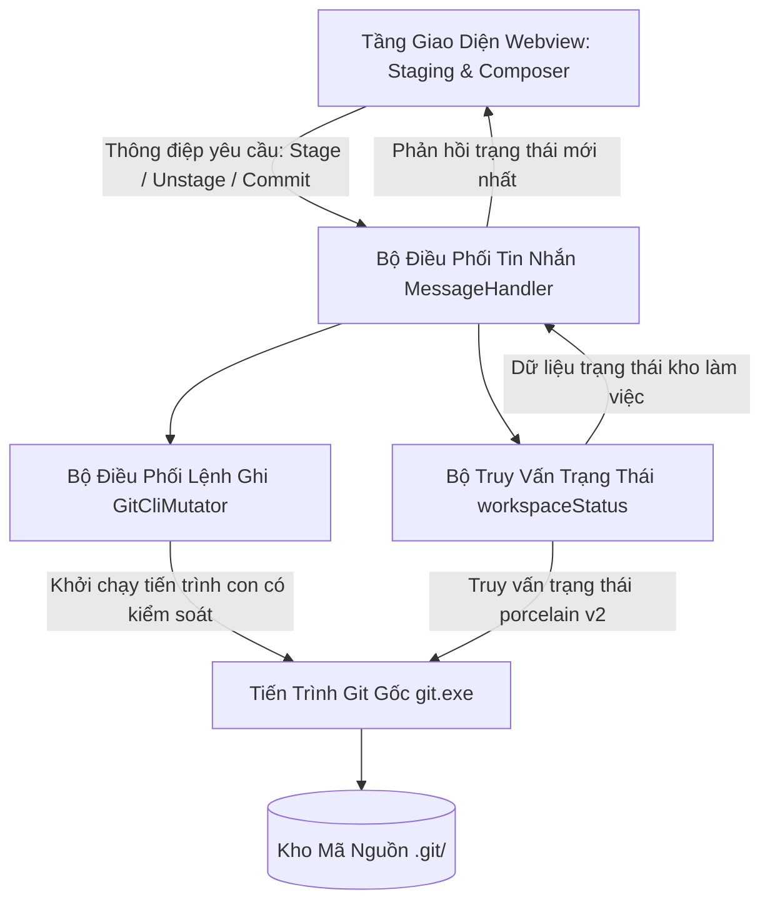

# 01. Thiết Kế Tầng Backend & Mutator Cho Staging (Backend & Mutator Architecture Specification)

Tài liệu này đặc tả chi tiết kiến trúc tầng Backend, các thao tác biến đổi trạng thái kho mã nguồn trong bộ điều phối Mutator, thuật toán phân tích cú pháp trạng thái kho từ lệnh trạng thái chuẩn của Git, và hệ thống từ điển dữ liệu phục vụ cho **Milestone 3.1: Khu Vực Staging & Bộ Soạn Thảo Commit**.

> [!NOTE]
> Mọi nội dung trong tài liệu này tuân thủ nguyên tắc: thiết kế bằng ngôn ngữ tự nhiên (**Design by Word**), tập trung vào kiến trúc hệ thống, luồng dữ liệu, quy chuẩn an toàn và hành vi tương tác; tuyệt đối không sử dụng mã nguồn mẫu dưới bất kỳ hình thức nào.
>
> 📌 **GitHub Tracking**: [Epic #12 - Backend Mutator, Status &amp; RPC](https://github.com/thatislg/f-gitgraph/issues/12) (Gồm 10 tasks con: [#13](https://github.com/thatislg/f-gitgraph/issues/13) đến [#22](https://github.com/thatislg/f-gitgraph/issues/22))

---

## 1. Kiến Trúc Tầng Backend & Ranh Giới An Toàn Dữ Liệu

Hệ thống tiếp tục duy trì kiến trúc phân tầng độc lập và ranh giới an toàn tuyệt đối đã được thiết lập từ Phase 1:

### 1.1. Phân Tách Ranh Giới Giữa Các Tầng Xử Lý

1. **Tầng Giao Diện Người Dùng (Webview Preact)**:
   - Đóng vai trò là tầng hiển thị và thu nhận tương tác người dùng.
   - Hoàn toàn không có quyền hạn truy cập hệ thống tệp hoặc gọi tiến trình hệ điều hành.
   - Mọi thao tác người dùng (như bấm nút Stage, bấm nút Unstage, nhập nội dung commit) được đóng gói thành các thông điệp yêu cầu hành động (Action Request) và gửi qua cầu nối liên lạc hai chiều (WebviewBridge).
2. **Tầng Điều Phối Backend (VS Code Extension Host)**:
   - Tiếp nhận thông điệp yêu cầu từ Webview thông qua bộ điều phối tin nhắn trung tâm (MessageHandler).
   - Kiểm tra tính hợp lệ của tham số yêu cầu và xác thực trạng thái kho làm việc hiện tại.
   - Điều hướng yêu cầu đến đúng module xử lý chuyên trách: các truy vấn trạng thái được chuyển đến bộ truy vấn kho, các yêu cầu thay đổi dữ liệu được chuyển đến bộ điều phối `GitCliMutator`.
3. **Bộ Điều Phối Thay Đổi Dữ Liệu (`GitCliMutator`)**:
   - Chịu trách nhiệm thực thi 100% các thao tác ghi và thay đổi trạng thái kho mã nguồn.
   - Ủy thác toàn bộ thao tác cho tiến trình Git gốc của hệ điều hành (`git.exe`).
   - Tuyệt đối không can thiệp ghi trực tiếp vào thư mục nội bộ `.git` để bảo toàn tính toàn vẹn của chữ ký số (GPG/SSH), bộ quản lý chứng thực (Git Credential Manager) và các bộ móc nối tự động (Git Hooks).
4. **Bộ Phân Tích Trạng Thái Kho Làm Việc (`workspaceStatus`)**:
   - Sử dụng lệnh trạng thái máy đọc chuẩn của Git (`git status --porcelain=v2`) để lấy ảnh chụp trạng thái tức thời của thư mục làm việc và vùng nhớ đệm Staging.
   - Chuyển đổi dữ liệu chuỗi dạng phẳng thành cấu trúc đối tượng có thứ tự, phân định rõ ràng giữa tệp đã đưa vào Staging và tệp còn nằm trên đĩa làm việc.



---

## 2. Đặc Tả Nghiệp Vụ Bộ Lệnh Ghi `GitCliMutator`

Tất cả các phương thức trong bộ điều phối `GitCliMutator` được thiết kế theo mô hình bất đồng bộ, thực thi thông qua danh sách tham số mảng an toàn (ngăn chặn triệt để lỗ hổng chèn lệnh shell - Command Injection), và trả về kết quả chuẩn hóa bao gồm cờ thành công, mã thoát của tiến trình và thông báo lỗi chi tiết nếu có.

### 2.1. Nhóm Lệnh Thao Tác Vùng Nhớ Đệm Staging

1. **Lệnh Đưa Một Tệp Vào Staging (Stage File)**:
   - **Mục đích**: Chuyển các thay đổi hiện tại của một tệp cụ thể trên thư mục làm việc vào chỉ mục Staging Index của Git.
   - **Lệnh Git gốc tương ứng**: `git add -- <đường_dẫn_tệp>`
   - **Tham số đầu vào**: Đường dẫn tương đối của tệp so với thư mục gốc của kho mã nguồn.
   - **Xử lý an toàn**: Ký tự phân tách `--` bắt buộc phải có để ngăn Git hiểu nhầm đường dẫn tệp trùng với tên một nhánh hoặc cờ tùy chọn.
2. **Lệnh Rút Một Tệp Ra Khỏi Staging (Unstage File)**:
   - **Mục đích**: Loại bỏ thay đổi của một tệp ra khỏi chỉ mục Staging Index mà vẫn giữ nguyên nội dung chỉnh sửa của tệp đó trên đĩa làm việc.
   - **Lệnh Git gốc tương ứng**: `git restore --staged -- <đường_dẫn_tệp>`
   - **Tham số đầu vào**: Đường dẫn tương đối của tệp cần rút.
   - **Hành vi nghiệp vụ**: Đối với tệp mới tạo chưa từng commit (Untracked đã lỡ add vào stage), lệnh này sẽ đưa tệp trở lại danh sách tệp chưa theo dõi an toàn mà không làm mất nội dung người dùng vừa tạo.
3. **Lệnh Đưa Toàn Bộ Tệp Vào Staging (Stage All)**:
   - **Mục đích**: Đưa toàn bộ các tệp đã sửa đổi, tệp mới tạo và tệp bị xóa trong toàn bộ kho mã nguồn vào Staging Index trong một thao tác duy nhất.
   - **Lệnh Git gốc tương ứng**: `git add -A`
   - **Hành vi nghiệp vụ**: Áp dụng cho toàn bộ cây thư mục từ gốc dự án, bao gồm cả các tệp nằm trong thư mục con sâu nhất.
4. **Lệnh Rút Toàn Bộ Tệp Ra Khỏi Staging (Unstage All)**:
   - **Mục đích**: Rút toàn bộ các tệp đang nằm trong Staging Index về lại trạng thái thay đổi chưa stage trên thư mục làm việc.
   - **Lệnh Git gốc tương ứng**: `git restore --staged .`
   - **Hành vi nghiệp vụ**: Làm sạch hoàn toàn Staging Index, đưa chỉ mục trở về trạng thái khớp với commit trên đỉnh HEAD gần nhất mà không làm mất bất kỳ dòng code nào trên đĩa.
5. **Lệnh Hoàn Tác Thay Đổi Của Một Tệp (Discard File Changes)**:
   - **Mục đích**: Xóa bỏ vĩnh viễn các thay đổi chưa commit của một tệp, khôi phục tệp về trạng thái sạch sẽ giống hệt như trong commit gần nhất.
   - **Phân định hai trường hợp kỹ thuật**:
     - *Trường hợp tệp đã được Git theo dõi (Tracked File)*: Thực thi lệnh `git restore -- <đường_dẫn_tệp>`. Lệnh này khôi phục nội dung tệp từ Index hoặc HEAD.
     - *Trường hợp tệp mới tạo chưa theo dõi (Untracked File)*: Thực thi lệnh xóa tệp rác `git clean -f -- <đường_dẫn_tệp>`. Lệnh này xóa tệp mới khỏi hệ thống đĩa cứng.
   - **Nguyên tắc an toàn tối cao**: Tầng giao diện bắt buộc phải hiển thị hộp thoại xác nhận cảnh báo mất dữ liệu vĩnh viễn trước khi gửi yêu cầu thực thi lệnh này sang tầng Backend.
6. **Lệnh Hoàn Tác Toàn Bộ Thay Đổi Trong Kho (Discard All Changes)**:
   - **Mục đích**: Làm sạch toàn bộ thư mục làm việc, hủy bỏ mọi thay đổi trên các tệp theo dõi và xóa toàn bộ tệp mới chưa theo dõi.
   - **Quy trình thực thi hai bước tuần tự**:
     - Bước 1: Thực thi `git restore .` để khôi phục toàn bộ tệp đã theo dõi. Nếu bước này gặp lỗi, tiến trình dừng ngay lập tức và báo lỗi cho người dùng.
     - Bước 2: Thực thi `git clean -fd` để xóa sạch toàn bộ tệp và thư mục mới chưa được theo dõi.

### 2.2. Chiến Lược Tương Thích Đa Phiên Bản Git (Git Version Probe & Fallback Strategy)

1. **Bối Cảnh Kỹ Thuật**:
   - Lệnh `git restore` chỉ bắt đầu xuất hiện từ phiên bản Git **2.23.0** (phát hành tháng 08/2019).
   - Đối với các môi trường phát triển sử dụng các phiên bản Git cũ hơn 2.23 (Git < 2.23), việc gọi `git restore` sẽ bị lỗi lệnh không tồn tại.
   - Trước Git 2.23, các thao tác Unstage và Discard được thực hiện bởi hai lệnh Git cổ điển: `git reset` và `git checkout`. Các lệnh này vẫn được Git duy trì và hỗ trợ ổn định 100% đến tận ngày nay.
2. **Cơ Chế Thăm Dò Phiên Bản Một Lần (One-Time Version Probe & Cache)**:
   - Khi khởi tạo hoặc khi lần đầu tiên thực hiện một thao tác unstage/discard, hệ thống thực thi lệnh `git version` một lần duy nhất.
   - Bóc tách chỉ số phiên bản chính (Major) và phiên bản phụ (Minor) từ chuỗi kết quả:
     - Nếu `Major > 2` HOẶC `(Major == 2 và Minor >= 23)`: Xác định hệ thống hỗ trợ lệnh hiện đại, đánh dấu cờ `supportsRestore = true`.
     - Ngược lại: Đánh dấu cờ `supportsRestore = false`.
   - Kết quả này được lưu trữ trong bộ nhớ đệm (In-Memory Cache) của đối tượng điều phối, bảo đảm các thao tác về sau không tốn thêm bất kỳ tiến trình kiểm tra phiên bản nào.
3. **Bảng Đối Chiếu Lệnh Hiện Đại vs Lệnh Fallback Cổ Điển**:

| Thao Tác Nghiệp Vụ                       | Phiên Bản Hiện Đại (Git $\ge$ 2.23)      | Fallback Cổ Điển (Mọi Phiên Bản Git)      | Ghi Chú Kỹ Thuật & An Toàn                                                                                        |
| :------------------------------------------ | :---------------------------------------------- | :---------------------------------------------- | :-------------------------------------------------------------------------------------------------------------------- |
| **Unstage 1 tệp**                    | `git restore --staged -- <đường_dẫn>`     | `git reset -- <đường_dẫn>`                | `git reset -- <đường_dẫn>` không bị deprecated, xử lý tốt cả tệp tracked lẫn tệp untracked vừa stage. |
| **Unstage toàn bộ**                 | `git restore --staged .`                      | `git reset`                                   | Đưa toàn bộ Staging Index về lại HEAD mà không làm ảnh hưởng đến tệp trên đĩa.                      |
| **Discard 1 tệp đã track**         | `git restore -- <đường_dẫn>`              | `git checkout -- <đường_dẫn>`             | Khôi phục nội dung tệp về trạng thái commit gần nhất.                                                        |
| **Discard toàn bộ tệp đã track** | `git restore .`                               | `git checkout -- .`                           | Khôi phục toàn bộ các tệp đã theo dõi trên cây thư mục.                                                  |
| **Discard tệp untracked**            | `git clean -f -- <đường_dẫn>`             | `git clean -f -- <đường_dẫn>`             | Dùng chung cho mọi phiên bản Git (có từ phiên bản Git đầu tiên).                                           |
| **Stage 1 tệp / Stage All**          | `git add -- <đường_dẫn>` / `git add -A` | `git add -- <đường_dẫn>` / `git add -A` | Dùng chung cho mọi phiên bản Git, không cần fallback.                                                           |

---

### 2.3. Nâng Cấp Phương Thức Tạo Commit (`commit`)

Phương thức tạo commit được thiết kế lại toàn diện để hỗ trợ đầy đủ các quy chuẩn tạo commit chuyên nghiệp trong Git:

1. **Phân Tách Rõ Ràng Giữa Tiêu Đề Và Nội Dung Mô Tả Chi Tiết**:
   - Khi gọi lệnh commit, tham số cờ `-m` đầu tiên đại diện cho dòng tiêu đề tóm tắt (Commit Summary).
   - Nếu người dùng có nhập nội dung mô tả mở rộng (Commit Description), hệ thống tự động gắn thêm một cờ `-m` thứ hai chứa toàn bộ nội dung mô tả này. Git sẽ tự động chèn một dòng trống ngăn cách giữa tiêu đề và mô tả theo đúng chuẩn quy ước Git Commit Message.
2. **Hỗ Trợ Chế Độ Sửa Đổi Commit Gần Nhất (Amend Mode)**:
   - Khi tùy chọn sửa đổi commit được kích hoạt, hệ thống tự động bổ sung cờ `--amend` vào danh sách tham số dòng lệnh.
   - Hành vi này cho phép gộp các thay đổi mới trong Staging vào chính commit trên đỉnh `HEAD` hiện tại mà không sinh thêm commit rác trong lịch sử phả hệ.
3. **Hỗ Trợ Tùy Chọn Ký Số Bảo Mật (Commit Signing)**:
   - Khi tùy chọn ký số được bật, hệ thống gắn thêm cờ `-S` vào lệnh commit.
   - Tiến trình `git.exe` sẽ tự động tìm khóa ký số (GPG hoặc SSH) đã được cấu hình trong tệp cài đặt `.gitconfig` của máy lập trình viên, kích hoạt trình quản lý khóa hoặc phần cứng bảo mật để gắn chữ ký điện tử hợp lệ vào đối tượng commit.

---

## 3. Thuật Toán Phân Tích Cú Pháp Trạng Thái Kho (`workspaceStatus`)

### 3.1. Bản Đặc Tả Câu Lệnh & Giải Mã Từng Cờ Tham Số

Để bảo đảm hiệu năng tối ưu, tính toàn vẹn dữ liệu đa nền tảng và độ ổn định chuẩn máy móc tuyệt đối, hàm `workspaceStatus` bắt buộc thực thi câu lệnh Git với đúng 5 cờ tham số chiến lược sau:

```
git status --porcelain=v2 --branch --untracked-files=all -c core.quotepath=false -z
```

Bảng phân tích mục đích kỹ thuật và lý do bắt buộc của từng cờ tham số:

| Cờ Tham Số                | Mục Đích Kỹ Thuật Chi Tiết                                                                                                                                                                                                                          | Hậu Quả Nghiêm Trọng Nếu Bỏ Qua                                                                                                                                                                |
| :-------------------------- | :-------------------------------------------------------------------------------------------------------------------------------------------------------------------------------------------------------------------------------------------------------- | :--------------------------------------------------------------------------------------------------------------------------------------------------------------------------------------------------- |
| `--porcelain=v2`          | Định dạng chuẩn máy thế hệ 2 của Git. Cung cấp cấu trúc dữ liệu phẳng có phân định trường rõ ràng, ổn định tuyệt đối giữa mọi bản phát hành Git, không phụ thuộc ngôn ngữ hiển thị hệ điều hành (`LC_ALL`). | Dùng bản v1 hoặc lệnh mặc định sẽ phụ thuộc ngôn ngữ (ví dụ: tiếng Nhật, tiếng Pháp) làm hỏng hoàn toàn parser.                                                                |
| `--branch`                | Xuất các dòng siêu dữ liệu tiêu đề (`#`) chứa tên nhánh hiện tại, định danh commit HEAD, tên nhánh remote tracking (`upstream`), và số lượng commit lệch (`ahead`/`behind`).                                               | Phải spawn thêm 2 tiến trình độc lập (`git branch` và `git rev-list`) làm tăng độ trễ thêm từ 60ms đến 150ms trên Windows.                                                     |
| `--untracked-files=all`   | Liệt kê chi tiết từng tệp con riêng lẻ bên trong các thư mục chưa theo dõi (thay vì chỉ gom lại thành 1 dòng tên thư mục gốc như chế độ mặc định).                                                                           | Bảng Staging UI không thể hiển thị cây tệp con chi tiết và người dùng không thể chọn stage từng tệp con trong thư mục mới.                                                       |
| `-c core.quotepath=false` | Ép tiến trình Git giữ nguyên chuỗi UTF-8 nguyên bản cho tên tệp có dấu tiếng Việt, ký tự Kanji/Hanja hoặc ký tự đặc biệt.                                                                                                           | Tên tệp tiếng Việt có dấu sẽ bị mã hóa thành chuỗi octal khó đọc (ví dụ `"\304\221\306\260\341\273\235ng.ts"`), gây lỗi hiển thị và lỗi đường dẫn khi gọi lệnh stage. |
| `-z`                      | Sử dụng byte NUL (`\0`, mã ASCII số 0) làm ký tự phân tách bản ghi thay cho ký tự ngắt dòng `\n`.                                                                                                                                       | Nếu tệp tin có tên chứa ký tự ngắt dòng hoặc ký tự tab, parser dùng `\n` sẽ bị gãy dòng, làm sai lệch cấu trúc dữ liệu toàn bộ kho.                                       |

---

### 3.2. Cấu Trúc Chi Tiết Của 5 Loại Bản Ghi (Record Formats) Trong Porcelain v2

Khi sử dụng cờ `-z`, toàn bộ đầu ra từ tiến trình Git là một luồng byte liên tục được phân tách bằng byte NUL (`\0`). Mỗi bản ghi bắt đầu bằng một ký tự nhận diện loại bản ghi duy nhất tại vị trí đầu dòng:

#### 1. Nhóm Bản Ghi Siêu Dữ Liệu Nhánh (Headers - Bắt Đầu Bằng `#`)

Xuất hiện ở phần đầu của luồng dữ liệu, phân cách các trường bằng dấu cách trắng:

- `# branch.oid <committish>`: Chứa mã băm SHA-1 (40 ký tự hex) của commit HEAD hiện tại. Trong trường hợp kho hoàn toàn mới chưa có commit nào (Unborn branch / Initial commit), giá trị này sẽ hiển thị là chuỗi `(initial)`.
- `# branch.head <branch-name>`: Tên của nhánh hiện tại đang được trỏ tới. Nếu con trỏ HEAD đang ở trạng thái tách rời (Detached HEAD), giá trị sẽ hiển thị là `(detached)`.
- `# branch.upstream <upstream-name>`: Tên của nhánh từ xa đang theo dõi (ví dụ: `origin/main`). Nếu nhánh cục bộ chưa được cấu hình upstream tracking, dòng này sẽ hoàn toàn vắng mặt.
- `# branch.ab +<ahead> -<behind>`: Độ lệch số lượng commit giữa nhánh cục bộ và nhánh từ xa (ví dụ `+2 -1` nghĩa là cục bộ đi trước 2 commit và đi sau 1 commit). Nếu không có upstream, dòng này sẽ hoàn toàn vắng mặt.

#### 2. Nhóm Bản Ghi Tệp Biến Động Thông Thường (Bắt Đầu Bằng `1`)

Biểu diễn các tệp tin đã được Git theo dõi từ trước và có thay đổi nội dung, quyền thực thi, hoặc bị xóa:

- Cấu trúc trường: `1 <XY> <sub> <mH> <mI> <mW> <hH> <hI> <path>`
- Chi tiết 9 trường dữ liệu được phân cách bằng dấu cách trắng:
  1. Trường 1 (`1`): Định danh bản ghi loại 1 (Ordinary changed entry).
  2. Trường 2 (`<XY>`): Cặp 2 ký tự mô tả trạng thái (ký tự X đại diện Staging Index, ký tự Y đại diện Working Tree).
  3. Trường 3 (`<sub>`): Cụm 4 ký tự trạng thái submodule. Với tệp tin thông thường, giá trị luôn là `N...`. Với submodule, biểu diễn trạng thái commit, sửa đổi và tệp chưa theo dõi (`S<c><m><u>`).
  4. Trường 4 (`<mH>`): Quyền tệp (octal file mode) tại commit HEAD (ví dụ `100644` là tệp thường, `100755` là tệp thực thi, `120000` là liên kết mềm symlink, `160000` là submodule, `000000` khi tệp mới được thêm).
  5. Trường 5 (`<mI>`): Quyền tệp (octal file mode) tại Staging Index.
  6. Trường 6 (`<mW>`): Quyền tệp (octal file mode) tại Working Tree trên đĩa cứng.
  7. Trường 7 (`<hH>`): Mã băm SHA của đối tượng blob tại commit HEAD (chuỗi 40 ký tự hex; hoặc chuỗi 40 số 0 nếu tệp mới tạo).
  8. Trường 8 (`<hI>`): Mã băm SHA của đối tượng blob tại Staging Index (hoặc chuỗi 40 số 0 nếu tệp bị xóa trong Staging).
  9. Trường 9 (`<path>`): Đường dẫn tương đối của tệp tin tính từ gốc kho làm việc. Kết thúc bằng byte NUL (`\0`).

#### 3. Nhóm Bản Ghi Tệp Đổi Tên Hoặc Sao Chép (Bắt Đầu Bằng `2`)

Biểu diễn các tệp tin được Git nhận diện là đã đổi tên đường dẫn hoặc sao chép từ một tệp khác:

- Cấu trúc trường: `2 <XY> <sub> <mH> <mI> <mW> <hH> <hI> <Xscore> <path><NUL><origPath>`
- Điểm đặc thù sống còn của loại 2: Bản ghi này chiếm **hai phân đoạn NUL liên tiếp**:
  1. Phân đoạn thứ nhất: Chứa các trường thông tin từ mã `2` đến hết đường dẫn mới `<path>`. Trường `<Xscore>` thể hiện loại biến đổi và độ tương đồng phần trăm (ví dụ: `R100` là đổi tên giữ nguyên 100% nội dung, `R92` là đổi tên kèm chỉnh sửa 8% nội dung, `C100` là sao chép tệp).
  2. Phân đoạn thứ hai (nằm ngay sau byte NUL đầu tiên): Chứa duy nhất chuỗi đường dẫn gốc ban đầu `<origPath>`, kết thúc bằng byte NUL tiếp theo.
  3. *Quy tắc bóc tách*: Khi parser gặp bản ghi bắt đầu bằng ký tự `2`, con trỏ duyệt mảng NUL bắt buộc phải đọc tiếp phần tử ngay sau đó để lấy `origPath` trước khi chuyển sang bản ghi kế tiếp.

#### 4. Nhóm Bản Ghi Tệp Xung Đột Chưa Hợp Nhất (Bắt Đầu Bằng `u`)

Biểu diễn các tệp tin đang bị xung đột (Merge Conflict / Rebase Conflict / Cherry-pick Conflict) chưa được giải quyết:

- Cấu trúc trường: `u <XY> <sub> <m1> <m2> <m3> <mW> <h1> <h2> <h3> <path>`
- Chi tiết các trường: Chứa 3 mốc quyền tệp (`<m1>`, `<m2>`, `<m3>`) và 3 mã băm SHA (`<h1>`, `<h2>`, `<h3>`) đại diện cho 3 giai đoạn của quá trình 3-way merge: Giai đoạn 1 là tổ tiên chung (Ancestor/Merge Base), Giai đoạn 2 là phiên bản của nhánh hiện tại (`ours`), Giai đoạn 3 là phiên bản của nhánh đang gộp vào (`theirs`).
- Cặp mã `<XY>` xác định rõ kịch bản xung đột: `UU` (cả hai bên cùng sửa đổi), `AA` (cả hai bên cùng thêm mới tệp cùng tên), `UD` (nhánh mình sửa, nhánh kia xóa), `DU` (nhánh mình xóa, nhánh kia sửa).

#### 5. Nhóm Bản Ghi Tệp Chưa Theo Dõi (Bắt Đầu Bằng `?`) & Bị Bỏ Qua (Bắt Đầu Bằng `!`)

- Bản ghi tệp chưa theo dõi (`?`): Định dạng `? <path>`. Đại diện cho các tệp hoàn toàn mới trên đĩa làm việc chưa từng được đưa vào Git Index.
- Bản ghi tệp bị bỏ qua (`!`): Định dạng `! <path>`. Đại diện cho các tệp bị loại trừ bởi quy tắc `.gitignore` (chỉ xuất hiện khi truyền cờ `--ignored`).

---

### 3.3. Bảng Ma Trận Chi Tiết Toàn Bộ 14 Tổ Hợp Trạng Thái `XY` Trong Nghiệp Vụ Thực Tế

Trong mọi bản ghi loại `1`, `2` và `u`, cặp ký tự `XY` phản ánh trạng thái hai tầng của tệp tin. Dưới đây là ma trận ánh xạ nghiệp vụ toàn diện cho mọi tình huống:

|    Mã `XY`    | Vị Trí X (Staged) | Vị Trí Y (Unstaged) | Bản Ghi Được Đưa Vào Phân Khu Nào?                                                                | Hành Vi Hiển Thị & Quy Tắc Nghiệp Vụ                                                                                                                                                                                               |
| :--------------: | :-----------------: | :-------------------: | :--------------------------------------------------------------------------------------------------------- | :--------------------------------------------------------------------------------------------------------------------------------------------------------------------------------------------------------------------------------------- |
|      `M.`      |        `M`        |         `.`         | Đưa vào danh sách `stagedFiles` (`status: M`)                                                      | Tệp đã được sửa đổi và đưa trọn vẹn vào Staging. Working tree hoàn toàn sạch sẽ.                                                                                                                                      |
|      `.M`      |        `.`        |         `M`         | Đưa vào danh sách `unstagedFiles` (`status: M`)                                                    | Tệp đã có trong commit trước, bị sửa đổi trên đĩa nhưng chưa đưa vào Staging.                                                                                                                                          |
| **`MM`** |   **`M`**   |    **`M`**    | **Tách đôi**: Đưa vào CẢ HAI danh sách `stagedFiles` (`M`) và `unstagedFiles` (`M`) | **Tình huống kép**: Lập trình viên đã sửa tệp và bấm Stage một lần, sau đó lại tiếp tục gõ thêm mã mới trên tệp đó mà chưa Stage lại. Tệp xuất hiện đồng thời ở cả 2 bảng trên giao diện. |
|      `A.`      |        `A`        |         `.`         | Đưa vào danh sách `stagedFiles` (`status: A`)                                                      | Tệp hoàn toàn mới được đưa vào Staging lần đầu tiên.                                                                                                                                                                       |
| **`AM`** |   **`A`**   |    **`M`**    | **Tách đôi**: Đưa vào `stagedFiles` (`A`) và `unstagedFiles` (`M`)                    | Tệp mới đã được Stage, nhưng sau đó lập trình viên lại chỉnh sửa tiếp nội dung trên đĩa.                                                                                                                            |
|      `AD`      |        `A`        |         `D`         | **Tách đôi**: Đưa vào `stagedFiles` (`A`) và `unstagedFiles` (`D`)                    | Tệp mới đã được Stage, nhưng sau đó bị xóa vật lý trên đĩa.                                                                                                                                                             |
|      `D.`      |        `D`        |         `.`         | Đưa vào danh sách `stagedFiles` (`status: D`)                                                      | Tệp đã bị xóa và thao tác xóa đã được đưa vào Staging.                                                                                                                                                                   |
|      `.D`      |        `.`        |         `D`         | Đưa vào danh sách `unstagedFiles` (`status: D`)                                                    | Tệp bị xóa vật lý trên đĩa làm việc nhưng chưa thực hiện stage thao tác xóa.                                                                                                                                             |
|      `R.`      |        `R`        |         `.`         | Đưa vào danh sách `stagedFiles` (`status: R`, kèm `oldPath`)                                    | Tệp đã được đổi tên hoặc di chuyển thư mục và đã đưa vào Staging.                                                                                                                                                     |
| **`RM`** |   **`R`**   |    **`M`**    | **Tách đôi**: Đưa vào `stagedFiles` (`R`) và `unstagedFiles` (`M`)                    | Tệp đổi tên đã được Stage, nhưng sau đó lại có thêm sửa đổi nội dung mới trên đĩa.                                                                                                                                |
|      `RD`      |        `R`        |         `D`         | **Tách đôi**: Đưa vào `stagedFiles` (`R`) và `unstagedFiles` (`D`)                    | Tệp đổi tên đã Stage nhưng sau đó bị xóa bỏ trên đĩa.                                                                                                                                                                     |
|      `?`      |    *(Không)*    |         `U`         | Đưa vào danh sách `unstagedFiles` (`status: U`, `isUntracked: true`)                             | Tệp mới hoàn toàn chưa từng được Git quản lý.                                                                                                                                                                                 |
|  `UU`, `AA`  |        `U`        |         `U`         | Đưa vào danh sách `conflictedFiles`                                                                  | Xung đột hợp nhất 2 chiều (cả 2 nhánh cùng sửa hoặc cùng tạo mới).                                                                                                                                                          |
|  `UD`, `DU`  |        `U`        |         `U`         | Đưa vào danh sách `conflictedFiles`                                                                  | Xung đột sửa/xóa (một nhánh xóa tệp trong khi nhánh kia chỉnh sửa).                                                                                                                                                           |

---

### 3.4. Thuật Toán Bóc Tách Bằng Máy Trạng Thái NUL-Delimiter (State Machine Parser Algorithm)

Thuật toán xử lý luồng dữ liệu byte NUL được tổ chức theo mô hình Máy trạng thái (State Machine) với các bước thực thi nghiêm ngặt:

```
[Luồng Byte NUL (\0) từ git status]
            │
            ▼
 ┌──────────────────────┐
 │ Đọc Token Nhận Diện  │
 └──────────┬───────────┘
            │
   ┌────────┼────────┬────────┬────────┬────────┐
   ▼        ▼        ▼        ▼        ▼        ▼
  '#'      '1'      '2'      'u'      '?'      '!'
Branch   Ordinary  Renamed Conflict Untracked Ignore
Header    Entry     Entry    Entry    Entry    (Skip)
                    │
                    ▼
          (Đọc tiếp 1 token NUL
           để lấy origPath)
```

Quy trình tuần tự chi tiết từng bước:

#### Bước 1: Khởi Tạo Cấu Trúc Trả Về Mặc Định

- Khởi tạo danh sách `stagedFiles: StagedFileRecord[] = []`.
- Khởi tạo danh sách `unstagedFiles: UnstagedFileRecord[] = []`.
- Khởi tạo đối tượng nhánh: `head = ""`, `upstream = undefined`, `ahead = 0`, `behind = 0`.
- Khởi tạo biến chỉ mục duyệt: `index = 0`.

#### Bước 2: Phân Tách Mảng Token Theo Ký Tự NUL

- Tách toàn bộ chuỗi đầu ra nhận được từ tiến trình Git thành mảng các chuỗi token dựa trên ký tự phân tách `\0`.
- Lưu ý: Phần tử cuối cùng của mảng thường là chuỗi rỗng do ký tự NUL kết thúc stream, loại bỏ phần tử rỗng này.

#### Bước 3: Vòng Lặp Máy Trạng Thái Duyệt Mảng Token

Khi `index < tokens.length`, lấy chuỗi `token = tokens[index]`. Nếu `token` rỗng, tăng `index` và chuyển tiếp. Kiểm tra ký tự đầu tiên của `token`:

1. **Trường hợp ký tự đầu là `#` (Siêu dữ liệu nhánh)**:

   - Tách chuỗi `token` bằng dấu cách trắng.
   - Nếu phần tử thứ hai là `branch.oid`: Lưu mã commit HEAD. Nếu bằng `(initial)` nghĩa là kho chưa có commit nào.
   - Nếu phần tử thứ hai là `branch.head`: Lưu tên nhánh hiện tại vào `head`. Nếu bằng `(detached)` nghĩa là đang ở trạng thái Detached HEAD.
   - Nếu phần tử thứ hai là `branch.upstream`: Lưu tên nhánh theo dõi từ xa vào `upstream`.
   - Nếu phần tử thứ hai là `branch.ab`: Tách số đi trước `+<ahead>` và số đi sau `-<behind>`, chuyển đổi thành số nguyên dương và gán vào `ahead` và `behind`.
   - Tăng `index` lên 1.
2. **Trường hợp ký tự đầu là `1` (Tệp biến động thông thường)**:

   - Tìm vị trí của 8 dấu cách trắng đầu tiên để bóc tách 8 trường cố định: mã loại (`1`), mã trạng thái (`XY`), trạng thái submodule (`<sub>`), và 5 trường mode/hash.
   - Toàn bộ phần còn lại từ sau dấu cách trắng thứ 8 cho đến hết chuỗi `token` chính là đường dẫn tệp (`path`). Cách bóc tách này bảo đảm nếu tên tệp có chứa dấu cách trắng ở giữa, đường dẫn vẫn được giữ nguyên vẹn 100%.
   - Lấy ký tự `X = XY[0]` và ký tự `Y = XY[1]`:
     - *Xử lý Staged*: Nếu `X !== "."`, thêm một bản ghi vào `stagedFiles` với `path`, `status = X` (có thể là `M`, `A`, hoặc `D`).
     - *Xử lý Unstaged*: Nếu `Y !== "."`, thêm một bản ghi vào `unstagedFiles` với `path`, `status = Y` (có thể là `M` hoặc `D`), `isUntracked = false`.
   - Tăng `index` lên 1.
3. **Trường hợp ký tự đầu là `2` (Tệp đổi tên hoặc sao chép)**:

   - Tương tự bản ghi loại 1, bóc tách 9 trường cố định đầu tiên bằng dấu cách trắng để lấy mã `XY`, độ tương đồng `<Xscore>`, và đường dẫn mới `<path>`.
   - **Xử lý đặc thù hai phân đoạn**: Tăng chỉ số duyệt lên 1 bước (`index = index + 1`). Chuỗi tại `tokens[index]` kế tiếp chính là đường dẫn gốc ban đầu (`origPath`).
   - Lấy ký tự `X = XY[0]` và ký tự `Y = XY[1]`:
     - *Xử lý Staged*: Nếu `X !== "."`, thêm một bản ghi vào `stagedFiles` với `path`, `status = "R"`, và gán trường `oldPath = origPath`.
     - *Xử lý Unstaged*: Nếu `Y !== "."`, thêm một bản ghi vào `unstagedFiles` với `path`, `status = Y`, `isUntracked = false`.
   - Tăng `index` lên 1.
4. **Trường hợp ký tự đầu là `?` (Tệp chưa theo dõi)**:

   - Cắt bỏ 2 ký tự đầu (`"? "`), toàn bộ phần còn lại của `token` là đường dẫn tệp `path`.
   - Thêm bản ghi vào `unstagedFiles` với `path`, `status = "U"`, và đặt cờ `isUntracked = true`.
   - Tăng `index` lên 1.
5. **Trường hợp ký tự đầu là `u` (Tệp xung đột)**:

   - Bóc tách lấy mã `XY` và đường dẫn `path`.
   - Đưa vào danh sách tệp xung đột để giao diện hiển thị cảnh báo đỏ và kích hoạt trình giải quyết xung đột Merge Conflict Resolver.
   - Tăng `index` lên 1.
6. **Trường hợp ký tự đầu là `!` (Tệp bị bỏ qua do `.gitignore`)**:

   - Bỏ qua, không xử lý. Tăng `index` lên 1.

#### Bước 4: Đánh Giá Cờ Sạch Sẽ (Clean State Evaluation)

- Kiểm tra độ dài của cả hai danh sách: nếu `stagedFiles.length === 0` VÀ `unstagedFiles.length === 0`, đặt cờ `isClean = true`.
- Nếu có bất kỳ tệp nào tồn tại trong một trong hai danh sách, đặt `isClean = false`.
- Đóng gói toàn bộ kết quả thành cấu trúc `WorkspaceStatusResult` và trả về cho lời gọi hàm.

---

### 3.5. Kiểm Soát Hiệu Năng & Cơ Chế Chống Xung Đột Truy Vấn (Race Condition Prevention)

Khi lập trình viên thao tác liên tục (như gõ phím nhanh, bấm stage hàng loạt tệp dồn dập, hoặc chuyển đổi nhánh), nhiều tiến trình truy vấn `workspaceStatus` có thể được kích hoạt cùng lúc. Để bảo đảm hệ thống luôn mượt mà và không bị sai lệch dữ liệu:

1. **Cơ Chế Hủy Bỏ Truy Vấn Cũ (Request Cancellation via AbortSignal)**:
   - Mỗi lần gọi `workspaceStatus`, hệ thống kiểm tra xem có tiến trình truy vấn nào trước đó đang chạy dở hay không.
   - Nếu có, phát tín hiệu hủy bỏ (`AbortController.abort()`) để ngắt tiến trình `git.exe` đang chạy ngầm và hủy bỏ lời hứa (Promise) tương ứng.
   - Đảm bảo rằng chỉ có kết quả của thao tác mới nhất được trả về cho Webview, triệt tiêu hoàn toàn lỗi Race Condition (tình huống kết quả cũ chạy chậm trả về đè lên kết quả mới).
2. **Chiến Lược Phân Tách Chuỗi Không Cấp Phát Thừa (Zero-Allocation Scanning)**:
   - Thay vì chuyển đổi toàn bộ mảng byte thô sang chuỗi văn bản khổng lồ rồi gọi hàm cắt mảng con nhiều lần làm tăng tải cho trình dọn rác (Garbage Collector), parser sử dụng phương pháp duyệt chỉ mục vị trí (`indexOf('\0')`) tuần tự trên bộ nhớ đệm Buffer để trích xuất từng trường khi cần thiết.
3. **Ngưỡng Hiệu Năng Định Lượng Cam Kết (Performance Benchmark SLA)**:
   - Kho chứa dưới 1.000 tệp biến động: Tổng thời gian từ lúc spawn lệnh Git đến khi Webview nhận được dữ liệu hoàn tất phải dưới **25ms**.
   - Kho chứa 10.000 tệp biến động: Tổng thời gian xử lý toàn trình phải dưới **60ms**.
   - Mức tiêu thụ bộ nhớ RAM bổ sung không được vượt quá **15MB** trong suốt quá trình phân tích cú pháp.

---

## 4. Đặc Tả Từ Điển Dữ Liệu & Hợp Đồng Giao Tiếp RPC

## 4. Đặc Tả Từ Điển Dữ Liệu & Hợp Đồng Khai Báo Payload (Type-Safe RPC Contracts)

Toàn bộ quá trình giao tiếp giữa Webview (Preact UI) và Extension Host (Node.js Backend) được quản lý thông qua hệ thống RPC định kiểu tĩnh (Type-Safe RPC). Mọi lệnh gửi đi bắt buộc phải có phần dữ liệu kèm theo (Payload) được khai báo tường minh trong hai tệp định kiểu trung tâm: `src/types/actions.ts` (cho các lệnh ghi/thay đổi trạng thái) và `src/types/queries.ts` (cho các yêu cầu đọc trạng thái).

---

### 4.1. Bản Đặc Tả Hợp Đồng Action Payloads (`src/types/actions.ts`)

Tệp `src/types/actions.ts` đóng vai trò là hợp đồng dữ liệu cho mọi thao tác ghi dữ liệu từ giao diện xuống tiến trình Git. Bảng sau đây đặc tả chi tiết Payload của từng hành động:

| Tên Hành Động (Action Command) | Cấu Trúc Khai Báo Payload                                                                                                          | Ý Nghĩa Ngữ Nghĩa & Quy Chuẩn Nghiệp Vụ                                                                                                                                         |
| :--------------------------------- | :------------------------------------------------------------------------------------------------------------------------------------ | :------------------------------------------------------------------------------------------------------------------------------------------------------------------------------------- |
| `stageFile`                      | `filePath`: Chuỗi ký tự (string)                                                                                                 | Đường dẫn tương đối của tệp tin cần đưa vào Staging Index (ví dụ: `src/index.ts`).                                                                                   |
| `unstageFile`                    | `filePath`: Chuỗi ký tự (string)                                                                                                 | Đường dẫn tương đối của tệp tin cần rút ra khỏi Staging Index.                                                                                                            |
| `stageAll`                       | Rỗng (`object` / không tham số)                                                                                                  | Lệnh đưa toàn bộ tệp biến động vào Staging Index, không cần truyền tham số đường dẫn.                                                                                |
| `unstageAll`                     | Rỗng (`object` / không tham số)                                                                                                  | Lệnh rút toàn bộ tệp biến động ra khỏi Staging Index, không cần truyền tham số.                                                                                           |
| `discardFileChanges`             | `filePath`: Chuỗi ký tự (string); `isUntracked`: Giá trị logic (boolean)                                                     | Đường dẫn tệp và cờ nhận diện tệp chưa theo dõi (để Backend chọn gọi `clean -f` hay `restore`/`checkout`).                                                       |
| `discardAllChanges`              | Rỗng (`object` / không tham số)                                                                                                  | Lệnh hoàn tác và dọn sạch toàn bộ thay đổi trong working tree, không cần tham số.                                                                                         |
| `commitChanges`                  | `summary`: Chuỗi ký tự (string); `description`: Chuỗi ký tự (string); `amend`: Logic (boolean); `sign`: Logic (boolean) | Bộ 4 tham số phục vụ tạo commit: Tiêu đề dòng đơn (Summary), Mô tả mở rộng (Description), Cờ sửa đổi commit HEAD (Amend), và Cờ ký số bảo mật GPG/SSH (Sign). |
| `commitAndPush`                  | `summary`: Chuỗi ký tự (string); `description`: Chuỗi ký tự (string); `amend`: Logic (boolean); `sign`: Logic (boolean) | Cùng bộ 4 tham số như `commitChanges`, nhưng sau khi commit thành công sẽ tự động gọi `git push` để đẩy nhánh hiện tại lên nhánh theo dõi từ xa (upstream). |

#### Cơ Chế Đóng Gói Thông Điệp Yêu Cầu (`ActionRequest`) & Phản Hồi (`ActionResponse`)

1. **Đóng gói yêu cầu (`ActionRequest`)**:
   - Khi Webview gửi một hành động bất kỳ, hệ thống WebviewBridge tự động kết hợp tên lệnh (`command`), đường dẫn gốc kho (`repo: string`), và gói dữ liệu Payload tương ứng thành một thông điệp chuẩn hóa.
   - Ví dụ: Thao tác stage tệp sẽ được đóng gói thành một đối tượng chứa `command: "stageFile"`, `repo: "/path/to/repo"`, và `filePath: "src/app.ts"`.
2. **Đóng gói phản hồi (`ActionResponse`)**:
   - Sau khi `GitCliMutator` hoàn tất thực thi lệnh Git tương ứng, Backend gửi phản hồi về Webview chứa: tên lệnh (`command`) và trạng thái kết quả (`status: GitCommandStatus`).
   - Nếu thao tác thành công: `status` trả về giá trị `null`.
   - Nếu thao tác thất bại: `status` trả về một chuỗi thông báo lỗi có định dạng thân thiện (ví dụ: lỗi khóa tệp `.git/index.lock` hoặc lỗi từ chối commit).

---

### 4.2. Bản Đặc Tả Hợp Đồng Query Payloads (`src/types/queries.ts`)

Tệp `src/types/queries.ts` quản lý toàn bộ các yêu cầu đọc trạng thái từ Webview lên Backend, bảo đảm tính đối xứng hai chiều giữa tham số hỏi (Request) và dữ liệu trả lời (Response).

| Tên Truy Vấn (Query Command) | Cấu Trúc Request Payload                                           | Cấu Trúc Response Payload                | Ý Nghĩa Nghiệp Vụ                                                                                                                                              |
| :----------------------------- | :------------------------------------------------------------------- | :----------------------------------------- | :----------------------------------------------------------------------------------------------------------------------------------------------------------------- |
| `workspaceStatus`            | `repo`: Chuỗi ký tự (string)                                    | `WorkspaceStatusResult`                  | Yêu cầu Backend chạy lệnh `git status --porcelain=v2` để phân tích và trả về toàn bộ dữ liệu trạng thái Staged, Unstaged, Untracked và nhánh. |
| `commitDetails`              | `repo`: Chuỗi; `commitHash`: Chuỗi                             | `commitDetails: GitCommitDetails \| null` | Yêu cầu lấy thông tin chi tiết một commit lịch sử (đã có từ Phase 1).                                                                                  |
| `loadBranches`               | `repo`: Chuỗi; `showRemoteBranches`: Boolean; `hard`: Boolean | Danh sách nhánh và HEAD                 | Yêu cầu nạp danh sách nhánh của kho (đã có từ Phase 1).                                                                                                  |

---

### 4.3. Cấu Trúc Chi Tiết Từ Điển Dữ Liệu `WorkspaceStatusResult`

Dữ liệu trả về từ truy vấn `workspaceStatus` được chuẩn hóa thành một đối tượng duy nhất gồm các thành phần sau:

#### 1. Cấu Trúc Bản Ghi Dữ Liệu Tệp Đã Stage (`StagedFileRecord`)

| Tên Trường | Kiểu Dữ Liệu Ngữ Nghĩa                            | Mô Tả Ý Nghĩa & Quy Chuẩn Nghiệp Vụ                                                                |
| :------------ | :----------------------------------------------------- | :-------------------------------------------------------------------------------------------------------- |
| `path`      | Chuỗi ký tự đường dẫn                           | Đường dẫn tương đối của tệp tính từ thư mục gốc của kho làm việc.                       |
| `status`    | Ký tự phân loại (`A` \| `M` \| `D` \| `R`) | Mã trạng thái trong Staging: `A` (Thêm mới), `M` (Sửa đổi), `D` (Xóa), `R` (Đổi tên). |
| `oldPath`   | Chuỗi ký tự (Tùy chọn)                            | Đường dẫn ban đầu trước khi tệp được đổi tên (chỉ xuất hiện khi `status` là `R`).  |

#### 2. Cấu Trúc Bản Ghi Dữ Liệu Tệp Chưa Stage (`UnstagedFileRecord`)

| Tên Trường   | Kiểu Dữ Liệu Ngữ Nghĩa                   | Mô Tả Ý Nghĩa & Quy Chuẩn Nghiệp Vụ                                                         |
| :-------------- | :-------------------------------------------- | :------------------------------------------------------------------------------------------------- |
| `path`        | Chuỗi ký tự đường dẫn                  | Đường dẫn tương đối của tệp tính từ thư mục gốc của kho làm việc.                |
| `status`      | Ký tự phân loại (`M` \| `D` \| `U`) | Mã trạng thái trên đĩa: `M` (Sửa đổi), `D` (Xóa), `U` (Tệp mới chưa theo dõi). |
| `isUntracked` | Giá trị logic (boolean)                     | Đánh dấu `true` nếu tệp hoàn toàn mới chưa từng có trong lịch sử Git.               |

#### 3. Cấu Trúc Tổng Thể Toàn Kho (`WorkspaceStatusResult`)

| Tên Trường     | Kiểu Dữ Liệu Ngữ Nghĩa  | Mô Tả Ý Nghĩa & Quy Chuẩn Nghiệp Vụ                                                          |
| :---------------- | :--------------------------- | :-------------------------------------------------------------------------------------------------- |
| `head`          | Chuỗi ký tự               | Tên của nhánh hiện tại đang được trỏ tới (hoặc mã băm nếu ở trạng thái Detached). |
| `upstream`      | Chuỗi ký tự (Tùy chọn)  | Tên nhánh từ xa đang theo dõi (ví dụ: `origin/main`).                                      |
| `ahead`         | Số nguyên không âm       | Số lượng commit cục bộ chưa được đẩy lên upstream.                                      |
| `behind`        | Số nguyên không âm       | Số lượng commit trên upstream chưa được kéo về cục bộ.                                  |
| `stagedFiles`   | Mảng `StagedFileRecord`   | Danh sách toàn bộ các tệp hiện đang nằm trong vùng nhớ đệm Staging.                     |
| `unstagedFiles` | Mảng `UnstagedFileRecord` | Danh sách toàn bộ các tệp có biến động nhưng chưa đưa vào Staging.                    |
| `isClean`       | Giá trị logic (boolean)    | Đặt thành `true` khi cả `stagedFiles` và `unstagedFiles` đều rỗng.                    |

---

### 4.4. Cơ Chế Đăng Ký & Điều Phối Message Handlers (`src/extension/services/messageHandler.ts`)

Tệp `messageHandler.ts` đóng vai trò là tổng đài điều hướng thông điệp trung tâm tại Extension Host Backend:

```
[Webview postMessage] 
        │
        ▼
[MessageHandler Router]
   ├── Action Request? ────► Kiểm tra repo ────► Chuyển tới GitCliMutator (stage, commit...)
   │                                                     │
   │                                                     ▼
   │                                             (Thao tác thành công)
   │                                                     │
   │                                                     ▼
   │                                         (Tự động gửi Refresh Event)
   │
   └── Query Request? ─────► Kiểm tra repo ────► Chuyển tới workspaceStatus(repo)
                                                         │
                                                         ▼
                                               (Trả kết quả về Webview)
```

1. **Điều Hướng Action Requests**:
   - Khi tiếp nhận một thông điệp thuộc loại Action, bộ điều phối trích xuất trường `command` và kiểm tra đường dẫn `repo`.
   - Gọi phương thức tương ứng trên thực thể `GitCliMutator` với các tham số lấy ra từ `ActionPayload`:
     - Nhận `stageFile` $\rightarrow$ gọi `mutator.stageFile(payload.filePath)`.
     - Nhận `unstageFile` $\rightarrow$ gọi `mutator.unstageFile(payload.filePath)`.
     - Nhận `stageAll` $\rightarrow$ gọi `mutator.stageAll()`.
     - Nhận `unstageAll` $\rightarrow$ gọi `mutator.unstageAll()`.
     - Nhận `discardFileChanges` $\rightarrow$ gọi `mutator.discardFileChanges(payload.filePath, payload.isUntracked)`.
     - Nhận `discardAllChanges` $\rightarrow$ gọi `mutator.discardAllChanges()`.
     - Nhận `commitChanges` $\rightarrow$ gọi `mutator.commit(payload.summary, payload.description, payload.amend, payload.sign)`.
     - Nhận `commitAndPush` $\rightarrow$ gọi `mutator.commitAndPush(payload.summary, payload.description, payload.amend, payload.sign)`.
2. **Kích Hoạt Chu Trình Tự Động Làm Mới (Auto Refresh Cycle)**:
   - Ngay sau khi bất kỳ thao tác Action nào của `GitCliMutator` hoàn tất thành công mà không phát sinh lỗi, `messageHandler` sẽ tự động kích hoạt một sự kiện cập nhật (`refreshStatusEvent`) để Webview và File Watcher đồng bộ trạng thái mới nhất mà người dùng không cần phải bấm nút F5/Refresh thủ công.
3. **Điều Hướng Query Requests**:
   - Khi tiếp nhận truy vấn `workspaceStatus`, bộ điều phối chuyển tiếp yêu cầu tới hàm `getWorkspaceStatus(payload.repo)` và gửi gói kết quả `WorkspaceStatusResult` trở lại Webview.

---

## 5. Quy Chuẩn Xử Lý Lỗi & Các Kịch Bản Rủi Ro Kỹ Thuật

1. **Xử Lý Xung Đột Tệp Khóa Của Git (`.git/index.lock`)**:
   - Khi một tiến trình Git khác đang hoạt động ngoài terminal, Git sẽ khóa tệp chỉ mục để tránh xung đột dữ liệu.
   - Nếu tiến trình `GitCliMutator` nhận được thông báo lỗi chứa chuỗi `Unable to create '...index.lock': File exists`, Backend sẽ nhận diện mã lỗi đặc thù này và chuyển hóa thành thông điệp cảnh báo thân thiện cho người dùng: *"Kho mã nguồn đang bị khóa bởi một tiến trình Git khác. Vui lòng thử lại sau vài giây hoặc kiểm tra terminal"*.
   - Tuyệt đối không làm sập tiến trình Webview hay làm treo Extension Host khi gặp tình huống khóa tệp.
2. **Bảo Vệ Tính Toàn Vẹn Khi Tên Tệp Chứa Ký Tự Nguy Hiểm**:
   - Toàn bộ danh sách tham số đường dẫn tệp được truyền trực tiếp dưới dạng các phần tử độc lập của mảng tham số khi gọi hàm khởi tạo tiến trình con (`child_process.spawn`).
   - Tuyệt đối không thực hiện ghép nối chuỗi lệnh dạng văn bản thô để ngăn chặn triệt để nguy cơ Command Injection khi tên tệp hoặc đường dẫn chứa các ký tự điều khiển shell (như dấu chấm phẩy, dấu gạch đứng, dấu và).
3. **Giới Hạn Bộ Nhớ Đệm Khi Kho Chứa Hàng Nghìn Tệp Biến Động**:
   - Trong trường hợp kho mã nguồn có số lượng tệp biến động cực lớn (ví dụ sau khi chạy lệnh cài đặt thư viện tạo ra hàng chục nghìn tệp mới), luồng đọc dữ liệu từ lệnh trạng thái được đọc dưới dạng dòng luồng (streaming) có phân đoạn, tránh nạp toàn bộ khối văn bản khổng lồ vào bộ nhớ RAM cùng một lúc.
