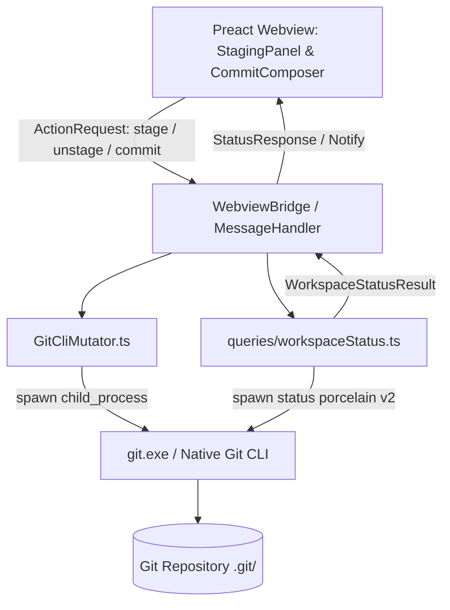

# 01. Thiết Kế Tầng Backend & Mutator Cho Staging (Backend & Mutator Design)

Tài liệu này đặc tả chi tiết kiến trúc tầng Backend, các hàm thao tác ghi mở rộng trong `GitCliMutator.ts`, thuật toán phân tích cú pháp trạng thái kho `git status --porcelain=v2`, và hệ thống kiểu dữ liệu RPC phục vụ cho **Milestone 3.1: Khu Vực Staging & Bộ Soạn Thảo Commit**.

---

## 1. Kiến Trúc Tầng Backend & Ranh Giới An Toàn

Tiếp tục tuân thủ nguyên tắc cốt lõi đã đề ra từ Phase 1:
- **Tầng Giao diện (Webview)**: Không trực tiếp gọi tiến trình hệ điều hành, chỉ gửi thông điệp yêu cầu (Action Request) sang Extension Host qua WebviewBridge.
- **Tầng Điều phối Backend (TypeScript Extension Host)**:
  - Tiếp nhận thông điệp, điều phối thực thi.
  - Gọi **`GitCliMutator.ts`** để spawn tiến trình `git.exe` thực thi mọi thao tác ghi nhằm bảo toàn 100% chữ ký số (GPG/SSH), git hooks (`pre-commit`, `commit-msg`), và Git Credential Manager.
- **Tầng Truy vấn Trạng thái Kho (Workspace Status Query)**:
  - Sử dụng lệnh `git status --porcelain=v2 --branch --untracked-files=all` để trích xuất trạng thái tức thời của toàn bộ tệp tin trong Working Tree và Index mà không làm sai lệch vị trí con trỏ hay tệp khóa.



---

## 2. Đặc Tả Chi Tiết Mở Rộng `GitCliMutator.ts`

Toàn bộ các hàm ghi mới được bổ sung vào class `GitCliMutator` trong [src/extension/mutator/gitCliMutator.ts](file:///d:/Kojin/neo-git-graph/src/extension/mutator/gitCliMutator.ts):

### 2.1. Nhóm Lệnh Thao Tác Staging

```typescript
export class GitCliMutator {
  // ... các phương thức hiện có giữ nguyên ...

  /** Đưa một tệp cụ thể vào Staging Index: git add -- <filePath> */
  async stageFile(filePath: string): Promise<MutatorResult> {
    return this.run(["add", "--", filePath]);
  }

  /** Rút một tệp cụ thể ra khỏi Staging Index: git restore --staged -- <filePath> */
  async unstageFile(filePath: string): Promise<MutatorResult> {
    return this.run(["restore", "--staged", "--", filePath]);
  }

  /** Đưa toàn bộ các tệp thay đổi và tệp mới vào Staging Index: git add -A */
  async stageAll(): Promise<MutatorResult> {
    return this.run(["add", "-A"]);
  }

  /** Rút toàn bộ tệp trong Staging Index về working tree: git restore --staged . */
  async unstageAll(): Promise<MutatorResult> {
    return this.run(["restore", "--staged", "."]);
  }

  /**
   * Hoàn tác (Discard) thay đổi của một tệp an toàn:
   * - Tệp tracked: git restore -- <filePath>
   * - Tệp untracked: git clean -f -- <filePath>
   */
  async discardFileChanges(filePath: string, isUntracked = false): Promise<MutatorResult> {
    if (isUntracked) {
      return this.run(["clean", "-f", "--", filePath]);
    }
    return this.run(["restore", "--", filePath]);
  }

  /** Hoàn tác toàn bộ tệp trong working tree về trạng thái sạch sẽ */
  async discardAllChanges(): Promise<MutatorResult> {
    const restoreRes = await this.run(["restore", "."]);
    if (!restoreRes.ok) return restoreRes;
    return this.run(["clean", "-fd"]);
  }
}
```

### 2.2. Nâng Cấp Phương Thức `commit`

Phương thức `commit` được mở rộng để hỗ trợ tách biệt dòng tiêu đề (Summary) và nội dung chi tiết (Description), đồng thời hỗ trợ cờ `--amend` và `-S` (ký số):

```typescript
export type CommitOptions = {
  amend?: boolean;
  sign?: boolean;
  description?: string;
};

export class GitCliMutator {
  async commit(
    summary: string,
    options: CommitOptions = {}
  ): Promise<MutatorResult> {
    const args = ["commit", "-m", summary];
    
    if (options.description && options.description.trim().length > 0) {
      args.push("-m", options.description.trim());
    }
    if (options.amend) {
      args.push("--amend");
    }
    if (options.sign) {
      args.push("-S");
    }
    
    return this.run(args);
  }
}
```

---

## 3. Thuật Toán Phân Tích Cú Pháp Trạng Thái Kho (`workspaceStatus`)

Tệp mới: `src/backend/queries/workspaceStatus.ts`.

### 3.1. Tại Sao Sử Dụng `git status --porcelain=v2`?
- **Khả năng phân tách hoàn hảo**: Phiên bản `v2` của porcelain phân tách rõ ràng trạng thái chỉ mục (Index) và trạng thái tệp làm việc (Worktree), đồng thời hỗ trợ tên tệp chứa ký tự khoảng trắng hoặc Unicode mà không bị lỗi octal escape.
- **Tốc độ thực thi cực nhanh**: Lệnh `git status --porcelain=v2 --branch -uall` trả về cấu trúc phẳng, định dạng dòng đơn giản:
  - Header branch: `# branch.oid <hash>`, `# branch.head <name>`, `# branch.ab +<ahead> -<behind>`
  - Ordinary changes: `1 <XY> <sub> <mH> <mI> <mW> <hH> <hI> <path>`
  - Renamed/Copied: `2 <XY> <sub> <mH> <mI> <mW> <hH> <hI> <X><score> <path>\t<origPath>`
  - Untracked: `? <path>`

### 3.2. Bảng Ánh Xạ Mã Trạng Thái `XY`

Ký tự `X` đại diện cho trạng thái trong **Staging Index**, ký tự `Y` đại diện cho trạng thái trong **Working Tree**:

| Ký tự `X` (Staged) | Ý Nghĩa Trong Staging | Ký tự `Y` (Unstaged) | Ý Nghĩa Trong Changes |
| :---: | :--- | :---: | :--- |
| `.` | Không có thay đổi so với HEAD | `.` | Không có thay đổi so với Index |
| `M` | Đã sửa đổi và đã stage | `M` | Đã sửa đổi nhưng chưa stage |
| `A` | Tệp mới thêm vào và đã stage | `A` | *(Không xuất hiện ở Y)* |
| `D` | Đã xóa và đã stage | `D` | Đã xóa trên đĩa nhưng chưa stage |
| `R` | Đã đổi tên và đã stage | `.` | |
| `?` | Tệp untracked (chưa theo dõi) | `?` | |

### 3.3. Thuật Toán Phân Loại Đầu Ra (Parser Logic)

```typescript
export type StagedFile = {
  path: string;
  status: "A" | "M" | "D" | "R";
  oldPath?: string;
};

export type UnstagedFile = {
  path: string;
  status: "M" | "D" | "U";
  isUntracked: boolean;
};

export type WorkspaceStatusResult = {
  head: string | null;
  upstream: string | null;
  ahead: number;
  behind: number;
  stagedFiles: StagedFile[];
  unstagedFiles: UnstagedFile[];
  isClean: boolean;
};
```

**Quy tắc phân loại**:
1. Nếu dòng bắt đầu bằng `? <path>`:
   - Đưa vào `unstagedFiles` với `status = "U"`, `isUntracked = true`.
2. Nếu dòng bắt đầu bằng `1 <XY> ... <path>` hoặc `2 <XY> ... <path>\t<origPath>`:
   - **Xử lý Staged (`X`)**: Nếu `X !== "."`, tạo một mục trong `stagedFiles` với loại tương ứng (`A`, `M`, `D`, `R`).
   - **Xử lý Unstaged (`Y`)**: Nếu `Y !== "."`, tạo một mục trong `unstagedFiles` với loại tương ứng (`M`, `D`).
3. Nếu cả `stagedFiles` và `unstagedFiles` đều rỗng: `isClean = true`.

---

## 4. Định Nghĩa Kiểu Dữ Liệu Giao Tiếp (Protocol & RPC Types)

Bổ sung vào [src/types/actions.ts](file:///d:/Kojin/neo-git-graph/src/types/actions.ts) và [src/types/queries.ts](file:///d:/Kojin/neo-git-graph/src/types/queries.ts):

### 4.1. Action Payloads Mới

```typescript
// Bổ sung vào ActionPayloads trong src/types/actions.ts
type ActionPayloads = {
  // ... các action cũ ...
  stageFile: { filePath: string };
  unstageFile: { filePath: string };
  stageAll: Record<string, never>;
  unstageAll: Record<string, never>;
  discardFileChanges: { filePath: string; isUntracked: boolean };
  discardAllChanges: Record<string, never>;
  commitChanges: {
    summary: string;
    description?: string;
    amend?: boolean;
    sign?: boolean;
  };
};
```

### 4.2. Query Payloads Mới

```typescript
// Bổ sung vào QueryPayloads trong src/types/queries.ts
type QueryPayloads = {
  // ... các query cũ ...
  workspaceStatus: {
    request: { repo: string };
    response: WorkspaceStatusResult;
  };
};
```

---

## 5. Xử Lý Các Trường Hợp Rủi Ro Kỹ Thuật (Edge Cases & Safety)

1. **Khóa Tệp Git (Index Lock - `.git/index.lock`)**:
   - Khi người dùng đang chạy lệnh git ngoài terminal mà Webview gọi `stageFile`, `git.exe` sẽ trả về lỗi `fatal: Unable to create '.../index.lock': File exists`.
   - Backend sẽ bắt lỗi này, bóc tách thông báo lỗi thân thiện: *"Git repository is currently locked by another process"* và không làm crash Webview.
2. **Đường Dẫn Chứa Dấu Cách & Ký Tự Unicode (Tiếng Việt có dấu)**:
   - Luôn sử dụng cú pháp phân tách tham số mảng an toàn: `["add", "--", filePath]`, không bao giờ nối chuỗi chuỗi lệnh dạng shell string (phòng ngừa Command Injection).
   - Truyền cờ `-c core.quotepath=false` trong lệnh status để Git không escape tên tệp tiếng Việt thành mã octal (`\303\240...`).
