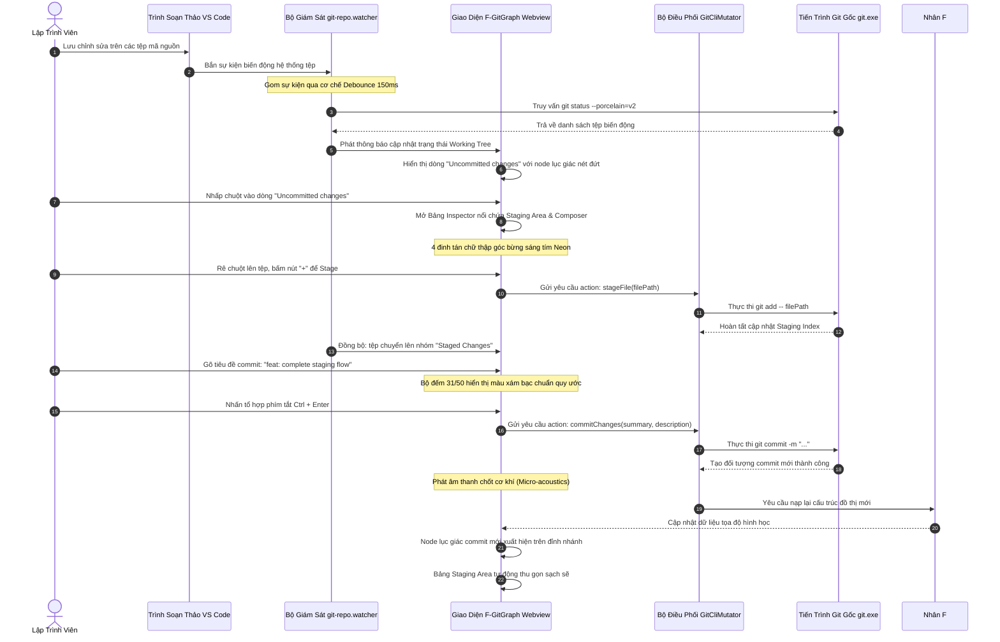

# 03. Thiết Kế Tích Hợp Đồng Bộ Working Tree & File Watcher (Integration & Real-Time Sync Specification)

Tài liệu này đặc tả cơ chế tích hợp đồng bộ hai chiều giữa trạng thái tệp trong thư mục làm việc với Đồ thị commit DAG, cơ chế mở phân vùng Staging khi click vào dòng "Uncommitted changes", và kiến trúc bộ giám sát tệp tin với cơ chế Debounce chống bão sự kiện phục vụ cho **Milestone 3.1: Khu Vực Staging & Bộ Soạn Thảo Commit**.

> [!NOTE]
> Mọi nội dung trong tài liệu này tuân thủ nguyên tắc: thiết kế bằng ngôn ngữ tự nhiên (**Design by Word**), tập trung vào kiến trúc tích hợp hệ thống, nguyên tắc bảo toàn hình học, thuật toán điều phối thời gian thực và trải nghiệm luồng làm việc; tuyệt đối không sử dụng mã nguồn mẫu dưới bất kỳ hình thức nào.
>
> 📌 **GitHub Tracking**: [Epic #36 - F# DAG Integration & File Watcher](https://github.com/thatislg/f-gitgraph/issues/36) (Gồm 6 tasks con: [#37](https://github.com/thatislg/f-gitgraph/issues/37) đến [#42](https://github.com/thatislg/f-gitgraph/issues/42))

---

## 1. Nguyên Tắc Bất Biến: Bảo Toàn 100% Cấu Trúc Đồ Thị & Hexagon Node

> [!IMPORTANT]
> **Cam kết không phá vỡ hình học (Zero Geometric Distortion Guarantee)**:
> - Nút lục giác commit (`HexagonNode`), đường viền cắt ảnh avatar (`clipPath`), tương tác phóng to vi mô 1.15× khi rê chuột, tương tác phóng to cực đại 5.0× khi nhấp chuột, vầng sáng Neon Ambient Gradient mềm mại và các đường cong rẽ nhánh Bézier do nhân F# Core Engine tính toán **hoàn toàn không bị xáo trộn hay chỉnh sửa**.
> - Khối Staging Area & Commit Composer được tích hợp dưới dạng **Bảng điều khiển Inspector nổi (Overlay Inspector Panel)** nằm đè lên lớp hiển thị phía trên của bảng commit, bảo toàn 100% chiều cao các dòng và hệ tọa độ phẳng SVG của đồ thị DAG.

---

## 2. Cơ Chế Kết Nối Dòng "Uncommitted Changes" Trên Đồ Thị

Trong bảng hiển thị commit của F-GitGraph, khi có thay đổi chưa commit trong kho làm việc, đồ thị sẽ xuất hiện một dòng mầm trên đỉnh cùng:

1. **Nhận Diện Dòng Thay Đổi Chưa Commit**:
   - Dòng này được định danh bằng mã băm hằng số đặc biệt là ký tự dấu sao (`*`), đại diện cho trạng thái chưa đóng gói thành commit chính thức.
   - Nút đồ thị tại dòng này được vẽ bằng hình lục giác nét đứt màu xám bạc, biểu thị trạng thái "mầm" (Uncommitted / Work-in-progress).
2. **Cơ Chế Kích Hoạt Lựa Chọn Trong Bảng Commit (`CommitTable`)**:
   - Trong thiết kế cũ, dòng dấu sao này bị vô hiệu hóa hoàn toàn sự kiện nhấp chuột, khiến người dùng không thể tương tác.
   - Trong thiết kế mới, sự kiện nhấp chuột trên dòng này được mở khóa để kích hoạt cơ chế chuyển đổi trạng thái tiêu điểm, tương tự như khi chọn một commit lịch sử.
3. **Bộ Điều Phối Bảng Inspector Nổi (Overlay Inspector Dispatcher)**:
   - Khi người dùng nhấp chuột vào một dòng trong bảng:
     - *Nếu dòng được chọn là một commit lịch sử thông thường*: Bảng Inspector nổi sẽ hiển thị Component Chi Tiết Commit (`CommitDetails`) để xem mã băm, tác giả, ngày giờ, thông điệp và danh sách tệp thay đổi trong commit đó.
     - *Nếu dòng được chọn là dòng Uncommitted Changes*: Bảng Inspector nổi sẽ tự động chuyển sang hiển thị Component **Khu Vực Staging & Bộ Soạn Thảo Commit (`StagingArea`)**.
4. **Quy Tắc Định Vị & Neo Vị Trí (Anchoring Rules)**:
   - Bảng Inspector nổi được neo cố định bắt đầu từ mép phải của cột đồ thị graph (`left: var(--col-graph)`) và kéo dài đến mép phải của cửa sổ.
   - Tọa độ đỉnh trên (`top`) của bảng nổi được tính toán chính xác thẳng hàng với vị trí hàng đang được chọn.
   - Nhờ cơ chế lớp phủ tuyệt đối (Absolute Positioning), việc mở bảng Staging không làm thay đổi chiều cao dòng của bảng commit bên dưới và hoàn toàn không làm xô lệch bất kỳ tọa độ nào của các đường cong SVG Bézier.

---

## 3. Kiến Trúc Bộ Giám Sát Tệp Tin (File Watcher Architecture)

Bộ giám sát tệp tin đóng vai trò là "giác quan" của hệ thống, giúp F-GitGraph tự động nhận biết mọi biến động mã nguồn trong thời gian thực mà không đòi hỏi người dùng phải bấm nút làm mới thủ công:

### 3.1. Ba Vùng Thư Mục Giám Sát Cốt Lõi

Hệ thống thiết lập ba kênh lắng nghe sự kiện độc lập thông qua bộ giám sát hệ thống tệp của VS Code:

1. **Kênh Giám Sát Chỉ Mục Git (`.git/index`)**:
   - Lắng nghe các biến động ghi vào tệp chỉ mục nhị phân của Git.
   - Kênh này tự động phát tín hiệu khi người dùng thực hiện các thao tác `git add`, `git restore --staged`, `git rm` từ giao diện F-GitGraph hoặc từ bất kỳ cửa sổ dòng lệnh bên ngoài nào.
2. **Kênh Giám Sát Con Trỏ Nhánh (`.git/HEAD`, `.git/refs/heads/**`)**:
   - Lắng nghe sự thay đổi của con trỏ nhánh hiện tại và các nhánh cục bộ.
   - Kênh này kích hoạt khi có commit mới được tạo, khi người dùng chuyển nhánh (`checkout`/`switch`), hoặc khi hoàn tất quá trình rebase/merge.
3. **Kênh Giám Sát Thư Mục Làm Việc (Working Tree Source Files)**:
   - Lắng nghe các sự kiện tạo mới, chỉnh sửa nội dung hoặc xóa tệp tin trong toàn bộ thư mục dự án đang mở.

### 3.2. Danh Mục Loại Trừ Thư Mục Rác (Ignore Patterns)

Để tránh lãng phí tài nguyên CPU và ngăn ngừa tình trạng kích hoạt thông báo giả, bộ giám sát tự động bỏ qua toàn bộ các sự kiện xuất phát từ các thư mục rác hoặc thư mục tạm:

- Thư mục quản lý gói phụ thuộc: `node_modules`, `vendor`, `packages`.
- Thư mục đối tượng nội bộ của Git: `.git/objects`, `.git/logs`.
- Thư mục xuất bản và biên dịch mã nguồn: `bin`, `obj`, `dist`, `out`, `target`, `.vs`.
- Thư mục lưu vết tạm của hệ điều hành và IDE: `.cache`, `.tmp`, `.DS_Store`.

### 3.3. Thuật Toán Debounce 150ms Chống Bão Sự Kiện (Anti-Event Storm Algorithm)

1. **Vấn Đề Bão Sự Kiện Kỹ Thuật (Event Storm Problem)**:
   - Khi lập trình viên thực hiện thao tác lưu toàn bộ tệp (`Save All`), chạy lệnh cài đặt thư viện (`npm install`), hoặc khi trình biên dịch sinh ra hàng trăm tệp trung gian trong một phần nghìn giây, bộ giám sát có thể nhận về hàng trăm sự kiện biến động dồn dập.
   - Nếu mỗi sự kiện đều kích hoạt một tiến trình Git để truy vấn trạng thái kho (`git status`), hệ thống sẽ bị nghẽn hàng đợi tiến trình, gây giật lag giao diện và tiêu tốn CPU nghiêm trọng.
2. **Quy Trình Xử Lý Debounce 150ms Bằng Ngôn Ngữ Tự Nhiên**:
   - Mỗi khi một sự kiện tệp hợp lệ xảy ra, hệ thống kiểm tra xem đồng hồ đếm ngược chờ xử lý (Timer) có đang chạy hay không.
   - Nếu đồng hồ đang chạy, hệ thống lập tức hủy bỏ đồng hồ cũ và thiết lập một đồng hồ đếm ngược mới với thời gian chờ là 150 mili-giây.
   - Chỉ khi nào trôi qua trọn vẹn 150 mili-giây mà không có thêm bất kỳ sự kiện tệp mới nào phát sinh (khoảng lặng ổn định), đồng hồ mới kích hoạt duy nhất một tác vụ truy vấn trạng thái kho làm việc.
   - Tác vụ này gọi lệnh trạng thái một lần duy nhất, bóc tách dữ liệu mới và phát thông báo cập nhật sang tầng giao diện Webview.
   - Nhờ thuật toán này, dù có hàng nghìn tệp biến động cùng lúc, hệ thống vẫn duy trì độ mượt mà tuyệt đối và chỉ thực thi đúng một lần truy vấn tổng thể.

---

## 4. Toàn Bộ Vòng Lặp Trải Nghiệm Lập Trình Viên (End-to-End Workflow)

Quy trình khép kín từ khi chỉnh sửa mã nguồn cho đến khi tạo commit hoàn tất được diễn họa chi tiết qua sơ đồ tuần tự:

---

## 5. Kế Hoạch Kiểm Thử Nghiệm Thu Tích Hợp (Verification Plan)

1. **Kiểm Thử Tính Bất Biến Hình Học (Geometry Invariance Verification)**:
   - Mở và đóng liên tục bảng Staging Area trên nhiều vị trí commit khác nhau.
   - Đo đạc tọa độ tâm nút và chuỗi đường cong Bézier SVG của toàn bộ các nhánh lân cận trước và sau khi mở bảng Staging.
   - Tiêu chuẩn nghiệm thu: Sai lệch tọa độ hình học bằng 0 pixel tuyệt đối.
2. **Kiểm Thử Chịu Tải Bộ Giám Sát Tệp (Stress File Watcher Verification)**:
   - Thực thi kịch bản tạo tự động đồng thời 500 tệp tin mới trong thư mục làm việc.
   - Theo dõi tiến trình Extension Host: đảm bảo cơ chế Debounce 150ms gom toàn bộ 500 sự kiện thành đúng 1 đợt cập nhật trạng thái duy nhất, không gây hiện tượng đơ giật giao diện hay quá tải CPU.
3. **Kiểm Thử Toàn Diện Luồng Phím Tắt (End-to-End Shortcut Verification)**:
   - Thực hiện quy trình chuẩn: Sửa tệp $\rightarrow$ Rê chuột bấm Stage $\rightarrow$ Nhập tiêu đề commit $\rightarrow$ Bấm `Ctrl + Enter`.
   - Tiêu chuẩn nghiệm thu: Toàn bộ quá trình hoàn tất mượt mà trong dưới 2 giây, không phát sinh bất kỳ lỗi hiển thị hoặc lệch vị trí con trỏ nào.
