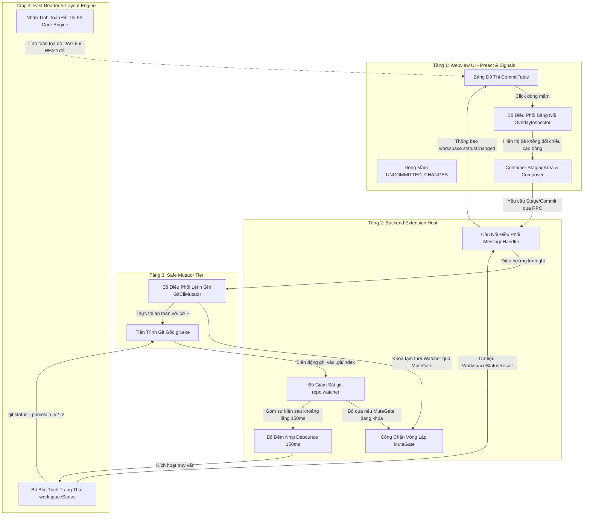
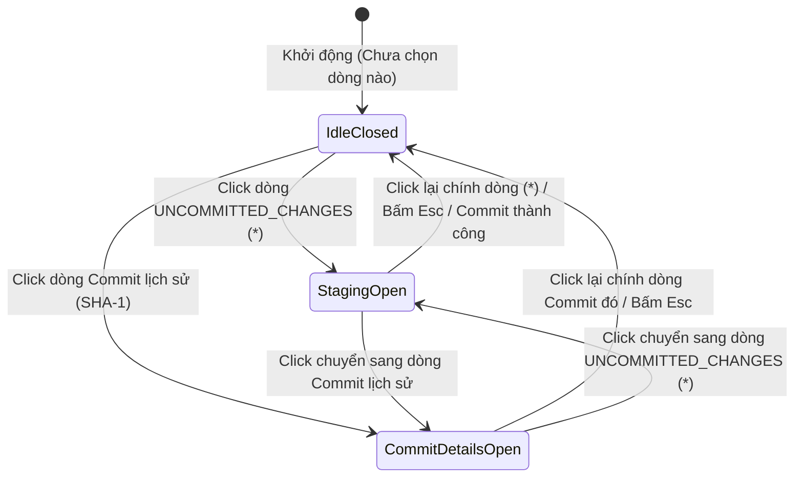
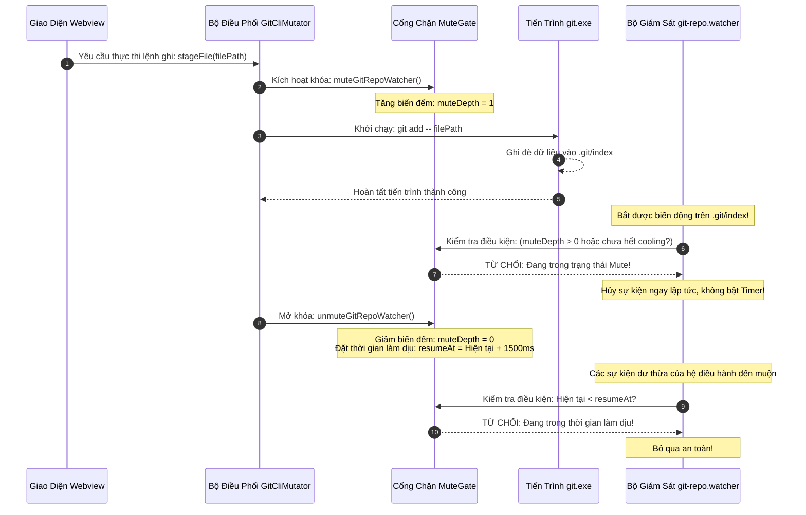

# 03. Thiết Kế Tích Hợp Đồng Bộ Working Tree & File Watcher (Integration & Real-Time Sync Specification)

Tài liệu này đặc tả chi tiết kiến trúc tích hợp hệ thống, cơ chế đồng bộ hai chiều giữa thư mục làm việc (Working Tree) với đồ thị commit DAG, cơ chế mở phân vùng Staging khi tương tác với dòng thay đổi chưa commit ("Uncommitted changes"), và giải thuật bộ giám sát tệp tin thời gian thực với cơ chế Debounce 150ms chống bão sự kiện phục vụ cho **Milestone 3.1: Khu Vực Staging & Bộ Soạn Thảo Commit**.

> [!NOTE]
> Mọi nội dung trong tài liệu này tuân thủ nguyên tắc: thiết kế bằng ngôn ngữ tự nhiên (**Design by Word**), tập trung vào kiến trúc tích hợp hệ thống, nguyên tắc bảo toàn hình học, thuật toán điều phối thời gian thực và trải nghiệm luồng làm việc; tuyệt đối không sử dụng mã nguồn mẫu dưới bất kỳ hình thức nào.
>
> 📌 **GitHub Tracking**: [Epic #36 - F# DAG Integration &amp; File Watcher](https://github.com/thatislg/f-gitgraph/issues/36) (Gồm 6 tasks con: [#37](https://github.com/thatislg/f-gitgraph/issues/37) đến [#42](https://github.com/thatislg/f-gitgraph/issues/42))

---

## 1. Tầm Nhìn, Mục Tiêu & Ranh Giới An Toàn 4 Tầng

### 1.1. Mục Tiêu Cốt Lõi Của Bản Thiết Kế

Trong quy trình làm việc hàng ngày của lập trình viên, vòng lặp phát triển cốt lõi (Core Dev Loop) diễn ra liên tục:

1. Chỉnh sửa tệp mã nguồn trong trình soạn thảo.
2. Lưu tệp và quan sát biến động phản ánh tức thời lên giao diện Git Client mà không cần thao tác bấm nút làm mới thủ công (Manual Refresh).
3. Nhấp chọn dòng thay đổi chưa commit để mở không gian làm việc Staging.
4. Đưa các tệp chọn lọc vào Staging Index, nhập thông điệp và xác nhận commit.
5. Quan sát nút commit mới xuất hiện mượt mà trên đỉnh đồ thị DAG và khu vực Staging tự động thu gọn sạch sẽ.

Để hiện thực hóa vòng lặp mượt mà trên, hệ thống đòi hỏi một cơ chế tích hợp đồng bộ thời gian thực mạnh mẽ, vừa bảo đảm độ trễ phản hồi cực thấp (< 200ms), vừa triệt tiêu hoàn toàn nguy cơ quá tải CPU hoặc treo giao diện khi phát sinh hàng loạt biến động tệp đồng thời.

---

### 1.2. Phân Tách Ranh Giới An Toàn 4 Tầng (4-Tier Safety Boundary)

Kiến trúc tích hợp đồng bộ tuân thủ nghiêm ngặt mô hình 4 tầng độc lập của F-GitGraph:



1. **Tầng Giao Diện Webview (Webview UI Tier)**:
   - Quản lý trạng thái tiêu điểm hàng (`selectedRowHash`), nhận diện dòng mầm `UNCOMMITTED_CHANGES`, và điều phối hiển thị Component `StagingArea` bên trong khung nổi `OverlayInspectorPanel`.
   - **Ranh giới an toàn**: Hoàn toàn không gọi API hệ điều hành hay module `fs`, chỉ nhận dữ liệu thông qua các sự kiện RPC từ Backend.
2. **Tầng Điều Phối Backend (Extension Host Tier)**:
   - Khởi tạo và quản lý vòng đời bộ giám sát tệp tin của VS Code (`vscode.FileSystemWatcher`).
   - Thực thi thuật toán Debounce 150ms và cơ chế cổng chặn vòng lặp (`MuteGate`) để lọc bỏ sự kiện tự kích hoạt khi Mutator ghi tệp.
3. **Tầng Biến Đổi Dữ Liệu An Toàn (`GitCliMutator`)**:
   - Ủy thác 100% thao tác thay đổi kho mã nguồn cho `git.exe` thông qua các cờ phân tách an toàn `--`.
   - Chủ động phát tín hiệu khóa (`muteGitRepoWatcher`) trước khi thực hiện thao tác ghi và mở khóa (`unmuteGitRepoWatcher`) sau khi tiến trình Git kết thúc.
4. **Tầng Đọc Nhanh & Bố Cục Đồ Thị (F# Core Engine & Status Parser)**:
   - Thực thi truy vấn trạng thái kho siêu tốc `git status --porcelain=v2 -z` để cung cấp dữ liệu tệp thay đổi cho Webview mà không làm nghẽn luồng xử lý đồ thị.
   - Tính toán lại ma trận tọa độ topo DAG khi con trỏ nhánh hoặc commit `HEAD` có sự dịch chuyển.

---

### 1.3. Cam Kết Bảo Toàn Hình Học Đồ Thị 100% (Geometric Invariance Guarantee)

> [!IMPORTANT]
> **Nguyên Tắc Bất Khả Xâm Phạm Về Hình Học Đồ Thị**:
>
> - Toàn bộ hệ thống đồ thị SVG đã được hoàn thiện từ Phase 1 — bao gồm nút lục giác `HexagonNode.tsx`, đường viền cắt ảnh đại diện tác giả (`clipPath`), tương tác phóng to vi mô 1.15× khi rê chuột, tương tác phóng to cực đại 5.0× khi nhấp chuột, vầng sáng Neon Ambient Gradient mềm mại và các đường cong rẽ nhánh Bézier do nhân F# Core Engine tính toán — **phải được bảo toàn nguyên vẹn 100%**.
> - Tuyệt đối không chèn thêm phần tử DOM dạng dòng bảng (Table Row) có chiều cao biến động làm đẩy xô lệch các dòng commit bên dưới.
> - Khối `StagingArea` & `CommitComposer` bắt buộc phải hoạt động dưới cơ chế **Bảng Lớp Phủ Nổi Tuyệt Đối (Absolute Overlay Inspector Panel)**:
>   - Chiều cao các dòng của bảng commit (`CommitRow`) luôn cố định ở giá trị chuẩn **24px**.
>   - Bảng Inspector nổi được vẽ đè lên trên lớp hiển thị bảng commit, bắt đầu từ mép phải của cột đồ thị SVG sang đến mép phải cửa sổ Webview.
>   - Tọa độ trục X và trục Y của mọi nút lục giác và đường cong Bézier SVG có độ sai lệch bằng 0 pixel tuyệt đối trong suốt quá trình đóng, mở hoặc tương tác bên trong khu vực Staging.

---

## 2. Cơ Chế Kết Nối Dòng "Uncommitted Changes" & Điều Phối Bảng Inspector Nổi

Hạng mục này giải quyết trực tiếp yêu cầu của **Task 3.1: Mở khóa click dòng UNCOMMITTED_CHANGES** ([Issue #37](https://github.com/thatislg/f-gitgraph/issues/37)) và **Task 3.2: Kiểm soát bất biến hình học đồ thị DAG** ([Issue #38](https://github.com/thatislg/f-gitgraph/issues/38)).

### 2.1. Bản Chất Kỹ Thuật Của Dòng Mầm Trên Đồ Thị

Trong kiến trúc hiển thị của F-GitGraph, khi kho làm việc xuất hiện ít nhất một tệp tin bị chỉnh sửa, thêm mới hoặc xóa bỏ chưa được đóng gói vào commit, hệ thống sẽ chèn một dòng đặc biệt trên đỉnh đồ thị:

- **Định danh băm (Hash Identifier)**: Sử dụng chuỗi ký tự hằng số đặc biệt là dấu sao (`*`), được định nghĩa qua hằng số toàn cục `UNCOMMITTED_CHANGES = "*"`.
- **Hình thái hiển thị nút đồ thị**:
  - Nút lục giác tại dòng này không mang ảnh đại diện của tác giả hay mã commit SHA rút gọn.
  - Được vẽ bằng nét đứt kỹ thuật (`stroke-dasharray: 3 3`), tông màu xám chì kim loại (`#64748b` ở chế độ sáng và `#94a3b8` ở chế độ tối).
  - Biểu thị trạng thái "mầm" (Uncommitted Work-in-Progress) — một đối tượng đang chờ được đóng dấu thành commit chính thức.

#### 2.1.1. Cơ Chế Chèn Dòng Mầm Từ Backend (Backend Injection)

Dòng mầm `*` **không phải là commit thật** và **không nằm trong lịch sử commit** mà nhân F# Core Engine đọc được. Nó là một dòng tổng hợp do tầng cầu nối dữ liệu Extension Host (`GraphDataBridge`) tạo ra và chèn vào đỉnh danh sách commit trước khi trả về Webview. Cơ chế này phải tuân thủ nghiêm ngặt các nguyên tắc sau:

1. **Điều kiện kích hoạt (Trigger Condition)**: Cầu nối đồng thời gọi bộ truy vấn trạng thái kho làm việc (Working Tree Status) ngay khi nạp hoặc làm mới đồ thị. Nếu kết quả trả về trạng thái **không sạch** (`isClean = false`, tức tồn tại ít nhất một tệp đã stage, chưa stage hoặc đang xung đột), cầu nối bật cờ `hasUncommitted` và chèn dòng `*`; ngược lại, khi kho sạch, cầu nối trả về đúng danh sách commit thật mà không chèn gì.
2. **Vị trí và chỉ số (Placement & Indexing)**: Dòng `*` chiếm **hàng 0** (đỉnh đồ thị), làn 0, màu 0. Tổng số dòng (`commitCount`) trả về cho Webview được tăng thêm đúng **1** so với số commit thật. Toàn bộ commit thật bị dịch xuống đúng một dòng.
3. **Bảo toàn hình học (Geometric Invariance)**: Nhân F# chỉ tính hình học cho commit thật. Vì vậy cầu nối phải tự dịch toàn bộ tọa độ Y của nút và chuỗi đường nối SVG xuống đúng **một chiều cao dòng (24 px)** để giữ nguyên quan hệ tương đối giữa các commit thật — tuyệt đối không sửa đổi nhân F# hay thay đổi tọa độ tương đối giữa chúng.
4. **Dịch chỉ số cửa sổ (Window Index Translation)**: Khi Webview yêu cầu một cửa sổ dòng bằng chỉ số đã bao gồm dòng `*`, cầu nối phải dịch ngược chỉ số về hệ tọa độ commit thật trước khi gọi nhân F#, rồi chèn lại dòng `*` ở đầu khi cửa sổ bắt đầu từ hàng 0.
5. **Metadata tổng hợp (Synthetic Metadata)**: Dòng `*` mang metadata tối thiểu có mã băm `*` để Webview nhận diện đúng loại nút `uncommitted` (biểu tượng bút chì) và hiển thị nhãn "Uncommitted Changes".

---

### 2.2. Cơ Chế Mở Khóa Tương Tác Click Trong `CommitTable` & `CommitRow`

1. **Hiện Trạng Khiếm Khuyết Ban Đầu**:
   - Trong phiên bản cũ, tại component `CommitTable.tsx`, thuộc tính hành động `onSelect` được truyền vào `CommitRow` với điều kiện loại trừ: nếu mã băm trùng với `UNCOMMITTED_CHANGES`, giá trị truyền vào là `undefined`.
   - Hậu quả: Dòng "Uncommitted changes" bị trơ hoàn toàn trước sự kiện chuột của người dùng, không thể nhấp chọn, gây cụt luồng trải nghiệm.
2. **Cơ Chế Mở Khóa Mới**:
   - Loại bỏ hoàn toàn điều kiện gán `undefined`.
   - Cung cấp hàm phản hồi chuyên biệt khi người dùng nhấp chuột vào dòng `UNCOMMITTED_CHANGES`.
   - Khi dòng mầm được chọn, hệ thống kích hoạt bộ điều phối trạng thái tiêu điểm, thiết lập chỉ số dòng được chọn (`expandedRow`) và đồng thời phát tín hiệu kích hoạt mở phân vùng Staging.

---

### 2.3. Bộ Điều Phối Bảng Inspector Nổi (Overlay Inspector Dispatcher)

Hệ thống duy trì một bộ điều phối hiển thị trung tâm để quản lý nội dung hiển thị trong khung nổi phụ thuộc vào loại đối tượng mà người dùng đang chọn:



1. **Chế Độ Chi Tiết Commit (`CommitDetails`)**:
   - Kích hoạt khi người dùng nhấp chọn một dòng commit lịch sử thông thường.
   - Nội dung hiển thị: Mã băm đầy đủ, tác giả, thư điện tử, ngày giờ tạo, thông điệp commit, danh sách các tệp thay đổi trong commit đó và nút so sánh Diff với commit cha.
2. **Chế Độ Khu Vực Staging (`StagingArea`)**:
   - Kích hoạt khi người dùng nhấp chọn dòng `UNCOMMITTED_CHANGES`.
   - Nội dung hiển thị: Danh sách tệp `Staged Changes`, danh sách tệp `Changes`, các nút thao tác nhanh (Stage, Unstage, Discard), ô nhập tiêu đề và mô tả commit (`CommitComposer`), các checkbox Amend/Sign, và nút thực thi Commit.
3. **Quy Tắc Chuyển Đổi Trạng Thái Trơn Tru**:
   - Nếu người dùng đang mở xem chi tiết một commit và bấm chọn dòng `UNCOMMITTED_CHANGES`, khung nổi giữ nguyên vị trí neo và hoán đổi mượt mà nội dung bên trong từ `CommitDetails` sang `StagingArea` với hiệu ứng hòa tan độ mờ (Cross-fade 120ms), không làm giật khung hình.

---

### 2.4. Quy Tắc Định Vị & Neo Vị Trí Lớp Phủ (Spatial Anchoring Rules)

Để bảo đảm tính bất biến hình học tuyệt đối, khung Inspector nổi tuân theo hệ quy chiếu định vị không gian sau:

```
┌─────────────────────────── Cửa Sổ Webview F-GitGraph ───────────────────────────┐
│ [Thanh Tiêu Đề & Công Cụ Lọc Nhánh]                                             │
├───────────────┬─────────────────────────────────────────────────────────────────┤
│ Cột Đồ Thị    │ Cột Thông Tin Commit (Mô tả, Tác giả, Ngày giờ, Mã SHA)        │
│ SVG DAG       │                                                                 │
├───────────────┼─────────────────────────────────────────────────────────────────┤
│ ( * ) [Mầm]   │ Uncommitted changes (3 files)  ◄── [Dòng Đang Chọn]             │
│   │           │ ┌─────────────────────────────────────────────────────────────┐ │
│   │           │ │ ◄── Bắt đầu từ mép phải cột SVG (left: avatarRightX + 12px)  │ │
│   │           │ │ <CornerCrossFrame> (Khung viền đinh tán chữ thập góc tím)   │ │
│   │           │ │ ┌─────────────────────────────────────────────────────────┐ │ │
│   │           │ │ │ <StagingArea>                                           │ │ │
│   │           │ │ │  • Staged Changes (1)                                   │ │ │
│   │           │ │ │  • Changes (2)                                          │ │ │
│   │           │ │ │ <CommitComposer>                                        │ │ │
│   │           │ │ └─────────────────────────────────────────────────────────┘ │ │
│   │           │ └─────────────────────────────────────────────────────────────┘ │
│ ( o ) [Head]  │ feat(core): implement DAG rendering engine                     │
│   │ \         │                                                                 │
│ ( o )  ( o )  │ fix(parser): handle NUL byte in porcelain format                │
└───────────────┴─────────────────────────────────────────────────────────────────┘
```

1. **Định Vị Trục Ngang (Horizontal Axis)**:
   - Tọa độ cạnh trái của khung nổi (`left`) được neo cố định bắt đầu ngay sau mép phải của cột đồ thị SVG: `left: var(--col-graph-width)`.
   - Chiều rộng của khung nổi kéo dài tự động đến sát mép phải của bảng commit (`right: 0`), tạo không gian rộng rãi để hiển thị danh sách tệp và khung soạn thảo văn bản.
2. **Định Vị Trục Dọc (Vertical Axis)**:
   - Khi dòng được chọn nằm trong phạm vi hiển thị của khung nhìn cuộn ảo (Virtualized Scroll Viewport), đỉnh trên của khung nổi (`top`) được định vị khớp với tọa độ đáy của hàng đang chọn.
   - Nếu chiều cao của bảng Inspector lớn hơn khoảng trống còn lại phía dưới màn hình, hệ thống tự động kích hoạt thanh cuộn nội bộ bên trong khung Staging (`overflow-y: auto`), tuyệt đối không làm giãn nở chiều cao của hàng commit cha hay đẩy toàn bộ bảng commit xuống dưới.
3. **Độ Sâu Hiển Thị (Z-Index Layering)**:
   - Cột đồ thị SVG và các đường cong Bézier nằm ở lớp hiển thị tiêu chuẩn (`z-index: 10`).
   - Khung Inspector nổi được gán lớp hiển thị cao hơn (`z-index: 40`), bảo đảm che phủ hoàn hảo phần văn bản của các dòng commit phía sau mà không chạm vào các nút đồ thị bên cột trái.

---

## 3. Kiến Trúc Bộ Giám Sát Tệp Tin Thời Gian Thực (`git-repo.watcher.ts`)

Hạng mục này giải quyết trực tiếp yêu cầu của **Task 3.3: Debounce 150ms trong git-repo.watcher.ts** ([Issue #39](https://github.com/thatislg/f-gitgraph/issues/39)).

### 3.1. Ba Kênh Lắng Nghe Sự Kiện Cốt Lõi (Core Watch Channels)

Bộ giám sát tệp tin đóng vai trò là hệ thần kinh thụ cảm của F-GitGraph, theo dõi biến động hệ thống thông qua `vscode.workspace.createFileSystemWatcher` với mẫu bao phủ toàn diện:

1. **Kênh 1: Giám Sát Chỉ Mục Git (`.git/index`)**:
   - Theo dõi các biến động ghi vào tệp chỉ mục nhị phân của Git.
   - **Tác nhân kích hoạt**: Lệnh `git add`, `git reset`, `git restore --staged`, `git rm` do người dùng chạy từ F-GitGraph, từ terminal tích hợp của VS Code hoặc từ các công cụ Git bên ngoài (SourceTree, GitKraken, CLI).
   - **Mục đích**: Nhận diện tức thời sự hoán đổi tệp giữa nhóm Staged và Unstaged.
2. **Kênh 2: Giám Sát Con Trỏ Nhánh (`.git/HEAD`, `.git/refs/heads/**`, `.git/packed-refs`)**:
   - Theo dõi sự dịch chuyển của con trỏ nhánh hiện tại và các mốc tham chiếu nhánh cục bộ.
   - **Tác nhân kích hoạt**: Tạo commit mới, chuyển nhánh (`checkout`/`switch`), hợp nhất nhánh (`merge`), tái cơ sở (`rebase`), hoặc khôi phục commit (`reset`).
   - **Mục đích**: Kích hoạt việc vẽ lại cấu trúc phả hệ đồ thị commit DAG.
3. **Kênh 3: Giám Sát Cây Thư Mục Làm Việc (Working Tree Source Files)**:
   - Theo dõi các thao tác tạo mới, ghi chỉnh sửa nội dung hoặc xóa bỏ tệp nguồn trong toàn bộ không gian làm việc của dự án.
   - **Mục đích**: Cập nhật danh sách các tệp biến động chưa stage (Unstaged Changes).

---

### 3.2. Bộ Lọc Thư Mục Rác & Quy Tắc Loại Trừ (Exclusion Filter & Ignore Patterns)

Để bảo đảm hiệu năng tối đa và ngăn ngừa hiện tượng kích hoạt thông báo giả, bộ giám sát cài đặt bộ lọc đường dẫn nghiêm ngặt:

| Nhóm Tệp / Thư Mục                     | Danh Mục Mẫu Loại Trừ (Ignore Patterns)                                          | Lý Do Kỹ Thuật Bắt Buộc Phải Loại Trừ                                                                              |
| :------------------------------------- | :------------------------------------------------------------------------------- | :----------------------------------------------------------------------------------------------------------------- |
| **Thư viện phụ thuộc**                 | `**/node_modules/**`, `**/vendor/**`, `**/packages/**`                           | Chứa hàng chục nghìn tệp mã nguồn bên ngoài, gây bão sự kiện làm đóng băng tiến trình khi chạy lệnh cài đặt gói.   |
| **Dữ liệu nội bộ Git không cần thiết** | `.git/objects/**`, `.git/logs/**`, `.git/hooks/**`                               | Các đối tượng blob/tree nén sinh ra liên tục khi thao tác Git, không chứa thông tin trạng thái làm việc trực tiếp. |
| **Tệp xuất bản & tệp nhị phân build**  | `**/bin/**`, `**/obj/**`, `**/dist/**`, `**/out/**`, `**/target/**`, `**/.vs/**` | Trình biên dịch tạo mới và ghi đè liên tục trong quá trình build dự án.                                            |
| **Tệp tạm hệ thống & IDE**             | `**/.cache/**`, `**/.tmp/**`, `**/.DS_Store`, `**/Thumbs.db`, `**/*.tmp`         | Các tệp rác của hệ điều hành tự động sinh ra và tự biến mất.                                                       |

---

### 3.3. Thuật Toán Debounce 150ms Chống Bão Sự Kiện (Anti-Event Storm Algorithm)

#### 1. Bài Toán Kỹ Thuật (Event Storm Problem)

Khi lập trình viên thực hiện thao tác lưu toàn bộ tệp mở (`Ctrl + K, S` / `Save All`), chạy công cụ định dạng mã nguồn tự động (`Prettier`), hoặc khi tiến trình `git rebase` áp dụng hàng chục commit liên tiếp, hệ thống tệp có thể phát sinh hàng trăm sự kiện `changed`/`created` dồn dập chỉ trong vòng 20 - 50 mili-giây.

Nếu mỗi sự kiện đơn lẻ đều kích hoạt một lệnh truy vấn `git status` độc lập:

- Extension Host sẽ bị nghẽn hàng đợi tiến trình (Process Starvation).
- CPU tăng vọt 100%, gây đơ giật hoàn toàn trải nghiệm cuộn và vẽ đồ thị trên Webview.
- Xảy ra hiện tượng tranh chấp đọc ghi dữ liệu tệp nhị phân `.git/index.lock`.

#### 2. Giải Thuật Debounce 150ms Bằng Ngôn Ngữ Tự Nhiên

Hệ thống thiết lập một máy trạng thái đồng hồ đếm ngược với khoảng thời gian ổn định là **150 mili-giây**:

```
Dòng Thời Gian Sự Kiện:
Sự kiện tệp A   ───► [Nhận e1] ───► Khởi tạo Timer 150ms
                         │
                         ▼ (Trôi qua 40ms)
Sự kiện tệp B   ───► [Nhận e2] ───► HỦY Timer cũ, Thiết lập Timer MỚI 150ms
                         │
                         ▼ (Trôi qua 60ms)
Sự kiện tệp C   ───► [Nhận e3] ───► HỦY Timer cũ, Thiết lập Timer MỚI 150ms
                         │
                         ▼ (Trôi qua trọn vẹn 150ms KHÔNG có sự kiện mới - Khoảng Lặng Ổn Định)
Kích hoạt:      ────────────────────────────────────────────────────────► [Bắn 1 truy vấn git status duy nhất]
```

1. **Giai đoạn tiếp nhận sự kiện**: Khi một sự kiện tệp (`created`, `changed`, `deleted`) vượt qua bộ lọc thư mục rác, hệ thống kiểm tra sự tồn tại của bộ đếm thời gian (`refreshTimer`).
2. **Giai đoạn tái thiết lập nhịp (Reset Timer)**:
   - Nếu bộ đếm thời gian đang tồn tại: Tiến hành hủy bỏ bộ đếm cũ ngay lập tức.
   - Thiết lập một bộ đếm thời gian mới với thời lượng chính xác **150 mili-giây**.
3. **Giai đoạn kích hoạt khoảng lặng (Trailing Trigger)**:
   - Chỉ khi trôi qua trọn vẹn 150 mili-giây mà không có thêm bất kỳ sự kiện nào chen ngang, bộ đếm thời gian mới phát hỏa.
   - Hủy tham chiếu bộ đếm về trạng thái rỗng.
   - Kích hoạt duy nhất **1 lệnh truy vấn trạng thái kho tổng thể**.
   - Gửi gói dữ liệu trạng thái mới qua RPC sang tầng giao diện Webview.

> [!TIP]
> **Tại Sao Lại Là 150ms? (The Sweet Spot)**:
>
> - Dưới 100ms: Quá ngắn, chưa đủ gom hết các đợt ghi tệp dồn dập của trình biên dịch hoặc thao tác `Save All`.
> - Trên 300ms: Quá dài, lập trình viên sẽ cảm nhận được độ trễ thị giác khi chuyển cửa sổ từ trình soạn thảo sang F-GitGraph.
> - **150ms** là ngưỡng tối ưu hoàn hảo giữa tính phản hồi tức thời của con người (< 200ms) và năng lực gom sự kiện triệt để của hệ thống.

---

### 3.4. Thuật Toán Chặn Đứng Vòng Lặp Tự Kích Hoạt (Anti-Self-Triggering Event Loop)

Một vấn đề chí mạng trong các ứng dụng Git Client là hiện tượng **vòng lặp phản hồi vô tận (Self-Event Feedback Loop)**:

- Người dùng bấm nút Stage trên giao diện F-GitGraph $\rightarrow$ `GitCliMutator` chạy lệnh `git add` $\rightarrow$ Tệp `.git/index` bị ghi đè $\rightarrow$ File Watcher phát hiện biến động trên `.git/index` $\rightarrow$ Watcher kích hoạt truy vấn `git status` $\rightarrow$ Webview render lại $\rightarrow$ Lập trình viên tương tác tiếp $\rightarrow$ Vòng lặp kéo dài làm lãng phí chu kỳ xử lý vô ích.

Để loại bỏ triệt để hiện tượng này, F-GitGraph triển khai cơ chế **Cổng Chặn Độ Sâu (Mute Depth Gate)** phối hợp với **Thời Gian Làm Dịu (Cooling Window)**:



1. **Quản lý biến đếm độ sâu khóa (`muteDepth`)**:
   - Sử dụng biến đếm nguyên thủy thay vì biến cờ nhị phân (boolean) để xử lý hoàn hảo các trường hợp nhiều thao tác ghi diễn ra lồng nhau hoặc liên tiếp.
   - Khi bất kỳ thao tác Mutator nào bắt đầu: Tăng `muteDepth` lên 1 đơn vị.
   - Khi thao tác kết thúc: Giảm `muteDepth` đi 1 đơn vị.
2. **Cửa sổ làm dịu thời gian thực (`resumeAt`)**:
   - Sau khi `muteDepth` trở về 0, hệ điều hành (đặc biệt là Windows NTFS File System) vẫn có thể phát ra các sự kiện ghi trễ sau vài chục đến vài trăm mili-giây.
   - Do đó, khi `muteDepth === 0`, hệ thống đóng dấu mốc thời gian phục hồi: `resumeAt = Thời điểm hiện tại + 1500 mili-giây`.
   - Toàn bộ sự kiện tệp phát sinh trước mốc thời gian này đều bị hủy bỏ trong âm thầm.

---

## 4. Hợp Đồng Từ Điển Dữ Liệu & Giao Thức RPC Đồng Bộ

Hạng mục này giải quyết trực tiếp yêu cầu của **Task 3.4: Đồng bộ Watcher → Webview qua RPC** ([Issue #40](https://github.com/thatislg/f-gitgraph/issues/40)).

### 4.1. Hợp Đồng Thông Báo Sự Kiện Backend $\rightarrow$ Webview (Server Events)

| Tên Định Danh Thông Báo (Event Name) | Cấu Trúc Dữ Liệu Payload                                                                                                                                                                                 | Điều Kiện Kích Hoạt                                                                         | Hành Vi Xử Lý Tương Ứng Của Tầng Webview                                                                                             |
| :----------------------------------- | :------------------------------------------------------------------------------------------------------------------------------------------------------------------------------------------------------- | :------------------------------------------------------------------------------------------ | :----------------------------------------------------------------------------------------------------------------------------------- |
| `repo.updated`                       | - `path`: Chuỗi đường dẫn tuyệt đối đến thư mục gốc của kho làm việc (`string`).                                                                                                                         | Phát sinh khi File Watcher hoàn tất chu kỳ Debounce 150ms sau biến động nhánh hoặc chỉ mục. | Webview kiểm tra nếu kho hiện tại trùng khớp, tự động phát lệnh yêu cầu nạp lại trạng thái mới nhất.                                 |
| `workspace.statusChanged`            | - `repoPath`: Chuỗi đường dẫn kho (`string`)- `branch`: Thông tin nhánh (`BranchMetadata`)- `staged`: Mảng tệp Staged (`WorkspaceFileRecord[]`)- `unstaged`: Mảng tệp Unstaged (`WorkspaceFileRecord[]`) | Phát sinh khi có kết quả bóc tách từ lệnh `workspaceStatus`.                                | Cập nhật trực tiếp `stagingStore`: tính lại số lượng tệp, cập nhật giao diện Staging Area và ẩn/hiện dòng mầm `UNCOMMITTED_CHANGES`. |

---

### 4.2. Hợp Đồng Yêu Cầu Hành Động Webview $\rightarrow$ Backend (Action Requests)

| Tên Định Danh Hành Động (Action Name) | Cấu Trúc Tham Số Đầu Vào (Payload)                                                                                           | Cấu Trúc Dữ Liệu Trả Về (Response)                                                                          | Mô Tả Nghiệp Vụ                                                                                                                                                     |
| :------------------------------------ | :--------------------------------------------------------------------------------------------------------------------------- | :---------------------------------------------------------------------------------------------------------- | :------------------------------------------------------------------------------------------------------------------------------------------------------------------ |
| `getWorkspaceStatus`                  | - `repoPath`: Chuỗi đường dẫn thư mục gốc kho làm việc (`string`).                                                           | - `success`: Trạng thái logic (`boolean`)- `status`: Đối tượng dữ liệu trạng thái (`WorkspaceStatusResult`) | Truy vấn ảnh chụp trạng thái tức thời của thư mục làm việc và vùng đệm Staging.                                                                                     |
| `openFileDiff`                        | - `repoPath`: Đường dẫn gốc kho (`string`)- `filePath`: Đường dẫn tương đối tệp (`string`)- `isStaged`: Cờ logic (`boolean`) | - `success`: Trạng thái logic (`boolean`)- `error`: Thông báo lỗi nếu có (`string \| undefined`)            | Mở trình so sánh Diff trực quan của VS Code (`vscode.diff`) giữa tệp trên đĩa làm việc với phiên bản trong Staging Index (hoặc giữa Staging Index với commit HEAD). |

---

### 4.3. Bảng Chuẩn Hóa Lỗi & Ngoại Lệ Tích Hợp (Error Handling)

| Mã Lỗi Kỹ Thuật (Error Code) | Nguyên Nhân Gốc                                                                                      | Hành Vi Xử Lý Tự Động Của Hệ Thống                                                             | Trải Nghiệm Hiển Thị Phía Người Dùng                                                                                |
| :--------------------------- | :--------------------------------------------------------------------------------------------------- | :--------------------------------------------------------------------------------------------- | :------------------------------------------------------------------------------------------------------------------ |
| `ERR_INDEX_LOCKED`           | Tệp `.git/index.lock` đang tồn tại do một tiến trình Git khác đang thực thi ghi dở dang.             | Tự động thử lại tối đa 3 lần, mỗi lần cách nhau 200ms. Nếu vẫn khóa, thông báo cho người dùng. | Hiển thị thanh cảnh báo viền vàng mỏng: "Chỉ mục Git đang bị khóa bởi tiến trình khác. Đang tự động kết nối lại..." |
| `ERR_REPO_PATH_INVALID`      | Thư mục dự án đã bị xóa hoặc di chuyển trên hệ điều hành trong lúc F-GitGraph đang mở.               | Hủy bỏ toàn bộ watcher liên quan, giải phóng tài nguyên tiến trình.                            | Hiển thị thông báo màu đỏ: "Không tìm thấy kho mã nguồn tại đường dẫn đã chỉ định."                                 |
| `ERR_DIFF_BINARY_FILE`       | Người dùng yêu cầu xem Diff của tệp tin định dạng nhị phân (ảnh PNG, tệp nén ZIP, tệp thư viện DLL). | Chặn mở trình diff văn bản của VS Code để tránh làm treo trình biên tập.                       | Hiển thị thông báo nhẹ nhàng dạng thanh Toast: "Không thể so sánh nội dung tệp nhị phân."                           |

---

## 5. Đặc Tả Kiến Trúc Tầng Giao Diện, Tương Tác & Quản Lý Trạng Thái

### 5.1. Mô Hình Quản Lý Trạng Thái Bằng Preact Signals

Kiến trúc giao diện phân định rạch ròi giữa Tín hiệu gốc (`signal`), Tín hiệu dẫn xuất (`computed`), và các Hành động điều phối (`store actions`):

```
┌─────────────────────────────────── stagingStore ───────────────────────────────────┐
│ Tín hiệu gốc (Signals):                                                            │
│   • stagedFiles: Signal<WorkspaceFileRecord[]>                                     │
│   • unstagedFiles: Signal<WorkspaceFileRecord[]>                                   │
│   • activeRepoPath: Signal<string>                                                 │
│                                                                                    │
│ Tín hiệu dẫn xuất (Computed):                                                      │
│   • hasUncommittedChanges: Computed<boolean>                                       │
│     (Đúng khi tổng số lượng tệp staged và unstaged > 0)                            │
│   • totalChangedCount: Computed<number>                                            │
│     (Tổng số lượng tệp biến động cả 2 phân khu)                                     │
│   • isCleanWorkingTree: Computed<boolean>                                          │
│     (Đúng khi không còn tệp nào biến động trên cả đĩa và chỉ mục)                   │
└────────────────────────────────────────┬───────────────────────────────────────────┘
                                         │ Kích hoạt đồng bộ
                                         ▼
┌───────────────────────────────── inspectorStore ───────────────────────────────────┐
│ Tín hiệu gốc (Signals):                                                            │
│   • selectedRowHash: Signal<string | null>                                         │
│     (Nhận giá trị "*" khi chọn dòng mầm, hoặc chuỗi SHA khi chọn commit)           │
│   • isInspectorOpen: Signal<boolean>                                               │
│                                                                                    │
│ Tín hiệu dẫn xuất (Computed):                                                      │
│   • inspectorMode: Computed<'none' | 'staging' | 'commit-details'>                 │
│     (Trả về 'staging' nếu selectedRowHash === "*")                                 │
│     (Trả về 'commit-details' nếu selectedRowHash là chuỗi SHA hợp lệ)              │
│     (Trả về 'none' nếu isInspectorOpen === false)                                  │
└────────────────────────────────────────────────────────────────────────────────────┘
```

---

### 5.2. Luồng Phản Ứng Hai Chiều Khi Trạng Thái Kho Làm Việc Biến Đổi

1. **Kịch bản Phát Sinh Thay Đổi Mới (Dirty State Emergence)**:
   - Ban đầu kho ở trạng thái sạch sẽ: Không có dòng `UNCOMMITTED_CHANGES` trên đồ thị.
   - Lập trình viên chỉnh sửa 1 tệp tin và lưu lại:
     - File Watcher kích hoạt sau 150ms $\rightarrow$ Backend phát `workspace.statusChanged`.
     - `stagingStore` nhận dữ liệu, tính toán `hasUncommittedChanges` chuyển từ `false` sang `true`.
     - `CommitTable` tự động chèn dòng `UNCOMMITTED_CHANGES` lên đỉnh đồ thị với hiệu ứng chuyển tiếp trượt êm ái (Slide-down 150ms).
     - Nút lục giác nét đứt xuất hiện trên đồ thị, sẵn sàng để người dùng tương tác.
2. **Kịch bản Làm Sạch Kho Hoàn Toàn (Clean State Restoration)**:
   - Người dùng thực hiện thao tác Commit thành công hoặc bấm nút Discard All toàn bộ tệp:
     - Mutator cập nhật kho $\rightarrow$ Watcher kích hoạt $\rightarrow$ `hasUncommittedChanges` chuyển về `false`.
     - Nếu bảng Staging Area đang mở: Khung nổi tự động thu gọn mượt mà.
     - Dòng `UNCOMMITTED_CHANGES` tự động tiêu biến khỏi đỉnh đồ thị.
     - Tiêu điểm chọn dòng tự động chuyển về commit `HEAD` mới nhất.

---

### 5.3. Quy Chuẩn Bắt Sự Kiện & Điều Hướng Bàn Phím (Keyboard Ergonomics)

Hệ thống hỗ trợ thao tác bàn phím toàn diện nhằm tối ưu hóa năng suất làm việc của lập trình viên:

| Phím Tắt (Windows / macOS) | Ngữ Cảnh Tương Tác (Context)                   | Hành Vi Thực Thi Chi Tiết                                                                                                                                   |
| :------------------------- | :--------------------------------------------- | :---------------------------------------------------------------------------------------------------------------------------------------------------------- |
| **`Mũi Tên Lên / Xuống`**  | Bảng CommitTable đang có tiêu điểm             | Di chuyển dòng chọn lên hoặc xuống. Cho phép di chuyển thẳng lên dòng `UNCOMMITTED_CHANGES` trên đỉnh cùng.                                                 |
| **`Enter` / `Phím Cách`**  | Đang đứng tại dòng `UNCOMMITTED_CHANGES`       | Mở hoặc đóng chuyển đổi (Toggle) Bảng Inspector nổi hiển thị phân vùng Staging Area.                                                                        |
| **`Esc`**                  | Bảng Staging Area đang mở                      | Thu gọn ngay lập tức Bảng Inspector nổi và trả tiêu điểm bàn phím về chính dòng `UNCOMMITTED_CHANGES` trên bảng đồ thị.                                     |
| **`Ctrl + Enter`**         | Con trỏ đang đứng trong ô nhập Commit Composer | Kiểm tra điều kiện (`canCommit = true`): Gửi lệnh commit ngay lập tức, phát âm thanh chốt cơ khí vi mô, và đóng gọn bảng Staging sau khi commit thành công. |
|                            |                                                |                                                                                                                                                             |

---

## 6. Quy Chuẩn Thẩm Mỹ Cyber-Lab, Phản Hồi Trực Quan & Vi Mô

### 6.1. Ngôn Ngữ Hình Thái Dòng Mầm `UNCOMMITTED_CHANGES`

Dòng mầm đại diện cho trạng thái thay đổi chưa commit được thiết kế theo đúng quy chuẩn thị giác Cyber-Lab:

1. **Nút Lục Giác Nét Đứt Kỹ Thuật (Dashed Hexagon)**:
   - Tâm nút nằm trên cùng trục thẳng đứng của đường nhánh đang checkout (nhánh `HEAD`).
   - Đường viền lục giác sử dụng nét đứt 3px đan xen (`stroke-dasharray: 3 3`), độ dày nét 1.5px.
   - Màu nét viền: Màu xám kim loại chì `#94a3b8` (Chế độ tối) hoặc `#64748b` (Chế độ sáng).
2. **Hiệu Ứng Phát Quang Nhịp Thở Vi Mô (Neon Amber Ambient Breathing)**:
   - Khi có tệp biến động chưa commit, viền ngoài của nút lục giác nét đứt kích hoạt một vầng hào quang phát xung màu vàng hổ phách Neon (`#f59e0b`):
     - Chu kỳ nhịp thở: 2.5 giây/lần.
     - Độ mờ dao động mềm mại giữa 20% và 60% (`opacity: 0.2 <-> 0.6`).
   - Tạo cảm giác có một thực thể đang "sống", nhắc nhở nhẹ nhàng và tinh tế lập trình viên rằng công việc đang làm dở dang chưa được lưu trữ an toàn vào lịch sử.

---

### 6.2. Quy Chuẩn Khung Viền Đinh Tán Chữ Thập Góc (`CornerCrossFrame`)

Khung Inspector nổi bọc toàn bộ khối Staging Area và Commit Composer tuân thủ chuẩn thẩm mỹ Cyber-Lab:

- Bốn ký tự chữ thập (`+`) bằng phông Monospace kích thước 11px đặt tại 4 góc nhọn với độ lệch âm `-6px`.
- **Trạng thái Active**: Khi bảng Staging được mở, cả 4 đinh tán góc lập tức bừng sáng sắc tím Neon rực rỡ (`#a855f7`) kèm hiệu ứng đổ bóng phát quang 6px (`drop-shadow(0 0 6px rgba(168, 85, 247, 0.6))`).

---

## 7. Ma Trận Kiểm Thử Đơn Vị & Tích Hợp Song Hành (Unit Testing Matrix)

Hạng mục này giải quyết trực tiếp yêu cầu của **Task 3.5: Test tích hợp: Watcher debounce & CommitTable toggle** ([Issue #41](https://github.com/thatislg/f-gitgraph/issues/41)) và **Task 3.6: E2E Core Dev Loop & an toàn dữ liệu** ([Issue #42](https://github.com/thatislg/f-gitgraph/issues/42)).

| Tệp Kiểm Thử Độc Lập                                               | Module / Component Mục Tiêu          | Danh Mục Kịch Bản Kiểm Thử Bắt Buộc                                                                                                                                                                                                                                                                                                                                                                                                                                                                                                                                                                                                                                                                                                                                                     |
| :----------------------------------------------------------------- | :----------------------------------- | :-------------------------------------------------------------------------------------------------------------------------------------------------------------------------------------------------------------------------------------------------------------------------------------------------------------------------------------------------------------------------------------------------------------------------------------------------------------------------------------------------------------------------------------------------------------------------------------------------------------------------------------------------------------------------------------------------------------------------------------------------------------------------------------- |
| `tests/extension/watchers/git-repo.watcher.test.ts`                | `git-repo.watcher.ts`                | 1. **Kiểm thử 3 kênh lắng nghe**: Đảm bảo bắt chính xác sự kiện khi tệp trong `.git/index`, `.git/HEAD` và thư mục làm việc thay đổi.2. **Kiểm thử bộ lọc thư mục rác**: Tạo biến động trong `node_modules` và `.git/objects`, xác minh không có sự kiện nào lọt qua bộ lọc.3. **Kiểm thử cơ chế Debounce 150ms**: Phát sinh đồng thời 100 sự kiện tệp dồn dập trong khoảng thời gian 50ms; xác minh chỉ có đúng duy nhất 1 thông báo `repo.updated` được phát ra sau 150ms tính từ sự kiện cuối.4. **Kiểm thử Cổng Chặn MuteGate**: Gọi `muteGitRepoWatcher()`, kích hoạt sự kiện tệp; xác minh sự kiện bị hủy bỏ hoàn toàn.5. **Kiểm thử thời gian làm dịu (Cooling Window)**: Gọi `unmuteGitRepoWatcher()`; xác minh sự kiện phát sinh trong vòng 1500ms sau đó vẫn bị chặn an toàn. |
| `tests/webview/components/commit/CommitTable.integration.test.tsx` | `CommitTable.tsx` & `CommitRow.tsx`  | 1. **Mở khóa click dòng mầm**: Giả lập nhấp chuột vào dòng `UNCOMMITTED_CHANGES`; xác minh callback `onSelect` được kích hoạt và mở bảng Staging.2. **Kiểm thử tính bất biến hình học (Zero Distortion)**: Đo đạc tọa độ tâm nút lục giác và chuỗi đường cong Bézier SVG trước và sau khi nhấp mở bảng Staging; xác nhận sai lệch bằng 0 pixel tuyệt đối.3. **Chuyển đổi hai chế độ Inspector**: Click dòng mầm (hiện Staging), sau đó click dòng commit thường (chuyển sang CommitDetails), sau đó click lại dòng mầm (quay lại Staging trơn tru).4. **Điều hướng phím tắt**: Dùng phím Mũi tên di chuyển lên dòng mầm, bấm `Enter` để mở, bấm `Esc` để đóng bảng an toàn.                                                                                                             |
| `tests/integration/core-dev-loop.e2e.test.ts`                      | Toàn bộ vòng lặp Core Dev Loop       | 1. **Kịch bản E2E hoàn chỉnh**: Tạo tệp mới trên đĩa $\rightarrow$ Watcher phát hiện sau 150ms $\rightarrow$ Dòng mầm xuất hiện trên Webview $\rightarrow$ Click mở Staging $\rightarrow$ Bấm nút Stage tệp $\rightarrow$ Nhập tiêu đề commit $\rightarrow$ Bấm `Ctrl + Enter` $\rightarrow$ Tiến trình commit hoàn tất an toàn $\rightarrow$ Node commit mới xuất hiện trên đỉnh nhánh $\rightarrow$ Dòng mầm tự biến mất.2. **Kiểm thử an toàn dữ liệu**: Đảm bảo toàn bộ lệnh ghi đều có cờ `--`, không xảy ra hiện tượng Command Injection ngay cả khi tên tệp chứa khoảng trắng hoặc ký tự Unicode đặc biệt.                                                                                                                                                                       |
| `tests/backend/sidecar/graph-data-bridge.test.ts`                  | `GraphDataBridge` (chèn dòng `*`)    | 1. **Kho bẩn**: Xác minh `initialize` chèn dòng `*` và tăng `commitCount` thêm 1 khi trạng thái kho không sạch.2. **Kho sạch**: Xác minh không chèn dòng `*` khi kho sạch.3. **Dời hình học**: Xác minh dòng `*` ở hàng 0, các commit thật dời xuống đúng 24px, đường nối SVG dời xuống đúng một dòng.4. **Dịch chỉ số cửa sổ**: Xác minh cửa sổ bắt đầu từ chỉ số khác 0 dịch đúng chỉ số commit thật và không chèn dòng `*`.                                                                                                                                                                                                                                                                                                                                                          |
| `tests/backend/sidecar/graph-merge.test.ts` (mở rộng)              | `buildUncommittedRow` & `shiftPathD` | 1. **Dòng tổng hợp**: Xác minh `buildUncommittedRow` trả về hash `*`, làn 0, màu 0.2. **Dịch tọa độ Y**: Xác minh `shiftPathD` dịch đúng tọa độ Y cho chuỗi `M`/`V`/`Q`, giữ nguyên `H`, trả nguyên văn khi độ dời bằng 0.                                                                                                                                                                                                                                                                                                                                                                                                                                                                                                                                                              |

---

## 8. Tiêu Chí Nghiệm Thu Kỹ Thuật (Acceptance Criteria & Quality Gate)

### 8.1. Các Chỉ Số Định Lượng Nghiệm Thu

1. **Sai lệch hình học**: Độ lệch tọa độ hình học của các nút lục giác và đường cong Bézier SVG trước, trong và sau khi mở bảng Staging Area là **0 pixel tuyệt đối**.
2. **Hiệu năng Debounce**: Khả năng gom 100% sự kiện tệp phát sinh dồn dập trong khoảng lặng 150ms thành đúng 1 lần gọi trạng thái tổng thể duy nhất.
3. **Độ trễ phản hồi giao diện**: Thời gian từ khi nhấp chuột vào dòng `UNCOMMITTED_CHANGES` đến khi bảng Staging hiển thị hoàn tất **nhỏ hơn 50 mili-giây**.
4. **Độ phủ kiểm thử**: 100% các bộ kịch bản kiểm thử trong Ma Trận Kiểm Thử Đơn Vị & Tích Hợp Song Hành phải đạt trạng thái **PASS tuyệt đối**.

---

### 8.2. Bảng Tiêu Chí Đánh Giá Chất Lượng Thiết Kế (Design Quality Gate 10/10)

| STT | Tiêu Chí Kiểm Tra (Checklist)     | Yêu Cầu Đạt Chuẩn                                                                       | Trạng Thái |
| :-: | :-------------------------------- | :-------------------------------------------------------------------------------------- | :--------: |
|  1  | **Không có mã nguồn mẫu**         | Toàn bộ tài liệu đặc tả bằng ngôn ngữ tự nhiên, bảng biểu và sơ đồ; không có code mẫu.  |  **ĐẠT**   |
|  2  | **Ranh giới Webview sạch sẽ**     | Webview hoàn toàn không gọi `fs` hay `child_process`, chỉ trao đổi dữ liệu qua RPC.     |  **ĐẠT**   |
|  3  | **Ủy thác Git CLI an toàn**       | 100% thao tác ghi gọi qua `git.exe` với cờ phân tách `--`, không sửa trực tiếp `.git/`. |  **ĐẠT**   |
|  4  | **Tương thích đa phiên bản**      | Phối hợp đồng bộ với chiến lược Version Probe & Fallback đã quy chuẩn tại Document 01.  |  **ĐẠT**   |
|  5  | **Đầy đủ hợp đồng RPC**           | Bảng hợp đồng sự kiện và yêu cầu hành động chỉ rõ tên trường, kiểu dữ liệu và mã lỗi.   |  **ĐẠT**   |
|  6  | **Tương thích Preact Signals**    | Phân định rạch ròi giữa tín hiệu gốc (`signal`) và tín hiệu dẫn xuất (`computed`).      |  **ĐẠT**   |
|  7  | **Đồng bộ Token Cyber-Lab**       | Chuẩn hóa màu sắc huy hiệu, đinh tán góc `+`, và hiệu ứng phát quang cả Dark & Light.   |  **ĐẠT**   |
|  8  | **Hover-to-Reveal rõ ràng**       | Cụm nút tác vụ ẩn ở trạng thái tĩnh, chỉ hiện khi rê chuột để chống ô nhiễm thị giác.   |  **ĐẠT**   |
|  9  | **Bảo toàn hình học SVG 100%**    | Chiều cao dòng bảng commit cố định 24px, bảng Inspector nổi dạng absolute overlay.      |  **ĐẠT**   |
| 10  | **Có ma trận Unit Test chi tiết** | Liệt kê đầy đủ kịch bản kiểm thử từ unit test watcher đến tích hợp UI và luồng E2E.     |  **ĐẠT**   |

---

## 9. Lịch Sử Sửa Đổi (Revision History)

| Ngày       | Lý Do / Defect                                                                                                                                                                                                                                                                                                                                                                                  | Phần Bị Ảnh Hưởng                                                                                                                                                                        |
| :--------- | :---------------------------------------------------------------------------------------------------------------------------------------------------------------------------------------------------------------------------------------------------------------------------------------------------------------------------------------------------------------------------------------------- | :--------------------------------------------------------------------------------------------------------------------------------------------------------------------------------------- |
| 2026-10-16 | `[DESIGN_DEFECT]` — Bản thiết kế gốc chỉ mô tả "backend cấp hash `*`" cho dòng Uncommitted Changes nhưng không đặc tả cơ chế chèn. Trong quá trình di trú đồ thị sang nhân F# (commit `94907ff`), logic `commits.unshift({ hash: "*", ... })` của `loadCommits.ts` đã bị xóa và không được tái hiện ở pipeline F# sidecar, khiến dòng `*` không bao giờ xuất hiện → UI không hiện Staging Area. | Mục 2.1 — bổ sung mục 2.1.1 mô tả cơ chế chèn dòng `*` từ tầng `GraphDataBridge` (trigger condition, placement/indexing, bảo toàn hình học 24px, dịch chỉ số cửa sổ, metadata tổng hợp). |
