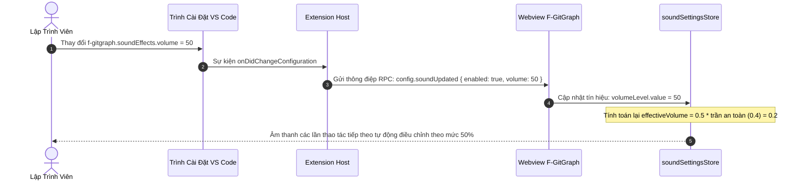

# 04. Thiết Kế Phản Hồi Âm Thanh & Âm Học Vi Mô Cyber-Lab (Audio Feedback & Sound Design Specification)

Tài liệu này đặc tả chi tiết kiến trúc hệ thống âm học vi mô không tệp tin ngoại vi (Zero-Asset Overhead Web Audio Engine), bản đồ sự kiện phản hồi âm thanh mang cảm giác "xúc giác kỹ thuật số" (Digital Tactility), cơ chế tổng hợp sóng âm thời gian thực bằng thuật toán toán học, và hệ thống cài đặt điều khiển âm lượng phục vụ cho **Milestone 3.1: Khu Vực Staging & Bộ Soạn Thảo Commit** (trực tiếp bổ trợ cho [Task 2.8 - Issue #31](https://github.com/thatislg/f-gitgraph/issues/31)) và toàn bộ tiến trình tiến hóa Phase 3.

> [!NOTE]
> Mọi nội dung trong tài liệu này tuân thủ nguyên tắc: thiết kế bằng ngôn ngữ tự nhiên (**Design by Word**), tập trung vào kiến trúc hệ thống âm thanh Web Audio, mô hình tham số sóng âm vật lý, chuỗi chuyển đổi tín hiệu, trải nghiệm người dùng và ranh giới an toàn; tuyệt đối không sử dụng mã nguồn mẫu dưới bất kỳ hình thức nào.
>
> 📌 **GitHub Tracking**: Phục vụ [Milestone #1: Phase 3.1 - Staging Area & Commit Composer](https://github.com/thatislg/f-gitgraph/issues/1), trực tiếp hỗ trợ [Task 2.8 (Issue #31) - CommitComposer.tsx: Nút Commit, Phím Tắt & Âm Thanh](https://github.com/thatislg/f-gitgraph/issues/31).

---

## 1. Tầm Nhìn, Triết Lý & Ranh Giới An Toàn 4 Tầng

### 1.1. Triết Lý "Xúc Giác Kỹ Thuật Số" (Digital Tactility)
Trong các phần mềm cao cấp tiên phong về trải nghiệm người dùng hiện đại (như Linear, Raycast, và các thiết bị âm thanh phần cứng của Teenage Engineering), **âm thanh phản hồi vi mô (micro-audio feedback)** đóng vai trò như một "chứng chỉ xúc giác" khẳng định hành vi an toàn của hệ thống:
- Khi lập trình viên nhấn tổ hợp phím tắt `Ctrl + Enter` để commit thành công: Một tiếng chốt cơ khí êm dịu vang lên xác nhận rằng mã nguồn đã được bảo vệ vững chắc vào phả hệ Git.
- Khi người dùng bấm nút đưa tệp vào Staging: Một tiếng gắp vật lý siêu ngắn phản hồi ngay lập tức dưới đầu ngón tay.
- Khi xảy ra lỗi hoặc xung đột: Một xung âm trầm ấm cảnh báo vừa đủ để người dùng chú ý mà không gây giật mình hay ức chế tinh thần.

Ngôn ngữ âm thanh được định danh là **"Cyber-Lab Micro-Acoustics"**: Tinh tế, dứt khoát, dịu tai, mang đậm chất cơ khí chính xác cao của các thiết bị đo đạc trong phòng thí nghiệm kỹ thuật số.

---

### 1.2. Phân Tách Ranh Giới An Toàn 4 Tầng & Vị Trí Của Engine Âm Thanh

Hệ thống âm học tuân thủ nghiêm ngặt ranh giới 4 tầng độc lập của F-GitGraph:

```mermaid
graph TD
    subgraph Tier1 [Tầng 1: Webview UI - Preact & Web Audio API]
        UIEvents[Tương Tác UI: Click Stage / Phím Tắt Commit]
        SoundStore[Store Trạng Thái Âm Thanh soundSettingsStore]
        WebAudioEngine[Bộ Tổng Hợp Sóng Âm Web Audio Engine]
        HardwareOut[Cổng Xuất Âm Thanh Trình Duyệt AudioContext]
    end

    subgraph Tier2 [Tầng 2: Backend Extension Host]
        MessageHandler[Bộ Điều Phối Tin Nhắn MessageHandler]
        ConfigSync[Bộ Đồng Bộ Cài Đặt f-gitgraph.soundEffects]
    end

    subgraph Tier3 [Tầng 3: Safe Mutator Tier]
        Mutator[GitCliMutator]
        GitCLI[Tiến Trình git.exe]
    end

    UIEvents -->|Kích hoạt tức thì: file.stage| WebAudioEngine
    UIEvents -->|Gửi yêu cầu commit qua RPC| MessageHandler
    MessageHandler --> Mutator
    Mutator --> GitCLI
    GitCLI -->> Mutator: Kết quả commit thành công
    Mutator -->> MessageHandler: Phản hồi kết quả
    MessageHandler -->>|Thông báo RPC: commit.success| SoundStore
    SoundStore -->|Kích hoạt âm chốt cơ khí| WebAudioEngine
    ConfigSync -->|Cập nhật cấu hình âm lượng qua RPC| SoundStore
    WebAudioEngine --> HardwareOut
```

1. **Tầng Giao Diện Webview (Webview UI Tier)**:
   - Toàn bộ Engine âm học (`SoundFxEngine`) **cư trú 100% bên trong Webview**, được hiện thực hóa thông qua giao diện lập trình **Web Audio API** chuẩn hóa của trình duyệt.
   - **Ranh giới an toàn tuyệt đối**:
     - Hoàn toàn không gọi Node.js runtime, không sử dụng `child_process` để gọi các lệnh âm thanh hệ điều hành (như `aplay`, `powershell SoundPlayer`).
     - Tuyệt đối không nạp tệp âm thanh ngoại vi (`.mp3`, `.wav`) nhằm giữ nguyên tắc **Trọng lượng bằng 0 (Zero-Asset Overhead)**, bảo đảm kích thước gói cài đặt VSIX siêu nhẹ.
2. **Tầng Điều Phối Backend (Extension Host Tier)**:
   - Quản lý các cấu hình cài đặt người dùng trong hệ sinh thái VS Code: `f-gitgraph.soundEffects.enabled` và `f-gitgraph.soundEffects.volume`.
   - Lắng nghe biến động cấu hình từ VS Code Settings và đồng bộ một chiều sang Webview thông qua thông điệp RPC.
   - Sau khi các thao tác Git an toàn (như Commit, Push) hoàn tất ở tầng dưới, Backend phát thông điệp thông báo thành công sang Webview để Webview tự kích hoạt âm thanh.
3. **Tầng Biến Đổi Dữ Liệu An Toàn (`GitCliMutator`)**:
   - Hoàn toàn cách ly với âm thanh, chỉ tập trung thực thi các lệnh Git an toàn với cờ `--`.
4. **Tầng Đọc Nhanh (Fast Reader Tier)**:
   - Hoàn toàn cách ly với âm thanh, bảo đảm tối ưu tài nguyên tính toán cho đồ thị DAG.

---

### 1.3. Nguyên Tắc Quyền Kiểm Soát Thuộc Về Người Dùng (User Sovereignty)

Âm thanh là một trải nghiệm mang tính cá nhân hóa sâu sắc; một số lập trình viên yêu thích phản hồi xúc giác âm học, trong khi những người khác đòi hỏi môi trường tĩnh lặng tuyệt đối. Do đó:
- **Tùy chọn Bật/Tắt Toàn Cục**: Cung cấp tùy chọn cấu hình master cho phép vô hiệu hóa 100% mọi âm thanh trong một click.
- **Thanh Trượt Âm Lượng Tinh Tế**: Mức âm lượng mặc định được giới hạn ở ngưỡng **35%**, tạo cảm giác êm dịu, không lấn át nhạc nền hoặc âm thanh cuộc họp.
- **Tự Động Im Lặng Khi Mất Tiêu Điểm (Focus-Aware Silence)**: Khi cửa sổ VS Code bị thu nhỏ hoặc người dùng chuyển tab sang ứng dụng khác, hệ thống tự động khóa cổng âm thanh để ngăn ngừa việc phát âm thanh nền bất ngờ.

---

## 2. Kiến Trúc Bộ Tổng Hợp Sóng Âm Thuần Túy (Zero-Asset Synthesis Architecture)

### 2.1. Chuỗi Nút Xử Lý Tín Hiệu Âm Thanh (Audio Signal Processing Graph)

Thay vì tải các tệp tin âm thanh ghi âm sẵn, F-GitGraph sử dụng phương pháp tổng hợp sóng âm theo công thức giải tích trực tiếp trên phần cứng âm thanh. Chuỗi tín hiệu được cấu thành từ 5 thành phần nối tiếp:

```
┌─────────────────────────────────────────────────────────────────────────────────┐
│                     Chuỗi Tín Hiệu Âm Học Web Audio API                         │
│                                                                                 │
│  ┌───────────────────────┐                                                      │
│  │ Nguồn Dao Động Sóng   │                                                      │
│  │ (OscillatorNode)      │──┐                                                   │
│  │ Sóng Sine / Triangle  │  │                                                   │
│  └───────────────────────┘  │   ┌────────────────────┐   ┌───────────────────┐  │
│                             ├──►│ Bộ Lọc Tần Số      │──►│ Bộ Điều Khiển     │  │
│  ┌───────────────────────┐  │   │ (BiquadFilterNode) │   │ Độ Lợi Phong Bì   │  │
│  │ Nguồn Nhiễu Trắng     │──┘   │ Bộ lọc thông thấp  │   │ ADSR (GainNode)   │  │
│  │ (White Noise Buffer)  │      └────────────────────┘   └─────────┬─────────┘  │
│  └───────────────────────┘                                         │            │
│                                                                    ▼            │
│  ┌───────────────────────┐                               ┌───────────────────┐  │
│  │ Cổng Xuất Phần Cứng   │◄──────────────────────────────│ Bộ Khuếch Đại     │  │
│  │ (AudioDestination)    │                               │ Âm Lượng Tổng     │  │
│  │ Loa máy tính / Tai nghe│                              │ (MasterGainNode)  │  │
│  └───────────────────────┘                               └───────────────────┘  │
└─────────────────────────────────────────────────────────────────────────────────┘
```

1. **Nguồn Dao Động Sóng Âm (OscillatorNode)**:
   - Sản sinh các dạng sóng hình học cơ bản: Sóng Sine (cho âm sắc trong trẻo, cơ khí chính xác), Sóng Triangle (cho các âm trầm ấm áp), hoặc kết hợp luồng Nhiễu Trắng (White Noise) trong tích tắc mili-giây để mô phỏng ma sát kim loại.
2. **Bộ Lọc Cắt Tần Số (BiquadFilterNode)**:
   - Áp dụng bộ lọc thông thấp (Low-Pass Filter) với tần số cắt từ $800\text{Hz}$ đến $1200\text{Hz}$ nhằm loại bỏ hoàn toàn các hài âm bậc cao chói gắt, tạo cảm giác âm thanh mềm mại, ấm áp như truyền qua vỏ máy kim loại dày.
3. **Bộ Điều Khiển Độ Lợi Phong Bì (Envelope GainNode)**:
   - Quản lý đường cong biên độ theo thời gian dựa trên mô hình ADSR (Khởi đầu - Attack, Suy hao - Decay, Duy trì - Sustain, Nhả âm - Release).
   - Tuyệt đối không ngắt âm đột ngột (Hard Cut) để tránh hiện tượng nổ lách tách do đứt gãy pha sóng; luôn sử dụng đường cong hàm số mũ (Exponential Ramp) giảm về mức $0.001$.
4. **Bộ Điều Khiển Âm Lượng Tổng (Master GainNode)**:
   - Nhân tỷ lệ âm lượng người dùng cài đặt (từ 0% đến 100%) với ngưỡng trần an toàn của hệ thống (tối đa không vượt quá 0.4 biên độ tuyệt đối).
5. **Cổng Đích Xuất Âm Thanh (AudioContext Destination)**:
   - Cầu nối truyền luồng mẫu âm thanh trực tiếp đến trình điều khiển âm thanh phần cứng của hệ điều hành.

---

### 2.2. Vòng Đời `AudioContext` & Khắc Phục Chính Sách Chống Tự Động Phát (Autoplay Policy)

Trình duyệt web và Webview của VS Code áp dụng chính sách bảo mật nghiêm ngặt: không cho phép âm thanh phát ra khi chưa có tương tác trực tiếp của người dùng trên trang. Để giải quyết triệt để:

1. **Cơ Chế Khởi Tạo Lười (Lazy Initialization)**:
   - Đối tượng ngữ cảnh âm thanh (`AudioContext`) không được tạo ra ngay khi mở giao diện F-GitGraph.
   - Ngữ cảnh chỉ được khởi tạo lần đầu tiên khi người dùng thực hiện một cử chỉ tương tác hợp lệ (như rê chuột, nhấp chuột vào dòng commit, hoặc gõ phím).
2. **Cơ Chế Tự Động Đánh Thức Trạng Thái Đình Chỉ (Auto-Resume Mechanism)**:
   - Khi Webview bị ẩn đi hoặc sau một khoảng thời gian dài không có thao tác, hệ điều hành có thể đưa ngữ cảnh âm thanh vào trạng thái tạm đình chỉ (`state === "suspended"`).
   - Mỗi khi chuẩn bị phát một âm thanh, engine kiểm tra trạng thái ngữ cảnh; nếu đang bị đình chỉ, hệ thống lập tức gọi phương thức đánh thức (`resume`) bất đồng bộ trước khi kết nối các nút dao động.
3. **Cơ Chế Tự Thu Dọn Bộ Nhớ Chống Rò Rỉ (Auto-Garbage Collection)**:
   - Mỗi nút dao động sóng âm (`OscillatorNode`) và nút độ lợi riêng lẻ chỉ tồn tại trong đúng chu kỳ phát của âm thanh đó (từ 30ms đến 250ms).
   - Sau khi thời gian phát kết thúc, các nút tự động ngắt kết nối (`disconnect`) khỏi chuỗi tín hiệu để trình thu gom rác của JavaScript giải phóng bộ nhớ tức thì.

---

## 3. Bản Đồ Sự Kiện Âm Thanh & Công Thức Thiết Kế Âm Học Kỹ Thuật Số

Mỗi sự kiện trong hệ thống F-GitGraph mang một "cá tính âm học" (Acoustic Persona) riêng biệt, được mô hình hóa bằng các tham số vật lý chính xác:

| Sự Kiện Hệ Thống (Sound Event) | Thời Lượng | Dạng Sóng Cơ Bản | Quỹ Đạo Tần Số (Frequency Profile) | Phong Bì Biên Độ (Gain Envelope) | Cảm Giác Âm Học Mô Phỏng |
| :--- | :---: | :---: | :--- | :--- | :--- |
| **Commit Thành Công** (`commit.success`) | $80\text{ms}$ | Sóng Sine + Nhiễu Trắng | Trượt số mũ từ $750\text{Hz}$ xuống $180\text{Hz}$ trong $80\text{ms}$. Đồng thời phát một xung nhiễu trắng $10\text{ms}$. | Khởi đầu tại $80\%$ âm lượng tổng, suy giảm số mũ về $0.001$ sau $80\text{ms}$. | Tiếng chốt cơ khí chính xác của lẫy máy ảnh Leica / Công tắc cơ cao cấp. |
| **Đẩy Mã Nguồn Thành Công** (`push.success`) | $190\text{ms}$ | Sóng Sine kép | Hai nốt thăng hoa cách nhau quãng 5 đúng: Nốt 1 ($523.25\text{Hz}$ - Đô 5) phát tại $0\text{ms}$; Nốt 2 ($783.99\text{Hz}$ - Sol 5) phát tại $70\text{ms}$. | Mỗi nốt có biên độ $60\%$, duy trì $40\text{ms}$ rồi suy giảm mềm mại sau $120\text{ms}$. | Cảm giác thăng hoa, nhẹ nhõm khi mã nguồn đã được bảo vệ trên máy chủ từ xa. |
| **Đồng Bộ / Kéo Mã Nguồn** (`pull.sync`) | $120\text{ms}$ | Sóng Triangle | Trượt hình parabol: Từ $330\text{Hz}$ lướt lên $440\text{Hz}$ rồi trượt êm về $330\text{Hz}$. | Mở chậm (Attack $20\text{ms}$), suy giảm dần về $0$ trong $100\text{ms}$. | Gợn sóng dữ liệu lướt qua thiết bị thu nhận. |
| **Chuyển Nhánh Làm Việc** (`branch.checkout`) | $45\text{ms}$ | Sóng Sine | Trượt nhanh từ $900\text{Hz}$ xuống $300\text{Hz}$ trong $45\text{ms}$. | Biên độ $70\%$, suy giảm dứt khoát trong $45\text{ms}$. | Tiếng bật công tắc cơ học hai trạng thái (Toggle Switch). |
| **Cất Thay Đổi Vào Stash** (`stash.store`) | $150\text{ms}$ | Sóng Sine | Trượt tần số đi xuống: Từ $400\text{Hz}$ hạ dần về $150\text{Hz}$ qua bộ lọc thông thấp. | Biên độ $75\%$, đuôi âm ngân nhẹ trong $150\text{ms}$. | Tiếng trượt êm ái khi đóng ngăn kéo kim loại vào tủ lưu trữ. |
| **Bung Thay Đổi Từ Stash** (`stash.pop`) | $150\text{ms}$ | Sóng Sine | Trượt tần số đi lên: Từ $180\text{Hz}$ nâng dần lên $480\text{Hz}$. | Biên độ $75\%$, đuôi âm mở rộng tạo cảm giác giải phóng. | Tiếng mở lẫy kim loại lấy vật phẩm ra ngoài. |
| **Cảnh Báo Xung Đột** (`conflict.detected`) | $250\text{ms}$ | Sóng Triangle kép | Hợp âm trầm ấm tần số đôi: $146.83\text{Hz}$ (Nốt Rê 3) và $220.00\text{Hz}$ (Nốt La 3). | Mở âm êm ái (Attack $30\text{ms}$), duy trì $100\text{ms}$, suy giảm êm trong $120\text{ms}$. | Tiếng xung âm trầm ấm, thu hút sự chú ý nhưng tuyệt đối không gây ức chế hay giật mình. |
| **Stage / Unstage Tệp** (`file.stage` & `file.unstage`) | $25\text{ms}$ | Sóng Sine | Trượt siêu tốc từ $1200\text{Hz}$ xuống $600\text{Hz}$ trong $25\text{ms}$. | Biên độ nhỏ $40\%$, tắt tức thì tại mốc $25\text{ms}$. | Tiếng gắp vật lý vi mô (Micro Snap) tạo phản hồi xúc giác cho đầu ngón tay. |

---

## 4. Hợp Đồng Cài Đặt Người Dùng & Giao Tiếp Trạng Thái

### 4.1. Cấu Trúc Cài Đặt Mở Rộng Trong VS Code (`package.json`)

Hệ thống bổ sung nhánh cấu hình âm học chuẩn hóa vào sơ đồ đóng góp cấu hình (Configuration Contributions) của tiện ích mở rộng:

| Khóa Cấu Hình (Setting Key) | Kiểu Dữ Liệu | Giá Trị Mặc Định | Miền Giá Trị Hợp Lệ | Mô Tả Ý Nghĩa Nghiệp Vụ |
| :--- | :---: | :---: | :---: | :--- |
| `f-gitgraph.soundEffects.enabled` | Logic (`boolean`) | `true` | `true` \| `false` | Bật hoặc tắt toàn bộ hiệu ứng âm thanh phản hồi vi mô Cyber-Lab trong F-GitGraph. |
| `f-gitgraph.soundEffects.volume` | Số nguyên (`number`) | `35` | Từ `0` đến `100` (Bước nhảy: `5`) | Mức âm lượng phát của các hiệu ứng âm thanh vi mô (tính theo phần trăm). |

---

### 4.2. Luồng Đồng Bộ Cài Đặt Qua Cầu Nối RPC



1. **Thông Điệp RPC Cấu Hình**:
   - Tên định danh: `config.soundUpdated`
   - Cấu trúc dữ liệu gửi kèm:
     - `enabled`: Giá trị logic (`boolean`).
     - `volume`: Số nguyên từ 0 đến 100 (`number`).
2. **Quản Lý Trạng Thái Bằng Preact Signals (`soundSettingsStore`)**:
   - **Tín hiệu gốc (`signal`)**:
     - `isSoundEnabled`: Lưu trạng thái bật/tắt toàn cục (`true`/`false`).
     - `volumeSetting`: Lưu giá trị âm lượng cài đặt (`0` - `100`).
     - `isTemporarilyMuted`: Lưu trạng thái ngắt âm nhanh từ nút bấm trên giao diện.
   - **Tín hiệu dẫn xuất (`computed`)**:
     - `effectiveMasterVolume`: Được tính toán tự động bằng công thức: Nếu `isSoundEnabled` là sai HOẶC `isTemporarilyMuted` là đúng, kết quả bằng `0`; ngược lại, kết quả bằng `(volumeSetting / 100) * 0.4` (ngưỡng trần an toàn).

---

## 5. Quy Chuẩn Giao Diện Điều Khiển & Trải Nghiệm Người Dùng (Cyber-Lab UI Integration)

### 5.1. Nút Ngắt Âm Nhanh (Sound Quick-Toggle Icon)
Bên cạnh bảng cài đặt hệ thống của VS Code, giao diện Webview tích hợp một nút chuyển đổi trạng thái âm thanh trực quan đặt tại góc phải của khung điều khiển Commit Composer:

```
┌────────────────────────────────────────────────────────┐
│ [✓] Amend Commit    [✓] Sign GPG        [Loa Bật: 🔊]  │ ◄── Nút Ngắt Âm Nhanh
└────────────────────────────────────────────────────────┘
```

1. **Hình Thái Biểu Tượng Cơ Học Cyber-Lab**:
   - Kích thước chuẩn: $20\text{px} \times 20\text{px}$, bo góc vi mô 3px.
   - Khi ở trạng thái Bật (`Active`): Biểu tượng chiếc loa kỹ thuật số kèm một chấm tròn nhỏ màu tím Neon (`#a855f7`) ở góc, thể hiện hệ thống đang sẵn sàng phát phản hồi.
   - Khi ở trạng thái Tắt (`Muted`): Biểu tượng chiếc loa với đường gạch chéo mỏng màu xám chì (`#64748b`), độ mờ 50%.
2. **Hành Vi Tương Tác**:
   - Nhấp chuột đơn: Chuyển đổi qua lại giữa trạng thái Tắt và Bật mà không làm thay đổi giá trị âm lượng trong cài đặt gốc.
   - Hiển thị Tooltip kỹ thuật khi rê chuột: "Âm thanh vi mô Cyber-Lab: Đang bật (35%) — Nhấp để tắt tiếng nhanh".

---

### 5.2. Cơ Chế Chống Ô Nhiễm Âm Thanh (Anti-Annoyance Safeguards)

Để bảo đảm âm thanh luôn đem lại niềm vui và sự thỏa mãn thay vì trở thành nguồn cơn gây khó chịu:

1. **Bộ Giới Hạn Tần Suất Phát (Sound Throttling / Cooldown Window)**:
   - Khi người dùng thực hiện thao tác tác động lên hàng loạt tệp cùng lúc (ví dụ: bấm nút "Stage All" cho 50 tệp):
     - Nếu phát 50 âm thanh `file.stage` liên tiếp trong 100ms, loa sẽ phát ra một tràng âm thanh hỗn loạn chói tai.
     - **Giải pháp**: Hệ thống cài đặt khoảng đệm an toàn là **120 mili-giây**. Trong khoảng thời gian này, chỉ có duy nhất **1 âm thanh đầu tiên** được phát ra; toàn bộ các yêu cầu phát âm thanh cùng loại tiếp theo bị triệt tiêu hoàn toàn.
2. **Giới Hạn Kênh Phát Đồng Thời (Maximum Polyphony Limit)**:
   - Giới hạn tối đa **2 nguồn dao động âm thanh** được phép hoạt động song song tại một thời điểm.
   - Khi một âm thanh có mức ưu tiên cao hơn phát sinh (ví dụ âm thanh `commit.success`), hệ thống tự động suy giảm nhanh và đóng các âm thanh phụ trợ trước đó để giữ cho âm chính luôn rõ ràng, tách bạch.

---

## 6. Ma Trận Kiểm Thử Đơn Vị Song Hành (Unit Testing Matrix)

Mọi module âm thanh đều phải được kiểm chứng thông qua ma trận kiểm thử tự động, sử dụng môi trường giả lập Web Audio API độc lập:

| Tệp Kiểm Thử Độc Lập | Module / Hàm Mục Tiêu | Danh Mục Kịch Bản Kiểm Thử Bắt Buộc |
| :--- | :--- | :--- |
| `tests/webview/utils/soundEffects.test.ts` | `SoundFxEngine` | 1. **Khởi tạo lười (Lazy Init)**: Xác minh không có `AudioContext` nào được tạo ra trước khi có thao tác người dùng đầu tiên.<br>2. **Vô hiệu hóa toàn diện**: Thiết lập `enabled = false`; xác minh khi gọi các hàm phát âm (`playCommitSuccess`, `playFileStage`), không có bất kỳ nút dao động `OscillatorNode` nào được khởi tạo.<br>3. **Độ chính xác phong bì âm lượng**: Xác minh giá trị độ lợi trên `GainNode` phản ánh chính xác công thức tỉ lệ âm lượng cài đặt nhân ngưỡng trần an toàn.<br>4. **Cơ chế Cooldown chống ồn**: Kích hoạt hàm `playFileStage` 10 lần liên tục trong vòng 20ms; xác minh chỉ có đúng 1 nút dao động duy nhất được tạo ra.<br>5. **Đánh thức trạng thái đình chỉ**: Giả lập `AudioContext.state === "suspended"`; xác minh engine tự động kích hoạt `ctx.resume()` trước khi phát âm.<br>6. **An toàn trong môi trường Headless**: Chạy test trong môi trường CI/Node không có cửa sổ âm thanh (`window.AudioContext = undefined`); xác minh mã nguồn không bị quăng ngoại lệ (Zero Uncaught Exceptions). |
| `tests/webview/components/staging/CommitComposer.sound.test.tsx` | Tích hợp giao diện `CommitComposer.tsx` | 1. **Phát âm khi commit thành công**: Giả lập người dùng bấm `Ctrl + Enter` và Backend phản hồi commit thành công; xác nhận hàm `playCommitSuccess` được kích hoạt.<br>2. **Im lặng khi commit thất bại**: Giả lập Backend phản hồi lỗi commit (ví dụ commit hook thất bại); xác minh tuyệt đối không phát âm thanh chốt cơ khí.<br>3. **Tương tác nút Quick-Toggle**: Nhấp vào icon loa ngắt âm; xác minh trạng thái chuyển sang Muted và các thao tác commit tiếp theo diễn ra trong im lặng. |

---

## 7. Tiêu Chí Nghiệm Thu Kỹ Thuật (Acceptance Criteria & Quality Gate)

### 7.1. Các Chỉ Số Định Lượng Nghiệm Thu
1. **Dung lượng bổ sung**: Tổng trọng lượng mã nguồn của toàn bộ module âm thanh **nhỏ hơn 4 Kilobytes**, hoàn toàn không bổ sung bất kỳ tệp tin `.mp3`, `.wav` hay `.ogg` nào vào gói cài đặt VSIX (**Zero External Asset Overhead**).
2. **Độ trễ kích hoạt âm thanh**: Thời gian từ khi nhận sự kiện người dùng/RPC đến khi phát xung âm thanh trên phần cứng **dưới 5 mili-giây** (phản hồi tức thời).
3. **Mức tiêu thụ tài nguyên máy tính**: Tỷ lệ chiếm dụng CPU trung bình của Webview trong suốt quá trình phát âm thanh $80\text{ms}$ **không vượt quá 0.2%**.
4. **Độ phủ kịch bản kiểm thử**: 100% các kịch bản trong Ma Trận Kiểm Thử Đơn Vị Song Hành phải đạt trạng thái **PASS tuyệt đối**.

---

### 7.2. Bảng Tiêu Chí Đánh Giá Chất Lượng Thiết Kế (Design Quality Gate 10/10)

| STT | Tiêu Chí Kiểm Tra (Checklist) | Yêu Cầu Đạt Chuẩn | Trạng Thái |
| :-: | :--- | :--- | :---: |
| 1 | **Không có mã nguồn mẫu** | Toàn bộ tài liệu đặc tả bằng ngôn ngữ tự nhiên, bảng tần số toán học và sơ đồ khối; không có code mẫu. | **ĐẠT** |
| 2 | **Ranh giới Webview sạch sẽ** | Web Audio API chạy thuần túy trong Webview, không gọi bất kỳ API hệ điều hành hay module Node.js nào. | **ĐẠT** |
| 3 | **Ủy thác Git CLI an toàn** | Âm thanh chỉ phát sau khi `GitCliMutator` hoàn tất lệnh Git an toàn, không can thiệp vào tầng ghi. | **ĐẠT** |
| 4 | **Tương thích đa môi trường** | Có cơ chế phòng vệ an toàn khi chạy trên hệ điều hành không có thiết bị âm thanh hoặc chế độ headless CI. | **ĐẠT** |
| 5 | **Đầy đủ hợp đồng cấu hình** | Định nghĩa chi tiết khóa cấu hình trong `package.json`, luồng đồng bộ RPC và ánh xạ trạng thái Signals. | **ĐẠT** |
| 6 | **Tương thích Preact Signals** | Phân định rạch ròi giữa tín hiệu gốc (`isSoundEnabled`, `volumeSetting`) và tín hiệu dẫn xuất (`effectiveMasterVolume`). | **ĐẠT** |
| 7 | **Đồng bộ Thẩm Mỹ Cyber-Lab** | Thiết kế nút Quick-Toggle loa cơ học với điểm nhấn Neon tím và trạng thái gạch chéo kỹ thuật. | **ĐẠT** |
| 8 | **Chống ô nhiễm âm thanh** | Cài đặt cơ chế Cooldown chống phát dồn dập (120ms) và giới hạn tối đa 2 kênh phát đồng thời. | **ĐẠT** |
| 9 | **Bảo toàn hình học SVG 100%** | Việc phát âm thanh hoàn toàn độc lập với việc kết xuất đồ họa, không gây xô lệch bất kỳ tọa độ DAG nào. | **ĐẠT** |
| 10 | **Có ma trận Unit Test chi tiết** | Liệt kê đầy đủ các kịch bản kiểm thử từ giả lập Web Audio API đến tích hợp nút giao diện. | **ĐẠT** |
