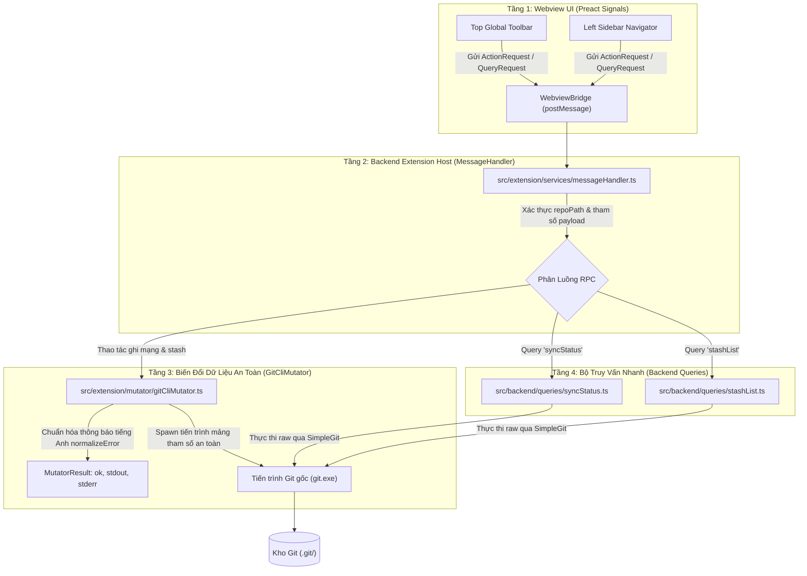

# 05. Thiết Kế Chi Tiết Tầng Backend Mutator Đồng Bộ, Quản Lý Stash & Hợp Đồng RPC

Tài liệu này đặc tả chi tiết kiến trúc tầng Backend, quy trình mở rộng bộ điều phối `GitCliMutator`, thuật toán phân tích cú pháp hai bộ truy vấn trạng thái đồng bộ (`syncStatus`) và ngăn xếp lưu trữ tạm (`stashList`), quy chuẩn chuẩn hóa lỗi ngoại lệ mạng/xung đột, cùng hệ thống hợp đồng dữ liệu RPC phục vụ cho **Phase 3.2: Nhóm Việc 1 — Mở Rộng Backend Mutator, Bộ Truy Vấn & Hợp Đồng RPC (Contract-First)**.

> [!NOTE]
> Mọi nội dung trong tài liệu này tuân thủ nguyên tắc: thiết kế và đặc tả bằng ngôn ngữ tự nhiên (**Design by Word**), tập trung vào phân tích kiến trúc hệ thống, giải thuật phân tách luồng byte, ranh giới an toàn 4 tầng, hợp đồng I/O từ điển dữ liệu; **tuyệt đối không sử dụng mã nguồn mẫu hoặc khối code block dưới bất kỳ hình thức nào**.
>
> Toàn bộ thông báo lỗi và giao diện người dùng (UI) **sử dụng tiếng Anh chuẩn mực làm ngôn ngữ chính thức**. Phần giải nghĩa tiếng Việt trong tài liệu đóng vai trò tham khảo kỹ thuật.
>
> 📌 **Truy vết tiến độ**: [Phase 3.2 Tiến Độ (Nhóm Việc 1)](../../03_progess/phase3/002_phase3_2_3pane_workspace.md#nhóm-việc-1-mở-rộng-backend-mutator-bộ-truy-vấn--hợp-đồng-rpc-contract-first).

---

## 1. Tầm Nhìn, Mục Tiêu & Ranh Giới An Toàn Dữ Liệu 4 Tầng

### 1.1. Mục Tiêu Cốt Lõi
1. **Nền tảng mạng độc lập và toàn vẹn**: Cho phép F-GitGraph thực thi đầy đủ các tác vụ mạng Git cốt lõi (`fetch`, `pull`, `push`) ngay trong Webview mà không làm gián đoạn luồng hiển thị đồ thị và không phụ thuộc vào terminal ngoài.
2. **Quản lý ngăn xếp lưu trữ tạm (Stash Management)**: Cung cấp khả năng lưu nhanh (Save), khôi phục (Pop), xóa (Drop) các biến động mã nguồn, bảo vệ cả tệp untracked.
3. **Bộ đếm lệch đồng bộ siêu tốc (High-Performance Ahead/Behind Counter)**: Tính toán số lượng commit chênh lệch giữa Local Branch và Upstream Branch với thời gian thực thi dưới 50ms, cung cấp dữ liệu tức thời cho các huy hiệu Neon trên Top Toolbar và Sidebar.
4. **Chuẩn hóa thông báo lỗi tiếng Anh chuẩn mực (Standard English Error Normalization)**: Biến đổi các thông báo lỗi thô từ tiến trình Git (mất mạng, từ chối SSH key, non-fast-forward, xung đột merge/rebase) thành các thông báo tiếng Anh rõ ràng, có hướng dẫn thao tác cụ thể cho người dùng.

### 1.2. Phân Tách Ranh Giới An Toàn 4 Tầng (4-Tier Safety Boundary)

### 1.3. Các Nguyên Tắc An Toàn Bắt Buộc
- **Bảo toàn cơ chế xác thực gốc**: Toàn bộ thao tác kết nối máy chủ từ xa (Remote) phải ủy thác 100% cho tiến trình Git CLI gốc của hệ điều hành. Điều này bảo đảm tự động kế thừa:
  - Trình quản lý chứng thực cá nhân (Git Credential Manager trên Windows / Keychain trên macOS / Secret Service trên Linux).
  - Trình quản lý khóa SSH (SSH Agent, khóa SSH mặc định).
  - Chữ ký số GPG/SSH và các bộ móc nối mạng tự động (pre-push hooks).
- **Kế thừa đường dẫn Git tùy chỉnh (`gitPath`)**: Toàn bộ các lệnh đọc và ghi bắt buộc phải kế thừa `gitPath` được cấu hình từ cài đặt người dùng (thông qua `GitCliMutator` và thực thể `SimpleGit` từ `gitClientFactory`). Tuyệt đối không gọi lệnh `"git"` mặc định tự phát để bảo đảm hoạt động chính xác trên môi trường Git Portable hoặc thư mục cài đặt tùy biến.
- **Ngăn chặn triệt để Command Injection**: Mọi lệnh Git thực thi bắt buộc truyền dưới dạng danh sách mảng chuỗi (String Array Arguments) trong phương thức `run` của Mutator hoặc `git.raw` của SimpleGit. Tuyệt đối không dùng `child_process.exec` hoặc nối chuỗi thô vào shell.
- **Bảo vệ nhánh remote bằng cờ `--force-with-lease`**: Trong tùy chọn ép đẩy (Force Push), bắt buộc sử dụng `--force-with-lease` thay cho cờ `--force` trần tục để ngăn chặn ghi đè commit của đồng nghiệp trong trường hợp remote branch đã có commit mới mà máy cục bộ chưa cập nhật.
- **Cách ly môi trường Webview (Zero Node.js Runtime in Webview)**: Tầng hợp đồng dữ liệu RPC (`src/types/`) phải định nghĩa kiểu trả về của các truy vấn một cách độc lập; tầng Webview tuyệt đối không được nhập khẩu (import) bất kỳ kiểu dữ liệu hay module nào kéo theo thư viện Node.js (`child_process`, `Buffer`).

---

## 2. Đặc Tả Chi Tiết Input / Output & Các Bước Xử Lý Của Bộ Lệnh Ghi (`GitCliMutator.ts`)

Mọi phương thức ghi trong `GitCliMutator` bắt buộc tuân thủ chuẩn giao diện hộp đen: nhận tham số đầu vào được kiểm định chặt chẽ, trả về kết quả chuẩn hóa `Promise<MutatorResult>`, và thực thi tuần tự theo các bước xử lý logic rõ ràng.

### Bảng Từ Điển Dữ Liệu Đối Tượng Trả Về Chung (`MutatorResult`):

| Tên Trường | Kiểu Dữ Liệu | Mô Tả Ý Nghĩa |
| :--- | :--- | :--- |
| `ok` | boolean | Trạng thái thực thi: `true` nếu lệnh thành công (exitCode = 0); `false` nếu lệnh thất bại hoặc phát sinh xung đột. |
| `exitCode` | number \| null | Mã thoát của tiến trình (0 khi thành công, số nguyên dương khi thất bại, `null` nếu tiến trình không thể khởi chạy). |
| `stdout` | string | Toàn bộ dữ liệu xuất ra luồng chuẩn (Standard Output) từ tiến trình Git. |
| `stderr` | string | Toàn bộ dữ liệu lỗi (Standard Error) từ Git, đã được chuẩn hóa thành tiếng Anh thân thiện nếu `ok === false`. |

---

### 2.1. Phương Thức `fetchAll`

- **Chữ Ký Hàm**: `fetchAll(prune?: boolean): Promise<MutatorResult>`
- **Đặc Tả Đầu Vào (Input)**:
  - Tham số `prune`: Kiểu boolean, tùy chọn, giá trị mặc định là `true`.
  - Ý nghĩa: Khi bật `true`, Git tự động loại bỏ các nhánh theo dõi từ xa (remote tracking branches) đã bị xóa trên máy chủ remote. Khi `false`, chỉ tải commit/branch mới về mà không xóa nhánh cũ.
- **Đặc Tả Đầu Ra (Output)**:
  - Khi thành công (`ok = true`): `exitCode = 0`, `stdout` chứa báo cáo danh sách branch/tag được nạp về.
  - Khi thất bại (`ok = false`): `exitCode != 0`, `stderr` chứa thông báo lỗi tiếng Anh đã qua chuẩn hóa (ví dụ lỗi mất mạng, không thể kết nối remote).
- **Quy Trình Các Bước Xử Lý Cụ Thể**:
  1. *Bước 1 (Chuẩn bị tham số)*: Khởi tạo mảng tham số gồm hai phần tử `fetch` và `--all`. Nếu `prune === true`, bổ sung thêm cờ `--prune` vào cuối mảng.
  2. *Bước 2 (Thực thi tiến trình)*: Gọi phương thức nội bộ `this.run(args)` để khởi chạy tiến trình `git` trong thư mục kho làm việc hiện tại (`this.options.repoPath`).
  3. *Bước 3 (Chuẩn hóa kết quả)*: Đưa đối tượng kết quả qua phương thức `this.normalizeError(result)` để nhận diện và chuyển đổi thông báo lỗi mạng sang tiếng Anh chuẩn mực nếu có.
  4. *Bước 4 (Trả kết quả)*: Trả về đối tượng `MutatorResult` đã chuẩn hóa.
- **Trường Hợp Biên & Ngoại Lệ**:
  - Khi kho chưa cấu hình bất kỳ remote nào: Git CLI in thông báo rỗng hoặc cảnh báo nhẹ và thoát với mã 0 $\rightarrow$ Phương thức trả về `ok = true`.
  - Khi mất kết nối mạng: Chuẩn hóa thành thông báo: *"Unable to connect to the remote Git server. Please check your internet connection or remote URL."*

---

### 2.2. Phương Thức `pull`

- **Chữ Ký Hàm**: `pull(mode: 'merge' | 'rebase'): Promise<MutatorResult>`
- **Đặc Tả Đầu Vào (Input)**:
  - Tham số `mode`: Kiểu chuỗi ký tự bắt buộc, chỉ nhận một trong hai giá trị cố định: `"merge"` hoặc `"rebase"`.
  - Ý nghĩa: `"merge"` kích hoạt chiến lược tích hợp bằng merge commit hoặc fast-forward; `"rebase"` kích hoạt chiến lược tái lập lịch sử commit cục bộ nối tiếp lên đỉnh remote branch.
- **Đặc Tả Đầu Ra (Output)**:
  - Khi thành công (`ok = true`): `exitCode = 0`, `stdout` chứa báo cáo cập nhật fast-forward hoặc `"Already up to date."`.
  - Khi thất bại hoặc xung đột (`ok = false`): `exitCode != 0`, `stderr` chứa thông báo tiếng Anh chuẩn hóa về xung đột hoặc lỗi đè tệp chưa commit.
- **Quy Trình Các Bước Xử Lý Cụ Thể**:
  1. *Bước 1 (Xác định cờ lệnh)*:
     - Nếu `mode === "rebase"`: Tạo mảng tham số gồm `pull` và `--rebase`.
     - Nếu `mode === "merge"`: Tạo mảng tham số gồm `pull` và `--no-rebase` (bắt buộc truyền `--no-rebase` để ghi đè trường hợp cấu hình người dùng đặt `pull.rebase = true`).
  2. *Bước 2 (Thực thi tiến trình)*: Gọi `this.run(args)`.
  3. *Bước 3 (Kiểm tra xung đột)*:
     - Nếu tiến trình trả về mã thoát khác 0:
       - Kiểm tra nếu `stdout` hoặc `stderr` chứa từ khóa `CONFLICT`: Xác nhận xảy ra xung đột mã nguồn. Git đã dừng lại ở trạng thái xung đột để người dùng xử lý. Gán `result.stderr` bằng thông điệp tiếng Anh: *"Merge conflict detected. Please resolve conflicts in your working tree."* (nếu merge) hoặc *"Rebase conflict detected. Please resolve conflicts or abort the rebase."* (nếu rebase).
       - Kiểm tra nếu chứa mẫu chuỗi `Your local changes to the following files would be overwritten`: Gán thông điệp: *"Your local changes would be overwritten by pull. Please commit or stash your changes before pulling."*
  4. *Bước 4 (Chuẩn hóa & Trả kết quả)*: Gọi `this.normalizeError(result)` và trả về.
- **Trường Hợp Biên & Ngoại Lệ**:
  - Tuyệt đối không tự động kích hoạt `git merge --abort` hay `git rebase --abort` khi có xung đột, nhằm bảo tồn trạng thái tệp xung đột cho Webview hiển thị.

---

### 2.3. Phương Thức `push`

- **Chữ Ký Hàm**: `push(options?: PushOptions): Promise<MutatorResult>`
- **Đặc Tả Đầu Vào (Input)**:
  - Tham số `options`: Đối tượng tùy chọn, có cấu trúc chi tiết như bảng sau:

| Tên Thuộc Tính | Kiểu Dữ Liệu | Bắt Buộc? | Mặc Định | Mô Tả Ý Nghĩa |
| :--- | :--- | :---: | :---: | :--- |
| `forceWithLease` | boolean | Không | `false` | Bật cờ `--force-with-lease` ép đẩy an toàn |
| `remote` | string | Không | `undefined` | Tên remote đích (ví dụ `"origin"`) |
| `branch` | string | Không | `undefined` | Tên nhánh đích (ví dụ `"main"`) |
| `setUpstream` | boolean | Không | `false` | Bật cờ `-u` (`--set-upstream`) khi nhánh chưa liên kết |

- **Đặc Tả Đầu Ra (Output)**:
  - Khi thành công (`ok = true`): `exitCode = 0`, `stdout`/`stderr` chứa báo cáo cập nhật ref từ Git.
  - Khi thất bại (`ok = false`): `exitCode != 0`, `stderr` chứa thông báo tiếng Anh chuẩn hóa về lỗi từ chối đẩy (non-fast-forward rejected) hoặc lỗi quyền truy cập.
- **Quy Trình Các Bước Xử Lý Cụ Thể**:
  1. *Bước 1 (Khởi tạo mảng tham số)*: Bắt đầu với mảng chứa một phần tử duy nhất `push`.
  2. *Bước 2 (Ghép cờ an toàn & upstream)*:
     - Nếu `options.forceWithLease === true`: Thêm phần tử `"--force-with-lease"`.
     - Nếu `options.setUpstream === true`: Thêm phần tử `"-u"`.
  3. *Bước 3 (Xác thực refname)*:
     - Nếu có truyền cả `remote` và `branch`:
       - Gọi `this.isValidRefName(options.branch, "branch")`. Nếu không hợp lệ, dừng ngay và trả về `{ ok: false, exitCode: null, stdout: "", stderr: "Invalid branch name: " + options.branch }`.
       - Thêm `options.remote` và `options.branch` vào mảng tham số.
     - Nếu không truyền remote/branch: Giữ nguyên lệnh `git push` để Git tự đẩy nhánh hiện tại theo cấu hình mặc định.
  4. *Bước 4 (Thực thi & Chuẩn hóa)*:
     - Gọi `this.run(args)`.
     - Chuyển qua `this.normalizeError(result)`.
     - Nếu phát hiện lỗi `[rejected]` (non-fast-forward): Gán thông điệp: *"Push rejected: the remote branch contains work that you do not have locally. Please pull before pushing."*
  5. *Bước 5 (Trả kết quả)*: Trả về đối tượng `MutatorResult`.

---

### 2.4. Phương Thức `stashSave`

- **Chữ Ký Hàm**: `stashSave(message?: string, includeUntracked?: boolean): Promise<MutatorResult>`
- **Đặc Tả Đầu Vào (Input)**:
  - Tham số `message`: Kiểu chuỗi ký tự, tùy chọn. Nội dung thông điệp mô tả bản stash.
  - Tham số `includeUntracked`: Kiểu boolean, tùy chọn, mặc định `false`. Khi bật `true`, lưu cả các tệp mới tạo chưa được theo dõi.
- **Đặc Tả Đầu Ra (Output)**:
  - Khi thành công (`ok = true`): `exitCode = 0`, `stdout` chứa xác nhận lưu stash hoặc `"No local changes to save"`.
  - Khi thất bại (`ok = false`): `exitCode != 0`, `stderr` chứa thông báo lỗi.
- **Quy Trình Các Bước Xử Lý Cụ Thể**:
  1. *Bước 1 (Tạo mảng tham số gốc)*: Khởi tạo mảng chứa `stash` và `push`.
  2. *Bước 2 (Thêm cờ untracked)*: Nếu `includeUntracked === true`, thêm cờ `"-u"`.
  3. *Bước 3 (Thêm thông điệp mô tả)*: Nếu `message` tồn tại và sau khi cắt khoảng trắng có độ dài lớn hơn 0, thêm cờ `"-m"` và giá trị chuỗi đã cắt khoảng trắng.
  4. *Bước 4 (Ký tự phân cách an toàn)*: Bổ sung phần tử `"--"` vào cuối mảng tham số.
  5. *Bước 5 (Thực thi)*: Gọi `this.run(args)`. Nếu Git trả về `No local changes to save` với mã thoát 0, vẫn ghi nhận `ok = true`. Chuyển tiếp qua `this.normalizeError(result)` và trả về.

---

### 2.5. Phương Thức `stashPop`

- **Chữ Ký Hàm**: `stashPop(index?: number): Promise<MutatorResult>`
- **Đặc Tả Đầu Vào (Input)**:
  - Tham số `index`: Kiểu số nguyên, tùy chọn, mặc định `0`.
  - Ràng buộc: Bắt buộc là số nguyên không âm ($\ge 0$). Nếu truyền giá trị không hợp lệ, tự động làm tròn xuống và ép về cận dưới bằng 0 qua công thức: `Math.max(0, Math.floor(index))`.
- **Đặc Tả Đầu Ra (Output)**:
  - Khi thành công (`ok = true`): `exitCode = 0`, `stdout` chứa danh sách tệp được khôi phục và dòng xác nhận xóa bản stash khỏi ngăn xếp.
  - Khi thất bại / xung đột (`ok = false`): `exitCode != 0`, `stderr` chứa thông báo lỗi tiếng Anh chuẩn hóa.
- **Quy Trình Các Bước Xử Lý Cụ Thể**:
  1. *Bước 1 (Chuẩn hóa selector)*: Tạo chuỗi định danh bản stash mục tiêu: `"stash@{" + validIndex + "}"`.
  2. *Bước 2 (Thực thi)*: Gọi `this.run(["stash", "pop", targetStash])`.
  3. *Bước 3 (Bắt lỗi chuyên biệt)*:
     - Nếu lỗi chứa chuỗi `is not a stash-like commit`: Gán thông báo tiếng Anh: *"Stash entry 'stash@{" + validIndex + "}' does not exist or has already been dropped."*
     - Nếu phát hiện `CONFLICT`: Gán thông báo: *"Conflict encountered while applying stash. Stash entry was preserved."*
  4. *Bước 4 (Chuẩn hóa & Trả kết quả)*: Gọi `this.normalizeError(result)` và trả về.

---

### 2.6. Phương Thức `stashDrop`

- **Chữ Ký Hàm**: `stashDrop(index?: number): Promise<MutatorResult>`
- **Đặc Tả Đầu Vào (Input)**:
  - Tham số `index`: Kiểu số nguyên, tùy chọn, mặc định `0`, ràng buộc $\ge 0$.
- **Đặc Tả Đầu Ra (Output)**:
  - Khi thành công (`ok = true`): `exitCode = 0`, `stdout` chứa xác nhận đã xóa bản stash.
  - Khi thất bại (`ok = false`): `exitCode != 0`, `stderr` chứa thông báo lỗi bản stash không tồn tại.
- **Quy Trình Các Bước Xử Lý Cụ Thể**:
  1. *Bước 1 (Chuẩn hóa selector)*: Tạo chuỗi `"stash@{" + validIndex + "}"`.
  2. *Bước 2 (Thực thi)*: Gọi `this.run(["stash", "drop", targetStash])`.
  3. *Bước 3 (Chuẩn hóa)*: Gọi `this.normalizeError(result)` và trả về kết quả.

---

## 3. Đặc Tả Chi Tiết Input / Output & Các Bước Xử Lý Của Bộ Truy Vấn Nhanh (Backend Queries)

### 3.1. Truy Vấn `getSyncStatus`

- **Chữ Ký Hàm**: `getSyncStatus(git: SimpleGit): Promise<SyncStatusResult>`
- **Đặc Tả Đầu Vào (Input)**:
  - Tham số `git`: Thực thể `SimpleGit` (thu được từ `gitClient.getInstance()`), đã được đóng gói sẵn đường dẫn kho hiện tại `baseDir` và đường dẫn nhị phân `binary: gitPath`.
- **Đặc Tả Đầu Ra (Output)**:
  - Trả về đối tượng `SyncStatusResult` (được định nghĩa trực tiếp tại `src/types/queries.ts` theo nguyên tắc Contract-First).

#### Bảng Từ Điển Dữ Liệu Đối Tượng Trả Về (`SyncStatusResult`):

| Tên Thuộc Tính | Kiểu Dữ Liệu | Ràng Buộc / Miền Giá Trị | Mô Tả Ý Nghĩa |
| :--- | :--- | :---: | :--- |
| `ahead` | number | Số nguyên $\ge 0$ | Số lượng commit cục bộ đã tạo nhưng chưa đẩy lên remote |
| `behind` | number | Số nguyên $\ge 0$ | Số lượng commit mới trên remote mà máy cục bộ chưa kéo về |
| `upstream` | string \| null | Chuỗi ref hoặc `null` | Tên nhánh remote tracking tương ứng (ví dụ `"origin/main"`) |
| `isDetached` | boolean | `true` hoặc `false` | Đánh dấu kho có đang ở trạng thái Detached HEAD hay không |

#### Quy Trình Xử Lý Thuật Toán 3 Bước Chi Tiết:

1. **Bước 1 (Kiểm tra trạng thái Detached HEAD)**:
   - Thực thi lệnh raw qua `git.raw(["rev-parse", "--abbrev-ref", "HEAD"])`.
   - Nếu lệnh bị lỗi (Promise reject) hoặc chuỗi kết quả cắt khoảng trắng bằng đúng `"HEAD"`:
     - Kết luận: Kho đang ở trạng thái Detached HEAD.
     - Trả về đối tượng: `{ isDetached: true, upstream: null, ahead: 0, behind: 0 }`.
2. **Bước 2 (Xác định Upstream Tracking Branch)**:
   - Thực thi lệnh raw qua `git.raw(["rev-parse", "--abbrev-ref", "--symbolic-full-name", "@{u}"])`.
   - Nếu lệnh trả về lỗi ngoại lệ (thường gặp khi mã thoát 128 do nhánh chưa thiết lập upstream hoặc chưa chạy `git push -u`):
     - Bắt lỗi an toàn, không ném exception ra ngoài. Kết luận: Nhánh chưa liên kết remote.
     - Trả về đối tượng: `{ isDetached: false, upstream: null, ahead: 0, behind: 0 }`.
   - Nếu thành công:
     - Lấy chuỗi kết quả cắt khoảng trắng: `upstreamName = stdout.trim()` (ví dụ `"origin/main"`).
3. **Bước 3 (Đếm số lượng commit chênh lệch hai chiều)**:
   - Thực thi lệnh raw qua `git.raw(["rev-list", "--left-right", "--count", "HEAD...@{u}"])`.
   - Nếu lệnh thành công:
     - Đọc chuỗi `stdout` có định dạng `<left>\t<right>\n`.
     - Cắt khoảng trắng chuỗi đầu ra.
     - Tách chuỗi thành mảng các token bằng ký tự tab `\t` (hoặc khoảng trắng `\s+` nếu không có tab).
     - Bóc tách chỉ số bên trái thành số nguyên: `aheadCount = parseInt(tokens[0], 10)` (nếu không hợp lệ gán bằng 0).
     - Bóc tách chỉ số bên phải thành số nguyên: `behindCount = parseInt(tokens[1], 10)` (nếu không hợp lệ gán bằng 0).
     - Trả về: `{ isDetached: false, upstream: upstreamName, ahead: aheadCount, behind: behindCount }`.
   - Nếu lệnh `rev-list` thất bại bất thường:
     - Fallback an toàn: Trả về `{ isDetached: false, upstream: upstreamName, ahead: 0, behind: 0 }`.

---

### 3.2. Truy Vấn `getStashList`

- **Chữ Ký Hàm**: `getStashList(git: SimpleGit): Promise<StashListResult>`
- **Đặc Tả Đầu Vào (Input)**:
  - Tham số `git`: Thực thể `SimpleGit` (thu được từ `gitClient.getInstance()`).
- **Đặc Tả Đầu Ra (Output)**:
  - Trả về đối tượng `StashListResult` (được định nghĩa trực tiếp tại `src/types/queries.ts`).

#### Bảng Từ Điển Dữ Liệu Đối Tượng Bản Ghi Stash (`StashRecord`):

| Tên Thuộc Tính | Kiểu Dữ Liệu | Ràng Buộc | Mô Tả Ý Nghĩa |
| :--- | :--- | :---: | :--- |
| `index` | number | Số nguyên $\ge 0$ | Chỉ số thứ tự của bản stash trong ngăn xếp (0 là mới nhất) |
| `hash` | string | Chuỗi Hex 7 ký tự | Mã băm commit rút gọn đại diện cho bản stash |
| `message` | string | Chuỗi UTF-8 | Tiêu đề thông điệp tóm tắt của bản stash |
| `date` | string | Chuỗi thời gian | Thời gian tạo tương đối (ví dụ `"10 minutes ago"`) |

#### Bảng Đối Tượng Kết Quả (`StashListResult`):

| Tên Thuộc Tính | Kiểu Dữ Liệu | Mô Tả Ý Nghĩa |
| :--- | :--- | :--- |
| `stashes` | Mảng các đối tượng `StashRecord` | Danh sách toàn bộ các bản lưu trữ tạm sắp xếp từ mới nhất đến cũ nhất |

#### Quy Trình Xử Lý Thuật Toán Bóc Tách Byte NUL Chi Tiết:

1. **Bước 1 (Thực thi lệnh Git)**:
   - Thực thi lệnh raw qua `git.raw(["stash", "list", "--pretty=format:%gd%x00%h%x00%gs%x00%cr"])`.
2. **Bước 2 (Kiểm tra dữ liệu rỗng)**:
   - Nếu lệnh ném ngoại lệ hoặc chuỗi `stdout` cắt khoảng trắng là rỗng:
     - Trả về ngay đối tượng rỗng: `{ stashes: [] }`.
3. **Bước 3 (Bóc tách từng dòng qua byte NUL)**:
   - Khởi tạo mảng kết quả: `stashes = []`.
   - Tách chuỗi `stdout` thành mảng các dòng bằng ký tự ngắt dòng `\n`.
   - Lặp qua từng dòng (bỏ qua các dòng rỗng):
     - Tách dòng hiện tại thành mảng các token phân cách bởi byte NUL (`\0`).
     - *Trích xuất chỉ số index*: Đọc `tokens[0]` (có dạng `stash@{N}`). Sử dụng biểu thức chính quy `^stash@\{(\d+)\}$`. Nếu khớp, ép kiểu `parseInt(match[1], 10)`; nếu không khớp, sử dụng chỉ số vòng lặp hiện tại.
     - *Trích xuất mã hash*: Đọc `tokens[1]`, cắt khoảng trắng đầu cuối.
     - *Trích xuất thông điệp message*: Đọc `tokens[2]`, cắt khoảng trắng đầu cuối (bảo toàn nguyên vẹn Unicode tiếng Việt).
     - *Trích xuất thời gian date*: Đọc `tokens[3]`, cắt khoảng trắng đầu cuối.
     - Tạo đối tượng `StashRecord` và đẩy vào mảng `stashes`.
4. **Bước 4 (Trả kết quả)**:
   - Trả về đối tượng `{ stashes }`.

---

## 4. Bảng Chuẩn Hóa Lỗi & Ngoại Lệ (Error Normalization Matrix)

Toàn bộ thông báo lỗi trả về cho tầng Giao diện Webview **bắt buộc sử dụng tiếng Anh chuẩn mực làm ngôn ngữ chính thức**. Bảng đối chiếu quy tắc nhận diện chuỗi và câu thông báo chuẩn hóa:

| STT | Chuỗi Nhận Diện Trong `stderr` / `stdout` Của Git | Thông Báo Chuẩn Hóa Tiếng Anh Trả Về UI (Official UI Error) | Giải Thích Nghiệp Vụ (Tham Khảo Kỹ Thuật) |
| :-: | :--- | :--- | :--- |
| 1 | `Could not resolve host` / `Failed to connect` / `Network is unreachable` | *"Unable to connect to the remote Git server. Please check your internet connection or remote URL."* | Lỗi mất mạng Internet hoặc sai địa chỉ máy chủ remote. |
| 2 | `Permission denied (publickey)` / `Authentication failed` / `Invalid username or password` | *"Git authentication failed. Please verify your SSH key or Personal Access Token."* | Lỗi sai thông tin đăng nhập hoặc SSH key bị máy chủ từ chối. |
| 3 | `[rejected]` ... `(non-fast-forward)` / `Updates were rejected because the remote contains work` | *"Push rejected: the remote branch contains work that you do not have locally. Please pull before pushing."* | Lỗi remote đã có commit mới hơn, bắt buộc pull về trước. |
| 4 | `CONFLICT (content): Merge conflict in` / `Automatic merge failed; fix conflicts` | *"Merge conflict detected. Please resolve conflicts in your working tree."* | Xung đột nội dung tệp khi chạy lệnh Pull ở chế độ Merge. |
| 5 | `error: could not apply` / `Resolve all conflicts manually` | *"Rebase conflict detected. Please resolve conflicts or abort the rebase."* | Xung đột nội dung tệp khi chạy lệnh Pull ở chế độ Rebase. |
| 6 | `error: Your local changes to the following files would be overwritten by merge` | *"Your local changes would be overwritten by pull. Please commit or stash your changes before pulling."* | Có tệp chưa commit bị trùng với tệp pull về. |
| 7 | `fatal: 'stash@{` ... `}' is not a stash-like commit` | *"The specified stash entry does not exist or has already been dropped."* | Chỉ số stash yêu cầu pop hoặc drop không tồn tại trong ngăn xếp. |
| 8 | `Another git process seems to be running` / `index.lock': File exists` | *"The repository is locked by another Git process. Please wait a few seconds or check your terminal."* | Xung đột tệp khóa `.git/index.lock` do tiến trình Git khác đang chạy. |

---

## 5. Hợp Đồng Từ Điển Dữ Liệu & Giao Thức RPC

Hợp đồng dữ liệu giao tiếp giữa Webview và Extension Host được đặc tả chi tiết dưới dạng bảng từ điển dữ liệu (Data Dictionary Tables):

### 5.1. Bảng Đặc Tả Hợp Đồng Action Requests (`src/types/actions.ts`)

| Tên Action | Danh Sách Thuộc Tính Payload | Kiểu Dữ Liệu | Bắt Buộc? | Quy Tắc Kiểm Định (Validation) & Mô Tả |
| :--- | :--- | :--- | :---: | :--- |
| **`fetchAll`** | `prune` | boolean | Có | Bắt buộc kiểu boolean. Khi `true`, dọn dẹp các tracking branch đã bị xóa trên remote. |
| **`pull`** | `mode` | string | Có | Chỉ chấp nhận giá trị chuỗi `"merge"` hoặc `"rebase"`. |
| **`push`** | `forceWithLease` `remote` `branch` `setUpstream` | boolean string string boolean | Không Không Không Không | Tùy chọn ép đẩy an toàn; tên remote và branch đích; cờ đặt upstream `-u`. |
| **`stashSave`** | `message` `includeUntracked` | string boolean | Không Có | Nội dung mô tả bản stash; cờ bắt buộc xác định có lưu tệp untracked hay không. |
| **`stashPop`** | `index` | number | Có | Số nguyên không âm ($\ge 0$) chỉ định vị trí bản stash cần khôi phục. |
| **`stashDrop`** | `index` | number | Có | Số nguyên không âm ($\ge 0$) chỉ định vị trí bản stash cần xóa bỏ. |

---

### 5.2. Bảng Đặc Tả Hợp Đồng Query Requests (`src/types/queries.ts`)

| Tên Query | Cấu Trúc Tham Số Yêu Cầu (Request) | Cấu Trúc Dữ Liệu Phản Hồi (Response) | Mô Tả Nghiệp Vụ |
| :--- | :--- | :--- | :--- |
| **`syncStatus`** | `repo`: string (đường dẫn kho) | `ahead`: number ($\ge 0$) `behind`: number ($\ge 0$) `upstream`: string \| null `isDetached`: boolean | Truy vấn số đếm chênh lệch commit giữa HEAD và nhánh upstream theo dõi. |
| **`stashList`** | `repo`: string (đường dẫn kho) | `stashes`: Mảng các đối tượng gồm: - `index`: number - `hash`: string - `message`: string - `date`: string | Truy vấn toàn bộ danh sách các bản lưu trữ tạm trong kho mã nguồn. |

---

## 6. Đăng Ký Định Tuyến Trong `messageHandler.ts`

Trong bộ điều phối tin nhắn trung tâm `src/extension/services/messageHandler.ts`:

1. **Đăng ký Action Handlers**:
   - Sử dụng helper hàm `runMutation` đã chuẩn hóa ở Phase 3.1:
     - Hành động `fetchAll`: Ủy thác cho `gitMutator.fetchAll(payload.prune)`.
     - Hành động `pull`: Ủy thác cho `gitMutator.pull(payload.mode)`.
     - Hành động `push`: Ủy thác cho `gitMutator.push(payload)`.
     - Hành động `stashSave`: Ủy thác cho `gitMutator.stashSave(payload.message, payload.includeUntracked)`.
     - Hành động `stashPop`: Ủy thác cho `gitMutator.stashPop(payload.index)`.
     - Hành động `stashDrop`: Ủy thác cho `gitMutator.stashDrop(payload.index)`.
2. **Đăng ký Query Handlers**:
   - Truy vấn `syncStatus`: Ủy thác cho hàm `getSyncStatus(gitClient.getInstance())` và trả về trực tiếp kết quả `SyncStatusResult`.
   - Truy vấn `stashList`: Ủy thác cho hàm `getStashList(gitClient.getInstance())` và trả về đối tượng `{ stashes }`.

---

## 7. Ma Trận Kiểm Thử Đơn Vị Song Hành (Unit Testing Matrix)

Mọi tệp kiểm thử cho Nhóm Việc 1 bắt buộc đặt tên với đuôi `*.test.ts`, vận hành độc lập trên runner `vitest` và chạy thử nghiệm trên repository Git thật được khởi tạo trong thư mục tạm (`tmpdir`):

| Tệp Kiểm Thử Độc Lập | Module Mục Tiêu | Kịch Bản Kiểm Thử Chi Tiết Bắt Buộc |
| :--- | :--- | :--- |
| `tests/backend/mutator/syncMutator.test.ts` | `src/extension/mutator/gitCliMutator.ts` | 1. **`fetchAll`**: Tạo remote giả lập cục bộ, thực thi `fetchAll(true)`, xác nhận cờ `--prune` hoạt động và trả về `ok: true`. 2. **`pull` Merge**: Khởi tạo commit trên upstream, gọi `pull('merge')`, xác nhận commit mới được tích hợp vào HEAD. 3. **`pull` Rebase**: Tạo lịch sử phân nhánh, gọi `pull('rebase')`, xác nhận lịch sử commit được xếp thẳng hàng. 4. **`pull` Xung đột**: Giả lập sửa cùng 1 dòng trên cả local và remote, gọi `pull('merge')`, xác nhận trả về `ok: false` kèm thông điệp chuẩn hóa tiếng Anh về merge conflict. 5. **`push` Thường & Force-with-lease**: Thực thi push thành công commit mới; giả lập commit remote bị lệch, xác nhận `--force-with-lease` bảo vệ và báo lỗi `non-fast-forward` chuẩn hóa tiếng Anh. 6. **`stashSave` / `stashPop` / `stashDrop`**: Sửa tệp tracked và tạo tệp untracked, gọi `stashSave("test stash", true)`, xác nhận working tree sạch sẽ 100%; sau đó gọi `stashPop(0)` xác nhận toàn bộ tệp và nội dung khôi phục nguyên vẹn; gọi `stashDrop(0)` xác nhận xóa bản stash. |
| `tests/backend/queries/syncStatus.test.ts` | `src/backend/queries/syncStatus.ts` | 1. **Kho đồng bộ sạch sẽ**: Nhánh local trùng khớp commit với upstream $\rightarrow$ `ahead = 0, behind = 0, upstream = 'origin/main', isDetached = false`. 2. **Nhánh có commit chờ đẩy**: Tạo 3 commit cục bộ $\rightarrow$ `ahead = 3, behind = 0`. 3. **Nhánh chậm hơn remote**: Tạo 2 commit trên remote chưa pull $\rightarrow$ `ahead = 0, behind = 2`. 4. **Nhánh vừa ahead vừa behind**: Tạo 2 commit local và 3 commit remote $\rightarrow$ `ahead = 2, behind = 3`. 5. **Nhánh chưa có upstream**: Tạo nhánh mới không đặt cờ `-u` $\rightarrow$ `upstream = null, ahead = 0, behind = 0`. 6. **Trạng thái Detached HEAD**: `git checkout <commitHash>` $\rightarrow$ `isDetached = true`. |
| `tests/backend/queries/stashList.test.ts` | `src/backend/queries/stashList.ts` | 1. **Danh sách rỗng**: Kho chưa có stash nào $\rightarrow$ Trả về mảng rỗng `[]`. 2. **Danh sách nhiều stash**: Cất lần lượt 3 stash với các thông điệp có dấu $\rightarrow$ Bóc tách chính xác 3 phần tử với đúng thứ tự index 0, 1, 2, đúng chuỗi thông điệp và thời gian tương đối. 3. **Ký tự đặc biệt**: Thông điệp chứa dấu nháy kép, dấu hai chấm, dấu tab $\rightarrow$ Bóc tách NUL-delimiter không bị gãy chuỗi. |
| `tests/extension/services/syncMessageHandler.test.ts` | `src/extension/services/messageHandler.ts` | 1. Định tuyến chính xác action `fetchAll`, `pull`, `push`, `stashSave`, `stashPop`, `stashDrop` sang `gitMutator`. 2. Định tuyến chính xác query `syncStatus` và `stashList` sang hàm query tương ứng với tham số thực thể `SimpleGit`. 3. Xử lý lỗi ném ra từ mutator thành phản hồi lỗi RPC hợp lệ cho Webview. |

---

## 8. Lịch Sử Sửa Đổi Thiết Kế (Revision History)

| Phiên Bản | Ngày | Phân Loại | Người Sửa | Nội Dung Thay Đổi & Căn Nguyên Kỹ Thuật |
| :---: | :---: | :---: | :---: | :--- |
| **v1.0.0** | 2026-10-15 | Tạo mới | AI Architect | Khởi tạo tài liệu đặc tả Backend Mutator, Stash & RPC Protocol. |
| **v1.1.0** | 2026-10-19 | `[DESIGN_DEFECT]` | AI Architect | **Tái cấu trúc bộ truy vấn trạng thái sang SimpleGit**: Thay thế giải pháp `child_process.spawn` tự phát bằng `SimpleGit.raw(...)`. Khắc phục lỗ hổng ranh giới bỏ quên cấu hình `gitPath` (lỗi khi người dùng dùng Git Portable) và ngăn chặn triệt để nguy cơ rò rỉ kiểu dữ liệu Node.js (`node:child_process`, `Buffer`) vào môi trường Webview DOM. Định vị kiểu kết quả hợp đồng trực tiếp tại `src/types/queries.ts` chuẩn Contract-First. |
