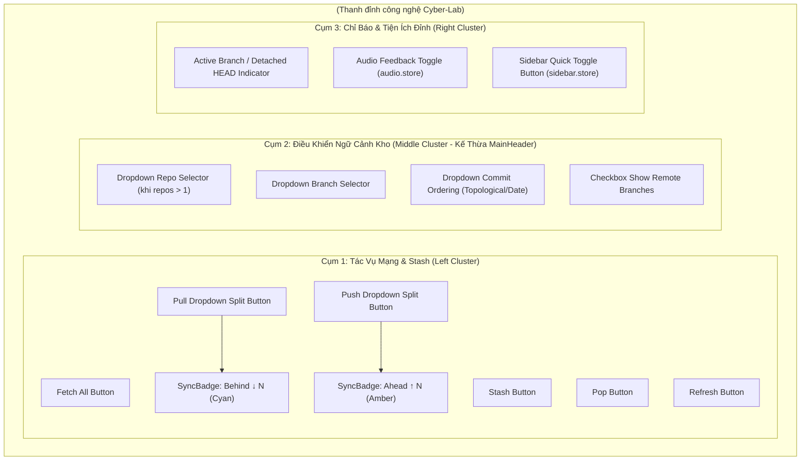
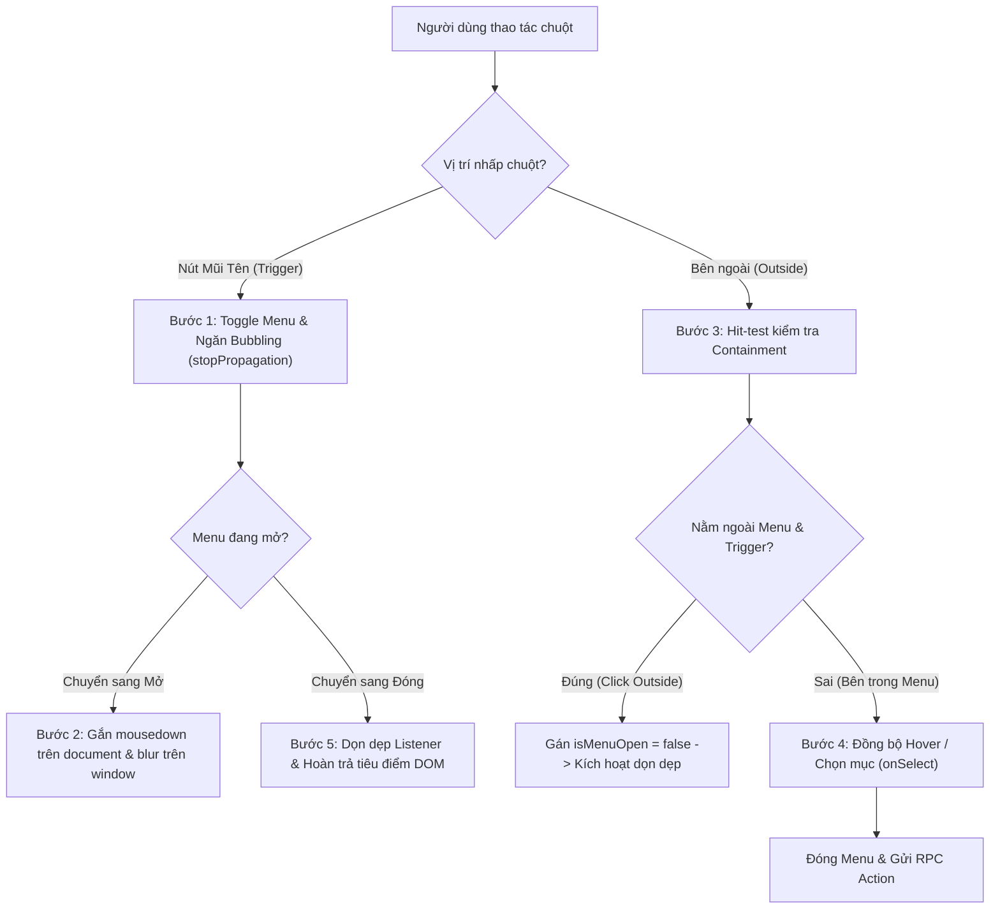
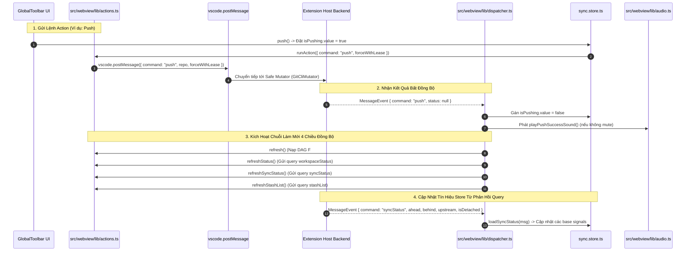

# 06. Thiết Kế Chi Tiết Thanh Công Cụ Đỉnh Toàn Cục & Huy Hiệu Đồng Bộ

Tài liệu này đặc tả chi tiết kiến trúc tầng Giao diện (Webview UI), các Component thành phần của thanh công cụ đỉnh (`GlobalToolbar`, `SyncBadge`, `ToolbarDropdownButton`), kho trạng thái phản ứng `sync.store.ts` bằng Preact Signals, và cơ chế tự động đồng bộ thời gian thực qua Dispatcher cho **Phase 3.2: Nhóm Việc 2 — Thiết Kế & Triển Khai Thanh Công Cụ Đỉnh Toàn Cục**.

> [!NOTE]
> Mọi nội dung trong tài liệu này tuân thủ nguyên tắc: thiết kế và đặc tả bằng ngôn ngữ tự nhiên (**Design by Word**), tập trung vào cấu trúc component, luồng dữ liệu phản ứng, quy chuẩn thẩm mỹ Cyber-Lab và bảo đảm phản xạ thời gian thực (**Realtime State Guarantee**); **tuyệt đối không sử dụng mã nguồn mẫu hoặc khối code block dưới bất kỳ hình thức nào**.
>
> Toàn bộ nhãn nút, gợi ý tooltip, trạng thái tải và thông báo giao diện **sử dụng tiếng Anh chuẩn mực làm ngôn ngữ chính thức**. Phần giải nghĩa tiếng Việt trong tài liệu đóng vai trò tham khảo kỹ thuật.
>
> 📌 **Truy vết tiến độ**: [Phase 3.2 Tiến Độ (Nhóm Việc 2)](../../03_progess/phase3/002_phase3_2_3pane_workspace.md#nhóm-việc-2-thiết-kế--triển-khai-thanh-công-cụ-đỉnh-toàn-cục-top-toolbar).

---

## 1. Tầm Nhìn, Mục Tiêu & Trải Nghiệm Người Dùng

### 1.1. Mục Tiêu Cốt Lõi
1. **Thay thế và kế thừa toàn diện `MainHeader.tsx`**: Loại bỏ hoàn toàn component di sản `MainHeader.tsx`, thay thế bằng `GlobalToolbar.tsx` mang phong cách Cyber-Lab nhất quán. Kế thừa trọn vẹn 100% 4 điều khiển không gian làm việc từ `MainHeader` (Bộ chọn kho Repo, Bộ chọn nhánh Branch, Bộ chọn thứ tự commit Ordering, Hộp kiểm hiện nhánh từ xa Remote branches) nhằm **triệt tiêu hoàn toàn nguy cơ suy thoái chức năng (Zero Regression Guarantee)**.
2. **Cụm tác vụ mạng và lưu trữ trực quan một chạm**: Bố trí các nút tác vụ cốt lõi (`Fetch All`, `Pull`, `Push`, `Stash`, `Pop`, `Refresh`) tại thanh công cụ đỉnh với vùng bấm đạt chuẩn tối thiểu 32px x 32px, tooltip tiếng Anh rõ nghĩa và trạng thái đang tải (Busy State) chống thao tác lặp.
3. **Huy hiệu phát quang Neon phản xạ trung thực**: Hiển thị số lượng commit chênh lệch giữa Local Branch và Upstream Remote Branch qua `SyncBadge` với màu sắc trực quan (Xanh lơ Neon cho `↓behind`, Vàng hổ phách Neon cho `↑ahead`).
4. **Trực giao hóa tương tác (Orthogonal Interaction)**: Tích hợp menu dropdown cho các thao tác phân nhánh (Pull Merge vs Pull Rebase; Push tiêu chuẩn vs Force Push with lease) qua kiến trúc Split Button mà không làm phức tạp luồng bấm mặc định.
5. **Tiện ích công thái học & điều hướng nhanh**: Tích hợp trực tiếp nút bật/tắt phản hồi âm thanh vi mô (`Audio Feedback Toggle`) điều phối qua `audio.store.ts` và nút thu gọn/mở rộng thanh điều hướng cây (`Sidebar Quick Toggle Button`) điều phối qua `sidebar.store.ts`.

### 1.2. Cam Kết Phản Xạ Thời Gian Thực 4 Chiều (Realtime State Guarantee)
- Đúc kết từ bài học lỗi STT 18 của Phase 3.1: Mọi hành động kích hoạt từ Toolbar sau khi được Backend thực thi thành công **bắt buộc phải đi qua Router tập trung trong `dispatcher.ts`** để tự động kích hoạt chuỗi làm mới 4 chiều đồng bộ:
  1. `refresh()`: Nạp lại đồ thị DAG ảo hóa và các commit mới từ F# Core Engine.
  2. `refreshStatus()`: Gửi query `workspaceStatus` nạp lại trạng thái Working Tree và Staging Index.
  3. `refreshSyncStatus()`: Gửi query `syncStatus` nạp lại số đếm ahead/behind và trạng thái upstream tracking branch.
  4. `refreshStashList()`: Gửi query `stashList` nạp lại danh sách stash lưu trữ.

---

## 2. Đặc Tả Kiến Trúc Giao Diện & Phân Rã Component

---

### 2.1. Component `GlobalToolbar.tsx`

- **Vị trí & Bố cục**: Đặt cố định ở đỉnh toàn bộ Webview, chiều cao cơ sở 40px (hỗ trợ co giãn linh hoạt `flex-wrap` khi thu hẹp cửa sổ), phân tách với thân làm việc bên dưới bằng viền đáy kỹ thuật 1px.
- **Phong cách Cyber-Lab**:
  - Dark Mode: Nền tối sâu `#0f172a`, viền `#334155`.
  - Light Mode: Nền sáng nhẹ `#f8fafc`, viền `#cbd5e1`.
  - Đệm lề ngang 12px, căn chỉnh 3 cụm điều khiển (Trái - Giữa - Phải) qua bố cục flexbox co giãn linh hoạt (`display: flex; align-items: center; justify-content: space-between`).

#### Bảng Thuộc Tính Props Của `GlobalToolbar`:

| Tên Thuộc Tính | Kiểu Dữ Liệu | Bắt Buộc? | Mặc Định | Ràng Buộc & Mô Tả Ý Nghĩa |
| :--- | :--- | :---: | :---: | :--- |
| `repos` | `Array<GitRepo>` | Có | - | Danh sách các kho Git đang mở trong không gian làm việc (kế thừa trực tiếp từ `MainHeader.tsx`) |

#### Cấu Trúc DOM Phân Tầng Của `GlobalToolbar`:
1. **Khung bao ngoài (`toolbar-container`)**: Thẻ `<header>` với chiều cao tối thiểu 40px, bố cục `flex-wrap`, phân tách bằng viền đáy kỹ thuật số 1px, `overflow: visible` để các dropdown menu không bị cắt viền.
2. **Cụm bên trái (`toolbar-actions-left`)**: Thẻ `
` bố cục `flex-row`, `gap: 6px`. Chứa tuần tự:
   - Nút `Fetch All`.
   - Nút `Pull` (Split Button kết hợp `SyncBadge (behind)` và mũi tên dropdown).
   - Nút `Push` (Split Button kết hợp `SyncBadge (ahead)` và mũi tên dropdown).
   - Vạch phân cách kỹ thuật đứng (`toolbar-divider`) rộng 1px, cao 18px.
   - Nút `Stash`.
   - Nút `Pop`.
   - Vạch phân cách kỹ thuật đứng.
   - Nút `Refresh`.
3. **Cụm ở giữa (`toolbar-context-middle`)**: Thẻ `
` bố cục `flex-row`, `gap: 8px` kế thừa trọn vẹn 100% các điều khiển của `MainHeader`:
   - Bộ chọn kho (`Dropdown Repo Selector`): Kết nối tín hiệu `selectedRepo`, chỉ hiển thị khi `repos.length > 1`.
   - Bộ chọn nhánh (`Dropdown Branch Selector`): Kết nối tín hiệu `selectedBranch`, danh sách nhánh từ `branchList`, hỗ trợ tùy chọn `Show All Branches`. Bị vô hiệu hóa khi `branchList.value === undefined`.
   - Bộ chọn thứ tự commit (`Dropdown Commit Ordering`): Kết nối tín hiệu `commitOrdering` với hai lựa chọn `"Topological"` và `"Date"`.
   - Hộp kiểm nhánh từ xa (`Checkbox Show Remote Branches`): Kết nối tín hiệu `showRemoteBranch`, gọi hành động `setShowRemoteBranch`.
   - *Quy tắc ẩn khi kho rỗng*: Toàn bộ 4 điều khiển ngữ cảnh tự động ẩn khi `noCommits === true` (đồ thị đã khởi tạo nhưng không có commit nào và không có HEAD).
4. **Cụm bên phải (`toolbar-controls-right`)**: Thẻ `
` bố cục `flex-row`, `gap: 8px`. Chứa:
   - Chỉ báo trạng thái kho & nhánh:
     - Khi `isDetached === false`: Hiển thị biểu tượng Git Branch kèm tên nhánh HEAD phát quang tím nhẹ.
     - Khi `isDetached === true`: Hiển thị huy hiệu Capsule phát quang vàng Neon cảnh báo `"Detached HEAD"`.
   - Nút bật/tắt phản hồi âm thanh (`Audio Feedback Toggle`): Kết nối với `audio.store.ts` (`isAudioMuted`).
   - Nút đóng/mở nhanh Sidebar (`Sidebar Quick Toggle Button`): Kết nối với `sidebar.store.ts` (`isSidebarCollapsed`).

---

### 2.2. Component `SyncBadge.tsx`

Huy hiệu số đếm gắn trực tiếp bên cạnh nhãn của nút `Pull` và `Push` để cảnh báo số lượng commit chênh lệch giữa máy cục bộ và máy chủ remote.

#### Bảng Thuộc Tính Props Của `SyncBadge`:

| Tên Thuộc Tính | Kiểu Dữ Liệu | Bắt Buộc? | Mặc Định | Ràng Buộc & Mô Tả Ý Nghĩa |
| :--- | :--- | :---: | :---: | :--- |
| `direction` | "ahead" \| "behind" | Có | - | Hướng chênh lệch: `"ahead"` (chờ push) hoặc `"behind"` (chờ pull) |
| `count` | number | Có | - | Số lượng commit chênh lệch. Ràng buộc là số nguyên không âm ($\ge 0$) |

#### Quy Chuẩn Hiển Thị & Quy Tắc Render Từng Bước:
1. *Bước 1 (Kiểm tra điều kiện hiển thị)*: Nếu `count <= 0`, component lập tức trả về `null` (ẩn hoàn toàn khỏi DOM để tránh ô nhiễm thị giác).
2. *Bước 2 (Xác định văn bản hiển thị)*:
   - Nếu `direction === "behind"`: Chuỗi văn bản là `"↓ " + count` (ví dụ `"↓ 3"`).
   - Nếu `direction === "ahead"`: Chuỗi văn bản là `"↑ " + count` (ví dụ `"↑ 1"`).
3. *Bước 3 (Áp dụng phong cách Cyber-Lab Capsule)*:
   - Chiều cao chuẩn 16px, đệm lề ngang 6px, bo góc 8px (dạng viên thuốc Capsule).
   - Phông chữ Monospace kích thước 10px in hoa đậm (`font-weight: 700`).
   - Nếu hướng là `"behind"`:
     - Nền: Xanh lơ nhạt trong suốt `rgba(6, 182, 212, 0.15)`.
     - Viền: Viền 1px màu xanh lơ Neon `#06b6d4`.
     - Chữ: Màu xanh lơ phát quang `#22d3ee`.
     - Hiệu ứng phát quang nhẹ: `box-shadow: 0 0 6px rgba(6, 182, 212, 0.4)`.
   - Nếu hướng là `"ahead"`:
     - Nền: Vàng hổ phách nhạt trong suốt `rgba(245, 158, 11, 0.15)`.
     - Viền: Viền 1px màu vàng hổ phách Neon `#f59e0b`.
     - Chữ: Màu vàng hổ phách phát quang `#fbbf24`.
     - Hiệu ứng phát quang nhẹ: `box-shadow: 0 0 6px rgba(245, 158, 11, 0.4)`.

---

### 2.3. Component Nút Tác Vụ Kèm Dropdown Menu (`ToolbarDropdownButton.tsx`)

Áp dụng cho nút `Pull` và `Push` trên thanh công cụ để cung cấp tùy chọn nâng cao mà không làm phá vỡ thao tác 1 chạm cơ bản.

#### Bảng Thuộc Tính Props Của `ToolbarDropdownButton`:

| Tên Thuộc Tính | Kiểu Dữ Liệu | Bắt Buộc? | Mặc Định | Mô Tả Ý Nghĩa |
| :--- | :--- | :---: | :---: | :--- |
| `icon` | string | Có | - | Tên biểu tượng hiển thị (ví dụ `"arrow-down"`, `"arrow-up"`) |
| `label` | string | Có | - | Nhãn hiển thị chính bằng tiếng Anh (ví dụ `"Pull"`, `"Push"`) |
| `badgeCount` | number | Không | `0` | Số lượng commit truyền vào `SyncBadge` |
| `badgeDirection` | "ahead" \| "behind" | Có | - | Hướng chênh lệch của `SyncBadge` |
| `isLoading` | boolean | Có | - | Cờ đánh dấu tiến trình đang chạy để kích hoạt spinner |
| `disabled` | boolean | Có | - | Cờ vô hiệu hóa nút bấm |
| `onPrimaryClick` | () => void | Có | - | Callback khi người dùng nhấp vào nửa chính bên trái |
| `menuItems` | Array<DropdownItem> | Có | - | Danh sách các tùy chọn bên trong menu thả xuống |

#### Cấu Trúc Đối Tượng `DropdownItem`:
- `id`: Chuỗi định danh tùy chọn (ví dụ `"pull-merge"`, `"pull-rebase"`, `"push-standard"`, `"push-force"`).
- `label`: Tiêu đề tiếng Anh hiển thị trong menu (ví dụ `"Pull (Merge)"`, `"Pull with Rebase"`).
- `description`: Hướng dẫn phụ mờ tiếng Anh giải thích hành vi.
- `onSelect`: Hàm callback kích hoạt khi tùy chọn được nhấp.

#### Cấu Trúc Khối Nút Bấm Chia Đôi (Split Button Architecture):
1. **Nửa chính (Primary Action Area - 75% chiều rộng)**:
   - Chứa biểu tượng icon, nhãn chữ tiếng Anh và component `SyncBadge`.
   - Khi `isLoading === true`: Thay thế biểu tượng icon bằng icon Spinner xoay 360 độ chu kỳ 1s.
   - Khi nhấp chuột vào nửa này: Kích hoạt ngay `onPrimaryClick()`.
2. **Nửa phụ (Dropdown Arrow Area - 25% chiều rộng)**:
   - Phân tách với nửa chính bằng vạch mờ 1px.
   - Chứa biểu tượng mũi tên tam giác nhỏ quay xuống (Chevron Down).
   - Khi nhấp chuột vào nửa này: Bật/tắt trạng thái mở menu dropdown (`isMenuOpen = !isMenuOpen`).

#### Bảng Danh Mục Tùy Chọn Menu Thả Xuống:

| Nút Điều Khiển | Tùy Chọn Mặc Định (Primary) | Tùy Chọn Nâng Cao Trong Dropdown | Mô Tả Hành Vi Chi Tiết |
| :--- | :--- | :--- | :--- |
| **Pull Menu** | `"Pull (Merge)"` | `"Pull with Rebase"` | Tùy chọn 1 gọi `pull('merge')`; Tùy chọn 2 gọi `pull('rebase')`. |
| **Push Menu** | `"Push"` | `"Force Push (with lease)"` | Tùy chọn 1 gọi `push()`; Tùy chọn 2 gọi `push({ forceWithLease: true })`. |

### 2.4. Quy Trình Chi Tiết Xử Lý Sự Kiện Bẫy Chuột & Bàn Phím Từng Bước (Mouse & Keyboard Trapping Engine)

Mục này quy định chi tiết quy trình bẫy chuột (Mouse Trapping) và bẫy bàn phím (Keyboard Trapping) cho component `ToolbarDropdownButton.tsx` (áp dụng trên nút `Pull` và `Push`). Toàn bộ cơ chế được xây dựng theo chuẩn **WAI-ARIA Menu Button Pattern**, bảo đảm tính công thái học cao cấp của phong cách Cyber-Lab, triệt tiêu hiện tượng rò rỉ bộ nhớ (Memory Leak), không làm mất tiêu điểm (Focus Loss) và ngăn chặn xung đột sự kiện (Event Race Condition).

---

#### 2.4.1. Nguyên Lý Thiết Kế Trực Giao & Phân Rã Vùng Bấm (Split Button Architecture)
Component vận hành theo cơ chế nút chia đôi (Split Button) với hai phân vùng vật lý độc lập:
1. **Phân Vùng Nút Chính (Primary Action Zone - Chiếm 75% chiều rộng bên trái)**:
   - Chứa biểu tượng icon, nhãn tiếng Anh (ví dụ `"Pull"` / `"Push"`) và huy hiệu `SyncBadge`.
   - Đảm nhiệm duy nhất việc thực thi hành động mặc định thông qua callback `onPrimaryClick()`.
   - **Tính trực giao**: Việc nhấp chuột hoặc kích hoạt phím tại phân vùng này hoàn toàn không làm mở hoặc đóng menu thả xuống.
2. **Phân Vùng Nút Mũi Tên (Dropdown Trigger Zone - Chiếm 25% chiều rộng bên phải)**:
   - Phân tách với nửa chính bằng vạch kỹ thuật mờ 1px.
   - Chứa biểu tượng mũi tên Chevron Down (`aria-hidden="true"`).
   - Đóng vai trò là mỏ neo kích hoạt (Anchor Element), nhận tiêu điểm bàn phím và điều khiển trạng thái hiển thị của menu thả xuống (`isMenuOpen`).

---

#### 2.4.2. Chu Trình Xử Lý Sự Kiện Bẫy Chuột Từng Bước (Mouse Event Trapping Workflow)

- **Bước 1 (Kích hoạt đóng/mở & Cô lập sự kiện lan truyền - Toggle & Event Isolation)**:
  1. Khi người dùng nhấp chuột trái (`event.button === 0`) vào Nút Mũi Tên:
     - Kích hoạt phương thức ngăn chặn hành vi mặc định: `event.preventDefault()`.
     - Kích hoạt phương thức chặn sự kiện nổi bọt: `event.stopPropagation()` nhằm cô lập sự kiện trong phạm vi nút bấm, ngăn chặn sự kiện lan truyền lên container thanh công cụ hoặc thẻ `document`.
  2. Đảo ngược giá trị tín hiệu mở menu: `isMenuOpen.value = !isMenuOpen.value`.
  3. Nếu chuyển sang trạng thái mở (`isMenuOpen.value === true`):
     - Khởi tạo chỉ số mục đang chọn bằng bàn phím về trạng thái chờ: `focusedItemIndex.value = -1`.
     - Bật cờ khóa tạm thời trong microtask (`isTogglingRef = true`, tự động giải phóng sau chu kỳ 16ms) để báo hiệu cho bộ bắt click-outside bỏ qua lượt nhấp hiện tại.
  4. Nếu chuyển sang trạng thái đóng: Chuyển tiếp tới Bước 5 để dọn dẹp bộ lắng nghe.

- **Bước 2 (Đăng ký bộ bẫy chuột nhấp ra ngoài - Click-Outside Trap Registration)**:
  1. Ngay khi `isMenuOpen.value === true`, gắn một bộ lắng nghe sự kiện `mousedown` trên đối tượng toàn cục `document`.
  2. *Lý do kỹ thuật dùng `mousedown` thay vì `click`*:
     - Sự kiện `mousedown` kích hoạt ngay tại thời điểm con trỏ ấn xuống, cho phản hồi tức thì, triệt tiêu độ trễ thị giác và ngăn chặn tình trạng người dùng bấm giữ kéo rê (drag-selection) gây loạn trạng thái menu.
  3. Khi phát hiện sự kiện `mousedown` trên `document`:
     - Kiểm tra cờ bỏ qua `isTogglingRef`: Nếu cờ đang bật, bỏ qua xử lý vì đó là lượt nhấp của chính Nút Mũi Tên.
     - Trích xuất phần tử DOM mục tiêu từ con trỏ: `const targetNode = event.target as Node`.
     - Thực hiện thuật toán kiểm tra vùng va chạm hình học (DOM Containment Check):
       - Kiểm tra xem `targetNode` có nằm trong vùng bao menu hay không: `menuContainerRef.current?.contains(targetNode)`.
       - Kiểm tra xem `targetNode` có nằm trong vùng Nút Mũi Tên hay không: `dropdownTriggerRef.current?.contains(targetNode)`.
     - *Phân nhánh kết quả*:
       - **Nếu nằm ngoài cả hai vùng**: Xác định là thao tác nhấp ra ngoài (Click Outside). Lập tức gán `isMenuOpen.value = false`. Cho phép sự kiện `mousedown` tiếp tục lan truyền tự nhiên để người dùng có thể kích hoạt ngay nút bấm khác trên giao diện mà không bị nuốt mất cú nhấp (Zero-Stall UX).
       - **Nếu nằm bên trong vùng bao menu**: Giữ nguyên trạng thái hiển thị của menu để tiếp tục xử lý việc chọn mục ở Bước 4.

- **Bước 3 (Đồng bộ hóa trạng thái rê chuột - Hover Synchronization)**:
  1. Khi menu đang mở, người dùng di chuyển chuột qua danh sách các mục:
     - Gắn sự kiện `mouseenter` trên từng phần tử dòng mục (`DropdownItem`).
     - Khi con trỏ tiến vào mục thứ $k$ ($0 \le k < N$): Cập nhật ngay tín hiệu `focusedItemIndex.value = k`.
     - Đồng bộ hiệu ứng hiển thị Cyber-Lab: Xóa vầng hào quang tím tại mục trước đó, áp dụng ngay nền phát quang tím bán trong suốt (`rgba(168, 85, 247, 0.15)`) kèm viền cạnh trái 2px màu tím Neon `#a855f7` cho mục $k$.
  2. Khi con trỏ rời khỏi danh sách menu (`mouseleave` trên container menu):
     - Giữ nguyên menu mở; đặt lại `focusedItemIndex.value = -1` để không hiển thị giả lập bàn phím khi người dùng đang dùng chuột.

- **Bước 4 (Thực thi lựa chọn mục bằng chuột - Item Click Execution)**:
  1. Khi người dùng nhấp chuột trái (`event.button === 0`) vào một dòng mục `DropdownItem`:
     - Ngăn chặn hành vi mặc định và chặn lan truyền: `event.preventDefault()`, `event.stopPropagation()`.
     - Nếu mục đó đang ở trạng thái cấm (`disabled === true`): Bỏ qua, không thực thi.
     - Trích xuất hàm ủy nhiệm nghiệp vụ `onSelect()` của mục đó (ví dụ: `pull('rebase')` hoặc `push({ forceWithLease: true })`).
     - Gán ngay `isMenuOpen.value = false` để đóng menu.
     - Khôi phục tiêu điểm vật lý về Nút Mũi Tên (`dropdownTriggerRef.current?.focus()`).
     - Thực thi hàm `onSelect()`, phát lệnh RPC xuống Backend Extension Host.
  2. *Chặn menu ngữ cảnh*: Gắn listener sự kiện `contextmenu` trên toàn bộ container menu và kích hoạt `event.preventDefault()` để ngăn chặn menu chuột phải mặc định của hệ thống đè lên các tùy chọn.

- **Bước 5 (Bẫy mất tiêu điểm cửa sổ Webview - Window Defocus Trap)**:
  1. Gắn bộ lắng nghe sự kiện `blur` trên đối tượng `window` khi menu mở.
  2. Khi người dùng chuyển sang tab khác trong VS Code, mở Command Palette (`Ctrl+Shift+P`), hoặc chuyển ứng dụng ngoài hệ điều hành:
     - Lập tức gán `isMenuOpen.value = false`.
     - Triệt tiêu hoàn toàn nguy cơ menu dropdown trôi nổi vô chủ (Orphaned Floating Element) trên màn hình.

---

#### 2.4.3. Chu Trình Xử Lý Bẫy & Điều Hướng Bàn Phím Từng Bước (Keyboard Navigation & Trap Workflow)

Tuân thủ nghiêm ngặt tiêu chuẩn WAI-ARIA Menu Button, cung cấp trải nghiệm điều hướng khép kín cho lập trình viên thao tác hoàn toàn bằng bàn phím.

##### Bảng Ánh Xạ Phím Tắt & Hành Động Chi Tiết (Keyboard Interaction Matrix):

| Phím Nhấn (Key) | Ngữ Cảnh Kích Hoạt | Trạng Thái Menu | Hành Động Xử Lý Chi Tiết Từng Bước |
| :--- | :--- | :---: | :--- |
| **`Enter`** hoặc **`Space`** | Tiêu điểm tại Nút Chính (Primary Button) | Đang đóng | Kích hoạt `onPrimaryClick()`. Không mở menu dropdown. |
| **`Enter`** hoặc **`Space`** | Tiêu điểm tại Nút Mũi Tên (Dropdown Trigger) | Đang đóng | 1. Ngăn hành vi cuộn trang (`preventDefault`). 2. Mở menu: `isMenuOpen.value = true`. 3. Đặt tiêu điểm tại mục đầu tiên: `focusedItemIndex.value = 0`. |
| **`ArrowDown`** | Tiêu điểm tại Nút Mũi Tên | Đang đóng | 1. Ngăn cuộn trang. 2. Mở menu: `isMenuOpen.value = true`. 3. Đặt tiêu điểm tại mục đầu tiên: `focusedItemIndex.value = 0`. |
| **`ArrowUp`** | Tiêu điểm tại Nút Mũi Tên | Đang đóng | 1. Ngăn cuộn trang. 2. Mở menu: `isMenuOpen.value = true`. 3. Đặt tiêu điểm tại mục cuối cùng: `focusedItemIndex.value = itemCount - 1`. |
| **`ArrowDown`** | Bất kỳ vị trí nào trong component | Đang mở | 1. Ngăn cuộn trang. 2. Dịch chuyển chỉ số xuống mục kế tiếp: $i_{\text{next}} = (i + 1) \pmod N$. 3. Cập nhật `focusedItemIndex.value = i_{\text{next}}`. 4. Cuộn phần tử vào khung nhìn nếu cần. |
| **`ArrowUp`** | Bất kỳ vị trí nào trong component | Đang mở | 1. Ngăn cuộn trang. 2. Dịch chuyển chỉ số lên mục phía trước: $i_{\text{prev}} = (i - 1 + N) \pmod N$ (nếu $i = -1 \rightarrow$ nhảy về $N - 1$). 3. Cập nhật `focusedItemIndex.value = i_{\text{prev}}`. 4. Cuộn phần tử vào khung nhìn. |
| **`Home`** | Bất kỳ vị trí nào trong component | Đang mở | 1. Ngăn hành vi nhảy trang mặc định. 2. Đặt tiêu điểm tức thì về mục đầu tiên: `focusedItemIndex.value = 0`. |
| **`End`** | Bất kỳ vị trí nào trong component | Đang mở | 1. Ngăn hành vi nhảy trang mặc định. 2. Đặt tiêu điểm tức thì về mục cuối cùng: `focusedItemIndex.value = itemCount - 1`. |
| **`Enter`** hoặc **`Space`** | Khi `focusedItemIndex >= 0` | Đang mở | 1. Ngăn hành vi mặc định. 2. Trích xuất mục mục tiêu: `const item = menuItems[focusedItemIndex]`. 3. Nếu `item.disabled === true`: Bỏ qua. 4. Đóng menu: `isMenuOpen.value = false`. 5. Hoàn trả tiêu điểm DOM về Nút Mũi Tên. 6. Kích hoạt `item.onSelect()`. |
| **`Escape`** | Bất kỳ vị trí nào trong component | Đang mở | 1. Ngăn hành vi hủy mặc định của VS Code (`preventDefault`, `stopPropagation`). 2. Đóng menu ngay lập tức: `isMenuOpen.value = false`. 3. Khôi phục tiêu điểm DOM chính xác về Nút Mũi Tên (`dropdownTriggerRef.current?.focus()`). |
| **`Tab`** | Bất kỳ vị trí nào trong component | Đang mở | 1. Đóng menu ngay lập tức: `isMenuOpen.value = false`. 2. Không chặn sự kiện Tab (không dùng `preventDefault`). 3. Cho phép tiêu điểm tiến tự nhiên sang phần tử tiếp theo trên cây DOM của Toolbar. |
| **`Shift + Tab`** | Bất kỳ vị trí nào trong component | Đang mở | 1. Đóng menu ngay lập tức: `isMenuOpen.value = false`. 2. Không chặn sự kiện Tab. 3. Cho phép tiêu điểm lùi tự nhiên về Nút Chính (Primary Button). |

- **Thuật Toán Điều Hướng Xoay Vòng Bằng Bàn Phím (Circular Wrap-Around Algorithm)**:
  - Cho danh sách menu gồm $N$ phần tử ($N \ge 1$), được đánh chỉ số từ $0$ đến $N - 1$. Chỉ số hiện tại là $i \in [-1, N-1]$:
    - Khi nhận phím `ArrowDown`:
      $$i_{\text{mới}} = \begin{cases} 0 & \text{nếu } i = -1 \\ (i + 1) \pmod N & \text{ngược lại} \end{cases}$$
    - Khi nhận phím `ArrowUp`:
      $$i_{\text{mới}} = \begin{cases} N - 1 & \text{nếu } i \le 0 \\ i - 1 & \text{ngược lại} \end{cases}$$
  - Cơ chế xoay vòng kín bảo đảm người dùng bấm phím liên tục theo một chiều không bao giờ bị nghẽn ở hai đầu danh sách.

---

#### 2.4.4. Cơ Chế Quản Lý & Hoàn Trả Tiêu Điểm Kỹ Thuật Số (Focus Management & Virtual Focus Pipeline)

Nhằm duy trì cấu trúc cây hỗ trợ tiếp cận ổn định và loại trừ hoàn toàn lỗi mất dấu tiêu điểm (Focus Drift / Focus Loss):

1. **Cơ Chế Tiêu Điểm Ảo (Virtual Focus via `aria-activedescendant`)**:
   - Thay vì dịch chuyển tiêu điểm DOM vật lý (`element.focus()`) vào từng thẻ `
` mục con (hành vi này dễ làm mất liên kết ngữ cảnh phân cấp giữa nút kích hoạt và bảng menu trên một số trình đọc màn hình):
     - Nút Mũi Tên Dropdown **duy trì giữ tiêu điểm DOM vật lý liên tục** trong suốt quá trình người dùng dùng bàn phím điều hướng menu.
     - Khi `focusedItemIndex` thay đổi, cập nhật thuộc tính `aria-activedescendant` trên Nút Mũi Tên trỏ đến mã ID của mục con tương ứng (ví dụ: `aria-activedescendant="pull-menu-item-1"`).
     - Component render lớp giả lập phát quang Cyber-Lab tương ứng trên mục con đang mang chỉ số đó.
2. **Quy Trình Hoàn Trả Tiêu Điểm Xác Thực (Deterministic Focus Restoration)**:
   - Dù menu đóng lại bởi bất kỳ nguyên nhân nào:
     - Nhấn phím `Escape`.
     - Nhấp chuột chọn một mục.
     - Nhấn `Enter` / `Space` kích hoạt mục.
     - Nhấp chuột ra ngoài (Click Outside).
   - Hệ thống luôn bảo đảm hoàn trả tiêu điểm DOM về Nút Mũi Tên (`dropdownTriggerRef.current?.focus()`). Lập trình viên có thể ngay lập tức nhấn `Tab` để di chuyển sang nút tiếp theo (`Push`, `Stash`) mà không bao giờ bị rơi tiêu điểm về đỉnh trang `<body>`.

---

#### 2.4.5. Bảng Hợp Đồng Thuộc Tính Trợ Năng Bắt Buộc (WAI-ARIA Accessibility Contract)

| Phần Tử DOM | Thuộc Tính ARIA | Giá Trị Khi Menu Đóng | Giá Trị Khi Menu Mở | Mục Đích Trợ Năng Chi Tiết |
| :--- | :--- | :--- | :--- | :--- |
| **Nút Mũi Tên** | `role` | `"button"` | `"button"` | Khai báo ngữ nghĩa nút bấm chuẩn HTML |
| | `aria-haspopup` | `"menu"` | `"menu"` | Báo hiệu nút sở hữu menu con dạng danh mục |
| | `aria-expanded` | `"false"` | `"true"` | Trạng thái hiển thị đóng/mở của menu thả xuống |
| | `aria-controls` | `"{button-id}-dropdown-menu"` | `"{button-id}-dropdown-menu"` | Liên kết trực tiếp nút kích hoạt với container menu |
| | `aria-label` | `"More actions for " + label` | `"More actions for " + label` | Nhãn trợ thính tiếng Anh giải thích công dụng |
| | `aria-activedescendant` | Rỗng (`""`) | `"{button-id}-item-" + focusedIndex` | Định danh mục con đang có tiêu điểm ảo |
| **Khung Bao Dropdown Menu** | `role` | (Không render trong DOM) | `"menu"` | Xác nhận cấu trúc container là một menu lệnh |
| | `id` | - | `"{button-id}-dropdown-menu"` | Khớp với `aria-controls` của Nút Mũi Tên |
| | `aria-orientation` | - | `"vertical"` | Khai báo danh sách các mục xếp theo chiều dọc |
| | `tabindex` | - | `"-1"` | Ngăn nhận focus tab trực tiếp gây gián đoạn luồng |
| **Từng Dòng Mục Menu** | `role` | - | `"menuitem"` | Định danh mục là một lệnh có thể thực thi |
| | `id` | - | `"{button-id}-item-" + index` | Khớp với `aria-activedescendant` |
| | `aria-disabled` | - | `"true"` nếu bị khóa, ngược lại `"false"` | Báo hiệu trạng thái khả dụng cho bộ đọc |

---

#### 2.4.6. Vòng Đời Đăng Ký, Cách Ly & Dọn Dẹp Listener (Lifecycle Hygiene & Memory Leak Prevention)

Nhằm bảo đảm tài nguyên bộ nhớ của Webview không bị tích tụ qua hàng trăm lần tương tác đóng/mở:
1. **Nguyên Tắc Đăng Ký Theo Nhu Cầu (On-Demand Registration)**:
   - Khi `isMenuOpen.value === false`: Tuyệt đối không gắn bất kỳ bộ lắng nghe sự kiện nào trên `document` hoặc `window`.
   - Khi `isMenuOpen.value === true`: Gắn có điều kiện 3 bộ lắng nghe:
     - `document.addEventListener("mousedown", handleClickOutside, true)` (sử dụng cờ Capture `true` để bắt sớm trước khi các component con kịp nuốt sự kiện).
     - `document.addEventListener("keydown", handleKeyDown, false)` (sử dụng cờ Bubble `false` cho sự kiện bàn phím).
     - `window.addEventListener("blur", handleWindowBlur, false)`.
2. **Quy Trình Dọn Dẹp 4 Tầng Tức Thì (Deterministic 4-Tier Cleanup)**:
   - Hàm dọn dẹp được kích hoạt tức thì khi:
     - Trạng thái `isMenuOpen` chuyển về `false`.
     - Component `ToolbarDropdownButton` bị unmount khỏi cây DOM.
     - Repository đang mở bị đóng hoặc chuyển đổi nhánh làm Webview vẽ lại.
   - Các hành động trong hàm dọn dẹp:
     1. Gọi `document.removeEventListener("mousedown", handleClickOutside, true)`.
     2. Gọi `document.removeEventListener("keydown", handleKeyDown, false)`.
     3. Gọi `window.removeEventListener("blur", handleWindowBlur, false)`.
     4. Xóa sạch cờ tạm thời `isTogglingRef`.

---

#### 2.4.7. Bảng Xử Lý Các Trường Hợp Biên & Tình Huống Xung Đột (Edge Cases & Fault-Tolerant Trapping)

| Tình Huống Biên | Nguy Cơ Kỹ Thuật Tiềm Ẩn | Giải Pháp Bẫy Lỗi & Hành Vi Chuẩn Hóa Chi Tiết |
| :--- | :--- | :--- |
| **Xung đột nhấp đúp (Double-Click / Flapping Race Condition)** | Người dùng nhấp liên tục cực nhanh vào Nút Mũi Tên; sự kiện click-outside bắt nhầm lượt nhấp thứ hai và đóng/mở menu liên tục gây nhấp nháy. | Sử dụng cờ tạm `isTogglingRef = true` trong thời gian 16ms (1 khung hình render). Bộ lắng nghe click-outside kiểm tra nếu cờ đang bật thì lập tức bỏ qua, loại trừ 100% hiện tượng flapping. |
| **Trạng thái bận đột ngột (`isLoading` bật khi menu đang mở)** | Tiến trình mạng nền hoàn tất hoặc được kích hoạt từ nơi khác làm `isNetworkBusy = true`, nút chuyển sang trạng thái `disabled`. | Ngay khi phát hiện prop `isLoading === true` hoặc `disabled === true`, component tự động gán `isMenuOpen.value = false`, đóng menu ngay lập tức và kích hoạt toàn bộ chu trình dọn dẹp listener. |
| **Thay đổi kích thước cửa sổ Webview (`window.resize`)** | Người dùng kéo dãn thanh chia 3-pane hoặc thay đổi kích thước cửa sổ VS Code, khiến menu thả xuống bị lệch tọa độ khỏi Nút Mũi Tên. | Gắn thêm bộ lắng nghe `resize` trên `window` khi menu đang mở: Tự động đóng menu (`isMenuOpen.value = false`) để loại bỏ tình trạng menu bay lệch vị trí neo. |
| **Nhấn phím `Tab` khi menu đang mở** | Nếu bẫy phím Tab quá cứng nhắc (Strict Trap), người dùng phím bị kẹt vĩnh viễn trong menu không thể sang các cụm nút khác trên Toolbar. | Phím `Tab` và `Shift + Tab` được thiết kế theo chuẩn thoát tự nhiên: Đóng menu tức thì, dọn dẹp listener, và cho phép tiêu điểm di chuyển tự nhiên theo chuỗi TabIndex của trình duyệt. |
| **Menu mở sát mép phải màn hình** | Trình đơn thả xuống tràn ra ngoài khung nhìn của Webview gây xuất hiện thanh cuộn ngang kỹ thuật không mong muốn. | Thiết kế CSS cố định căn lề phải: Đặt `right: 0` trên khung menu để menu thả xuống luôn bám sát theo mép phải của nút điều khiển, bảo đảm luôn nằm 100% trong khung nhìn hiển thị. |

---

## 3. Quản Lý Trạng Thái Bằng Preact Signals & Giao Thức RPC Thực Tế

Toàn bộ dữ liệu phản ứng của thanh công cụ đỉnh được quản lý theo mô hình phân tầng tín hiệu phản ứng tinh vi (Fine-Grained Reactive Signals), tuân thủ nghiêm ngặt giao thức truyền tin bất đồng bộ hai chiều giữa Webview và Extension Host qua `vscode.postMessage` và Router tập trung `dispatcher.ts`.

---

### 3.1. Bảng Danh Mục Tín Hiệu Cơ Sở (`sync.store.ts`)

| Tên Tín Hiệu | Kiểu Dữ Liệu | Giá Trị Khởi Tạo | Mô Tả Ý Nghĩa Nghiệp Vụ & Ràng Buộc |
| :--- | :--- | :---: | :--- |
| `aheadCount` | number | `0` | Số lượng commit cục bộ đã commit nhưng chưa đẩy lên remote ($\ge 0$) |
| `behindCount` | number | `0` | Số lượng commit trên remote chưa kéo về thư mục làm việc ($\ge 0$) |
| `upstreamBranch` | string \| null | `null` | Tên nhánh remote tracking tương ứng (ví dụ `"origin/main"`) |
| `isDetached` | boolean | `false` | Cờ đánh dấu kho đang ở trạng thái Detached HEAD |
| `isFetching` | boolean | `false` | Cờ đánh dấu tiến trình `fetchAll` đang chạy ngầm |
| `isPulling` | boolean | `false` | Cờ đánh dấu tiến trình `pull` đang chạy ngầm |
| `isPushing` | boolean | `false` | Cờ đánh dấu tiến trình `push` đang chạy ngầm |
| `isStashing` | boolean | `false` | Cờ đánh dấu tiến trình `stashSave` hoặc `stashPop` đang chạy |

---

### 3.2. Bảng Danh Mục Tín Hiệu Dẫn Xuất (`sync.store.ts`)

| Tên Tín Hiệu | Kiểu Dữ Liệu | Công Thức / Logic Tính Toán Tự Động | Mô Tả Ý Nghĩa Nghiệp Vụ |
| :--- | :--- | :--- | :--- |
| `hasPendingSync` | boolean | `aheadCount.value > 0 \|\| behindCount.value > 0` | Tự động bằng `true` khi kho có commit lệch cần đồng bộ |
| `isNetworkBusy` | boolean | `isFetching.value \|\| isPulling.value \|\| isPushing.value \|\| isStashing.value` | Tự động bằng `true` khi có bất kỳ tác vụ mạng hoặc lưu trữ nào đang thực thi |
| `syncStatusText` | string | - Nếu `isDetached.value === true` $\rightarrow$ `"Detached HEAD"` - Nếu `behindCount.value > 0 && aheadCount.value > 0` $\rightarrow$ `"${aheadCount} ahead, ${behindCount} behind"` - Nếu `behindCount.value > 0` $\rightarrow$ `"${behindCount} commit(s) behind"` - Nếu `aheadCount.value > 0` $\rightarrow$ `"${aheadCount} commit(s) ahead"` - Ngược lại $\rightarrow$ `"Up to date"` | Chuỗi thông báo trạng thái tóm tắt tiếng Anh chuẩn mực |

---

### 3.3. Đặc Tả Giao Thức RPC Thực Tế, Dispatcher Router & Chuỗi Làm Mới 4 Chiều

Khắc phục lỗi thiết kế `[DESIGN_DEFECT]`: Webview trong kiến trúc F-GitGraph không vận hành theo cơ chế gửi/nhận Promise đơn lẻ của `WebviewBridge`, mà tuân thủ chuẩn **Gửi Lệnh Bất Đồng Bộ (Fire-and-Forget Command)** và **Tiếp Nhận Phản Hồi Tập Trung Qua Dispatcher (`src/webview/lib/dispatcher.ts`)**.

#### 1. Các Hàm Phát Lệnh Trong `src/webview/lib/actions.ts`:

- **Hàm `refreshSyncStatus(repo?: string): void`**:
  - *Đầu vào*: Tham số `repo` kiểu chuỗi ký tự tùy chọn (nếu không truyền, lấy từ `selectedRepo.value`).
  - *Đầu ra*: `void`.
  - *Quy trình*: Nếu `repo` không rỗng, gọi `vscode.postMessage({ command: "syncStatus", repo })`.
- **Hàm `refreshStashList(repo?: string): void`**:
  - *Đầu vào*: Tham số `repo` kiểu chuỗi ký tự tùy chọn (mặc định lấy `selectedRepo.value`).
  - *Đầu ra*: `void`.
  - *Quy trình*: Nếu `repo` hợp lệ, gọi `vscode.postMessage({ command: "stashList", repo })`.

#### 2. Các Hàm Điều Phối Trong `sync.store.ts`:

- **Hàm `loadSyncStatus(msg: SyncStatusResult): void`**:
  - *Đầu vào*: Đối tượng `msg` thuộc kiểu `SyncStatusResult` nhập khẩu từ `src/types/queries.ts`.
  - *Đầu ra*: `void`.
  - *Quy trình*:
    1. Gán `aheadCount.value = msg.ahead`.
    2. Gán `behindCount.value = msg.behind`.
    3. Gán `upstreamBranch.value = msg.upstream`.
    4. Gán `isDetached.value = msg.isDetached`.
- **Hàm `fetch(prune = true): void`**:
  - *Quy trình*: Nếu `isNetworkBusy.value === true`, thoát ngay. Gán `isFetching.value = true`. Gọi `runAction({ command: "fetchAll", prune })`.
- **Hàm `pull(mode: 'merge' | 'rebase' = 'merge'): void`**:
  - *Quy trình*: Nếu bận, thoát ngay. Gán `isPulling.value = true`. Gọi `runAction({ command: "pull", mode })`.
- **Hàm `push(forceWithLease = false): void`**:
  - *Quy trình*: Nếu bận, thoát ngay. Gán `isPushing.value = true`. Gọi `runAction({ command: "push", forceWithLease })`.
- **Hàm `stash(message?: string, includeUntracked = false): void`**:
  - *Quy trình*: Nếu bận, thoát ngay. Gán `isStashing.value = true`. Gọi `runAction({ command: "stashSave", message, includeUntracked })`.
- **Hàm `pop(index = 0): void`**:
  - *Quy trình*: Nếu bận, thoát ngay. Gán `isStashing.value = true`. Gọi `runAction({ command: "stashPop", index })`.

#### 3. Bộ Định Tuyến Trong `src/webview/lib/dispatcher.ts`:
1. Đăng ký xử lý query `syncStatus`: Chuyển dữ liệu phản hồi đến hàm `loadSyncStatus(msg)`.
2. Đăng ký 6 action (`fetchAll`, `pull`, `push`, `stashSave`, `stashPop`, `stashDrop`) vào bảng ánh xạ `handlers`:
   - Khi nhận phản hồi từ Backend, tự động giải phóng cờ bận tương ứng (`isFetching.value = false`, `isPulling.value = false`, `isPushing.value = false`, `isStashing.value = false`).
   - Nếu `msg.status !== null`: Mở hộp thoại thông báo lỗi tiếng Anh tương ứng dựa trên `ERROR_KEY` trong `action-result.ts`.
   - Nếu `msg.status === null` (thao tác thành công):
     - Kích hoạt chuỗi làm mới 4 chiều: `refresh()`, `refreshStatus()`, `refreshSyncStatus()`, `refreshStashList()`.
     - Kích hoạt âm thanh vi mô tương ứng (nếu âm thanh đang bật):
       - Đối với `push`: Gọi `playPushSuccessSound()`.
       - Đối với `pull`: Gọi `playPullSuccessSound()`.

---

### 3.4. Quản Lý Trạng Thái Âm Thanh Phản Hồi (`audio.store.ts`) & Web Audio Engine

Khắc phục lỗi thiết kế `[DESIGN_DEFECT]`: Xây dựng module quản lý âm lượng và trạng thái câm (Mute) ngay trong Nhóm Việc 2 để phục vụ trực tiếp nút `Audio Feedback Toggle` trên thanh công cụ đỉnh.

#### Bảng Tín Hiệu Của `audio.store.ts`:

| Tên Tín Hiệu | Kiểu Dữ Liệu | Giá Trị Khởi Tạo | Mô Tả Ý Nghĩa |
| :--- | :--- | :---: | :--- |
| `isAudioMuted` | boolean | Đọc từ `localStorage` khóa `"f-gitgraph.audioMuted"` (mặc định `false`) | Trạng thái tắt/bật toàn bộ âm thanh phản hồi vi mô |
| `audioToggleTooltip` | Computed<string> | Nếu `isAudioMuted.value === true` $\rightarrow$ `"Unmute audio feedback"`. Ngược lại $\rightarrow$ `"Mute audio feedback"` | Tooltip hiển thị khi rê chuột qua nút chuyển đổi |

#### Các Hàm Điều Phối Trong `audio.store.ts`:
- **Hàm `toggleAudio(): void`**:
  - Đảo ngược giá trị logic: `isAudioMuted.value = !isAudioMuted.value`.
  - Lưu trạng thái vào bộ nhớ cục bộ trình duyệt: `localStorage.setItem("f-gitgraph.audioMuted", String(isAudioMuted.value))`.

#### Mở Rộng Engine Âm Học Vi Mô Trong `src/webview/lib/audio.ts`:
Tuân thủ nghiêm ngặt nguyên lý tổng hợp sóng âm phân tích giải tích từ tài liệu thiết kế `docs/02_design/phase3/04_Audio_Feedback_And_Sound_Design.md` (Mục 3):
1. **Hàm `playPushSuccessSound(): void`**:
   - *Điều kiện chặn*: Nếu `isAudioMuted.value === true`, thoát hàm ngay lập tức.
   - *Thuật toán tổng hợp*: Khởi tạo hai bộ dao động sóng sine tạo hợp âm thăng hoa quãng 5 đúng:
     - Nốt 1 ($523.25\text{Hz}$ - Đô 5): Phát tại mốc $0\text{ms}$.
     - Nốt 2 ($783.99\text{Hz}$ - Sol 5): Phát tại mốc $70\text{ms}$.
     - Độ lợi phong bì ADSR đạt đỉnh $60\%$ và suy giảm mềm mại sau tổng thời gian $190\text{ms}$.
2. **Hàm `playPullSuccessSound(): void`**:
   - *Điều kiện chặn*: Nếu `isAudioMuted.value === true`, thoát ngay.
   - *Thuật toán tổng hợp*: Sử dụng bộ dao động sóng Triangle với quỹ đạo tần số trượt parabol từ $330\text{Hz}$ lướt lên $440\text{Hz}$ rồi trượt êm về $330\text{Hz}$, thời lượng $120\text{ms}$, mô phỏng gợn sóng dữ liệu lướt qua thiết bị thu nhận.
3. **Cập nhật hàm `playCommitSound(): void`**:
   - Bổ sung bước kiểm tra điều kiện chặn: Nếu `isAudioMuted.value === true`, không phát âm thanh chốt cơ khí.

---

### 3.5. Quản Lý Trạng Thái Thu Gọn Sidebar (`sidebar.store.ts`)

Khắc phục lỗi thiết kế `[DESIGN_DEFECT]`: Xây dựng cấu trúc phản ứng tối thiểu cho Sidebar ngay trong Nhóm Việc 2 để kết nối hoàn chỉnh với `Sidebar Quick Toggle Button`, sẵn sàng bàn giao cho Nhóm Việc 3 mà không gây nghẽn phụ thuộc chéo.

#### Bảng Tín Hiệu Của `sidebar.store.ts`:

| Tên Tín Hiệu | Kiểu Dữ Liệu | Giá Trị Khởi Tạo | Mô Tả Ý Nghĩa |
| :--- | :--- | :---: | :--- |
| `isSidebarCollapsed` | boolean | `false` | Trạng thái thu gọn của cây điều hướng Sidebar bên trái |
| `sidebarToggleTooltip` | Computed<string> | Nếu `isSidebarCollapsed.value === true` $\rightarrow$ `"Expand sidebar navigator"`. Ngược lại $\rightarrow$ `"Collapse sidebar navigator"` | Tooltip hiển thị khi rê chuột qua nút bấm |

#### Các Hàm Điều Phối Trong `sidebar.store.ts`:
- **Hàm `toggleSidebar(): void`**:
  - Đảo ngược giá trị logic: `isSidebarCollapsed.value = !isSidebarCollapsed.value`.

---

## 4. Bảng Nhãn Nút, Tooltip & Thông Báo Giao Diện (UI Strings Dictionary)

Toàn bộ văn bản hiển thị trên thanh công cụ đỉnh **bắt buộc sử dụng tiếng Anh chuẩn mực**:

| Phần Tử Giao Diện | Nhãn Hiển Thị (Display Label) | Chú Thích Rê Chuột (Tooltip) | Trạng Thái Đang Tải (Busy State) |
| :--- | :--- | :--- | :--- |
| **Nút Fetch** | `"Fetch All"` | `"Fetch latest commits from all remotes"` | Biểu tượng xoay 360 độ (Spinner) |
| **Nút Pull** | `"Pull"` | `"Pull changes from upstream branch into current"` | Biểu tượng xoay 360 độ |
| **Tùy chọn Pull Merge** | `"Pull (Merge)"` | `"Incorporate upstream changes using merge strategy"` | - |
| **Tùy chọn Pull Rebase** | `"Pull with Rebase"` | `"Replay local commits on top of upstream branch"` | - |
| **Nút Push** | `"Push"` | `"Push local commits to upstream branch"` | Biểu tượng xoay 360 độ |
| **Tùy chọn Push Standard** | `"Push"` | `"Publish local commits to tracking branch"` | - |
| **Tùy chọn Push Force** | `"Force Push (with lease)"` | `"Safely overwrite remote branch with lease protection"` | - |
| **Nút Stash** | `"Stash"` | `"Save working changes to stash"` | Nút bị vô hiệu hóa tạm thời |
| **Nút Pop** | `"Pop"` | `"Restore and drop most recent stash"` | Nút bị vô hiệu hóa tạm thời |
| **Nút Refresh** | `"Refresh"` | `"Refresh repository graph and status"` | Biểu tượng xoay 1 vòng |
| **Dropdown Repo** | Tên kho đang chọn | `"Select repository"` (khi repos > 1) | Vô hiệu hóa khi bận |
| **Dropdown Branch** | Tên nhánh hoặc `"Show all"` | `"Select branch to filter graph"` | Vô hiệu hóa khi `branchList` chưa sẵn sàng |
| **Dropdown Ordering** | `"Topological"` \| `"Date"` | `"Select commit ordering strategy"` | - |
| **Checkbox Remote** | `"Show remote branches"` | `"Include remote tracking branches in graph"` | - |
| **Huy hiệu Behind** | `"↓ " + N` | `"N commit(s) on remote to pull"` | - |
| **Huy hiệu Ahead** | `"↑ " + N` | `"N commit(s) locally to push"` | - |
| **Kho Đồng Bộ** | `"Up to date"` | `"Local branch is synchronized with remote"` | - |
| **Nhánh Detached** | `"Detached HEAD"` | `"Repository is currently at detached commit"` | Cảnh báo viền vàng Neon |
| **Nút Audio Toggle** | Biểu tượng Loa Cyber | Biến động theo `audioToggleTooltip` | Biểu tượng đổi gạch chéo khi Muted |
| **Nút Sidebar Toggle**| Biểu tượng Cột Sidebar | Biến động theo `sidebarToggleTooltip` | - |

---

## 5. Ma Trận Kiểm Thử Đơn Vị Song Hành (Unit Testing Matrix)

Mọi tệp kiểm thử cho Nhóm Việc 2 bắt buộc đặt tên với đuôi `*.test.ts`, vận hành độc lập trên runner `vitest` và kiểm định đầy đủ các trạng thái tín hiệu Preact:

| Tệp Kiểm Thử Độc Lập | Module Mục Tiêu | Kịch Bản Kiểm Thử Chi Tiết Bắt Buộc |
| :--- | :--- | :--- |
| `tests/webview/lib/stores/sync.store.test.ts` | `sync.store.ts` | 1. **Khởi tạo store**: Các giá trị mặc định bằng 0, cờ mạng bằng `false`. 2. **Tính toán `hasPendingSync`**: Đúng khi `ahead > 0` hoặc `behind > 0`; sai khi cả hai bằng 0. 3. **Tính toán `isNetworkBusy`**: Đúng khi ít nhất một cờ mạng bật; sai khi toàn bộ tắt. 4. **Tính toán `syncStatusText`**: Định dạng chuẩn cho 4 trạng thái (cả 2 lệch, chỉ behind, chỉ ahead, đồng bộ và detached). 5. **Cập nhật dữ liệu từ Dispatcher**: Hàm `loadSyncStatus(msg)` gán chính xác `aheadCount`, `behindCount`, `upstreamBranch`, `isDetached`. 6. **Cờ bận của các hàm Action**: Gọi `fetch`, `pull`, `push`, `stash`, `pop` bật đúng cờ loading và gửi lệnh `runAction` xuống Backend. 7. **Chống gọi trùng lặp (Double Invocations)**: Khi `isNetworkBusy === true`, các lời gọi tiếp theo bị chặn thoát sớm. |
| `tests/webview/lib/stores/audio.store.test.ts` | `audio.store.ts` | 1. **Khởi tạo**: Đọc đúng trạng thái từ `localStorage`. 2. **Hàm `toggleAudio`**: Đảo trạng thái logic và đồng bộ ghi vào `localStorage`. 3. **Tooltip dẫn xuất**: Hiển thị chính xác chuỗi gợi ý tiếng Anh tương ứng với trạng thái bật/tắt. |
| `tests/webview/lib/stores/sidebar.store.test.ts` | `sidebar.store.ts` | 1. **Khởi tạo**: Giá trị mặc định `isSidebarCollapsed = false`. 2. **Hàm `toggleSidebar`**: Đảo trạng thái mở/đóng. 3. **Tooltip dẫn xuất**: Hiển thị chính xác chuỗi gợi ý mở/thu gọn. |
| `tests/webview/components/toolbar/GlobalToolbar.test.ts` | `GlobalToolbar.tsx` & `SyncBadge.tsx` | 1. **Render đầy đủ 3 cụm**: Kết xuất chính xác Cụm 1 (Mạng & Stash), Cụm 2 (4 điều khiển Workspace kế thừa `MainHeader`), Cụm 3 (Chỉ báo & Utility toggles). 2. **Kế thừa không suy thoái (Zero Regression)**: Hiển thị bộ chọn Repo khi `repos.length > 1`; hiển thị bộ chọn Branch, Commit Ordering và Checkbox Remote khi kho có commit; ẩn khi kho rỗng (`noCommits === true`). 3. **Hiển thị huy hiệu `SyncBadge`**: Hiển thị nhãn `"↓ 2"` màu xanh lơ khi `behind = 2`; hiển thị `"↑ 1"` màu hổ phách khi `ahead = 1`; ẩn khi cả hai bằng 0. 4. **Chỉ báo Detached HEAD**: Render huy hiệu cảnh báo màu vàng khi `isDetached === true`. 5. **Vô hiệu hóa khi bận (Busy State)**: Khi `isNetworkBusy = true`, toàn bộ nút thao tác tự động có thuộc tính `disabled`. |
| `tests/webview/components/toolbar/ToolbarDropdownButton.test.ts` | `ToolbarDropdownButton.tsx` | 1. **Tính trực giao Split Button**: Nhấp Nút Chính chỉ kích hoạt `onPrimaryClick()`, không mở menu; nhấp Nút Mũi Tên kích hoạt mở/đóng menu thả xuống. 2. **Bẫy Click-Outside**: Khi menu đang mở, phát sự kiện `mousedown` bên ngoài container $\rightarrow$ Menu tự động đóng; nhấp bên trong menu $\rightarrow$ Không kích hoạt click-outside. 3. **Chống nháy lặp (Anti-Flapping)**: Nhấp nhanh 2 lần liên tiếp vào Nút Mũi Tên không làm menu bị kẹt trạng thái mở. 4. **Điều hướng bàn phím xoay vòng**: Khi menu mở, nhấn `ArrowDown` từ mục cuối xoay vòng về mục đầu; nhấn `ArrowUp` từ mục đầu xoay vòng về mục cuối; nhấn `Home` về mục 0; nhấn `End` về mục cuối. 5. **Kích hoạt mục bằng bàn phím**: Nhấn `Enter` hoặc `Space` khi `focusedItemIndex >= 0` $\rightarrow$ Kích hoạt đúng callback `onSelect()`, đóng menu và hoàn trả tiêu điểm DOM về Nút Mũi Tên. 6. **Thoát an toàn bằng phím Escape & Tab**: Nhấn `Escape` $\rightarrow$ Đóng menu tức thì, khôi phục tiêu điểm về Nút Mũi Tên; nhấn `Tab` / `Shift+Tab` $\rightarrow$ Đóng menu và cho phép tiêu điểm di chuyển tự nhiên không bị bẫy kẹt. 7. **Bẫy mất tiêu điểm (Window Blur & Resize)**: Phát sự kiện `blur` hoặc `resize` trên `window` $\rightarrow$ Menu tự động đóng. 8. **Dọn dẹp Listener chống Memory Leak**: Toàn bộ sự kiện trên `document` và `window` (`mousedown`, `keydown`, `blur`, `resize`) được `removeEventListener` đầy đủ khi menu đóng hoặc khi component unmount. |

---

## 6. Lịch Sử Sửa Đổi Thiết Kế (Revision History)

| Phiên Bản | Ngày | Phân Loại | Người Sửa | Nội Dung Thay Đổi & Căn Nguyên Kỹ Thuật |
| :---: | :---: | :---: | :---: | :--- |
| **v1.0.0** | 2026-10-15 | Tạo mới | AI Architect | Khởi tạo tài liệu đặc tả Top Toolbar & Sync Badge. |
| **v1.1.0** | 2026-10-19 | Đồng bộ hóa | AI Architect | **Đồng bộ hóa hợp đồng Contract-First với Design 05**: Xác nhận kiểu dữ liệu phản hồi `SyncStatusResult` được nhập khẩu từ `src/types/queries.ts`, duy trì tính cách ly tuyệt đối của Webview UI khỏi môi trường Node.js. Bổ sung yêu cầu đăng ký định danh lỗi cho 6 Action mạng/stash trong bộ điều phối lỗi Webview `action-result.ts`. |
| **v1.2.0** | 2026-10-19 | Nâng cấp thiết kế | AI Architect | **Chi tiết hóa toàn diện Quy trình Xử lý Sự kiện Bẫy Chuột & Bàn phím từng bước**: Mở rộng Mục 2.4 theo chuẩn WAI-ARIA Menu Button Pattern và Cyber-Lab UI; đặc tả chi tiết kiến trúc Split Button, chu trình bẫy chuột 5 bước (chống flapping, click-outside, hover sync, item select, window blur), ma trận bàn phím 11 tổ hợp phím kèm thuật toán xoay vòng kín modulo $N$, cơ chế tiêu điểm ảo `aria-activedescendant`, chu trình dọn dẹp listener 4 tầng và bảng bẫy lỗi 5 tình huống biên. Bổ sung ma trận test độc lập cho `ToolbarDropdownButton.test.ts`. |
| **v1.3.0** | 2026-10-19 | Khắc phục khiếm khuyết | AI Architect | **Khắc phục 3 lỗi `[DESIGN_DEFECT]` & Chốt Quyết Định Kế Thừa Không Suy Thoái**:  1. **Chuẩn hóa giao thức RPC**: Loại bỏ envelope `WebviewBridge.postMessage({ type: 'query' })` không khớp mã nguồn; chuyển hoàn toàn sang giao thức bất đồng bộ thực tế `vscode.postMessage({ command })` kết hợp bộ định tuyến `src/webview/lib/dispatcher.ts`. 2. **Bổ sung chuỗi làm mới 4 chiều**: Đặc tả hàm phát lệnh `refreshSyncStatus()` và `refreshStashList()` trong `actions.ts`; tự động kích hoạt 4 chiều (`refresh`, `refreshStatus`, `refreshSyncStatus`, `refreshStashList`) sau khi action mạng/stash hoàn tất. 3. **Đặc tả `audio.store.ts` & mở rộng âm học vi mô**: Xây dựng kho trạng thái câm âm thanh; bổ sung thuật toán tổng hợp âm thanh `playPushSuccessSound()` (quãng 5 thăng hoa) và `playPullSuccessSound()` (trượt parabol) trong `audio.ts`. 4. **Đặc tả `sidebar.store.ts`**: Xây dựng kho trạng thái thu gọn/mở rộng thanh điều hướng cây phục vụ nút Sidebar Toggle. 5. **Kế thừa 100% 4 điều khiển từ `MainHeader.tsx` (Zero Regression Guarantee)**: Bố trí Cụm Giữa của `GlobalToolbar` chứa trọn vẹn Bộ chọn Repo, Bộ chọn Branch, Bộ chọn Commit Ordering và Hộp kiểm Show Remote Branches; bổ sung prop `repos: Array<GitRepo>`. 6. **Chuẩn hóa nhãn `syncStatusText` & tích hợp `isDetached`**: Cảnh báo phát quang vàng `"Detached HEAD"` trên Cụm Phải. Cập nhật đầy đủ Ma trận kiểm thử đơn vị cho cả 5 mô-đun. |
