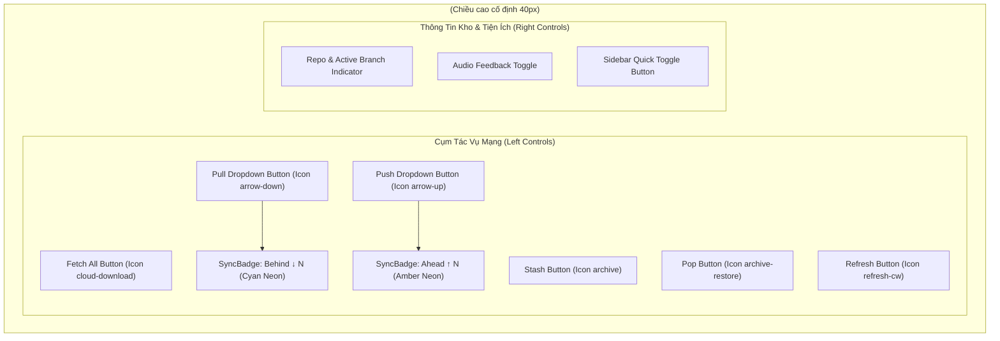

# 06. Thiết Kế Chi Tiết Thanh Công Cụ Đỉnh Toàn Cục & Huy Hiệu Đồng Bộ

Tài liệu này đặc tả chi tiết kiến trúc tầng Giao diện (Webview UI), các Component thành phần của thanh công cụ đỉnh (`GlobalToolbar`, `SyncBadge`, `ToolbarDropdownButton`), kho trạng thái phản ứng `sync.store.ts` bằng Preact Signals, và cơ chế tự động đồng bộ thời gian thực qua Dispatcher cho **Phase 3.2: Nhóm Việc 2 — Thiết Kế & Triển Khai Thanh Công Cụ Đỉnh Toàn Cục**.

> [!NOTE]
> Mọi nội dung trong tài liệu này tuân thủ nguyên tắc: thiết kế và đặc tả bằng ngôn ngữ tự nhiên (**Design by Word**), tập trung vào cấu trúc component, luồng dữ liệu phản ứng, quy chuẩn thẩm mỹ Cyber-Lab và bảo đảm phản xạ thời gian thực (**Realtime State Guarantee**); **tuyệt đối không sử dụng mã nguồn mẫu hoặc khối code block dưới bất kỳ hình thức nào**.
>
> Toàn bộ nhãn nút, gợi ý tooltip, trạng thái tải và thông báo giao diện **sử dụng tiếng Anh chuẩn mực làm ngôn ngữ chính thức**. Phần giải nghĩa tiếng Việt trong tài liệu đóng vai trò tham khảo kỹ thuật.
>
> 📌 **Truy vết tiến độ**: [Phase 3.2 Tiến Độ (Nhóm Việc 2)](../../03_progess/phase3/002_phase3_2_3pane_workspace.md#nhóm-việc-2-thiết-kế--triển-khai-thanh-công-cụ-đỉnh-toàn-cục-top-toolbar).

---

## 1. Tầm Nhìn, Mục Tiêu & Trải Nghiệm Người Dùng

### 1.1. Mục Tiêu Cốt Lõi
1. **Thay thế thanh tiêu đề cũ**: Loại bỏ hoàn toàn component di sản `MainHeader.tsx`, thay bằng `GlobalToolbar.tsx` mang phong cách Cyber-Lab nhất quán với hệ thống viền đinh tán chữ thập góc và bảng màu tối tương phản cao.
2. **Cụm tác vụ mạng trực quan một chạm**: Bố trí các nút tác vụ cốt lõi (`Fetch All`, `Pull`, `Push`, `Stash`, `Pop`, `Refresh`) tại thanh công cụ đỉnh với vùng bấm đạt chuẩn tối thiểu 32px x 32px, tooltip tiếng Anh rõ nghĩa và trạng thái đang tải (Busy State) chống thao tác lặp.
3. **Huy hiệu phát quang Neon phản xạ trung thực**: Hiển thị số lượng commit chênh lệch giữa Local Branch và Upstream Remote Branch qua `SyncBadge` với màu sắc trực quan (Xanh lơ Neon cho `↓behind`, Vàng hổ phách Neon cho `↑ahead`).
4. **Trực giao hóa tương tác (Orthogonal Interaction)**: Tích hợp menu dropdown cho các thao tác phân nhánh (Pull Merge vs Pull Rebase; Push tiêu chuẩn vs Force Push with lease) mà không làm phức tạp luồng bấm mặc định.

### 1.2. Cam Kết Phản Xạ Thời Gian Thực (Realtime State Guarantee)
- Đúc kết từ bài học lỗi STT 18 của Phase 3.1: Mọi hành động kích hoạt từ Toolbar sau khi được Backend thực thi thành công **bắt buộc phải đi qua Router tập trung trong `dispatcher.ts`** để tự động kích hoạt chuỗi làm mới 3 chiều:
  1. `refresh()`: Nạp lại đồ thị DAG ảo hóa và các commit mới từ F# Core Engine.
  2. `refreshStatus()`: Nạp lại trạng thái Working Tree và Staging Index.
  3. `refreshSyncStatus()`: Nạp lại số đếm ahead/behind để cập nhật huy hiệu nút bấm.

---

## 2. Đặc Tả Kiến Trúc Giao Diện & Phân Rã Component

---

### 2.1. Component `GlobalToolbar.tsx`

- **Vị trí & Bố cục**: Đặt cố định ở đỉnh toàn bộ Webview, chiều cao cố định 40px, phân tách với thân làm việc bằng viền đáy kỹ thuật 1px.
- **Phong cách Cyber-Lab**:
  - Dark Mode: Nền tối sâu `#0f172a`, viền `#334155`.
  - Light Mode: Nền sáng nhẹ `#f8fafc`, viền `#cbd5e1`.
  - Đệm lề ngang 12px, căn chỉnh hai cụm điều khiển trái/phải qua bố cục flexbox giãn cách hai đầu (`justify-content: space-between; align-items: center`).

#### Bảng Thuộc Tính Props Của `GlobalToolbar`:

| Tên Thuộc Tính | Kiểu Dữ Liệu | Bắt Buộc? | Mặc Định | Ràng Buộc & Mô Tả Ý Nghĩa |
| :--- | :--- | :---: | :---: | :--- |
| `repoName` | string | Có | - | Chuỗi tên thư mục kho Git hiện tại đang mở trên VS Code |
| `currentBranch` | string \| null | Có | - | Tên nhánh đang checkout tại HEAD (hoặc null nếu detached) |
| `isSidebarCollapsed` | boolean | Có | - | Trạng thái thu gọn của cây điều hướng bên trái |
| `onToggleSidebar` | () => void | Có | - | Hàm callback đảo trạng thái thu gọn Sidebar |

#### Cấu Trúc DOM Phân Tầng Của `GlobalToolbar`:
1. **Khung bao ngoài (`toolbar-container`)**: Thẻ `<header>` với chiều cao cố định 40px, `overflow: visible` để các dropdown menu không bị cắt viền.
2. **Cụm bên trái (`toolbar-actions-left`)**: Thẻ `
` bố cục `flex-row`, khoảng cách giữa các phần tử `gap: 6px`. Chứa tuần tự:
   - Nút `Fetch All`.
   - Nút `Pull` kết hợp `SyncBadge (behind)` và mũi tên dropdown.
   - Nút `Push` kết hợp `SyncBadge (ahead)` và mũi tên dropdown.
   - Vạch phân cách kỹ thuật đứng (`toolbar-divider`) rộng 1px, cao 18px.
   - Nút `Stash`.
   - Nút `Pop`.
   - Vạch phân cách kỹ thuật đứng.
   - Nút `Refresh`.
3. **Cụm bên phải (`toolbar-controls-right`)**: Thẻ `
` bố cục `flex-row`, `gap: 8px`. Chứa:
   - Huy hiệu định danh kho và nhánh: Biểu tượng Git Repo, tên kho, mũi tên trỏ vào tên nhánh checkout (in đậm phát quang tím nhẹ).
   - Nút bật/tắt phản hồi âm thanh (Audio Feedback Toggle).
   - Nút đóng/mở nhanh Sidebar (`Sidebar Toggle Button`).

---

### 2.2. Component `SyncBadge.tsx`

Huy hiệu số đếm gắn trực tiếp bên cạnh nhãn của nút `Pull` và `Push` để cảnh báo số lượng commit chênh lệch giữa máy cục bộ và máy chủ remote.

#### Bảng Thuộc Tính Props Của `SyncBadge`:

| Tên Thuộc Tính | Kiểu Dữ Liệu | Bắt Buộc? | Mặc Định | Ràng Buộc & Mô Tả Ý Nghĩa |
| :--- | :--- | :---: | :---: | :--- |
| `direction` | "ahead" \| "behind" | Có | - | Hướng chênh lệch: `"ahead"` (chờ push) hoặc `"behind"` (chờ pull) |
| `count` | number | Có | - | Số lượng commit chênh lệch. Ràng buộc là số nguyên không âm ($\ge 0$) |

#### Quy Chuẩn Hiển Thị & Quy Tắc Render Từng Bước:
1. *Bước 1 (Kiểm tra điều kiện hiển thị)*: Nếu `count <= 0`, component lập tức trả về `null` (ẩn hoàn toàn khỏi DOM để tránh ô nhiễm thị giác).
2. *Bước 2 (Xác định văn bản hiển thị)*:
   - Nếu `direction === "behind"`: Chuỗi văn bản là `"↓ " + count` (ví dụ `"↓ 3"`).
   - Nếu `direction === "ahead"`: Chuỗi văn bản là `"↑ " + count` (ví dụ `"↑ 1"`).
3. *Bước 3 (Áp dụng phong cách Cyber-Lab Capsule)*:
   - Chiều cao chuẩn 16px, đệm lề ngang 6px, bo góc 8px (dạng viên thuốc Capsule).
   - Phông chữ Monospace kích thước 10px in hoa đậm (`font-weight: 700`).
   - Nếu hướng là `"behind"`:
     - Nền: Xanh lơ nhạt trong suốt `rgba(6, 182, 212, 0.15)`.
     - Viền: Viền 1px màu xanh lơ Neon `#06b6d4`.
     - Chữ: Màu xanh lơ phát quang `#22d3ee`.
     - Hiệu ứng phát quang nhẹ: `box-shadow: 0 0 6px rgba(6, 182, 212, 0.4)`.
   - Nếu hướng là `"ahead"`:
     - Nền: Vàng hổ phách nhạt trong suốt `rgba(245, 158, 11, 0.15)`.
     - Viền: Viền 1px màu vàng hổ phách Neon `#f59e0b`.
     - Chữ: Màu vàng hổ phách phát quang `#fbbf24`.
     - Hiệu ứng phát quang nhẹ: `box-shadow: 0 0 6px rgba(245, 158, 11, 0.4)`.

---

### 2.3. Component Nút Tác Vụ Kèm Dropdown Menu (`ToolbarDropdownButton.tsx`)

Áp dụng cho nút `Pull` và `Push` trên thanh công cụ để cung cấp tùy chọn nâng cao mà không làm phá vỡ thao tác 1 chạm cơ bản.

#### Bảng Thuộc Tính Props Của `ToolbarDropdownButton`:

| Tên Thuộc Tính | Kiểu Dữ Liệu | Bắt Buộc? | Mặc Định | Mô Tả Ý Nghĩa |
| :--- | :--- | :---: | :---: | :--- |
| `icon` | string | Có | - | Tên biểu tượng hiển thị (ví dụ `"arrow-down"`, `"arrow-up"`) |
| `label` | string | Có | - | Nhãn hiển thị chính bằng tiếng Anh (ví dụ `"Pull"`, `"Push"`) |
| `badgeCount` | number | Không | `0` | Số lượng commit truyền vào `SyncBadge` |
| `badgeDirection` | "ahead" \| "behind" | Có | - | Hướng chênh lệch của `SyncBadge` |
| `isLoading` | boolean | Có | - | Cờ đánh dấu tiến trình đang chạy để kích hoạt spinner |
| `disabled` | boolean | Có | - | Cờ vô hiệu hóa nút bấm |
| `onPrimaryClick` | () => void | Có | - | Callback khi người dùng nhấp vào nửa chính bên trái |
| `menuItems` | Array<DropdownItem> | Có | - | Danh sách các tùy chọn bên trong menu thả xuống |

#### Cấu Trúc Đối Tượng `DropdownItem`:
- `id`: Chuỗi định danh tùy chọn (ví dụ `"pull-merge"`, `"pull-rebase"`, `"push-standard"`, `"push-force"`).
- `label`: Tiêu đề tiếng Anh hiển thị trong menu (ví dụ `"Pull (Merge)"`, `"Pull with Rebase"`).
- `description`: Hướng dẫn phụ mờ tiếng Anh giải thích hành vi.
- `onSelect`: Hàm callback kích hoạt khi tùy chọn được nhấp.

#### Cấu Trúc Khối Nút Bấm Chia Đôi (Split Button Architecture):
1. **Nửa chính (Primary Action Area - 75% chiều rộng)**:
   - Chứa biểu tượng icon, nhãn chữ tiếng Anh và component `SyncBadge`.
   - Khi `isLoading === true`: Thay thế biểu tượng icon bằng icon Spinner xoay 360 độ chu kỳ 1s.
   - Khi nhấp chuột vào nửa này: Kích hoạt ngay `onPrimaryClick()`.
2. **Nửa phụ (Dropdown Arrow Area - 25% chiều rộng)**:
   - Phân tách với nửa chính bằng vạch mờ 1px.
   - Chứa biểu tượng mũi tên tam giác nhỏ quay xuống (Chevron Down).
   - Khi nhấp chuột vào nửa này: Bật/tắt trạng thái mở menu dropdown (`isMenuOpen = !isMenuOpen`).

#### Bảng Danh Mục Tùy Chọn Menu Thả Xuống:

| Nút Điều Khiển | Tùy Chọn Mặc Định (Primary) | Tùy Chọn Nâng Cao Trong Dropdown | Mô Tả Hành Vi Chi Tiết |
| :--- | :--- | :--- | :--- |
| **Pull Menu** | `"Pull (Merge)"` | `"Pull with Rebase"` | Tùy chọn 1 gọi `pull('merge')`; Tùy chọn 2 gọi `pull('rebase')`. |
| **Push Menu** | `"Push"` | `"Force Push (with lease)"` | Tùy chọn 1 gọi `push()`; Tùy chọn 2 gọi `push({ forceWithLease: true })`. |

#### Quy Trình Xử Lý Sự Kiện Bẫy Chuột & Bàn Phím Từng Bước:
1. *Bước 1 (Đăng ký bắt chuột ra ngoài - Click Outside)*: Khi menu mở (`isMenuOpen === true`), đăng ký một listener sự kiện `mousedown` trên toàn bộ thẻ `document`. Nếu tọa độ con trỏ chuột không nằm trong phần tử container của dropdown, tự động gán `isMenuOpen = false`.
2. *Bước 2 (Đăng ký phím Esc)*: Đăng ký listener sự kiện `keydown`. Nếu mã phím là `"Escape"`, gán ngay `isMenuOpen = false` và giữ nguyên tiêu điểm tại nút chính.
3. *Bước 3 (Dọn dẹp Listener)*: Khi menu đóng lại hoặc component unmount, hủy đăng ký toàn bộ listener trên `document` để chống rò rỉ bộ nhớ.

---

## 3. Quản Lý Trạng Thái Bằng Preact Signals (`sync.store.ts`)

Kho trạng thái `sync.store.ts` chịu trách nhiệm toàn bộ dữ liệu phản ứng liên quan đến đồng bộ mạng và số đếm commit chênh lệch giữa các branch.

### 3.1. Bảng Danh Mục Tín Hiệu Cơ Sở (Base Signals)

| Tên Tín Hiệu | Kiểu Dữ Liệu | Giá Trị Khởi Tạo | Mô Tả Ý Nghĩa Nghiệp Vụ |
| :--- | :--- | :---: | :--- |
| `aheadCount` | number | `0` | Số lượng commit cục bộ đã commit nhưng chưa đẩy lên remote |
| `behindCount` | number | `0` | Số lượng commit trên remote chưa kéo về thư mục làm việc |
| `upstreamBranch` | string \| null | `null` | Tên nhánh remote tracking tương ứng (ví dụ `"origin/main"`) |
| `isDetached` | boolean | `false` | Cờ đánh dấu kho đang ở trạng thái Detached HEAD |
| `isFetching` | boolean | `false` | Cờ đánh dấu tiến trình `fetchAll` đang chạy |
| `isPulling` | boolean | `false` | Cờ đánh dấu tiến trình `pull` đang chạy |
| `isPushing` | boolean | `false` | Cờ đánh dấu tiến trình `push` đang chạy |
| `isStashing` | boolean | `false` | Cờ đánh dấu tiến trình `stashSave` / `stashPop` đang chạy |

---

### 3.2. Bảng Danh Mục Tín Hiệu Dẫn Xuất (Computed Signals)

| Tên Tín Hiệu | Kiểu Dữ Liệu | Công Thức / Logic Tính Toán | Mô Tả Ý Nghĩa |
| :--- | :--- | :--- | :--- |
| `hasPendingSync` | boolean | `aheadCount.value > 0 \|\| behindCount.value > 0` | Tự động bằng `true` khi kho có commit lệch cần đồng bộ |
| `isNetworkBusy` | boolean | `isFetching.value \|\| isPulling.value \|\| isPushing.value \|\| isStashing.value` | Tự động bằng `true` khi có bất kỳ tác vụ mạng/lưu trữ nào đang thực thi |
| `syncStatusText` | string | - Nếu `behindCount > 0 && aheadCount > 0` $\rightarrow$ `"N ahead, M behind"` - Nếu `behindCount > 0` $\rightarrow$ `"N commit(s) behind"` - Nếu `aheadCount > 0` $\rightarrow$ `"N commit(s) ahead"` - Ngược lại $\rightarrow$ `"Up to date"` | Chuỗi thông báo trạng thái tóm tắt tiếng Anh |

---

### 3.3. Đặc Tả Chi Tiết Input / Output & Các Bước Xử Lý Của Bộ Hàm Điều Phối

Mọi hàm điều phối trong `sync.store.ts` đều phải tuân thủ nghiêm ngặt tiêu chuẩn giao diện hộp đen:

#### 1. Hàm `loadSyncStatus(repo: string): Promise<void>`
- **Đặc Tả Đầu Vào (Input)**:
  - Tham số `repo`: Kiểu chuỗi ký tự bắt buộc. Đường dẫn tuyệt đối đến repository hiện tại.
- **Đặc Tả Đầu Ra (Output)**:
  - `Promise<void>`: Không trả về giá trị trực tiếp; cập nhật kết quả vào các tín hiệu cơ sở.
- **Quy Trình Các Bước Xử Lý Cụ Thể**:
  1. *Bước 1 (Gửi Query RPC)*: Gọi phương thức `WebviewBridge.postMessage({ type: 'query', query: 'syncStatus', params: { repo } })`.
  2. *Bước 2 (Xử lý phản hồi)*:
     - Nhận đối tượng phản hồi có cấu trúc `SyncStatusResult`.
     - Gán `aheadCount.value = response.ahead`.
     - Gán `behindCount.value = response.behind`.
     - Gán `upstreamBranch.value = response.upstream`.
     - Gán `isDetached.value = response.isDetached`.
  3. *Bước 3 (Bẫy ngoại lệ)*:
     - Nếu xảy ra lỗi mạng hoặc lỗi RPC: Không ném exception ra ngoài làm sập giao diện; reset các tín hiệu về giá trị an toàn: `aheadCount.value = 0`, `behindCount.value = 0`, `upstreamBranch.value = null`.

---

#### 2. Hàm `fetch(prune = true): Promise<void>`
- **Đặc Tả Đầu Vào (Input)**:
  - Tham số `prune`: Kiểu boolean, tùy chọn, mặc định `true`.
- **Đặc Tả Đầu Ra (Output)**:
  - `Promise<void>`.
- **Quy Trình Các Bước Xử Lý Cụ Thể**:
  1. *Bước 1 (Khóa trạng thái bận)*: Nếu `isNetworkBusy.value === true`, lập tức thoát hàm để chống kích hoạt trùng lặp. Gán `isFetching.value = true`.
  2. *Bước 2 (Gửi Action RPC)*: Gọi `WebviewBridge.postMessage({ type: 'action', action: 'fetchAll', payload: { prune } })`.
  3. *Bước 3 (Tiếp nhận kết quả)*:
     - Nhận đối tượng `MutatorResult` từ Backend.
     - Gán `isFetching.value = false`.
     - Nếu `result.ok === false`: Kích hoạt hiển thị hộp thoại thông báo lỗi tiếng Anh chuẩn hóa trích xuất từ `result.stderr`.
     - Nếu `result.ok === true`: Chuyển tiếp tới Router tập trung trong `dispatcher.ts` để kích hoạt chuỗi làm mới 3 chiều (`refresh()`, `refreshStatus()`, `loadSyncStatus()`).

---

#### 3. Hàm `pull(mode: 'merge' | 'rebase' = 'merge'): Promise<void>`
- **Đặc Tả Đầu Vào (Input)**:
  - Tham số `mode`: Kiểu chuỗi ký tự, chỉ nhận một trong hai giá trị `"merge"` hoặc `"rebase"`. Mặc định là `"merge"`.
- **Đặc Tả Đầu Ra (Output)**:
  - `Promise<void>`.
- **Quy Trình Các Bước Xử Lý Cụ Thể**:
  1. *Bước 1 (Khóa trạng thái bận)*: Kiểm tra `isNetworkBusy.value`. Nếu đang bận, thoát ngay. Gán `isPulling.value = true`.
  2. *Bước 2 (Gửi Action RPC)*: Gọi `WebviewBridge.postMessage({ type: 'action', action: 'pull', payload: { mode } })`.
  3. *Bước 3 (Xử lý kết quả & xung đột)*:
     - Nhận `MutatorResult` từ Backend.
     - Gán `isPulling.value = false`.
     - Nếu `result.ok === false`: Mở modal cảnh báo xung đột tiếng Anh cho người dùng (ví dụ: yêu cầu giải quyết conflict trong working tree).
     - Nếu `result.ok === true`: Kích hoạt bộ điều phối âm thanh phát âm click xác nhận và gọi chuỗi làm mới toàn diện qua `dispatcher.ts`.

---

#### 4. Hàm `push(forceWithLease = false): Promise<void>`
- **Đặc Tả Đầu Vào (Input)**:
  - Tham số `forceWithLease`: Kiểu boolean, tùy chọn, mặc định `false`.
- **Đặc Tả Đầu Ra (Output)**:
  - `Promise<void>`.
- **Quy Trình Các Bước Xử Lý Cụ Thể**:
  1. *Bước 1 (Khóa trạng thái bận)*: Kiểm tra `isNetworkBusy.value`. Nếu bận, thoát ngay. Gán `isPushing.value = true`.
  2. *Bước 2 (Gửi Action RPC)*: Gọi `WebviewBridge.postMessage({ type: 'action', action: 'push', payload: { forceWithLease } })`.
  3. *Bước 3 (Xử lý kết quả)*:
     - Nhận `MutatorResult`.
     - Gán `isPushing.value = false`.
     - Nếu `result.ok === false`: Hiển thị thông báo tiếng Anh chuẩn hóa hướng dẫn người dùng pull trước khi push nếu bị từ chối non-fast-forward.
     - Nếu `result.ok === true`: Kích hoạt âm thanh thăng hoa quãng 5 (Leica Push Success) và gọi chuỗi làm mới qua `dispatcher.ts`.

---

#### 5. Hàm `stash(message?: string, includeUntracked = false): Promise<void>`
- **Đặc Tả Đầu Vào (Input)**:
  - Tham số `message`: Chuỗi ký tự mô tả nội dung stash (tùy chọn).
  - Tham số `includeUntracked`: Kiểu boolean, mặc định `false`.
- **Đặc Tả Đầu Ra (Output)**:
  - `Promise<void>`.
- **Quy Trình Các Bước Xử Lý Cụ Thể**:
  1. *Bước 1*: Gán `isStashing.value = true`.
  2. *Bước 2*: Gửi Action RPC `stashSave` kèm payload `{ message, includeUntracked }`.
  3. *Bước 3*: Nhận kết quả từ Backend; gán `isStashing.value = false`.
  4. *Bước 4*: Nếu thành công, kích hoạt `refreshStatus()` và `refreshStashList()`.

---

#### 6. Hàm `pop(index = 0): Promise<void>`
- **Đặc Tả Đầu Vào (Input)**:
  - Tham số `index`: Kiểu số nguyên không âm, mặc định `0`.
- **Đặc Tả Đầu Ra (Output)**:
  - `Promise<void>`.
- **Quy Trình Các Bước Xử Lý Cụ Thể**:
  1. *Bước 1*: Gán `isStashing.value = true`.
  2. *Bước 2*: Gửi Action RPC `stashPop` kèm payload `{ index }`.
  3. *Bước 3*: Nhận kết quả; gán `isStashing.value = false`.
  4. *Bước 4*: Nếu có xung đột khi pop stash, hiển thị thông báo tiếng Anh; nếu thành công, kích hoạt chuỗi làm mới trạng thái.

---

## 4. Bảng Nhãn Nút, Tooltip & Thông Báo Giao Diện (UI Strings Dictionary)

Toàn bộ văn bản hiển thị trên thanh công cụ đỉnh **bắt buộc sử dụng tiếng Anh chuẩn mực**:

| Phần Tử Giao Diện | Nhãn Hiển Thị (Display Label) | Chú Thích Rê Chuột (Tooltip) | Trạng Thái Đang Tải (Busy State) |
| :--- | :--- | :--- | :--- |
| **Nút Fetch** | `"Fetch All"` | `"Fetch latest commits from all remotes"` | Biểu tượng xoay 360 độ (Spinner) |
| **Nút Pull** | `"Pull"` | `"Pull changes from upstream branch into current"` | Biểu tượng xoay 360 độ |
| **Tùy chọn Pull Merge** | `"Pull (Merge)"` | `"Incorporate upstream changes using merge strategy"` | - |
| **Tùy chọn Pull Rebase** | `"Pull with Rebase"` | `"Replay local commits on top of upstream branch"` | - |
| **Nút Push** | `"Push"` | `"Push local commits to upstream branch"` | Biểu tượng xoay 360 độ |
| **Tùy chọn Push Standard** | `"Push"` | `"Publish local commits to tracking branch"` | - |
| **Tùy chọn Push Force** | `"Force Push (with lease)"` | `"Safely overwrite remote branch with lease protection"` | - |
| **Nút Stash** | `"Stash"` | `"Save working changes to stash"` | Nút bị vô hiệu hóa tạm thời |
| **Nút Pop** | `"Pop"` | `"Restore and drop most recent stash"` | Nút bị vô hiệu hóa tạm thời |
| **Nút Refresh** | `"Refresh"` | `"Refresh repository graph and status"` | Biểu tượng xoay 1 vòng |
| **Huy hiệu Behind** | `"↓ " + N` | `"N commit(s) on remote to pull"` | - |
| **Huy hiệu Ahead** | `"↑ " + N` | `"N commit(s) locally to push"` | - |
| **Kho Đồng Bộ** | `"Up to date"` | `"Local branch is synchronized with remote"` | - |
| **Nhánh Detached** | `"Detached HEAD"` | `"Repository is currently at detached commit"` | Cảnh báo viền vàng |

---

## 5. Ma Trận Kiểm Thử Đơn Vị Song Hành (Unit Testing Matrix)

Mọi tệp kiểm thử cho Nhóm Việc 2 bắt buộc đặt tên với đuôi `*.test.ts`, vận hành độc lập trên runner `vitest` và kiểm định đầy đủ các trạng thái tín hiệu Preact:

| Tệp Kiểm Thử Độc Lập | Module Mục Tiêu | Kịch Bản Kiểm Thử Chi Tiết Bắt Buộc |
| :--- | :--- | :--- |
| `tests/webview/lib/stores/sync.store.test.ts` | `sync.store.ts` | 1. **Khởi tạo store**: Các giá trị mặc định bằng 0, cờ mạng bằng `false`. 2. **Tính toán `hasPendingSync`**: Đúng khi `ahead > 0` hoặc `behind > 0`; sai khi cả hai bằng 0. 3. **Tính toán `isNetworkBusy`**: Đúng khi ít nhất một cờ mạng bật; sai khi toàn bộ tắt. 4. **Cập nhật dữ liệu từ RPC**: Nạp kết quả query gán chính xác `aheadCount`, `behindCount`, `upstreamBranch`, `isDetached`. 5. **Xử lý lỗi RPC**: Khi truy vấn query thất bại, store reset an toàn về 0 mà không vỡ ứng dụng. 6. **Dispatcher kích hoạt cờ loading**: Kiểm tra cờ `isFetching`, `isPulling`, `isPushing`, `isStashing` bật khi gọi action và tự động tắt khi có phản hồi. 7. **Chống gọi trùng lặp (Double Invocations)**: Gọi liên tiếp hai lần `push()`, xác nhận chỉ có đúng 1 lệnh RPC được gửi đi. |
| `tests/webview/components/toolbar/GlobalToolbar.test.ts` | `GlobalToolbar.tsx` & `SyncBadge.tsx` | 1. **Render đầy đủ**: Kết xuất chính xác 6 nút tác vụ mạng/stash và cụm thông tin kho. 2. **Hiển thị huy hiệu `SyncBadge`**: Hiển thị nhãn `"↓ 2"` màu xanh lơ khi `behind = 2`; hiển thị `"↑ 1"` màu hổ phách khi `ahead = 1`. 3. **Ẩn huy hiệu**: Khi `ahead = 0 && behind = 0`, huy hiệu tự động ẩn hoàn toàn khỏi DOM. 4. **Click kích hoạt Action RPC**: Nhấp nút Fetch All gọi đúng action `fetchAll`; nhấp Pull gọi `pull`. 5. **Dropdown Menu tương tác**: Nhấp mũi tên mở menu tùy chọn; nhấp tùy chọn Rebase gọi đúng `pull('rebase')`; nhấp ra ngoài tự động đóng menu; bấm phím `Esc` đóng menu. 6. **Vô hiệu hóa khi bận (Busy State)**: Khi `isNetworkBusy = true`, các nút bấm tự động có thuộc tính `disabled` chống click lặp. |
