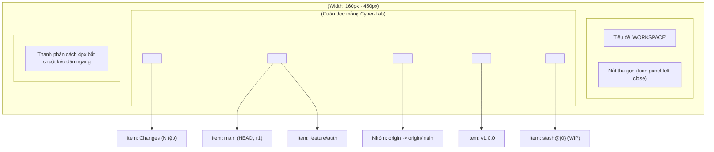

# 07. Thiết Kế Chi Tiết Cây Điều Hướng Left Sidebar Navigator

Tài liệu này đặc tả chi tiết kiến trúc tầng Giao diện (Webview UI), các Component thành phần của thanh điều hướng bên trái (`SidebarNavigator`, `SidebarSection`, `SidebarItem`, `SidebarResizer`), cơ chế co giãn kích thước linh hoạt, kho trạng thái `sidebar.store.ts` bằng Preact Signals, và các tương tác người dùng cho **Phase 3.2: Nhóm Việc 3 — Thiết Kế & Triển Khai Cây Điều Hướng Left Sidebar Navigator**.

> [!NOTE]
> Mọi nội dung trong tài liệu này tuân thủ nguyên tắc: thiết kế và đặc tả bằng ngôn ngữ tự nhiên (**Design by Word**), tập trung vào cấu trúc cây dữ liệu phân cấp, giải thuật kéo thả chuột mượt mà, lưu trữ trạng thái người dùng; **tuyệt đối không sử dụng mã nguồn mẫu hoặc khối code block dưới bất kỳ hình thức nào**.
>
> Toàn bộ tiêu đề nhóm, nhãn phần tử, menu ngữ cảnh và thông báo giao diện **sử dụng tiếng Anh chuẩn mực làm ngôn ngữ chính thức**. Phần giải nghĩa tiếng Việt trong tài liệu đóng vai trò tham khảo kỹ thuật.
>
> 📌 **Truy vết tiến độ**: [Phase 3.2 Tiến Độ (Nhóm Việc 3)](../../03_progess/phase3/002_phase3_2_3pane_workspace.md#nhóm-việc-3-thiết-kế--triển-khai-cây-điều-hướng-left-sidebar-navigator).

---

## 1. Tầm Nhìn, Mục Tiêu & Trải Nghiệm Điều Hướng

### 1.1. Mục Tiêu Cốt Lõi
1. **Bao quát toàn bộ tài nguyên Git trong một điểm nhìn**: Cung cấp cây phân cấp trực quan ở cột trái chia làm 5 phân nhóm chuyên biệt:
   - **Working Tree**: Hiển thị số lượng tệp biến động (`Changes: N`), nhấp chuột kích hoạt mở ngay phân vùng Staging Area & Commit Composer ở bảng phải.
   - **Local Branches**: Toàn bộ nhánh cục bộ, làm nổi bật nhánh `HEAD` đang checkout bằng viền tím Neon `#a855f7` và icon checkmark, hiển thị số commit chưa push cạnh từng nhánh (ví dụ: `feature/login ↑2`).
   - **Remotes**: Cây phân cấp theo tên remote (`origin`, `upstream`), bên trong chứa danh sách các nhánh remote tương ứng.
   - **Tags**: Danh sách toàn bộ các mốc phát hành (Release Tags).
   - **Stashes**: Danh sách các bản cất giữ tạm thời với chỉ số index và tiêu đề tóm tắt.
2. **Kéo dãn linh hoạt với biên an toàn tuyệt đối**: Cho phép lập trình viên tự do kéo dãn chiều rộng Sidebar từ $160\text{px}$ đến $450\text{px}$ qua thanh kéo `SidebarResizer`, hoặc thu gọn nhanh về $0\text{px}$ qua nút Toggle để tập trung 100% không gian cho bảng đồ thị DAG.
3. **Lưu trữ trạng thái người dùng bền vững (State Persistence)**: Tự động ghi nhớ chiều rộng (`sidebarWidth`), trạng thái thu gọn (`isCollapsed`) và các phân nhóm đang mở (`expandedSectionIds`) vào `localStorage` của Webview. Cấu hình được khôi phục nguyên vẹn ngay khi mở lại VS Code.

---

## 2. Đặc Tả Kiến Trúc Giao Diện & Phân Rã Component

---

### 2.1. Component `SidebarNavigator.tsx`

- **Vị trí & Bố cục**: Đặt tại cột trái của giao diện, chiều cao chiếm trọn vẹn $100\%$ chiều cao vùng làm việc dưới Toolbar, bố cục flex-column, viền phải kỹ thuật 1px.
- **Quy chuẩn hiển thị co giãn**:
  - Khi mở (`isCollapsed === false`): Chiều rộng bằng đúng giá trị pixel của tín hiệu `sidebarWidth.value` (mặc định $220\text{px}$, giới hạn trong khoảng $[160\text{px}, 450\text{px}]$).
  - Khi thu gọn (`isCollapsed === true`): Chiều rộng co về $0\text{px}$, thiết lập `overflow: hidden; opacity: 0; pointer-events: none; transition: width 150ms ease-in-out, opacity 150ms ease-in-out`.

#### Bảng Thuộc Tính Props Của `SidebarNavigator`:

| Tên Thuộc Tính | Kiểu Dữ Liệu | Bắt Buộc? | Mặc Định | Ràng Buộc & Mô Tả Ý Nghĩa |
| :--- | :--- | :---: | :---: | :--- |
| `branches` | Array<BranchItem> | Có | - | Danh sách các nhánh cục bộ kèm số đếm ahead |
| `currentHead` | string \| null | Có | - | Tên nhánh đang checkout tại HEAD (hoặc null nếu detached) |
| `remotes` | Array<RemoteGroup> | Có | - | Cấu trúc danh sách remote và các nhánh con tương ứng |
| `tags` | Array<string> | Có | - | Danh sách tên toàn bộ các release tag |
| `stashes` | Array<StashRecord> | Có | - | Danh sách bản ghi stash nhập khẩu từ `src/types/queries.ts` |
| `unstagedCount` | number | Có | - | Số lượng tệp biến động chưa đưa vào Staging |
| `stagedCount` | number | Có | - | Số lượng tệp đã đưa vào Staging Index |

#### Cấu Trúc Đối Tượng `BranchItem`:
- `name`: Tên nhánh cục bộ (string).
- `isHead`: Đánh dấu nhánh hiện tại (boolean).
- `aheadCount`: Số commit chưa push của riêng nhánh này (number).
- `upstream`: Tên nhánh remote theo dõi tương ứng (string hoặc null).

#### Cấu Trúc Đối Tượng `StashRecord` (Chuẩn Hóa Hợp Đồng RPC):
- `index`: Chỉ số của bản stash trong ngăn xếp (number $\ge 0$).
- `hash`: Mã băm commit đại diện rút gọn (string).
- `message`: Tiêu đề nội dung bản stash (string).
- `date`: Chuỗi thời gian lưu trữ tương đối (string).

---

### 2.2. Component `SidebarSection.tsx`

Khung phân nhóm có thể gập mở (Collapsible Accordion), đóng vai trò phân định các danh mục tài nguyên Git.

#### Bảng Thuộc Tính Props Của `SidebarSection`:

| Tên Thuộc Tính | Kiểu Dữ Liệu | Bắt Buộc? | Mặc Định | Mô Tả Ý Nghĩa |
| :--- | :--- | :---: | :---: | :--- |
| `id` | string | Có | - | Mã định danh duy nhất của nhóm (ví dụ `"branches"`, `"stashes"`) |
| `title` | string | Có | - | Tiêu đề nhóm hiển thị bằng tiếng Anh in hoa (ví dụ `"LOCAL BRANCHES"`) |
| `isExpanded` | boolean | Có | - | Trạng thái mở rộng (hiển thị con) hoặc gập lại |
| `badgeCount` | number | Không | `undefined` | Số lượng phần tử hiển thị dạng huy hiệu nhỏ cạnh tiêu đề |
| `onToggle` | () => void | Có | - | Hàm callback khi người dùng bấm vào tiêu đề nhóm để gập/mở |
| `actionIcon` | string | Không | `undefined` | Tên biểu tượng nút tác vụ vi mô bên phải (ví dụ `"+"` để tạo nhánh) |
| `onAction` | () => void | Không | `undefined` | Hàm callback khi người dùng bấm vào nút tác vụ vi mô |

#### Quy Chuẩn Hiển Thị & Chuyển Động:
- **Dòng Tiêu Đề (Header Row)**:
  - Chiều cao cố định 24px, đệm lề ngang 8px, phông chữ Monospace in hoa cỡ 11px đậm (`font-weight: 700`), màu chữ xám bạc `#94a3b8`.
  - Icon Chevron bên trái: Xoay góc 90 độ mượt mà với hiệu ứng CSS transition 150ms khi chuyển đổi giữa trạng thái mở và gập.
  - Vùng bấm chiếm trọn chiều rộng dòng (trừ nút tác vụ phụ).
- **Nút Tác Vụ Vi Mô (Action Icon)**:
  - Đặt ở mép phải của Header Row.
  - Nút `+` (trên nhóm Branches): Nhấp chuột mở modal tạo nhánh mới từ commit hiện tại. Nút có `stopImmediatePropagation()` để không gây gập/mở nhóm khi nhấp.
- **Thân Nhóm (Section Body)**:
  - Khi `isExpanded === true`: Hiển thị danh sách các item con.
  - Khi `isExpanded === false`: Ẩn hoàn toàn khỏi DOM để tiết kiệm tài nguyên kết xuất.

---

### 2.3. Component `SidebarItem.tsx`

Dòng hiển thị từng phần tử riêng lẻ bên trong một Section.

#### Bảng Thuộc Tính Props Của `SidebarItem`:

| Tên Thuộc Tính | Kiểu Dữ Liệu | Bắt Buộc? | Mặc Định | Mô Tả Ý Nghĩa |
| :--- | :--- | :---: | :---: | :--- |
| `type` | string | Có | - | Phân loại: `"working-tree"`, `"branch"`, `"remote-branch"`, `"tag"`, `"stash"` |
| `label` | string | Có | - | Văn bản chính hiển thị (Tên nhánh, tên tag, tiêu đề stash) |
| `isHead` | boolean | Không | `false` | Đánh dấu nếu đây là nhánh cục bộ đang active tại HEAD |
| `aheadCount` | number | Không | `0` | Số commit cục bộ chưa push của riêng nhánh này |
| `icon` | string | Có | - | Tên icon đại diện (`git-branch`, `tag`, `archive`, `file-diff`) |
| `secondaryLabel` | string | Không | `undefined` | Văn bản phụ mờ (ví dụ thời gian date của stash) |
| `onClick` | () => void | Không | `undefined` | Hàm xử lý khi nhấp chuột trái một lần |
| `onDoubleClick` | () => void | Không | `undefined` | Hàm xử lý khi nhấp đúp chuột trái (ví dụ checkout nhánh) |
| `onContextMenu` | (e: MouseEvent) => void | Không | `undefined` | Hàm xử lý khi nhấp chuột phải mở menu ngữ cảnh |

#### Quy Chuẩn Thẩm Mỹ Đẳng Cấp Cyber-Lab:
1. **Dòng thường**:
   - Chiều cao 22px, đệm lề trái 20px (thụt lề phân cấp), căn lề giữa dọc.
   - Màu chữ `#cbd5e1`, hover nền sáng nhẹ `rgba(255, 255, 255, 0.05)`, con trỏ chuột kiểu `pointer`.
2. **Nhánh HEAD Active**:
   - Viền trái dày 3px màu tím Neon `#a855f7`.
   - Nền sáng trong suốt tím nhẹ `rgba(168, 85, 247, 0.1)`.
   - Tên nhánh in đậm màu sáng rõ `#f8fafc`.
   - Icon checkmark nhỏ màu tím Neon đặt cạnh tên nhánh để định danh trực quan.
   - Nếu `aheadCount > 0`: Hiển thị nhãn nhỏ dạng `↑2` màu hổ phách Neon phía sau tên nhánh.

---

### 2.4. Component `SidebarResizer.tsx`

Thanh phân cách dọc chịu trách nhiệm điều khiển kéo dãn chiều rộng của Sidebar bằng chuột.

#### Bảng Thuộc Tính Props Của `SidebarResizer`:

| Tên Thuộc Tính | Kiểu Dữ Liệu | Bắt Buộc? | Mặc Định | Mô Tả Ý Nghĩa |
| :--- | :--- | :---: | :---: | :--- |
| `onResize` | (newWidth: number) => void | Có | - | Callback nhận chiều rộng mới trong quá trình kéo chuột |
| `onResizeEnd` | (finalWidth: number) => void | Có | - | Callback khi người dùng nhả chuột hoàn tất thao tác kéo |

#### Giải Thuật Kéo Dãn Bằng Chuột Từng Bước (Mouse Drag Algorithm):
1. **Bước 1 (Bắt đầu kéo - mousedown trên Resizer Handle)**:
   - Khi người dùng nhấn chuột trái vào thanh resizer:
     - Ghi nhận tọa độ X ban đầu: `startX = event.clientX`.
     - Ghi nhận độ rộng Sidebar ban đầu: `startWidth = sidebarWidth.value`.
     - Đặt cờ trạng thái `isResizing = true`.
     - Thêm lớp CSS chống chọn văn bản `user-select: none` vào thẻ `<body>`.
     - Đổi con trỏ chuột toàn cục thành kiểu `col-resize`.
2. **Bước 2 (Di chuyển chuột - mousemove trên toàn bộ Window)**:
   - Đăng ký listener sự kiện `mousemove` tại đối tượng `window`:
     - Tính toán độ lệch dịch chuyển: `deltaX = currentEvent.clientX - startX`.
     - Tính toán chiều rộng tạm tính: `candidateWidth = startWidth + deltaX`.
     - Kẹp giá trị trong ranh giới an toàn: `clampedWidth = Math.min(450, Math.max(160, candidateWidth))`.
     - Cập nhật trực tiếp vào tín hiệu: `sidebarWidth.value = clampedWidth`.
     - Kích hoạt callback `onResize(clampedWidth)`.
3. **Bước 3 (Kết thúc kéo - mouseup trên toàn bộ Window)**:
   - Khi người dùng nhả chuột trái:
     - Gỡ bỏ listener `mousemove` và `mouseup` khỏi `window`.
     - Xóa lớp CSS `user-select: none` và hoàn trả con trỏ chuột bình thường.
     - Đặt lại `isResizing = false`.
     - Ghi giá trị chiều rộng cuối cùng vào `localStorage` qua khóa `"f-gitgraph.sidebar.width"`.
     - Kích hoạt callback `onResizeEnd(clampedWidth)`.

---

## 3. Quản Lý Trạng Thái Bằng Preact Signals (`sidebar.store.ts`)

Kho trạng thái `sidebar.store.ts` chịu trách nhiệm quản lý toàn bộ dữ liệu phản ứng của thanh điều hướng cột trái, điều phối hành vi kéo dãn độ rộng, lưu trữ bền vững trạng thái người dùng và giao tiếp với Backend qua giao thức bất đồng bộ `vscode.postMessage`.

---

### 3.1. Bảng Danh Mục Tín Hiệu Cơ Sở & Tín Hiệu Dẫn Xuất

#### 1. Tín Hiệu Cơ Sở (Base Signals):

| Tên Tín Hiệu | Kiểu Dữ Liệu | Giá Trị Khởi Tạo | Mô Tả Ý Nghĩa Nghiệp Vụ & Ràng Buộc |
| :--- | :--- | :---: | :--- |
| `sidebarWidth` | number | `220` | Chiều rộng thực tế của Sidebar tính theo pixel, kẹp nghiêm ngặt trong khoảng $[160, 450]$ |
| `isSidebarCollapsed` | boolean | `false` | Cờ trạng thái thu gọn Sidebar hoàn toàn về 0px (đồng bộ tên gọi với Design 06) |
| `expandedSectionIds` | Set<string> | `Set(['working-tree', 'branches', 'remotes', 'tags', 'stashes'])` | Tập hợp các mã định danh của phân nhóm đang mở rộng hiển thị |
| `selectedItemId` | string \| null | `null` | Mã định danh duy nhất của phần tử đang được người dùng chọn hoặc giữ tiêu điểm |
| `isResizing` | boolean | `false` | Cờ đánh dấu đang trong quá trình kéo chuột điều chỉnh kích thước thanh Sidebar |
| `isCheckingOut` | boolean | `false` | Cờ khóa tương tác (Mutex Lock) khi đang gửi lệnh checkout nhánh xuống Backend |

#### 2. Tín Hiệu Dẫn Xuất (Computed Signals):

| Tên Tín Hiệu | Kiểu Dữ Liệu | Công Thức / Logic Tính Toán | Mô Tả Ý Nghĩa |
| :--- | :--- | :--- | :--- |
| `effectiveSidebarWidth` | number | `isSidebarCollapsed.value ? 0 : sidebarWidth.value` | Chiều rộng hiển thị thực tế áp dụng trực tiếp lên CSS của container Sidebar |
| `sidebarToggleTooltip` | string | `isSidebarCollapsed.value ? "Expand sidebar navigator" : "Collapse sidebar navigator"` | Tooltip hiển thị khi rê chuột qua nút chuyển đổi đóng/mở Sidebar |
| `isAnySectionExpanded` | boolean | `expandedSectionIds.value.size > 0` | Trạng thái có ít nhất một phân nhóm đang mở, phục vụ nút gập toàn bộ |

---

### 3.2. Đặc Tả Chi Tiết Input / Output & Quy Trình Xử Lý Cụ Thể Từng Bước Của Bộ Hàm Điều Phối

Mọi hàm điều phối trong `sidebar.store.ts` tuân thủ nghiêm ngặt nguyên tắc **Thiết Kế Hộp Đen (Black-Box Contract)** và **Lập Trình Phòng Vệ (Defensive Programming)**:

```mermaid
flowchart TD
    subgraph DragWorkflow["Quy Trình Kéo Dãn Độ Rộng Mượt Mà (Zero-Jank Resizing)"]
        MouseDown["Nhấn chuột mousedown trên Resizer"] --> SetFlag["Gán isResizing = true & startX, startWidth"]
        SetFlag --> MouseMove["Di chuyển mousemove liên tục (60-144fps)"]
        MouseMove --> StepClamped["setSidebarWidth(width, commitToStorage = false)"]
        StepClamped --> DirectUI["Cập nhật sidebarWidth.value mượt mà (Không ghi Disk)"]
        DirectUI --> MouseUp["Nhả chuột mouseup hoàn tất kéo"]
        MouseUp --> FinalCommit["setSidebarWidth(finalWidth, commitToStorage = true)"]
        FinalCommit --> SafeDisk["Ghi an toàn vào localStorage (try-catch)"]
    end
```

---

#### 1. Hàm `setSidebarWidth(width: number, commitToStorage = false): void`
- **Mục Tiêu**: Cập nhật chiều rộng pixel của Sidebar với cơ chế tách biệt tối ưu giữa cập nhật giao diện thời gian thực (60fps) và ghi đĩa bền vững, triệt tiêu hoàn toàn hiện tượng giật khung hình (Zero-Jank Resizing).
- **Đặc Tả Đầu Vào (Input)**:
  - `width`: Kiểu số thực hoặc số nguyên biểu thị chiều rộng pixel cần đặt.
  - `commitToStorage`: Kiểu boolean, tùy chọn, mặc định `false`. Khi bằng `true`, dữ liệu mới được ghi vào bộ nhớ bền vững `localStorage`.
- **Đặc Tả Đầu Ra (Output)**:
  - `void`: Không trả về giá trị trực tiếp; cập nhật tín hiệu và lưu trữ.
- **Quy Trình Các Bước Xử Lý Cụ Thể**:
  1. *Bước 1 (Làm sạch và kiểm tra dữ liệu phòng vệ)*:
     - Kiểm tra nếu `typeof width !== "number"` hoặc `Number.isFinite(width) === false` hoặc `Number.isNaN(width)`:
       - Tự động thay thế giá trị bằng độ rộng mặc định $220\text{px}$.
  2. *Bước 2 (Kẹp giá trị trong ranh giới an toàn tối thiểu và tối đa)*:
     - Làm tròn số nguyên: `const roundedWidth = Math.round(width)`.
     - Áp dụng công thức kẹp số học:
       $$ClampedWidth = \min(450, \max(160, roundedWidth))$$
     - Bảo đảm độ rộng luôn nằm vững chắc trong khoảng $[160\text{px}, 450\text{px}]$.
  3. *Bước 3 (Cập nhật tín hiệu phản ứng)*:
     - So sánh: Nếu `sidebarWidth.value !== ClampedWidth`:
       - Gán giá trị: `sidebarWidth.value = ClampedWidth`.
       - Tự động kích hoạt Preact render lại chiều rộng thanh Sidebar mà không gây gián đoạn luồng người dùng.
  4. *Bước 4 (Ghi lưu trữ bền vững có điều kiện & Bẫy ngoại lệ)*:
     - Nếu `commitToStorage === true`:
       - Khởi tạo khối phòng vệ `try-catch`:
         - Thực thi `localStorage.setItem('f-gitgraph.sidebar.width', String(ClampedWidth))`.
       - *Bẫy lỗi ngoại lệ*: Nếu trình duyệt chặn lưu trữ do chế độ ẩn danh (Private Browsing) hoặc ném lỗi vượt định mức dung lượng (`QuotaExceededError` / `SecurityError`):
         - Không ném lỗi ra ngoài làm sập giao diện; ghi log cảnh báo mức nhẹ và duy trì giá trị trong bộ nhớ RAM tạm thời.

---

#### 2. Hàm `toggleSidebar(): void` (hoặc `toggleCollapse`)
- **Mục Tiêu**: Chuyển đổi trạng thái đóng/mở thanh Sidebar bên trái và phát tín hiệu cho toàn bộ không gian làm việc tự động tái bố cục (Layout Reflow).
- **Đặc Tả Đầu Vào (Input)**: Không có tham số.
- **Đặc Tả Đầu Ra (Output)**: `void`.
- **Quy Trình Các Bước Xử Lý Cụ Thể**:
  1. *Bước 1 (Đảo trạng thái logic)*:
     - Tính toán trạng thái mới: `const nextState = !isSidebarCollapsed.value`.
  2. *Bước 2 (Cập nhật tín hiệu cơ sở)*:
     - Gán `isSidebarCollapsed.value = nextState`.
  3. *Bước 3 (Đồng bộ lưu trữ bền vững)*:
     - Bọc trong `try-catch`, gọi `localStorage.setItem('f-gitgraph.sidebar.collapsed', String(nextState))`.
  4. *Bước 4 (Kích hoạt sự kiện tái bố cục không gian làm việc - Layout Reflow Trigger)*:
     - Thiết lập bộ đếm thời gian trễ $160\text{ms}$ (khớp với thời gian hiệu ứng chuyển động CSS `transition: width 150ms ease-in-out` cộng thêm $10\text{ms}$ bù trễ khung hình).
     - Khi hết thời gian trễ: Kích hoạt phát sự kiện toàn cục `window.dispatchEvent(new Event('resize'))`.
     - *Mục đích kỹ thuật*: Bắt buộc bảng đồ thị F# commit DAG và bảng commit table tự động tính toán lại chiều rộng cột nhìn thấy, ngăn chặn tình trạng đồ thị SVG bị co rúm hoặc tràn lề sau khi mở rộng/thu gọn Sidebar.

---

#### 3. Hàm `toggleSection(sectionId: string): void`
- **Mục Tiêu**: Đóng hoặc mở một phân nhóm accordion cụ thể trong 5 nhóm tài nguyên Git của Sidebar.
- **Đặc Tả Đầu Vào (Input)**:
  - `sectionId`: Chuỗi ký tự định danh nhóm (chỉ chấp nhận một trong 5 giá trị: `"working-tree"`, `"branches"`, `"remotes"`, `"tags"`, `"stashes"`).
- **Đặc Tả Đầu Ra (Output)**: `void`.
- **Quy Trình Các Bước Xử Lý Cụ Thể**:
  1. *Bước 1 (Kiểm tra tính hợp lệ)*:
     - Nếu `sectionId` rỗng hoặc không thuộc danh sách 5 nhóm hợp lệ, lập tức thoát hàm để bảo toàn tính toàn vẹn dữ liệu.
  2. *Bước 2 (Tạo bản sao bất biến của tập hợp)*:
     - Khởi tạo tập hợp mới: `const nextSet = new Set(expandedSectionIds.value)`.
  3. *Bước 3 (Thao tác đảo trạng thái phân nhóm)*:
     - Nếu `nextSet.has(sectionId)` bằng `true`:
       - Gọi phương thức `nextSet.delete(sectionId)` (chuyển sang trạng thái gập).
     - Ngược lại:
       - Gọi phương thức `nextSet.add(sectionId)` (chuyển sang trạng thái mở rộng).
  4. *Bước 4 (Cập nhật tín hiệu phản ứng)*:
     - Gán `expandedSectionIds.value = nextSet`.
  5. *Bước 5 (Tuần tự hóa và lưu trữ bền vững)*:
     - Chuyển đổi tập hợp thành mảng chuỗi: `const serializedArray = Array.from(nextSet)`.
     - Bọc trong `try-catch`, gọi `localStorage.setItem('f-gitgraph.sidebar.sections', JSON.stringify(serializedArray))`.

---

#### 4. Hàm `expandAllSections(): void` & `collapseAllSections(): void`
- **Mục Tiêu**: Tiện ích một chạm cho phép người dùng mở toàn bộ hoặc gập toàn bộ 5 phân nhóm trên cây điều hướng.
- **Quy Trình Xử Lý Cụ Thể**:
  - Với `expandAllSections()`:
    1. Gán `expandedSectionIds.value = new Set(['working-tree', 'branches', 'remotes', 'tags', 'stashes'])`.
    2. Ghi mảng 5 phần tử vào `localStorage`.
  - Với `collapseAllSections()`:
    1. Gán `expandedSectionIds.value = new Set<string>()`.
    2. Ghi mảng rỗng `[]` vào `localStorage`.

---

#### 5. Hàm `selectItem(itemId: string | null): void`
- **Mục Tiêu**: Quản lý phần tử đang được người dùng bấm chọn hoặc đang nhận tiêu điểm điều hướng trên cây Sidebar.
- **Đặc Tả Đầu Vào (Input)**:
  - `itemId`: Chuỗi định danh duy nhất của phần tử (ví dụ `"branch:main"`, `"tag:v1.0.0"`, `"stash:0"`, `"working-tree:changes"`) hoặc `null` nếu bỏ chọn.
- **Đặc Tả Đầu Ra (Output)**: `void`.
- **Quy Trình Các Bước Xử Lý Cụ Thể**:
  1. *Bước 1*: Gán `selectedItemId.value = itemId`.
  2. *Bước 2*: Kích hoạt cập nhật DOM: Component hiển thị vạch sáng viền tím Neon Cyber-Lab (`#a855f7`) tại phần tử được chọn, đồng thời gỡ bỏ vạch sáng khỏi phần tử được chọn trước đó.

---

#### 6. Hàm `initSidebarStore(): void`
- **Mục Tiêu**: Khôi phục toàn diện trạng thái cây điều hướng từ bộ nhớ cục bộ `localStorage` khi Webview khởi động, kèm cơ chế phòng vệ chống dữ liệu rác (Defensive Hydration Pipeline).
- **Đặc Tả Đầu Vào (Input)**: Không có tham số.
- **Đặc Tả Đầu Ra (Output)**: `void`.
- **Quy Trình Khôi Phục Phòng Vệ 4 Tầng Từng Bước**:
  1. *Bước 1 (Khôi phục chiều rộng an toàn)*:
     - Đọc giá trị chuỗi từ `localStorage.getItem('f-gitgraph.sidebar.width')`.
     - Nếu tồn tại giá trị:
       - Sử dụng hàm `parseInt(storedWidth, 10)` để giải mã số nguyên.
       - Kiểm tra nếu kết quả là số hữu hạn hợp lệ:
         - Kẹp giá trị: `sidebarWidth.value = Math.min(450, Math.max(160, parsedWidth))`.
       - Nếu không hợp lệ hoặc bằng `NaN`: Thiết lập mặc định $220\text{px}$.
     - Nếu không tồn tại: Thiết lập mặc định $220\text{px}$.
  2. *Bước 2 (Khôi phục trạng thái thu gọn)*:
     - Đọc giá trị từ `localStorage.getItem('f-gitgraph.sidebar.collapsed')`.
     - So khớp nghiêm ngặt: Nếu bằng đúng chuỗi `"true"`, gán `isSidebarCollapsed.value = true`. Ngược lại gán `false`.
  3. *Bước 3 (Khôi phục danh sách phân nhóm mở rộng)*:
     - Đọc giá trị từ `localStorage.getItem('f-gitgraph.sidebar.sections')`.
     - Nếu tồn tại chuỗi JSON:
       - Bọc trong `try-catch`, phân tích bằng `JSON.parse(storedSections)`.
       - Kiểm tra nếu kết quả là một Mảng (`Array.isArray(parsed)`):
         - Lọc danh sách chỉ giữ lại các mã ID thuộc 5 nhóm hợp lệ.
         - Gán `expandedSectionIds.value = new Set(filteredArray)`.
       - Nếu xảy ra lỗi phân tích cú pháp JSON: Gán mặc định mở toàn bộ cả 5 nhóm.
     - Nếu không tồn tại: Gán mặc định mở toàn bộ cả 5 nhóm.
  4. *Bước 4 (Cô lập môi trường cấm Storage)*:
     - Toàn bộ 3 bước trên được đặt trong một khối bao bọc an toàn cấp cao; nếu đối tượng `window.localStorage` không khả dụng hoặc bị hệ điều hành chặn quyền:
       - Toàn bộ các tín hiệu tự động sử dụng giá trị mặc định chuẩn xác mà không ném ra bất kỳ biệt lệ nào làm sập ứng dụng.

---

#### 7. Hàm `checkoutBranchAction(branchName: string): Promise<void>`
- **Mục Tiêu**: Xử lý logic nghiệp vụ khi người dùng nhấp đúp vào một nhánh cục bộ để thực hiện checkout an toàn qua Safe Mutator Tier.
- **Đặc Tả Đầu Vào (Input)**:
  - `branchName`: Tên chuỗi của nhánh cần chuyển tới (ví dụ `"feature/login"`).
- **Đặc Tả Đầu Ra (Output)**: `Promise<void>`.
- **Quy Trình Các Bước Xử Lý Cụ Thể**:
  1. *Bước 1 (Khóa Mutex chống nhấp đúp liên hoàn)*:
     - Kiểm tra nếu `isCheckingOut.value === true`: Thoát ngay lập tức để ngăn ngừa gửi liên tiếp nhiều lệnh checkout gây xung đột tiến trình Git CLI.
     - Kiểm tra nếu `branchName === currentHead.value`: Bỏ qua vì kho đang ở chính nhánh này rồi.
     - Bật cờ khóa: `isCheckingOut.value = true`.
  2. *Bước 2 (Gửi Action RPC xuống Backend)*:
     - Gọi hàm phát lệnh an toàn:
       `vscode.postMessage({ command: "checkoutBranch", repo: selectedRepo.value, branch: branchName })`.
  3. *Bước 3 (Tiếp nhận phản hồi qua Dispatcher Router)*:
     - Khi Backend thực thi lệnh `git checkout -- <branch>` hoàn tất và gửi thông điệp `ActionResponse` về Webview:
       - Giải phóng cờ khóa: `isCheckingOut.value = false`.
       - *Nếu thất bại (`msg.status !== null`)*:
         - Hiển thị hộp thoại cảnh báo lỗi tiếng Anh từ `result.stderr` (ví dụ: cảnh báo tệp đang biến động trong Working Tree bị ghi đè, yêu cầu người dùng Stash hoặc Commit trước).
       - *Nếu thành công (`msg.status === null`)*:
         - Kích hoạt âm thanh vi mô chuyển công tắc cơ học `branch.checkout` (nếu âm thanh đang bật).
         - Kích hoạt chuỗi làm mới 4 chiều đồng bộ qua Dispatcher (`refresh()`, `refreshStatus()`, `refreshSyncStatus()`, `refreshStashList()`).
         - Cập nhật hiển thị viền tím Neon sang nhánh mới được checkout.

---

#### 8. Hàm `openWorkingTreeAction(): void`
- **Mục Tiêu**: Xử lý logic khi người dùng nhấp chọn mục `WORKING TREE -> Changes` trên Sidebar.
- **Đặc Tả Đầu Vào / Đầu Ra**: Không tham số, trả về `void`.
- **Quy Trình Các Bước Xử Lý Cụ Thể**:
  1. *Bước 1*: Đánh dấu lựa chọn: `selectItem("working-tree:changes")`.
  2. *Bước 2*: Kiểm tra trạng thái khung Staging Area ở bảng phải. Nếu chưa mở (`inspectorMode.value !== "staging"`):
     - Đặt `expandedCommit.value = UNCOMMITTED_CHANGES` (tương đương với việc nhấp vào dòng mầm `*` trên đồ thị).
  3. *Bước 3*: Gửi query cập nhật trạng thái tệp: `refreshStatus()`.

---

#### 9. Hàm `handleStashAction(index: number, mode: 'pop' | 'drop' | 'apply'): void`
- **Mục Tiêu**: Điều phối các hành động quản lý stash từ menu ngữ cảnh của dòng Stash Item trên Sidebar.
- **Đặc Tả Đầu Vào (Input)**:
  - `index`: Chỉ số số nguyên không âm của bản stash trong ngăn xếp ($\ge 0$).
  - `mode`: Một trong ba hành động: `"pop"`, `"drop"`, hoặc `"apply"`.
- **Quy Trình Các Bước Xử Lý Cụ Thể**:
  1. *Bước 1 (Kiểm tra an toàn)*:
     - Nếu `mode === "drop"`: Mở hộp thoại xác nhận cảnh báo nguy hiểm bằng tiếng Anh (*"Are you sure you want to drop stash@{index}? This action cannot be undone."*). Chỉ gửi lệnh khi người dùng xác nhận.
  2. *Bước 2 (Gửi Action RPC)*:
     - Nếu `mode === "pop"`: Gọi `runAction({ command: "stashPop", index })`.
     - Nếu `mode === "drop"`: Gọi `runAction({ command: "stashDrop", index })`.
  3. *Bước 3 (Xử lý kết quả & Làm mới dữ liệu)*:
     - Khi nhận kết quả từ Backend: Nếu thành công, tự động gọi `refreshStatus()` và `refreshStashList()` để cập nhật danh sách bản ghi mới nhất.

---

## 4. Đặc Tả Tương Tác Người Dùng & Điều Phối Hành Động Cây Phân Cấp

### 4.1. Tương Tác Chuột & Menu Ngữ Cảnh Từng Nhóm

1. **Nhấp Đơn (Single Click) Vào Item**:
   - Nhấp vào `Changes`: Kích hoạt `openWorkingTreeAction()`.
   - Nhấp vào nhánh hoặc tag: Đặt `selectedItemId` tương ứng và tự động cuộn bảng đồ thị DAG đến commit đỉnh của nhánh hoặc tag đó.
2. **Nhấp Đúp (Double Click) Vào Nhánh Cục Bộ**:
   - Kích hoạt ngay hàm `checkoutBranchAction(branchName)`.
3. **Menu Ngữ Cảnh Chuột Phải (Context Menu Workflow)**:
   - *Chuột phải vào Nhánh Cục Bộ*: Mở menu gồm các hành động tiếng Anh chuẩn mực:
     - `"Checkout"`: Chuyển nhánh.
     - `"Merge into current branch"`: Mở dialog xác nhận merge.
     - `"Rebase current branch onto this"`: Mở dialog xác nhận rebase.
     - `"Rename branch..."`: Mở dialog nhập tên mới.
     - `"Delete branch..."`: Mở dialog xác nhận xóa (chặn xóa nhánh HEAD hiện tại).
   - *Chuột phải vào Nhánh Remote*: Mở menu gồm:
     - `"Checkout as New Local Branch..."`.
     - `"Pull into Current Branch"`.
     - `"Delete Remote Branch..."` (cảnh báo xác nhận đỏ).
   - *Chuột phải vào Bản Ghi Stash*: Mở menu gồm:
     - `"Apply Stash"`: Áp dụng và giữ stash.
     - `"Pop Stash"`: Kích hoạt `handleStashAction(index, 'pop')`.
     - `"Drop Stash..."`: Kích hoạt `handleStashAction(index, 'drop')`.

---

### 4.2. Quy Chuẩn Điều Hướng Bằng Bàn Phím (WAI-ARIA Tree View Keyboard Navigation)

Nhằm bảo đảm tính tiếp cận toàn diện cho người dùng thao tác thuần bàn phím trên Sidebar:

| Phím Nhấn (Key) | Ngữ Cảnh Kích Hoạt | Hành Động Xử Lý Chi Tiết Từng Bước |
| :--- | :--- | :--- |
| **`ArrowDown`** | Bất kỳ vị trí nào trên cây Sidebar | Di chuyển tiêu điểm xuống phần tử hiển thị kế tiếp (duyệt tuần tự qua các Section Header và các Item con đang mở). |
| **`ArrowUp`** | Bất kỳ vị trí nào trên cây Sidebar | Di chuyển tiêu điểm lên phần tử hiển thị phía trước. |
| **`ArrowRight`** | Đang ở dòng Tiêu Đề Nhóm (Section Header) | - Nếu Section đang đóng: Mở rộng Section (`toggleSection(id)`). - Nếu Section đã mở: Di chuyển tiêu điểm vào Item con đầu tiên của Section đó. |
| **`ArrowLeft`** | Đang ở dòng Tiêu Đề Nhóm hoặc Item con | - Nếu đang ở Item con: Di chuyển tiêu điểm ngược về Section Header cha. - Nếu đang ở Section Header mở: Gập Section lại (`toggleSection(id)`). |
| **`Enter`** / **`Space`** | Tiêu điểm tại Section Header | Kích hoạt đóng/mở phân nhóm (`toggleSection(id)`). |
| **`Enter`** | Tiêu điểm tại Nhánh Cục Bộ | Kích hoạt chuyển nhánh (`checkoutBranchAction(branchName)`). |
| **`Enter`** | Tiêu điểm tại dòng `Changes` | Mở phân vùng Staging Area (`openWorkingTreeAction()`). |
| **`Home`** / **`End`** | Đang focus trên Sidebar | Nhảy tiêu điểm tức thì về dòng đầu tiên (`WORKSPACE`) hoặc dòng cuối cùng hiển thị của cây. |

---

## 5. Bảng Chuẩn Hóa Văn Bản Tiếng Anh Trên Cây Điều Hướng (Sidebar UI Strings)

| Nhóm / Vị Trí | Văn Bản Hiển Thị Tiếng Anh (English Display String) | Chú Thích Tooltip |
| :--- | :--- | :--- |
| **Tiêu Đề Sidebar** | `"WORKSPACE"` | `"Repository resources explorer"` |
| **Nút Thu Gọn** | Icon panel collapse | `"Collapse Sidebar (Toggle)"` |
| **Section 1** | `"WORKING TREE"` | `"Uncommitted changes in working directory"` |
| **Section 2** | `"LOCAL BRANCHES"` | `"Branches on local machine"` |
| **Section 3** | `"REMOTES"` | `"Tracked remote repositories"` |
| **Section 4** | `"TAGS"` | `"Release tags and milestones"` |
| **Section 5** | `"STASHES"` | `"Saved working state stashes"` |
| **Nút Tạo Nhánh** | `"+"` | `"Create new branch from current commit"` |
| **Dòng Working Tree** | `"Changes (" + N + ")"` | `"View and stage uncommitted changes"` |
| **Nhãn Trống Stash** | `"No stashes saved"` | `"No temporary changes in stash stack"` |
| **Nhãn Trống Tag** | `"No tags"` | `"No release tags created"` |
| **Nhãn Trống Nhánh Remote** | `"No remote branches"` | `"No branches found on remotes"` |

---

## 6. Ma Trận Kiểm Thử Đơn Vị Song Hành (Unit Testing Matrix)

Mọi tệp kiểm thử cho Nhóm Việc 3 bắt buộc đặt tên với đuôi `*.test.ts`, vận hành độc lập trên runner `vitest`:

| Tệp Kiểm Thử Độc Lập | Module Mục Tiêu | Kịch Bản Kiểm Thử Chi Tiết Bắt Buộc |
| :--- | :--- | :--- |
| `tests/webview/lib/stores/sidebar.store.test.ts` | `sidebar.store.ts` | 1. **Khởi tạo & Ranh giới an toàn**: Độ rộng mặc định 220px; thử nghiệm truyền giá trị ngoài khoảng (100px hoặc 600px, số âm, `NaN`) xác nhận kẹp đúng ranh giới $[160, 450]$. 2. **Tách biệt cập nhật UI vs Lưu trữ Disk**: Khi `commitToStorage = false`, tín hiệu cập nhật nhưng không gọi `localStorage.setItem`; khi `true`, ghi chính xác vào disk. 3. **Toggle Sidebar & Bẫy Reflow**: Đảo cờ `isSidebarCollapsed`, xác nhận lưu giá trị boolean và kiểm tra sự kiện resize được phát sau 160ms. 4. **Đóng mở Section & Mở/Gập toàn bộ**: Thêm/xóa đúng mã `sectionId`; kiểm tra `expandAllSections` và `collapseAllSections` cập nhật chính xác. 5. **Khôi phục phòng vệ (Defensive Hydration)**: Khôi phục store khi `localStorage` chứa giá trị hợp lệ, chuỗi rác `NaN`, hoặc JSON bị hỏng; xác nhận store luôn fallback an toàn về giá trị mặc định. 6. **Bẫy lỗi Storage Sandbox**: Giả lập `localStorage.setItem` ném ngoại lệ `QuotaExceededError`, xác nhận hàm không ném lỗi ra ngoài. 7. **Khóa Mutex Checkout**: Gọi `checkoutBranchAction` bật cờ `isCheckingOut = true`, gọi lần 2 liên tiếp bị chặn thoát sớm; giải phóng cờ khi có kết quả. |
| `tests/webview/components/sidebar/SidebarNavigator.test.ts` | `SidebarNavigator.tsx` | 1. **Render 5 phân nhóm**: Kết xuất đầy đủ 5 tiêu đề nhóm tiếng Anh chuẩn mực. 2. **Đánh dấu nhánh HEAD**: Nhánh active có class highlight viền tím Neon và render icon checkmark; các nhánh thường không có. 3. **Hiển thị số commit chưa push**: Nhánh có `aheadCount = 2` render đúng nhãn nhỏ `"↑2"` màu hổ phách. 4. **Tương tác Double-Click**: Bấm đúp vào nhánh phát chính xác Action RPC `checkoutBranch` kèm tên nhánh. 5. **Bấm nút `+` tạo nhánh**: Kích hoạt đúng callback mở modal tạo nhánh mới. 6. **Resizer kéo dãn chuột**: Giả lập sự kiện `mousedown` $\rightarrow$ `mousemove` dịch chuyển 50px $\rightarrow$ `mouseup`, xác nhận chiều rộng Sidebar tăng tương ứng và chỉ kích hoạt ghi `localStorage` tại nhịp `mouseup`. 7. **Điều hướng bàn phím WAI-ARIA**: Kiểm tra các phím `ArrowDown`, `ArrowUp`, `ArrowRight` (mở section), `ArrowLeft` (gập section), và `Enter` kích hoạt đúng phần tử. |

---

## 7. Lịch Sử Sửa Đổi Thiết Kế (Revision History)

| Phiên Bản | Ngày | Phân Loại | Người Sửa | Nội Dung Thay Đổi & Căn Nguyên Kỹ Thuật |
| :---: | :---: | :---: | :---: | :--- |
| **v1.0.0** | 2026-10-15 | Tạo mới | AI Architect | Khởi tạo tài liệu đặc tả Left Sidebar Navigator Tree. |
| **v1.1.0** | 2026-10-19 | Đồng bộ hóa | AI Architect | **Chuẩn hóa đối tượng StashRecord & Liên kết Action RPC**: Thay thế kiểu dữ liệu tự phát `StashItem` bằng `StashRecord` đồng nhất với `src/types/queries.ts` (Contract-First). Bổ sung định tuyến Action RPC `stashPop` và `stashDrop` trong menu ngữ cảnh của bản ghi Stash. |
| **v1.2.0** | 2026-10-19 | Nâng cấp thiết kế | AI Architect | **Chi tiết hóa toàn diện Mục 3.2 (Quy Trình Xử Lý Cụ Thể Từng Bước) & Bổ sung WAI-ARIA Tree Navigation**:  1. **Tách biệt cập nhật UI và lưu đĩa bền vững**: Bổ sung cờ `commitToStorage` trong `setSidebarWidth` triệt tiêu tình trạng nghẽn I/O (Zero-Jank Resizing) khi kéo chuột 60-144fps. 2. **Đồng bộ hóa tên gọi với Design 06**: Thống nhất dùng `isSidebarCollapsed` và `toggleSidebar()`; bổ sung cơ chế phát sự kiện `window.resize` sau 160ms transition. 3. **Bổ sung các hàm điều phối hành động Git**: Đặc tả chi tiết 9 hàm điều phối (`checkoutBranchAction` với khóa Mutex chống spam, `openWorkingTreeAction`, `handleStashAction`, `expandAllSections`, `collapseAllSections`, `selectItem`). 4. **Quy trình khôi phục phòng vệ 4 tầng**: Đặc tả `initSidebarStore` xử lý an toàn dữ liệu rác, `NaN`, JSON lỗi và môi trường cấm `localStorage`. 5. **Đặc tả điều hướng bàn phím WAI-ARIA Tree View**: Bổ sung bảng ánh xạ phím mũi tên 4 chiều, `Enter`, `Space`, `Home`, `End`. Mở rộng ma trận kiểm thử đơn vị. |
