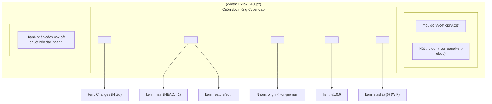

# 07. Thiết Kế Chi Tiết Cây Điều Hướng Left Sidebar Navigator

Tài liệu này đặc tả chi tiết kiến trúc tầng Giao diện (Webview UI), các Component thành phần của thanh điều hướng bên trái (`SidebarNavigator`, `SidebarSection`, `SidebarItem`, `SidebarResizer`), cơ chế co giãn kích thước linh hoạt, kho trạng thái `sidebar.store.ts` bằng Preact Signals, và các tương tác người dùng cho **Phase 3.2: Nhóm Việc 3 — Thiết Kế & Triển Khai Cây Điều Hướng Left Sidebar Navigator**.

> [!NOTE]
> Mọi nội dung trong tài liệu này tuân thủ nguyên tắc: thiết kế và đặc tả bằng ngôn ngữ tự nhiên (**Design by Word**), tập trung vào cấu trúc cây dữ liệu phân cấp, giải thuật kéo thả chuột mượt mà, lưu trữ trạng thái người dùng; **tuyệt đối không sử dụng mã nguồn mẫu hoặc khối code block dưới bất kỳ hình thức nào**.
>
> Toàn bộ tiêu đề nhóm, nhãn phần tử, menu ngữ cảnh và thông báo giao diện **sử dụng tiếng Anh chuẩn mực làm ngôn ngữ chính thức**. Phần giải nghĩa tiếng Việt trong tài liệu đóng vai trò tham khảo kỹ thuật.
>
> 📌 **Truy vết tiến độ**: [Phase 3.2 Tiến Độ (Nhóm Việc 3)](../../03_progess/phase3/002_phase3_2_3pane_workspace.md#nhóm-việc-3-thiết-kế--triển-khai-cây-điều-hướng-left-sidebar-navigator).

---

## 1. Tầm Nhìn, Mục Tiêu & Trải Nghiệm Điều Hướng

### 1.1. Mục Tiêu Cốt Lõi
1. **Bao quát toàn bộ tài nguyên Git trong một điểm nhìn**: Cung cấp cây phân cấp trực quan ở cột trái chia làm 5 phân nhóm chuyên biệt:
   - **Working Tree**: Hiển thị số lượng tệp biến động (`Changes: N`), nhấp chuột kích hoạt mở ngay phân vùng Staging Area & Commit Composer ở bảng phải.
   - **Local Branches**: Toàn bộ nhánh cục bộ, làm nổi bật nhánh `HEAD` đang checkout bằng viền tím Neon `#a855f7` và icon checkmark, hiển thị số commit chưa push cạnh từng nhánh (ví dụ: `feature/login ↑2`).
   - **Remotes**: Cây phân cấp theo tên remote (`origin`, `upstream`), bên trong chứa danh sách các nhánh remote tương ứng.
   - **Tags**: Danh sách toàn bộ các mốc phát hành (Release Tags).
   - **Stashes**: Danh sách các bản cất giữ tạm thời với chỉ số index và tiêu đề tóm tắt.
2. **Kéo dãn linh hoạt với biên an toàn tuyệt đối**: Cho phép lập trình viên tự do kéo dãn chiều rộng Sidebar từ $160\text{px}$ đến $450\text{px}$ qua thanh kéo `SidebarResizer`, hoặc thu gọn nhanh về $0\text{px}$ qua nút Toggle để tập trung 100% không gian cho bảng đồ thị DAG.
3. **Lưu trữ trạng thái người dùng bền vững (State Persistence)**: Tự động ghi nhớ chiều rộng (`sidebarWidth`), trạng thái thu gọn (`isCollapsed`) và các phân nhóm đang mở (`expandedSectionIds`) vào `localStorage` của Webview. Cấu hình được khôi phục nguyên vẹn ngay khi mở lại VS Code.

---

## 2. Đặc Tả Kiến Trúc Giao Diện & Phân Rã Component

---

### 2.1. Component `SidebarNavigator.tsx`

- **Vị trí & Bố cục**: Đặt tại cột trái của giao diện, chiều cao chiếm trọn vẹn $100\%$ chiều cao vùng làm việc dưới Toolbar, bố cục flex-column, viền phải kỹ thuật 1px.
- **Quy chuẩn hiển thị co giãn**:
  - Khi mở (`isCollapsed === false`): Chiều rộng bằng đúng giá trị pixel của tín hiệu `sidebarWidth.value` (mặc định $220\text{px}$, giới hạn trong khoảng $[160\text{px}, 450\text{px}]$).
  - Khi thu gọn (`isCollapsed === true`): Chiều rộng co về $0\text{px}$, thiết lập `overflow: hidden; opacity: 0; pointer-events: none; transition: width 150ms ease-in-out, opacity 150ms ease-in-out`.

#### Bảng Thuộc Tính Props Của `SidebarNavigator`:

| Tên Thuộc Tính | Kiểu Dữ Liệu | Bắt Buộc? | Mặc Định | Ràng Buộc & Mô Tả Ý Nghĩa |
| :--- | :--- | :---: | :---: | :--- |
| `branches` | Array<BranchItem> | Có | - | Danh sách các nhánh cục bộ kèm số đếm ahead |
| `currentHead` | string \| null | Có | - | Tên nhánh đang checkout tại HEAD (hoặc null nếu detached) |
| `remotes` | Array<RemoteGroup> | Có | - | Cấu trúc danh sách remote và các nhánh con tương ứng |
| `tags` | Array<string> | Có | - | Danh sách tên toàn bộ các release tag |
| `stashes` | Array<StashRecord> | Có | - | Danh sách bản ghi stash nhập khẩu từ `src/types/queries.ts` |
| `unstagedCount` | number | Có | - | Số lượng tệp biến động chưa đưa vào Staging |
| `stagedCount` | number | Có | - | Số lượng tệp đã đưa vào Staging Index |

#### Cấu Trúc Đối Tượng `BranchItem`:
- `name`: Tên nhánh cục bộ (string).
- `isHead`: Đánh dấu nhánh hiện tại (boolean).
- `aheadCount`: Số commit chưa push của riêng nhánh này (number).
- `upstream`: Tên nhánh remote theo dõi tương ứng (string hoặc null).

#### Cấu Trúc Đối Tượng `StashRecord` (Chuẩn Hóa Hợp Đồng RPC):
- `index`: Chỉ số của bản stash trong ngăn xếp (number $\ge 0$).
- `hash`: Mã băm commit đại diện rút gọn (string).
- `message`: Tiêu đề nội dung bản stash (string).
- `date`: Chuỗi thời gian lưu trữ tương đối (string).

---

### 2.2. Component `SidebarSection.tsx`

Khung phân nhóm có thể gập mở (Collapsible Accordion), đóng vai trò phân định các danh mục tài nguyên Git.

#### Bảng Thuộc Tính Props Của `SidebarSection`:

| Tên Thuộc Tính | Kiểu Dữ Liệu | Bắt Buộc? | Mặc Định | Mô Tả Ý Nghĩa |
| :--- | :--- | :---: | :---: | :--- |
| `id` | string | Có | - | Mã định danh duy nhất của nhóm (ví dụ `"branches"`, `"stashes"`) |
| `title` | string | Có | - | Tiêu đề nhóm hiển thị bằng tiếng Anh in hoa (ví dụ `"LOCAL BRANCHES"`) |
| `isExpanded` | boolean | Có | - | Trạng thái mở rộng (hiển thị con) hoặc gập lại |
| `badgeCount` | number | Không | `undefined` | Số lượng phần tử hiển thị dạng huy hiệu nhỏ cạnh tiêu đề |
| `onToggle` | () => void | Có | - | Hàm callback khi người dùng bấm vào tiêu đề nhóm để gập/mở |
| `actionIcon` | string | Không | `undefined` | Tên biểu tượng nút tác vụ vi mô bên phải (ví dụ `"+"` để tạo nhánh) |
| `onAction` | () => void | Không | `undefined` | Hàm callback khi người dùng bấm vào nút tác vụ vi mô |

#### Quy Chuẩn Hiển Thị & Chuyển Động:
- **Dòng Tiêu Đề (Header Row)**:
  - Chiều cao cố định 24px, đệm lề ngang 8px, phông chữ Monospace in hoa cỡ 11px đậm (`font-weight: 700`), màu chữ xám bạc `#94a3b8`.
  - Icon Chevron bên trái: Xoay góc 90 độ mượt mà với hiệu ứng CSS transition 150ms khi chuyển đổi giữa trạng thái mở và gập.
  - Vùng bấm chiếm trọn chiều rộng dòng (trừ nút tác vụ phụ).
- **Nút Tác Vụ Vi Mô (Action Icon)**:
  - Đặt ở mép phải của Header Row.
  - Nút `+` (trên nhóm Branches): Nhấp chuột mở modal tạo nhánh mới từ commit hiện tại. Nút có `stopImmediatePropagation()` để không gây gập/mở nhóm khi nhấp.
- **Thân Nhóm (Section Body)**:
  - Khi `isExpanded === true`: Hiển thị danh sách các item con.
  - Khi `isExpanded === false`: Ẩn hoàn toàn khỏi DOM để tiết kiệm tài nguyên kết xuất.

---

### 2.3. Component `SidebarItem.tsx`

Dòng hiển thị từng phần tử riêng lẻ bên trong một Section.

#### Bảng Thuộc Tính Props Của `SidebarItem`:

| Tên Thuộc Tính | Kiểu Dữ Liệu | Bắt Buộc? | Mặc Định | Mô Tả Ý Nghĩa |
| :--- | :--- | :---: | :---: | :--- |
| `type` | string | Có | - | Phân loại: `"working-tree"`, `"branch"`, `"remote-branch"`, `"tag"`, `"stash"` |
| `label` | string | Có | - | Văn bản chính hiển thị (Tên nhánh, tên tag, tiêu đề stash) |
| `isHead` | boolean | Không | `false` | Đánh dấu nếu đây là nhánh cục bộ đang active tại HEAD |
| `aheadCount` | number | Không | `0` | Số commit cục bộ chưa push của riêng nhánh này |
| `icon` | string | Có | - | Tên icon đại diện (`git-branch`, `tag`, `archive`, `file-diff`) |
| `secondaryLabel` | string | Không | `undefined` | Văn bản phụ mờ (ví dụ thời gian date của stash) |
| `onClick` | () => void | Không | `undefined` | Hàm xử lý khi nhấp chuột trái một lần |
| `onDoubleClick` | () => void | Không | `undefined` | Hàm xử lý khi nhấp đúp chuột trái (ví dụ checkout nhánh) |
| `onContextMenu` | (e: MouseEvent) => void | Không | `undefined` | Hàm xử lý khi nhấp chuột phải mở menu ngữ cảnh |

#### Quy Chuẩn Thẩm Mỹ Đẳng Cấp Cyber-Lab:
1. **Dòng thường**:
   - Chiều cao 22px, đệm lề trái 20px (thụt lề phân cấp), căn lề giữa dọc.
   - Màu chữ `#cbd5e1`, hover nền sáng nhẹ `rgba(255, 255, 255, 0.05)`, con trỏ chuột kiểu `pointer`.
2. **Nhánh HEAD Active**:
   - Viền trái dày 3px màu tím Neon `#a855f7`.
   - Nền sáng trong suốt tím nhẹ `rgba(168, 85, 247, 0.1)`.
   - Tên nhánh in đậm màu sáng rõ `#f8fafc`.
   - Icon checkmark nhỏ màu tím Neon đặt cạnh tên nhánh để định danh trực quan.
   - Nếu `aheadCount > 0`: Hiển thị nhãn nhỏ dạng `↑2` màu hổ phách Neon phía sau tên nhánh.

---

### 2.4. Component `SidebarResizer.tsx`

Thanh phân cách dọc chịu trách nhiệm điều khiển kéo dãn chiều rộng của Sidebar bằng chuột.

#### Bảng Thuộc Tính Props Của `SidebarResizer`:

| Tên Thuộc Tính | Kiểu Dữ Liệu | Bắt Buộc? | Mặc Định | Mô Tả Ý Nghĩa |
| :--- | :--- | :---: | :---: | :--- |
| `onResize` | (newWidth: number) => void | Có | - | Callback nhận chiều rộng mới trong quá trình kéo chuột |
| `onResizeEnd` | (finalWidth: number) => void | Có | - | Callback khi người dùng nhả chuột hoàn tất thao tác kéo |

#### Giải Thuật Kéo Dãn Bằng Chuột Từng Bước (Mouse Drag Algorithm):
1. **Bước 1 (Bắt đầu kéo - mousedown trên Resizer Handle)**:
   - Khi người dùng nhấn chuột trái vào thanh resizer:
     - Ghi nhận tọa độ X ban đầu: `startX = event.clientX`.
     - Ghi nhận độ rộng Sidebar ban đầu: `startWidth = sidebarWidth.value`.
     - Đặt cờ trạng thái `isResizing = true`.
     - Thêm lớp CSS chống chọn văn bản `user-select: none` vào thẻ `<body>`.
     - Đổi con trỏ chuột toàn cục thành kiểu `col-resize`.
2. **Bước 2 (Di chuyển chuột - mousemove trên toàn bộ Window)**:
   - Đăng ký listener sự kiện `mousemove` tại đối tượng `window`:
     - Tính toán độ lệch dịch chuyển: `deltaX = currentEvent.clientX - startX`.
     - Tính toán chiều rộng tạm tính: `candidateWidth = startWidth + deltaX`.
     - Kẹp giá trị trong ranh giới an toàn: `clampedWidth = Math.min(450, Math.max(160, candidateWidth))`.
     - Cập nhật trực tiếp vào tín hiệu: `sidebarWidth.value = clampedWidth`.
     - Kích hoạt callback `onResize(clampedWidth)`.
3. **Bước 3 (Kết thúc kéo - mouseup trên toàn bộ Window)**:
   - Khi người dùng nhả chuột trái:
     - Gỡ bỏ listener `mousemove` và `mouseup` khỏi `window`.
     - Xóa lớp CSS `user-select: none` và hoàn trả con trỏ chuột bình thường.
     - Đặt lại `isResizing = false`.
     - Ghi giá trị chiều rộng cuối cùng vào `localStorage` qua khóa `"f-gitgraph.sidebar.width"`.
     - Kích hoạt callback `onResizeEnd(clampedWidth)`.

---

## 3. Quản Lý Trạng Thái Bằng Preact Signals (`sidebar.store.ts`)

### 3.1. Bảng Danh Mục Tín Hiệu Cơ Sở (Base Signals)

| Tên Tín Hiệu | Kiểu Dữ Liệu | Giá Trị Khởi Tạo | Mô Tả Ý Nghĩa |
| :--- | :--- | :---: | :--- |
| `sidebarWidth` | number | `220` | Chiều rộng hiện tại của Sidebar tính theo pixel (kẹp trong khoảng $[160, 450]$) |
| `isCollapsed` | boolean | `false` | Cờ trạng thái thu gọn Sidebar hoàn toàn về 0px |
| `expandedSectionIds` | Set<string> | `Set(['working-tree', 'branches', 'remotes', 'tags', 'stashes'])` | Tập hợp các mã định danh nhóm Section đang ở trạng thái mở rộng |
| `selectedItemId` | string \| null | `null` | Mã định danh của item đang được người dùng chọn/focus |

---

### 3.2. Đặc Tả Chi Tiết Input / Output & Các Bước Xử Lý Của Bộ Hàm Điều Phối

#### 1. Hàm `setSidebarWidth(width: number): void`
- **Đặc Tả Đầu Vào (Input)**:
  - Tham số `width`: Số thực hoặc số nguyên đại diện cho chiều rộng pixel.
- **Đặc Tả Đầu Ra (Output)**:
  - Không trả về giá trị (`void`).
- **Quy Trình Các Bước Xử Lý Cụ Thể**:
  1. *Bước 1 (Kẹp giá trị an toàn)*: Tính toán giá trị hợp lệ: `clamped = Math.min(450, Math.max(160, Math.round(width)))`.
  2. *Bước 2 (Cập nhật tín hiệu)*: Gán `sidebarWidth.value = clamped`.
  3. *Bước 3 (Lưu trữ bền vững)*: Gọi `localStorage.setItem('f-gitgraph.sidebar.width', String(clamped))`.

---

#### 2. Hàm `toggleCollapse(): void`
- **Đặc Tả Đầu Vào (Input)**: Không có.
- **Đặc Tả Đầu Ra (Output)**: Không trả về giá trị (`void`).
- **Quy Trình Các Bước Xử Lý Cụ Thể**:
  1. *Bước 1 (Đảo cờ)*: Tính toán giá trị mới: `nextState = !isCollapsed.value`.
  2. *Bước 2 (Cập nhật tín hiệu)*: Gán `isCollapsed.value = nextState`.
  3. *Bước 3 (Lưu trữ bền vững)*: Gọi `localStorage.setItem('f-gitgraph.sidebar.collapsed', String(nextState))`.

---

#### 3. Hàm `toggleSection(sectionId: string): void`
- **Đặc Tả Đầu Vào (Input)**:
  - Tham số `sectionId`: Chuỗi ký tự định danh nhóm (ví dụ `"branches"`, `"stashes"`).
- **Đặc Tả Đầu Ra (Output)**: Không trả về giá trị (`void`).
- **Quy Trình Các Bước Xử Lý Cụ Thể**:
  1. *Bước 1 (Bản sao tập hợp)*: Tạo một bản sao mới `nextSet = new Set(expandedSectionIds.value)`.
  2. *Bước 2 (Thêm hoặc xóa)*:
     - Nếu `nextSet.has(sectionId)`: Gọi `nextSet.delete(sectionId)`.
     - Ngược lại: Gọi `nextSet.add(sectionId)`.
  3. *Bước 3 (Cập nhật tín hiệu)*: Gán `expandedSectionIds.value = nextSet`.
  4. *Bước 4 (Lưu trữ)*: Chuyển danh sách thành mảng JSON và lưu vào `localStorage.setItem('f-gitgraph.sidebar.sections', JSON.stringify([...nextSet]))`.

---

#### 4. Hàm `initSidebarStore(): void`
- **Đặc Tả Đầu Vào (Input)**: Không có.
- **Đặc Tả Đầu Ra (Output)**: Không trả về giá trị (`void`).
- **Quy Trình Khôi Phục Từ LocalStorage**:
  1. *Bước 1 (Khôi phục chiều rộng)*:
     - Đọc giá trị từ `localStorage.getItem('f-gitgraph.sidebar.width')`.
     - Nếu tồn tại và phân tích được số nguyên hợp lệ: Kẹp trong khoảng $[160, 450]$ và gán cho `sidebarWidth.value`.
     - Nếu không tồn tại: Giữ nguyên mặc định 220px.
  2. *Bước 2 (Khôi phục trạng thái thu gọn)*:
     - Đọc `localStorage.getItem('f-gitgraph.sidebar.collapsed')`.
     - Nếu bằng `"true"`: Gán `isCollapsed.value = true`.
  3. *Bước 3 (Khôi phục trạng thái Section)*:
     - Đọc `localStorage.getItem('f-gitgraph.sidebar.sections')`.
     - Nếu phân tích thành mảng hợp lệ: Gán `expandedSectionIds.value = new Set(parsedArray)`.

---

## 4. Đặc Tả Tương Tác Người Dùng & Điều Phối Hành Động

1. **Nhấp Chọn Mục Working Tree**:
   - Khi nhấp chuột trái vào dòng `Changes`: Tương đương với hành vi nhấp chọn dòng mầm `*` trên đồ thị DAG. Hệ thống kích hoạt tín hiệu mở phân vùng Staging Area & Commit Composer ở bảng phải.
2. **Nhấp Đúp (Double-Click) Vào Nhánh Cục Bộ**:
   - Khi nhấp đúp vào một nhánh trong nhóm `LOCAL BRANCHES`: Gửi ngay Action RPC `checkoutBranch` kèm tên nhánh về Backend.
   - Nếu nhánh checkout thành công: Backend phát sự kiện cập nhật $\rightarrow$ Webview tự động chuyển viền tím Neon sang nhánh mới.
   - Nếu có lỗi xung đột tệp chưa commit: Backend trả về lỗi tiếng Anh $\rightarrow$ Webview hiển thị thông báo yêu cầu Stash hoặc Commit trước khi chuyển nhánh.
3. **Nhấp Chuột Phải Mở Menu Ngữ Cảnh (Context Menu)**:
   - Chuột phải vào nhánh cục bộ: Tận dụng trực tiếp hệ thống Menu Phase 1: Checkout, Merge into Current, Rebase onto Current, Rename Branch, Delete Branch.
   - Chuột phải vào remote branch: Hiển thị menu: Checkout as New Local Branch, Pull, Delete Remote Branch.
   - Chuột phải vào bản ghi stash: Hiển thị menu tiếng Anh: Apply Stash, Pop Stash, Drop Stash. Trong đó:
     - Tùy chọn `Pop Stash`: Kích hoạt Action RPC `stashPop` với payload `{ index }`.
     - Tùy chọn `Drop Stash`: Kích hoạt Action RPC `stashDrop` với payload `{ index }`.
     - Sau khi thực thi thành công, tự động gọi `refreshStatus()` và nạp lại danh sách stash mới.

---

## 5. Bảng Chuẩn Hóa Văn Bản Tiếng Anh Trên Cây Điều Hướng (Sidebar UI Strings)

| Nhóm / Vị Trí | Văn Bản Hiển Thị Tiếng Anh (English Display String) | Chú Thích Tooltip |
| :--- | :--- | :--- |
| **Tiêu Đề Sidebar** | `"WORKSPACE"` | `"Repository resources explorer"` |
| **Nút Thu Gọn** | Icon panel collapse | `"Collapse Sidebar (Toggle)"` |
| **Section 1** | `"WORKING TREE"` | `"Uncommitted changes in working directory"` |
| **Section 2** | `"LOCAL BRANCHES"` | `"Branches on local machine"` |
| **Section 3** | `"REMOTES"` | `"Tracked remote repositories"` |
| **Section 4** | `"TAGS"` | `"Release tags and milestones"` |
| **Section 5** | `"STASHES"` | `"Saved working state stashes"` |
| **Nút Tạo Nhánh** | `"+"` | `"Create new branch from current commit"` |
| **Dòng Working Tree** | `"Changes (" + N + ")"` | `"View and stage uncommitted changes"` |
| **Nhãn Trống Stash** | `"No stashes saved"` | `"No temporary changes in stash stack"` |
| **Nhãn Trống Tag** | `"No tags"` | `"No release tags created"` |
| **Nhãn Trống Nhánh Remote** | `"No remote branches"` | `"No branches found on remotes"` |

---

## 6. Ma Trận Kiểm Thử Đơn Vị Song Hành (Unit Testing Matrix)

Mọi tệp kiểm thử cho Nhóm Việc 3 bắt buộc đặt tên với đuôi `*.test.ts`, vận hành độc lập trên runner `vitest`:

| Tệp Kiểm Thử Độc Lập | Module Mục Tiêu | Kịch Bản Kiểm Thử Chi Tiết Bắt Buộc |
| :--- | :--- | :--- |
| `tests/webview/lib/stores/sidebar.store.test.ts` | `sidebar.store.ts` | 1. **Khởi tạo & Ranh giới**: Độ rộng mặc định 220px; thử nghiệm truyền giá trị ngoài khoảng (ví dụ 100px hoặc 600px) xác nhận kẹp đúng ranh giới $[160, 450]$. 2. **Toggle Collapse**: Đảo trạng thái thu gọn và xác nhận lưu giá trị boolean vào `localStorage`. 3. **Đóng mở Section**: Thêm/xóa đúng mã `sectionId` khỏi tập hợp `expandedSectionIds`. 4. **Phục hồi từ LocalStorage**: Khởi tạo store với mock `localStorage` chứa giá trị cũ (ví dụ 300px), xác nhận store nạp đúng giá trị 300px. 5. **Bảo vệ dữ liệu rác**: Nếu `localStorage` chứa giá trị không hợp lệ (chuỗi rác), store tự động dùng giá trị mặc định 220px mà không ném lỗi. |
| `tests/webview/components/sidebar/SidebarNavigator.test.ts` | `SidebarNavigator.tsx` | 1. **Render 5 phân nhóm**: Kết xuất đầy đủ 5 tiêu đề nhóm tiếng Anh chuẩn mực. 2. **Đánh dấu nhánh HEAD**: Nhánh active có class highlight viền tím Neon và render icon checkmark; các nhánh thường không có. 3. **Hiển thị số commit chưa push**: Nhánh có `aheadCount = 2` render đúng nhãn nhỏ `"↑2"` màu hổ phách. 4. **Tương tác Double-Click**: Bấm đúp vào nhánh phát chính xác Action RPC `checkoutBranch` kèm tên nhánh. 5. **Bấm nút `+` tạo nhánh**: Kích hoạt đúng callback mở modal tạo nhánh mới. 6. **Resizer kéo dãn chuột**: Giả lập sự kiện `mousedown` $\rightarrow$ `mousemove` dịch chuyển 50px $\rightarrow$ `mouseup`, xác nhận chiều rộng Sidebar tăng tương ứng và kích hoạt ghi `localStorage`. |

---

## 7. Lịch Sử Sửa Đổi Thiết Kế (Revision History)

| Phiên Bản | Ngày | Phân Loại | Người Sửa | Nội Dung Thay Đổi & Căn Nguyên Kỹ Thuật |
| :---: | :---: | :---: | :---: | :--- |
| **v1.0.0** | 2026-10-15 | Tạo mới | AI Architect | Khởi tạo tài liệu đặc tả Left Sidebar Navigator Tree. |
| **v1.1.0** | 2026-10-19 | Đồng bộ hóa | AI Architect | **Chuẩn hóa đối tượng StashRecord & Liên kết Action RPC**: Thay thế kiểu dữ liệu tự phát `StashItem` bằng `StashRecord` đồng nhất với `src/types/queries.ts` (Contract-First). Bổ sung định tuyến Action RPC `stashPop` và `stashDrop` trong menu ngữ cảnh của bản ghi Stash. |
