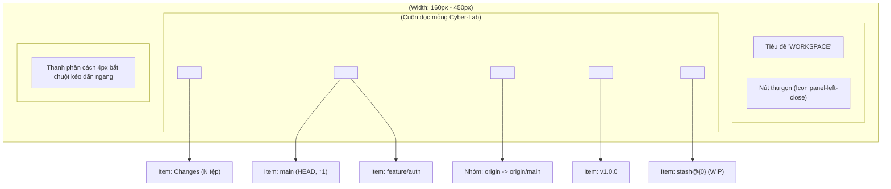

# 07. Thiết Kế Chi Tiết Cây Điều Hướng Left Sidebar Navigator

Tài liệu này đặc tả chi tiết kiến trúc tầng Giao diện (Webview UI), các Component thành phần của thanh điều hướng bên trái (`SidebarNavigator`, `SidebarSection`, `SidebarItem`, `SidebarResizer`), cơ chế co giãn kích thước linh hoạt, kho trạng thái `sidebar.store.ts` bằng Preact Signals, và các tương tác người dùng cho **Phase 3.2: Nhóm Việc 3 — Thiết Kế & Triển Khai Cây Điều Hướng Left Sidebar Navigator**.

> [!NOTE]
> Mọi nội dung trong tài liệu này tuân thủ nguyên tắc: thiết kế và đặc tả bằng ngôn ngữ tự nhiên (**Design by Word**), tập trung vào cấu trúc cây dữ liệu phân cấp, giải thuật kéo thả chuột mượt mà, lưu trữ trạng thái người dùng; **tuyệt đối không sử dụng mã nguồn mẫu hoặc khối code block dưới bất kỳ hình thức nào**.
>
> Toàn bộ tiêu đề nhóm, nhãn phần tử, menu ngữ cảnh và thông báo giao diện **sử dụng tiếng Anh chuẩn mực làm ngôn ngữ chính thức**. Phần giải nghĩa tiếng Việt trong tài liệu đóng vai trò tham khảo kỹ thuật.
>
> 📌 **Truy vết tiến độ**: [Phase 3.2 Tiến Độ (Nhóm Việc 3)](../../03_progess/phase3/002_phase3_2_3pane_workspace.md#nhóm-việc-3-thiết-kế--triển-khai-cây-điều-hướng-left-sidebar-navigator).

---

## 1. Tầm Nhìn, Mục Tiêu & Trải Nghiệm Điều Hướng

### 1.1. Mục Tiêu Cốt Lõi
1. **Bao quát toàn bộ tài nguyên Git trong một điểm nhìn**: Cung cấp cây phân cấp trực quan ở cột trái chia làm 5 phân nhóm chuyên biệt:
   - **Working Tree**: Hiển thị số lượng tệp biến động (`Changes: N`), nhấp chuột kích hoạt mở ngay phân vùng Staging Area & Commit Composer ở bảng phải.
   - **Local Branches**: Toàn bộ nhánh cục bộ, làm nổi bật nhánh `HEAD` đang checkout bằng viền tím Neon `#a855f7` và icon checkmark, hiển thị số commit chưa push cạnh từng nhánh (ví dụ: `feature/login ↑2`).
   - **Remotes**: Cây phân cấp theo tên remote (`origin`, `upstream`), bên trong chứa danh sách các nhánh remote tương ứng.
   - **Tags**: Danh sách toàn bộ các mốc phát hành (Release Tags).
   - **Stashes**: Danh sách các bản cất giữ tạm thời với chỉ số index và tiêu đề tóm tắt.
2. **Kéo dãn linh hoạt với biên an toàn tuyệt đối**: Cho phép lập trình viên tự do kéo dãn chiều rộng Sidebar từ $160\text{px}$ đến $450\text{px}$ qua thanh kéo `SidebarResizer`, hoặc thu gọn nhanh về $0\text{px}$ qua nút Toggle để tập trung 100% không gian cho bảng đồ thị DAG.
3. **Lưu trữ trạng thái người dùng bền vững (State Persistence)**: Tự động ghi nhớ chiều rộng (`sidebarWidth`), trạng thái thu gọn (`isCollapsed`) và các phân nhóm đang mở (`expandedSectionIds`) vào `localStorage` của Webview. Cấu hình được khôi phục nguyên vẹn ngay khi mở lại VS Code.

---

## 2. Đặc Tả Kiến Trúc Giao Diện & Phân Rã Component

---

### 2.1. Component `SidebarNavigator.tsx`

- **Vị trí & Bố cục**: Đặt tại cột trái của giao diện, chiều cao chiếm trọn vẹn $100\%$ chiều cao vùng làm việc dưới Toolbar, bố cục flex-column, viền phải kỹ thuật 1px.
- **Quy chuẩn hiển thị co giãn**:
  - Khi mở (`isCollapsed === false`): Chiều rộng bằng đúng giá trị pixel của tín hiệu `sidebarWidth.value` (mặc định $220\text{px}$, giới hạn trong khoảng $[160\text{px}, 450\text{px}]$).
  - Khi thu gọn (`isCollapsed === true`): Chiều rộng co về $0\text{px}$, thiết lập `overflow: hidden; opacity: 0; pointer-events: none; transition: width 150ms ease-in-out, opacity 150ms ease-in-out`.

#### Bảng Thuộc Tính Props Của `SidebarNavigator`:

| Tên Thuộc Tính | Kiểu Dữ Liệu | Bắt Buộc? | Mặc Định | Ràng Buộc & Mô Tả Ý Nghĩa |
| :--- | :--- | :---: | :---: | :--- |
| `branches` | Array<BranchItem> | Có | - | Danh sách các nhánh cục bộ kèm số đếm ahead |
| `currentHead` | string \| null | Có | - | Tên nhánh đang checkout tại HEAD (hoặc null nếu detached) |
| `remotes` | Array<RemoteGroup> | Có | - | Cấu trúc danh sách remote và các nhánh con tương ứng |
| `tags` | Array<string> | Có | - | Danh sách tên toàn bộ các release tag, được cung cấp trực tiếp từ tín hiệu phản ứng `tagList` nạp qua truy vấn RPC `listTags` (đặc tả tại Design 05 Mục 3.3). |
| `stashes` | Array<StashRecord> | Có | - | Danh sách bản ghi stash nhập khẩu từ `src/types/queries.ts` |
| `unstagedCount` | number | Có | - | Số lượng tệp biến động chưa đưa vào Staging |
| `stagedCount` | number | Có | - | Số lượng tệp đã đưa vào Staging Index |

#### Cấu Trúc Đối Tượng `BranchItem`:
- `name`: Tên nhánh cục bộ (string).
- `isHead`: Đánh dấu nhánh hiện tại (boolean).
- `aheadCount`: Số commit chưa push của riêng nhánh này (number).
- `upstream`: Tên nhánh remote theo dõi tương ứng (string hoặc null).

#### Cấu Trúc Đối Tượng `StashRecord` (Chuẩn Hóa Hợp Đồng RPC):
- `index`: Chỉ số của bản stash trong ngăn xếp (number $\ge 0$).
- `hash`: Mã băm commit đại diện rút gọn (string).
- `message`: Tiêu đề nội dung bản stash (string).
- `date`: Chuỗi thời gian lưu trữ tương đối (string).

---

### 2.2. Component `SidebarSection.tsx`

Khung phân nhóm có thể gập mở (Collapsible Accordion), đóng vai trò phân định các danh mục tài nguyên Git.

#### Bảng Thuộc Tính Props Của `SidebarSection`:

| Tên Thuộc Tính | Kiểu Dữ Liệu | Bắt Buộc? | Mặc Định | Mô Tả Ý Nghĩa |
| :--- | :--- | :---: | :---: | :--- |
| `id` | string | Có | - | Mã định danh duy nhất của nhóm (ví dụ `"branches"`, `"stashes"`) |
| `title` | string | Có | - | Tiêu đề nhóm hiển thị bằng tiếng Anh in hoa (ví dụ `"LOCAL BRANCHES"`) |
| `isExpanded` | boolean | Có | - | Trạng thái mở rộng (hiển thị con) hoặc gập lại |
| `badgeCount` | number | Không | `undefined` | Số lượng phần tử hiển thị dạng huy hiệu nhỏ cạnh tiêu đề |
| `onToggle` | () => void | Có | - | Hàm callback khi người dùng bấm vào tiêu đề nhóm để gập/mở |
| `actionIcon` | string | Không | `undefined` | Tên biểu tượng nút tác vụ vi mô bên phải (ví dụ `"+"` để tạo nhánh) |
| `onAction` | () => void | Không | `undefined` | Hàm callback khi người dùng bấm vào nút tác vụ vi mô |

#### Quy Chuẩn Hiển Thị & Chuyển Động:
- **Dòng Tiêu Đề (Header Row)**:
  - Chiều cao cố định 24px, đệm lề ngang 8px, phông chữ Monospace in hoa cỡ 11px đậm (`font-weight: 700`), màu chữ xám bạc `#94a3b8`.
  - Icon Chevron bên trái: Xoay góc 90 độ mượt mà với hiệu ứng CSS transition 150ms khi chuyển đổi giữa trạng thái mở và gập.
  - Vùng bấm chiếm trọn chiều rộng dòng (trừ nút tác vụ phụ).
- **Nút Tác Vụ Vi Mô (Action Icon)**:
  - Đặt ở mép phải của Header Row.
  - Nút `+` (trên nhóm Branches): Nhấp chuột mở modal tạo nhánh mới từ commit hiện tại. Nút có `stopImmediatePropagation()` để không gây gập/mở nhóm khi nhấp.
- **Thân Nhóm (Section Body)**:
  - Khi `isExpanded === true`: Hiển thị danh sách các item con.
  - Khi `isExpanded === false`: Ẩn hoàn toàn khỏi DOM để tiết kiệm tài nguyên kết xuất.

---

### 2.3. Component `SidebarItem.tsx`

Dòng hiển thị từng phần tử riêng lẻ bên trong một Section.

#### Bảng Thuộc Tính Props Của `SidebarItem`:

| Tên Thuộc Tính | Kiểu Dữ Liệu | Bắt Buộc? | Mặc Định | Mô Tả Ý Nghĩa |
| :--- | :--- | :---: | :---: | :--- |
| `type` | string | Có | - | Phân loại: `"working-tree"`, `"branch"`, `"remote-branch"`, `"tag"`, `"stash"` |
| `label` | string | Có | - | Văn bản chính hiển thị (Tên nhánh, tên tag, tiêu đề stash) |
| `isHead` | boolean | Không | `false` | Đánh dấu nếu đây là nhánh cục bộ đang active tại HEAD |
| `aheadCount` | number | Không | `0` | Số commit cục bộ chưa push của riêng nhánh này |
| `icon` | string | Có | - | Tên icon đại diện (`git-branch`, `tag`, `archive`, `file-diff`) |
| `secondaryLabel` | string | Không | `undefined` | Văn bản phụ mờ (ví dụ thời gian date của stash) |
| `onClick` | () => void | Không | `undefined` | Hàm xử lý khi nhấp chuột trái một lần |
| `onDoubleClick` | () => void | Không | `undefined` | Hàm xử lý khi nhấp đúp chuột trái (ví dụ checkout nhánh) |
| `onContextMenu` | (e: MouseEvent) => void | Không | `undefined` | Hàm xử lý khi nhấp chuột phải mở menu ngữ cảnh |

#### Quy Chuẩn Thẩm Mỹ Đẳng Cấp Cyber-Lab:
1. **Dòng thường**:
   - Chiều cao 22px, đệm lề trái 20px (thụt lề phân cấp), căn lề giữa dọc.
   - Màu chữ `#cbd5e1`, hover nền sáng nhẹ `rgba(255, 255, 255, 0.05)`, con trỏ chuột kiểu `pointer`.
2. **Nhánh HEAD Active**:
   - Viền trái dày 3px màu tím Neon `#a855f7`.
   - Nền sáng trong suốt tím nhẹ `rgba(168, 85, 247, 0.1)`.
   - Tên nhánh in đậm màu sáng rõ `#f8fafc`.
   - Icon checkmark nhỏ màu tím Neon đặt cạnh tên nhánh để định danh trực quan.
   - Nếu `aheadCount > 0`: Hiển thị nhãn nhỏ dạng `↑2` màu hổ phách Neon phía sau tên nhánh.

---

### 2.4. Component `SidebarResizer.tsx`

Thanh phân cách dọc chịu trách nhiệm điều khiển kéo dãn chiều rộng của Sidebar bằng chuột.

#### Bảng Thuộc Tính Props Của `SidebarResizer`:

| Tên Thuộc Tính | Kiểu Dữ Liệu | Bắt Buộc? | Mặc Định | Mô Tả Ý Nghĩa |
| :--- | :--- | :---: | :---: | :--- |
| `onResize` | (newWidth: number) => void | Có | - | Callback nhận chiều rộng mới trong quá trình kéo chuột |
| `onResizeEnd` | (finalWidth: number) => void | Có | - | Callback khi người dùng nhả chuột hoàn tất thao tác kéo |

#### Giải Thuật Kéo Dãn Bằng Chuột Từng Bước (Mouse Drag Algorithm):
1. **Bước 1 (Bắt đầu kéo - mousedown trên Resizer Handle)**:
   - Khi người dùng nhấn chuột trái vào thanh resizer:
     - Ghi nhận tọa độ X ban đầu: `startX = event.clientX`.
     - Ghi nhận độ rộng Sidebar ban đầu: `startWidth = sidebarWidth.value`.
     - Đặt cờ trạng thái `isResizing = true`.
     - Thêm lớp CSS chống chọn văn bản `user-select: none` vào thẻ `<body>`.
     - Đổi con trỏ chuột toàn cục thành kiểu `col-resize`.
2. **Bước 2 (Di chuyển chuột - mousemove trên toàn bộ Window)**:
   - Đăng ký listener sự kiện `mousemove` tại đối tượng `window`:
     - Tính toán độ lệch dịch chuyển: `deltaX = currentEvent.clientX - startX`.
     - Tính toán chiều rộng tạm tính: `candidateWidth = startWidth + deltaX`.
     - Kẹp giá trị trong ranh giới an toàn: `clampedWidth = Math.min(450, Math.max(160, candidateWidth))`.
     - Cập nhật trực tiếp vào tín hiệu: `sidebarWidth.value = clampedWidth`.
     - Kích hoạt callback `onResize(clampedWidth)`.
3. **Bước 3 (Kết thúc kéo - mouseup trên toàn bộ Window)**:
   - Khi người dùng nhả chuột trái:
     - Gỡ bỏ listener `mousemove` và `mouseup` khỏi `window`.
     - Xóa lớp CSS `user-select: none` và hoàn trả con trỏ chuột bình thường.
     - Đặt lại `isResizing = false`.
     - Ghi giá trị chiều rộng cuối cùng vào `localStorage` qua khóa `"f-gitgraph.sidebar.width"`.
     - Kích hoạt callback `onResizeEnd(clampedWidth)`.

---

## 3. Quản Lý Trạng Thái Bằng Preact Signals (`sidebar.store.ts`)

Kho trạng thái `sidebar.store.ts` chịu trách nhiệm quản lý toàn bộ dữ liệu phản ứng của thanh điều hướng cột trái, điều phối hành vi kéo dãn độ rộng, lưu trữ bền vững trạng thái người dùng và giao tiếp với Backend qua giao thức bất đồng bộ `vscode.postMessage`.

---

### 3.1. Bảng Danh Mục Tín Hiệu Cơ Sở & Tín Hiệu Dẫn Xuất

#### 1. Tín Hiệu Cơ Sở (Base Signals):

| Tên Tín Hiệu | Kiểu Dữ Liệu | Giá Trị Khởi Tạo | Mô Tả Ý Nghĩa Nghiệp Vụ & Ràng Buộc |
| :--- | :--- | :---: | :--- |
| `sidebarWidth` | number | `220` | Chiều rộng thực tế của Sidebar tính theo pixel, kẹp nghiêm ngặt trong khoảng $[160, 450]$ |
| `isSidebarCollapsed` | boolean | `false` | Cờ trạng thái thu gọn Sidebar hoàn toàn về 0px (đồng bộ tên gọi với Design 06) |
| `expandedSectionIds` | Set<string> | `Set(['working-tree', 'branches', 'remotes', 'tags', 'stashes'])` | Tập hợp các mã định danh của phân nhóm đang mở rộng hiển thị |
| `selectedItemId` | string \| null | `null` | Mã định danh duy nhất của phần tử đang được người dùng chọn hoặc giữ tiêu điểm |
| `isResizing` | boolean | `false` | Cờ đánh dấu đang trong quá trình kéo chuột điều chỉnh kích thước thanh Sidebar |
| `isCheckingOut` | boolean | `false` | Cờ khóa tương tác (Mutex Lock) khi đang gửi lệnh checkout nhánh xuống Backend |
| `isStashOperating` | boolean | `false` | Cờ khóa tương tác (Mutex Lock) khi đang thực thi lệnh thao tác stash (`pop`, `drop`, `apply`) |
| `isCreateBranchModalOpen` | boolean | `false` | Cờ kích hoạt hiển thị hộp thoại modal tạo nhánh mới từ commit cơ sở |
| `branchCreationBaseCommit` | string \| null | `null` | Mã băm commit cơ sở dùng để tạo nhánh mới (mặc định lấy HEAD nếu `null`) |

#### 2. Tín Hiệu Dẫn Xuất (Computed Signals):

| Tên Tín Hiệu | Kiểu Dữ Liệu | Công Thức / Logic Tính Toán | Mô Tả Ý Nghĩa |
| :--- | :--- | :--- | :--- |
| `effectiveSidebarWidth` | number | `isSidebarCollapsed.value ? 0 : sidebarWidth.value` | Chiều rộng hiển thị thực tế áp dụng trực tiếp lên CSS của container Sidebar |
| `sidebarToggleTooltip` | string | `isSidebarCollapsed.value ? "Expand sidebar navigator" : "Collapse sidebar navigator"` | Tooltip hiển thị khi rê chuột qua nút chuyển đổi đóng/mở Sidebar |
| `isAnySectionExpanded` | boolean | `expandedSectionIds.value.size > 0` | Trạng thái có ít nhất một phân nhóm đang mở, phục vụ nút gập toàn bộ |

---

### 3.2. Đặc Tả Chi Tiết Input / Output & Quy Trình Xử Lý Cụ Thể Từng Bước Của Bộ Hàm Điều Phối

Mọi hàm điều phối trong `sidebar.store.ts` tuân thủ nghiêm ngặt nguyên tắc **Thiết Kế Hộp Đen (Black-Box Contract)**, **Lập Trình Phòng Vệ (Defensive Programming)** và **Phân Tuyến An Toàn 4 Tầng**:

```mermaid
flowchart TD
    subgraph Flow1["1. Quy Trình Kéo Dãn Độ Rộng Mượt Mà (Zero-Jank Resizing)"]
        MouseDown["Nhấn chuột mousedown trên Resizer Handle"] --> SetResizeFlag["Gán isResizing = true & lưu startX, startWidth"]
        SetResizeFlag --> MouseMove["Di chuyển mousemove liên tục trên Window (60-144fps)"]
        MouseMove --> CallNoCommit["setSidebarWidth(candidateWidth, commitToStorage = false)"]
        CallNoCommit --> DirectCSS["Kẹp [160, 450]px & ghi trực tiếp biến CSS --sidebar-width (Không Disk I/O)"]
        DirectCSS --> MouseUp["Nhả chuột mouseup trên Window"]
        MouseUp --> CallCommit["setSidebarWidth(finalWidth, commitToStorage = true)"]
        CallCommit --> SafeDisk["Ghi an toàn vào localStorage.setItem('f-gitgraph.sidebar.width')"]
    end

    subgraph Flow2["2. Quy Trình Checkout Nhánh & Xử Lý Xung Đột Working Tree"]
        DblClickBranch["Double-Click hoặc Enter trên Local Branch"] --> CheckMutex["Kiểm tra isCheckingOut == true hoặc branch == currentHead"]
        CheckMutex -- "Đang bận / Trùng HEAD" --> AbortEarly["Thoát sớm không làm gì"]
        CheckMutex -- "Hợp lệ" --> LockCheckout["Bật isCheckingOut = true & hiển thị viền nhấp nháy"]
        LockCheckout --> PostCheckout["vscode.postMessage({ command: 'checkoutBranch', repo, branch })"]
        PostCheckout --> RecvResp["Nhận ActionResponse từ Extension Host"]
        RecvResp -- "Thành công (status == null)" --> PlaySwitchSound["Phát âm thanh chốt cơ học audio.playSwitch()"]
        PlaySwitchSound --> FourWayRefresh["Kích hoạt 4-Way Refresh Cycle & Cập nhật viền tím HEAD"]
        RecvResp -- "Xung đột Working Tree (stderr chứa conflict)" --> OpenConflictDialog["Mở Modal: Local changes would be overwritten"]
        OpenConflictDialog -- "Chọn Stash & Checkout" --> AutoStash["Tự động Stash nhanh rồi tái kích hoạt checkoutBranch"]
        OpenConflictDialog -- "Chọn Cancel" --> CancelCheckout["Hủy thao tác"]
        RecvResp -- "Lỗi khác (stderr)" --> ShowErrAlert["Hiển thị thông báo lỗi đỏ Neon & audio.playError()"]
        FourWayRefresh --> UnlockCheckout["Finally: Giải phóng isCheckingOut = false"]
        CancelCheckout --> UnlockCheckout
        ShowErrAlert --> UnlockCheckout
    end

    subgraph Flow3["3. Quy Trình Điều Phối Thao Tác Stash & Bẫy Xung Đột Merge"]
        StashContextClick["Chọn tác vụ từ Context Menu của Stash Item"] --> CheckStashMutex["Kiểm tra isStashOperating == true"]
        CheckStashMutex -- "Đang bận" --> AbortStash["Thoát sớm"]
        CheckStashMutex -- "Sẵn sàng" --> ModeBranch{"Phân nhánh theo mode"}
        ModeBranch -- "mode == 'drop'" --> ConfirmDropModal["Mở Modal xác nhận xóa vĩnh viễn Stash"]
        ConfirmDropModal -- "User xác nhận" --> LockStashDrop["Bật isStashOperating = true & gửi stashDrop"]
        ConfirmDropModal -- "User hủy" --> AbortStash
        ModeBranch -- "mode == 'pop' / 'apply'" --> LockStashApply["Bật isStashOperating = true & gửi stashPop / stashApply"]
        LockStashDrop --> RecvStashResult["Nhận kết quả từ Backend"]
        LockStashApply --> RecvStashResult
        RecvStashResult -- "Có xung đột merge" --> WarnStashConflict["Báo cảnh báo xung đột & Chuyển sang Staging Area"]
        RecvStashResult -- "Thành công" --> AudioStashRuffle["Phát âm thanh lật tài liệu audio.playStash() & 4-Way Refresh"]
        WarnStashConflict --> UnlockStash["Finally: Giải phóng isStashOperating = false"]
        AudioStashRuffle --> UnlockStash
    end
```

---

#### 1. Hàm `setSidebarWidth(width: number, commitToStorage = false): void`

##### Mục Tiêu & Trách Nhiệm Nghiệp Vụ:
Cập nhật chiều rộng hiển thị của thanh điều hướng Sidebar với cơ chế tách biệt tối ưu giữa cập nhật giao diện thời gian thực (tần số quét 60–144fps) và ghi đĩa bền vững, triệt tiêu hoàn toàn hiện tượng nghẽn I/O gây giật khung hình (Zero-Jank Resizing).

##### Bảng Đặc Tả Hợp Đồng I/O (Black-Box Contract):

| Tham Số / Giá Trị | Kiểu Dữ Liệu | Bắt Buộc? | Mặc Định | Ràng Buộc & Dải Giá Trị Hợp Lệ |
| :--- | :--- | :---: | :---: | :--- |
| `width` | number | Có | - | Số nguyên hoặc số thực biểu thị chiều rộng pixel, dải hợp lệ $[160, 450]$ |
| `commitToStorage` | boolean | Không | `false` | Cờ ghi đĩa: `false` trong lúc kéo chuột `mousemove`, `true` khi nhả chuột `mouseup` |
| **Giá Trị Trả Về** | void | - | - | Không trả về giá trị trực tiếp; cập nhật tín hiệu và lưu trữ cục bộ |

##### Tiền Điều Kiện & Bộ Lọc Phòng Vệ (Pre-conditions & Guard Clauses):
1. Kiểm tra tính hợp lệ số học: Nếu `typeof width !== "number"`, hoặc `Number.isFinite(width) === false`, hoặc `Number.isNaN(width)`: Tự động thay thế bằng độ rộng tiêu chuẩn $220\text{px}$.
2. Kiểm tra trạng thái thu gọn: Nếu Sidebar đang ở trạng thái thu gọn (`isSidebarCollapsed.value === true`) mà hàm được gọi từ thao tác kéo chuột: Tự động đảo cờ `isSidebarCollapsed.value = false` để mở lại thanh Sidebar.

##### Quy Trình Các Bước Xử Lý Cụ Thể Từng Bước:
1. *Bước 1 (Làm sạch và khử nhiễu số học)*:
   - Làm tròn số nguyên bằng `const roundedWidth = Math.round(width)` nhằm triệt tiêu các giá trị sub-pixel dạng dấu phẩy động làm mờ nét viền CSS 1px trên màn hình Retina/HiDPI.
2. *Bước 2 (Kẹp giá trị trong ranh giới an toàn tuyệt đối)*:
   - Áp dụng công thức số học kẹp hai đầu:
     $$ClampedWidth = \min(450, \max(160, roundedWidth))$$
   - Ranh giới tối thiểu $160\text{px}$ bảo đảm các tiêu đề nhóm, icon và nhãn văn bản không bị cắt cụt. Ranh giới tối đa $450\text{px}$ bảo đảm không lấn chiếm quá mức diện tích hiển thị của đồ thị DAG.
3. *Bước 3 (Cập nhật tín hiệu phản ứng)*:
   - So sánh: Nếu `sidebarWidth.value !== ClampedWidth`:
     - Gán giá trị: `sidebarWidth.value = ClampedWidth`.
     - Tín hiệu dẫn xuất `effectiveSidebarWidth` tự động kích hoạt cập nhật lại DOM mà không gây gián đoạn luồng người dùng.
4. *Bước 4 (Tối ưu hóa kết xuất 60fps qua Biến Môi Trường CSS)*:
   - Nhằm tối ưu hóa hiệu năng kéo dãn chuột không gây quá tải cho bộ đối soát ảo của Preact: Ghi trực tiếp giá trị vào thuộc tính CSS của phần tử gốc hoặc thẻ container:
     `document.documentElement.style.setProperty('--sidebar-width', ClampedWidth + 'px')`.
   - Cơ chế này cho phép bộ xử lý đồ họa (GPU Compositor) điều chỉnh kích thước container tức thì mà không cần chạy lại hàm render của toàn bộ các phần tử con bên trong cây thư mục.
5. *Bước 5 (Ghi lưu trữ bền vững có điều kiện & Bẫy ngoại lệ)*:
   - Nếu `commitToStorage === true`:
     - Khởi tạo khối phòng vệ `try-catch`:
       - Thực thi: `localStorage.setItem('f-gitgraph.sidebar.width', String(ClampedWidth))`.
     - *Bẫy lỗi ngoại lệ*: Nếu trình duyệt chặn quyền lưu trữ cục bộ do chính sách bảo mật Sandbox, chế độ ẩn danh (Private Browsing) hoặc ném lỗi vượt định mức dung lượng (`QuotaExceededError` / `SecurityError`):
       - Không ném lỗi ra ngoài làm sập giao diện; ghi log cảnh báo mức nhẹ và duy trì giá trị trong bộ nhớ RAM tạm thời của phiên làm việc.

##### Xử Lý Trường Hợp Ngoại Lệ & Ranh Giới (Edge Cases):
- Nếu người dùng kéo chuột quá nhanh vượt ra ngoài mép màn hình: Sự kiện `window.onmousemove` và `window.onmouseup` toàn cục vẫn bắt trọn tọa độ và kẹp chính xác ở mức $160\text{px}$ hoặc $450\text{px}$.

---

#### 2. Hàm `toggleSidebar(): void`

##### Mục Tiêu & Trách Nhiệm Nghiệp Vụ:
Chuyển đổi linh hoạt giữa trạng thái hiển thị đầy đủ và thu gọn hoàn toàn về $0\text{px}$ của Sidebar, đồng bộ hóa trạng thái nút Toggle trên Toolbar, quản lý an toàn tiêu điểm bàn phím (tránh bẫy tiêu điểm vô hình) và phát tín hiệu tái bố cục (Layout Reflow Trigger) cho đồ thị DAG và bảng Commit Table.

##### Bảng Đặc Tả Hợp Đồng I/O (Black-Box Contract):

| Tham Số / Giá Trị | Kiểu Dữ Liệu | Bắt Buộc? | Mặc Định | Ràng Buộc & Mô Tả Ý Nghĩa |
| :--- | :--- | :---: | :---: | :--- |
| Không có tham số | - | - | - | Hàm kích hoạt chuyển đổi trạng thái hai chiều |
| **Giá Trị Trả Về** | void | - | - | Không trả về giá trị trực tiếp |

##### Tiền Điều Kiện & Bộ Lọc Phòng Vệ (Pre-conditions & Guard Clauses):
1. Kiểm tra trạng thái kéo chuột: Nếu `isResizing.value === true` (người dùng đang giữ chuột kéo Resizer): Thoát hàm ngay lập tức để tránh xung đột hành vi kích thước.

##### Quy Trình Các Bước Xử Lý Cụ Thể Từng Bước:
1. *Bước 1 (Tính toán trạng thái đảo chiều logic)*:
   - Tính toán trạng thái tiếp theo: `const nextState = !isSidebarCollapsed.value`.
2. *Bước 2 (Bảo vệ tiêu điểm bàn phím - Focus Trap Prevention)*:
   - Nếu `nextState === true` (Sidebar chuẩn bị thu gọn về 0px):
     - Kiểm tra xem phần tử hiện đang giữ tiêu điểm (`document.activeElement`) có nằm bên trong vùng cây DOM của Sidebar hay không.
     - Nếu có: Tự động chuyển tiêu điểm an toàn sang nút bấm chuyển đổi Sidebar trên thanh Toolbar (`#btn-toggle-sidebar`) hoặc phần tử container chính.
     - *Mục đích kỹ thuật*: Ngăn chặn tình trạng tiêu điểm bàn phím bị mắc kẹt bên trong một phần tử có thuộc tính `overflow: hidden; pointer-events: none; opacity: 0`, bảo đảm chuẩn WAI-ARIA.
3. *Bước 3 (Cập nhật tín hiệu phản ứng)*:
   - Gán `isSidebarCollapsed.value = nextState`.
   - Tín hiệu dẫn xuất `effectiveSidebarWidth.value` ngay lập tức chuyển về $0$ (khi thu gọn) hoặc khôi phục về `sidebarWidth.value` (khi mở rộng).
4. *Bước 4 (Đồng bộ lưu trữ bền vững)*:
   - Khởi tạo khối phòng vệ `try-catch`, ghi giá trị boolean vào bộ nhớ:
     `localStorage.setItem('f-gitgraph.sidebar.collapsed', String(nextState))`.
5. *Bước 5 (Kích hoạt âm thanh cơ học Cyber-Lab)*:
   - Kiểm tra tín hiệu âm thanh `audioStore.isMuted.value`. Nếu âm thanh đang bật:
     - Khi thu gọn: Kích hoạt âm thanh chốt cơ học trượt giảm tần số từ $380\text{Hz}$ xuống $220\text{Hz}$ trong $40\text{ms}$.
     - Khi mở rộng: Kích hoạt âm thanh mở chốt trượt tăng tần số từ $220\text{Hz}$ lên $380\text{Hz}$ trong $40\text{ms}$.
6. *Bước 6 (Kích hoạt sự kiện tái bố cục không gian làm việc - Layout Reflow Trigger)*:
   - Thiết lập bộ đếm thời gian trễ $160\text{ms}$ (khớp với thời gian hiệu ứng chuyển động CSS `transition: width 150ms ease-in-out` cộng thêm $10\text{ms}$ bù trễ khung hình của trình duyệt).
   - Khi bộ đếm thời gian chạm mốc $160\text{ms}$:
     - Thực thi lệnh: `window.dispatchEvent(new Event('resize'))`.
     - *Mục đích kỹ thuật*: Buộc canvas đồ thị F# commit DAG và bảng ảo hóa `CommitTable` tự động tính toán lại chiều rộng cột nhìn thấy, ngăn chặn tình trạng đồ thị SVG bị biến dạng hoặc tràn lề ngang.

---

#### 3. Hàm `toggleSection(sectionId: string): void`

##### Mục Tiêu & Trách Nhiệm Nghiệp Vụ:
Đóng hoặc mở một phân nhóm accordion cụ thể trong 5 nhóm tài nguyên Git của Sidebar (`working-tree`, `branches`, `remotes`, `tags`, `stashes`), bảo vệ tiêu điểm bàn phím và tuần tự hóa danh sách nhóm mở vào bộ nhớ cục bộ.

##### Bảng Đặc Tả Hợp Đồng I/O (Black-Box Contract):

| Tham Số / Giá Trị | Kiểu Dữ Liệu | Bắt Buộc? | Mặc Định | Ràng Buộc & Dải Giá Trị Hợp Lệ |
| :--- | :--- | :---: | :---: | :--- |
| `sectionId` | string | Có | - | Phải là một trong 5 chuỗi định danh: `'working-tree'`, `'branches'`, `'remotes'`, `'tags'`, `'stashes'` |
| **Giá Trị Trả Về** | void | - | - | Không trả về giá trị trực tiếp |

##### Tiền Điều Kiện & Bộ Lọc Phòng Vệ:
1. Kiểm tra tính hợp lệ: Nếu `typeof sectionId !== "string"` hoặc `VALID_SECTION_IDS.has(sectionId) === false`: Lập tức thoát hàm để bảo vệ tính toàn vẹn của tập hợp dữ liệu.

##### Quy Trình Các Bước Xử Lý Cụ Thể Từng Bước:
1. *Bước 1 (Khởi tạo bản sao bất biến của tập hợp)*:
   - Tạo tập hợp mới độc lập: `const nextSet = new Set(expandedSectionIds.value)`.
2. *Bước 2 (Thao tác đảo trạng thái mở/gập)*:
   - Kiểm tra: Nếu `nextSet.has(sectionId)` bằng `true`:
     - Xóa phần tử: `nextSet.delete(sectionId)` (chuyển sang trạng thái gập).
   - Ngược lại:
     - Thêm phần tử: `nextSet.add(sectionId)` (chuyển sang trạng thái mở rộng).
3. *Bước 3 (Bảo vệ tiêu điểm bàn phím khi gập nhóm)*:
   - Nếu thao tác vừa thực hiện là gập nhóm (`!nextSet.has(sectionId)`):
     - Kiểm tra nếu phần tử đang giữ tiêu điểm (`document.activeElement`) là một item con nằm trong nhóm này:
     - Tự động di chuyển tiêu điểm ngược lên tiêu đề của phân nhóm (`#section-header-${sectionId}`) để người dùng không bị mất tiêu điểm điều hướng bàn phím.
4. *Bước 4 (Cập nhật tín hiệu phản ứng)*:
   - Gán `expandedSectionIds.value = nextSet`.
   - Trình duyệt cập nhật góc xoay của icon Chevron (từ $0^\circ$ khi đóng sang $90^\circ$ khi mở) qua hiệu ứng CSS transition 150ms.
5. *Bước 5 (Tuần tự hóa và lưu trữ đĩa bền vững)*:
   - Chuyển đổi tập hợp thành mảng chuỗi: `const serializedArray = Array.from(nextSet)`.
   - Bọc trong khối `try-catch`, gọi: `localStorage.setItem('f-gitgraph.sidebar.sections', JSON.stringify(serializedArray))`.

---

#### 4. Hàm `expandAllSections(): void`

##### Mục Tiêu & Trách Nhiệm Nghiệp Vụ:
Tiện ích một chạm cho phép người dùng mở đồng loạt toàn bộ 5 phân nhóm tài nguyên Git trên cây điều hướng, đồng bộ hóa lưu trữ đĩa và phát âm báo giao diện nhẹ.

##### Bảng Đặc Tả Hợp Đồng I/O (Black-Box Contract):

| Tham Số / Giá Trị | Kiểu Dữ Liệu | Bắt Buộc? | Mặc Định | Ràng Buộc & Mô Tả Ý Nghĩa |
| :--- | :--- | :---: | :---: | :--- |
| Không có tham số | - | - | - | Mở toàn bộ 5 phân nhóm |
| **Giá Trị Trả Về** | void | - | - | Cập nhật tín hiệu `expandedSectionIds` |

##### Quy Trình Các Bước Xử Lý Cụ Thể Từng Bước:
1. *Bước 1 (Kiểm tra điều kiện ngắn mạch)*:
   - Nếu `expandedSectionIds.value.size === 5`: Thoát sớm vì toàn bộ các nhóm đã ở trạng thái mở sẵn.
2. *Bước 2 (Cập nhật tín hiệu phản ứng)*:
   - Khởi tạo tập hợp đầy đủ: `const fullSet = new Set(['working-tree', 'branches', 'remotes', 'tags', 'stashes'])`.
   - Gán giá trị: `expandedSectionIds.value = fullSet`.
3. *Bước 3 (Lưu trữ đĩa bền vững)*:
   - Bọc trong `try-catch`, thực thi:
     `localStorage.setItem('f-gitgraph.sidebar.sections', JSON.stringify(['working-tree', 'branches', 'remotes', 'tags', 'stashes']))`.
4. *Bước 4 (Kích hoạt âm thanh vi mô Cyber-Lab)*:
   - Nếu âm thanh đang bật: Phát âm báo mở rộng (âm kép dạng chuông nhẹ tăng dần tần số $520\text{Hz} \rightarrow 680\text{Hz}$ trong $60\text{ms}$).

---

#### 5. Hàm `collapseAllSections(): void`

##### Mục Tiêu & Trách Nhiệm Nghiệp Vụ:
Tiện ích một chạm cho phép người dùng gập đồng loạt toàn bộ 5 phân nhóm, thu gọn giao diện cây điều hướng về mức tối giản nhất, bảo vệ tiêu điểm bàn phím không bị mắc kẹt.

##### Bảng Đặc Tả Hợp Đồng I/O (Black-Box Contract):

| Tham Số / Giá Trị | Kiểu Dữ Liệu | Bắt Buộc? | Mặc Định | Ràng Buộc & Mô Tả Ý Nghĩa |
| :--- | :--- | :---: | :---: | :--- |
| Không có tham số | - | - | - | Gập toàn bộ 5 phân nhóm |
| **Giá Trị Trả Về** | void | - | - | Cập nhật tín hiệu `expandedSectionIds` thành tập rỗng |

##### Quy Trình Các Bước Xử Lý Cụ Thể Từng Bước:
1. *Bước 1 (Bảo vệ tiêu điểm bàn phím)*:
   - Kiểm tra nếu tiêu điểm bàn phím (`document.activeElement`) đang nằm trên bất kỳ item con nào trong danh sách:
   - Tự động di chuyển tiêu điểm lên tiêu đề gốc của Sidebar (`#sidebar-header-title`) hoặc tiêu đề phân nhóm đầu tiên (`#section-header-working-tree`).
2. *Bước 2 (Cập nhật tín hiệu phản ứng)*:
   - Gán `expandedSectionIds.value = new Set<string>()`.
3. *Bước 3 (Lưu trữ đĩa bền vững)*:
   - Bọc trong `try-catch`, ghi mảng rỗng: `localStorage.setItem('f-gitgraph.sidebar.sections', '[]')`.
4. *Bước 4 (Kích hoạt âm thanh vi mô Cyber-Lab)*:
   - Nếu âm thanh đang bật: Phát âm báo thu gọn (âm kép dạng chuông nhẹ giảm dần tần số $680\text{Hz} \rightarrow 520\text{Hz}$ trong $60\text{ms}$).

---

#### 6. Hàm `selectItem(itemId: string | null): void`

##### Mục Tiêu & Trách Nhiệm Nghiệp Vụ:
Quản lý trạng thái phần tử đang được chọn hoặc giữ tiêu điểm điều hướng trên cây Sidebar; tự động áp dụng vạch sáng viền tím Neon Cyber-Lab, gỡ bỏ viền khỏi phần tử cũ và cuộn mượt mà đưa phần tử vào giữa tầm nhìn (Auto-Scroll into View).

##### Bảng Đặc Tả Hợp Đồng I/O (Black-Box Contract):

| Tham Số / Giá Trị | Kiểu Dữ Liệu | Bắt Buộc? | Mặc Định | Ràng Buộc & Không Gian Tiền Tố |
| :--- | :--- | :---: | :---: | :--- |
| `itemId` | string \| null | Có | - | Phải tuân thủ không gian tên tiền tố hoặc `null`:  • `"working-tree:changes"` • `"branch:<branch_name>"` • `"remote:<remote_name>/<branch_name>"` • `"tag:<tag_name>"` • `"stash:<index>"` |
| **Giá Trị Trả Về** | void | - | - | Không trả về giá trị trực tiếp |

##### Tiền Điều Kiện & Bộ Lọc Phòng Vệ:
1. Nếu `itemId` là chuỗi nhưng không bắt đầu bằng một trong 5 tiền tố chuẩn trên: Ghi log cảnh báo mức nhẹ và từ chối cập nhật để bảo đảm tính toàn vẹn của cấu trúc cây.

##### Quy Trình Các Bước Xử Lý Cụ Thể Từng Bước:
1. *Bước 1 (Cập nhật tín hiệu lựa chọn)*:
   - Gán `selectedItemId.value = itemId`.
2. *Bước 2 (Đồng bộ hóa thuộc tính ARIA & Viền sáng Cyber-Lab trên DOM)*:
   - Gỡ bỏ thuộc tính `aria-selected="true"` và class highlight khỏi phần tử đã chọn trước đó.
   - Nếu `itemId !== null`:
     - Tìm phần tử DOM tương ứng theo thuộc tính truy vấn `[data-item-id="${itemId}"]`.
     - Thêm thuộc tính `aria-selected="true"`.
     - Kích hoạt kiểu dáng viền trái tím Neon Cyber-Lab `#a855f7` dày 3px kèm màu nền dạ quang trong suốt `rgba(168, 85, 247, 0.12)`.
3. *Bước 3 (Tự động cuộn mượt mà - Auto-Scroll into View)*:
   - Kiểm tra nếu phần tử nằm ngoài vùng nhìn thấy của container cuộn `SidebarContent`:
   - Kích hoạt phương thức trình duyệt: `targetElement.scrollIntoView({ block: 'nearest', behavior: 'smooth' })`.
   - Cơ chế này đưa phần tử vào tầm mắt mà không làm giật thanh cuộn của toàn bộ trang Webview.

---

#### 7. Hàm `initSidebarStore(): void`

##### Mục Tiêu & Trách Nhiệm Nghiệp Vụ:
Khôi phục toàn diện trạng thái cây điều hướng từ bộ nhớ cục bộ `localStorage` khi Webview khởi động, kèm cơ chế phòng vệ 4 tầng chống dữ liệu rác (Defensive Hydration Pipeline) và tự động thích ứng với màn hình nhỏ.

##### Bảng Đặc Tả Hợp Đồng I/O (Black-Box Contract):

| Tham Số / Giá Trị | Kiểu Dữ Liệu | Bắt Buộc? | Mặc Định | Ràng Buộc & Mô Tả Ý Nghĩa |
| :--- | :--- | :---: | :---: | :--- |
| Không có tham số | - | - | - | Khởi tạo kho trạng thái khi nạp Webview |
| **Giá Trị Trả Về** | void | - | - | Khôi phục toàn bộ các tín hiệu về trạng thái hợp lệ |

##### Quy Trình Khôi Phục Phòng Vệ 4 Tầng Từng Bước:
1. *Tầng 1 (Khôi phục chiều rộng an toàn)*:
   - Đọc giá trị chuỗi từ `localStorage.getItem('f-gitgraph.sidebar.width')`.
   - Phân tích số nguyên bằng `parseInt(storedWidth, 10)`.
   - Kiểm tra điều kiện số học: Nếu kết quả là số hữu hạn hợp lệ (`Number.isFinite(parsed) && !Number.isNaN(parsed)`):
     - Kẹp giá trị: `sidebarWidth.value = Math.min(450, Math.max(160, parsed))`.
   - Nếu không tồn tại hoặc bằng `NaN`: Thiết lập giá trị mặc định chuẩn xác $220\text{px}$.
2. *Tầng 2 (Khôi phục trạng thái thu gọn & Thích ứng màn hình nhỏ)*:
   - Kiểm tra kích thước cửa sổ hiển thị: Nếu `window.innerWidth < 600`:
     - Tự động gán `isSidebarCollapsed.value = true` để ưu tiên toàn bộ không gian cho đồ thị DAG trên các màn hình hẹp.
   - Ngược lại:
     - Đọc giá trị từ `localStorage.getItem('f-gitgraph.sidebar.collapsed')`.
     - So khớp nghiêm ngặt: Nếu bằng đúng chuỗi `"true"`, gán `isSidebarCollapsed.value = true`. Ngược lại gán `false`.
3. *Tầng 3 (Khôi phục danh sách phân nhóm mở rộng)*:
   - Đọc giá trị từ `localStorage.getItem('f-gitgraph.sidebar.sections')`.
   - Nếu tồn tại chuỗi JSON:
     - Bọc trong khối `try-catch`, phân tích cú pháp bằng `JSON.parse(storedSections)`.
     - Kiểm tra kiểu dữ liệu: Phải là một Mảng (`Array.isArray(parsed)`).
     - Lọc dữ liệu phòng vệ: Chỉ giữ lại những mã ID thuộc danh sách 5 nhóm hợp lệ (`'working-tree'`, `'branches'`, `'remotes'`, `'tags'`, `'stashes'`).
     - Gán `expandedSectionIds.value = new Set(filteredArray)`.
     - Nếu xảy ra lỗi phân tích cú pháp JSON hoặc mảng rỗng bất thường: Gán mặc định mở toàn bộ cả 5 nhóm.
   - Nếu không tồn tại khóa trong bộ nhớ: Gán mặc định mở toàn bộ cả 5 nhóm.
4. *Tầng 4 (Bao bọc an toàn Storage Sandbox)*:
   - Toàn bộ 3 bước trên được đặt trong một khối bao bọc an toàn cấp cao `try-catch`.
   - Nếu đối tượng `window.localStorage` bị trình duyệt chặn quyền hoặc không khả dụng: Toàn bộ các tín hiệu tự động sử dụng giá trị mặc định chuẩn xác trong bộ nhớ RAM mà không ném ra bất kỳ biệt lệ nào làm sập ứng dụng.

---

#### 8. Hàm `checkoutBranchAction(branchName: string): Promise<void>`

##### Mục Tiêu & Trách Nhiệm Nghiệp Vụ:
Xử lý logic nghiệp vụ khi người dùng nhấp đúp hoặc nhấn Enter vào một nhánh cục bộ để thực hiện checkout an toàn qua Safe Mutator Tier, kèm cơ chế khóa Mutex chống spam lệnh và bẫy phát hiện xung đột dữ liệu chưa lưu trong Working Tree.

##### Bảng Đặc Tả Hợp Đồng I/O (Black-Box Contract):

| Tham Số / Giá Trị | Kiểu Dữ Liệu | Bắt Buộc? | Mặc Định | Ràng Buộc & Dải Giá Trị Hợp Lệ |
| :--- | :--- | :---: | :---: | :--- |
| `branchName` | string | Có | - | Chuỗi tên nhánh hợp lệ (ví dụ `"main"`, `"feature/auth"`) |
| **Giá Trị Trả Về** | Promise<void> | - | - | Bất đồng bộ; trả về hoàn tất sau chu kỳ đồng bộ dữ liệu |

##### Tiền Điều Kiện & Bộ Lọc Phòng Vệ:
1. Khóa Mutex chống gửi liên hoàn: Kiểm tra nếu `isCheckingOut.value === true`: Lập tức thoát hàm để ngăn ngừa việc nhấp đúp chuột liên tục gây xung đột nhiều tiến trình Git CLI chạy song song.
2. Kiểm tra chuỗi rỗng: Nếu `typeof branchName !== "string"` hoặc chuỗi rỗng sau khi loại bỏ khoảng trắng: Thoát hàm.
3. Kiểm tra nhánh hiện tại: Nếu `branchName === currentHead.value`: Thoát hàm vì kho Git đang ở chính nhánh này rồi.

##### Quy Trình Các Bước Xử Lý Cụ Thể Từng Bước:
1. *Bước 1 (Bật khóa Mutex & Hiển thị hiệu ứng trực quan)*:
   - Gán `isCheckingOut.value = true`.
   - Kích hoạt hiệu ứng viền xung nhịp nhấp nháy màu tím Neon trên dòng nhánh mục tiêu để phản hồi thị giác tức thì cho người dùng.
2. *Bước 2 (Gửi Action RPC an toàn xuống Extension Host)*:
   - Đóng gói thông điệp và phát lệnh:
     `vscode.postMessage({ command: "checkoutBranch", repo: selectedRepo.value, branch: branchName })`.
3. *Bước 3 (Tiếp nhận và định tuyến phản hồi qua Dispatcher Router)*:
   - Khi Backend thực thi lệnh `git checkout -- <branch>` và trả về thông điệp `ActionResponse`:
     - **Trường Hợp 1: Thành Công (`msg.status === null` hoặc `status === 0`)**:
       - Kích hoạt âm thanh vi mô chuyển công tắc cơ học `audio.playSwitch()` (tần số $440\text{Hz} \rightarrow 880\text{Hz}$ trong $60\text{ms}$).
       - Kích hoạt chuỗi làm mới 4 chiều đồng bộ qua Dispatcher (`refresh()`, `refreshStatus()`, `refreshSyncStatus()`, `refreshStashList()`).
       - Cập nhật vạch sáng viền tím Neon active sang nhánh mới được checkout.
       - Hiển thị thông báo trạng thái nhẹ: *"Switched to branch '<branchName>'."*
     - **Trường Hợp 2: Xung đột dữ liệu Working Tree bị ghi đè**:
       - Nếu `msg.stderr` chứa các cụm từ đặc trưng: `"Your local changes to the following files would be overwritten by checkout"` hoặc `"Please commit your changes or stash them before you switch branches"`:
       - Mở hộp thoại cảnh báo Cyber-Lab Modal:
         - Tiêu đề: *"Uncommitted Changes Conflict"*
         - Nội dung: *"Your local changes would be overwritten by checkout. Would you like to stash your changes now and switch branches?"*
         - 2 Lựa chọn hành động: Nút `[Stash & Checkout]` (Nút màu tím Neon) và Nút `[Cancel]`.
         - Nếu người dùng chọn `[Stash & Checkout]`: Tự động gọi chuỗi tạo stash nhanh với nhãn `"Auto-stash before checkout to <branchName>"`, sau đó tái kích hoạt `checkoutBranchAction(branchName)`.
     - **Trường Hợp 3: Thất bại do lỗi hệ thống khác**:
       - Hiển thị thông báo lỗi tiêu chuẩn màu đỏ Neon chứa nội dung chi tiết từ `result.stderr`.
       - Phát âm thanh cảnh báo lỗi `audio.playError()`.
4. *Bước 4 (Giải phóng cờ khóa trong khối bảo đảm `finally`)*:
   - Luôn luôn đặt lại `isCheckingOut.value = false` trong khối `finally` để bảo đảm giao diện không bao giờ bị treo khóa vĩnh viễn dù tiến trình Git bị lỗi hay mất kết nối IPC.

---

#### 9. Hàm `openWorkingTreeAction(): void`

##### Mục Tiêu & Trách Nhiệm Nghiệp Vụ:
Xử lý logic khi người dùng nhấp chọn mục `WORKING TREE -> Changes` trên Sidebar, điều phối việc mở phân vùng Staging Area ở bảng phải, đồng bộ hóa dòng mầm biến động trên đồ thị DAG và chuyển giao tiêu điểm bàn phím an toàn.

##### Bảng Đặc Tả Hợp Đồng I/O (Black-Box Contract):

| Tham Số / Giá Trị | Kiểu Dữ Liệu | Bắt Buộc? | Mặc Định | Ràng Buộc & Mô Tả Ý Nghĩa |
| :--- | :--- | :---: | :---: | :--- |
| Không có tham số | - | - | - | Kích hoạt mở phân vùng làm việc với Working Tree |
| **Giá Trị Trả Về** | void | - | - | Không trả về giá trị trực tiếp |

##### Quy Trình Các Bước Xử Lý Cụ Thể Từng Bước:
1. *Bước 1 (Đánh dấu lựa chọn trên cây Sidebar)*:
   - Gọi `selectItem("working-tree:changes")`.
2. *Bước 2 (Bảo đảm Section Working Tree đang mở)*:
   - Nếu `!expandedSectionIds.value.has("working-tree")`: Tự động thêm `"working-tree"` vào tập hợp để mở rộng hiển thị phần tử con.
3. *Bước 3 (Đồng bộ hóa bảng phải Staging Area)*:
   - Gán tín hiệu chế độ kiểm tra: `inspectorMode.value = "staging"`.
   - Kích hoạt hiển thị phân vùng Staging Area & Commit Composer ở bảng phải với khung viền `CornerCrossFrame`.
4. *Bước 4 (Đồng bộ hóa đồ thị DAG)*:
   - Gán `expandedCommit.value = UNCOMMITTED_CHANGES` (mã định danh biểu thị dòng biến động chưa commit).
   - Kích hoạt cuộn bảng ảo hóa `CommitTable` lên dòng trên cùng (dòng 0) để hiển thị mầm hoa thị `*` và các file biến động.
5. *Bước 5 (Gửi truy vấn làm mới trạng thái tệp)*:
   - Gọi `refreshStatus()` để nhận danh sách tệp biến động mới nhất từ Backend qua giao thức `git status --porcelain=v2 -z`.
6. *Bước 6 (Chuyển giao tiêu điểm bàn phím)*:
   - Nếu hành động được kích hoạt bằng phím Enter: Tự động chuyển tiêu điểm an toàn sang danh sách tệp Unstaged đầu tiên ở bảng phải.

---

#### 10. Hàm `handleStashAction(index: number, mode: 'pop' | 'drop' | 'apply'): Promise<void>`

##### Mục Tiêu & Trách Nhiệm Nghiệp Vụ:
Điều phối các hành động quản lý stash từ menu ngữ cảnh của dòng Stash Item trên Sidebar, kèm hộp thoại xác nhận hủy nguy hiểm khi drop, khóa Mutex chống xung đột và bẫy phát hiện xung đột merge khi pop/apply.

##### Bảng Đặc Tả Hợp Đồng I/O (Black-Box Contract):

| Tham Số / Giá Trị | Kiểu Dữ Liệu | Bắt Buộc? | Mặc Định | Ràng Buộc & Dải Giá Trị Hợp Lệ |
| :--- | :--- | :---: | :---: | :--- |
| `index` | number | Có | - | Chỉ số nguyên không âm của bản stash trong ngăn xếp ($\ge 0$) |
| `mode` | string | Có | - | Phải là một trong ba hành động: `'pop'`, `'drop'`, hoặc `'apply'` |
| **Giá Trị Trả Về** | Promise<void> | - | - | Bất đồng bộ; giải phóng khóa Mutex khi hoàn tất |

##### Tiền Điều Kiện & Bộ Lọc Phòng Vệ:
1. Kiểm tra tính hợp lệ số học: Nếu `typeof index !== "number"` hoặc `index < 0` hoặc `!Number.isInteger(index)`: Thoát hàm ngay lập tức.
2. Khóa Mutex chống thao tác song song: Nếu `isStashOperating.value === true`: Thoát hàm để ngăn ngừa việc gửi liên tiếp các lệnh stash gây lỗi chỉ mục Git lock file.

##### Quy Trình Các Bước Xử Lý Cụ Thể Từng Bước:
1. *Bước 1 (Hộp thoại xác nhận nguy hiểm khi Drop)*:
   - Nếu `mode === "drop"`:
     - Mở hộp thoại xác nhận Cyber-Lab Modal:
       - Tiêu đề: *"Drop Stash Confirmation"*
       - Nội dung: *"Are you sure you want to permanently drop stash@{" + index + "}? This action cannot be undone."*
       - Nút thao tác: Nút đỏ nguy hiểm `[Drop Stash]` và Nút `[Cancel]`.
     - Nếu người dùng chọn `Cancel`: Thoát quy trình ngay lập tức mà không gửi bất kỳ lệnh nào.
2. *Bước 2 (Bật khóa Mutex & Đóng gói lệnh RPC)*:
   - Bật cờ khóa: `isStashOperating.value = true`.
   - Xác định lệnh gửi:
     - Nếu `mode === "pop"`: Gửi `vscode.postMessage({ command: "stashPop", repo: selectedRepo.value, index })`.
     - Nếu `mode === "apply"`: Gửi `vscode.postMessage({ command: "stashApply", repo: selectedRepo.value, index })`.
     - Nếu `mode === "drop"`: Gửi `vscode.postMessage({ command: "stashDrop", repo: selectedRepo.value, index })`.
3. *Bước 3 (Tiếp nhận phản hồi & Bẫy xung đột Merge)*:
   - Chờ thông điệp phản hồi từ Backend:
   - **Trường Hợp 1: Có xung đột Merge (`msg.stderr` chứa "conflict" hoặc mã trạng thái lỗi xung đột)**:
     - Hiển thị hộp thoại cảnh báo: *"Stash applied with merge conflicts. Conflicted files have been placed in your working directory. Please resolve conflicts in the Staging Area."*
     - Tự động chuyển bảng phải sang chế độ Staging Area: `inspectorMode.value = "staging"`.
     - Gọi chuỗi làm mới 4 chiều để hiển thị ngay lập tức các tệp có nhãn xung đột đỏ Neon.
   - **Trường Hợp 2: Thành Công**:
     - Kích hoạt âm thanh vi mô lật trang tài liệu `audio.playStash()`.
     - Tự động gọi chuỗi làm mới 4 chiều (`refresh()`, `refreshStatus()`, `refreshSyncStatus()`, `refreshStashList()`).
     - Hiển thị thông báo trạng thái ngắn gọn: *"Stash@{" + index + "} successfully " + mode + "ed."*
   - **Trường Hợp 3: Lỗi hệ thống khác**:
     - Hiển thị thông báo lỗi tiêu chuẩn từ `result.stderr` và phát âm thanh lỗi `audio.playError()`.
4. *Bước 4 (Giải phóng cờ khóa trong khối `finally`)*:
   - Gán `isStashOperating.value = false`.

---

#### 11. Hàm `createBranchAction(baseCommit?: string): void`

##### Mục Tiêu & Trách Nhiệm Nghiệp Vụ:
Xử lý logic khi người dùng nhấp vào nút `+` trên dòng tiêu đề của phân nhóm `LOCAL BRANCHES` hoặc qua menu ngữ cảnh, mở hộp thoại tạo nhánh mới từ commit xác định kèm bộ kiểm tra tính hợp lệ tên nhánh chuẩn Git theo thời gian thực (Real-time Git Branch Name Linting).

##### Bảng Đặc Tả Hợp Đồng I/O (Black-Box Contract):

| Tham Số / Giá Trị | Kiểu Dữ Liệu | Bắt Buộc? | Mặc Định | Ràng Buộc & Mô Tả Ý Nghĩa |
| :--- | :--- | :---: | :---: | :--- |
| `baseCommit` | string | Không | `HEAD` commit | Mã băm commit làm điểm xuất phát cho nhánh mới; nếu không truyền thì mặc định lấy HEAD |
| **Giá Trị Trả Về** | void | - | - | Mở modal tạo nhánh |

##### Quy Trình Các Bước Xử Lý Cụ Thể Từng Bước:
1. *Bước 1 (Xác định commit cơ sở)*:
   - Nếu `baseCommit` không được truyền vào: Lấy mã băm commit hiện tại tại HEAD (`currentHeadCommitHash.value`).
   - Gán `branchCreationBaseCommit.value = resolvedCommit`.
2. *Bước 2 (Kích hoạt Modal tạo nhánh)*:
   - Gán `isCreateBranchModalOpen.value = true`.
   - Tự động gán tiêu điểm vào ô nhập tên nhánh trong Modal (`#input-new-branch-name`).
3. *Bước 3 (Kiểm tra hợp lệ tên nhánh theo thời gian thực - Real-time Git Linting)*:
   - Khi người dùng gõ tên nhánh, áp dụng bộ quy tắc kiểm tra nghiêm ngặt của Git (`git check-ref-format`):
     - Tên nhánh không được rỗng hoặc chứa khoảng trắng.
     - Không được bắt đầu hoặc kết thúc bằng dấu gạch chéo `/`.
     - Không được chứa hai dấu chấm liên tiếp `..`, dấu ngã `~`, mũ `^`, hai chấm `:`, dấu hỏi `?`, hoa thị `*`, mở ngoặc `[`, gạch chéo ngược `\`.
     - Không được trùng lặp với bất kỳ tên nhánh cục bộ nào đang tồn tại trong danh sách `branches.value`.
   - Nếu vi phạm: Hiển thị thông báo lỗi trực tiếp ngay dưới ô nhập bằng chữ đỏ Neon `#ef4444` và vô hiệu hóa nút bấm `[Create Branch]`.
4. *Bước 4 (Xác nhận phát lệnh Action RPC)*:
   - Khi người dùng nhấn nút `[Create Branch]` hoặc gõ phím `Enter`:
   - Đóng modal: `isCreateBranchModalOpen.value = false`.
   - Đọc trạng thái tùy chọn checkbox: *"Checkout new branch immediately"* (mặc định tích chọn `true`).
   - Gửi lệnh RPC:
     `vscode.postMessage({ command: "createBranch", repo: selectedRepo.value, branchName: sanitizedName, checkout: shouldCheckout, baseCommit: resolvedCommit })`.
5. *Bước 5 (Đón nhận kết quả & Làm mới đồng bộ)*:
   - Khi Backend trả về thành công: Kích hoạt âm thanh chốt công tắc `audio.playSwitch()`, gọi chuỗi làm mới 4 chiều và tự động đánh dấu viền sáng tím Neon trên nhánh mới tạo.

---

#### 12. Hàm `locateCommitOnGraphAction(commitHash: string, itemId?: string): void`

##### Mục Tiêu & Trách Nhiệm Nghiệp Vụ:
Định vị và cuộn mượt mà đồ thị DAG ảo hóa đến commit mục tiêu khi người dùng nhấp chuột vào một nhánh cục bộ, nhánh remote, tag hoặc bản ghi stash trên cây Sidebar, kèm đồng bộ hóa viền sáng và âm thanh vi mô.

##### Bảng Đặc Tả Hợp Đồng I/O (Black-Box Contract):

| Tham Số / Giá Trị | Kiểu Dữ Liệu | Bắt Buộc? | Mặc Định | Ràng Buộc & Mô Tả Ý Nghĩa |
| :--- | :--- | :---: | :---: | :--- |
| `commitHash` | string | Có | - | Mã băm commit cần định vị (dạng 7 ký tự rút gọn hoặc 40 ký tự đầy đủ) |
| `itemId` | string | Không | `undefined` | Mã định danh của item trên Sidebar để đồng bộ hóa trạng thái chọn |
| **Giá Trị Trả Về** | void | - | - | Không trả về giá trị trực tiếp |

##### Tiền Điều Kiện & Bộ Lọc Phòng Vệ:
1. Nếu `typeof commitHash !== "string"` hoặc chuỗi rỗng: Thoát hàm ngay lập tức.

##### Quy Trình Các Bước Xử Lý Cụ Thể Từng Bước:
1. *Bước 1 (Đồng bộ hóa lựa chọn trên Sidebar)*:
   - Nếu tham số `itemId` được cung cấp: Gọi `selectItem(itemId)`.
2. *Bước 2 (Tìm kiếm chỉ số dòng commit trên danh sách nạp hiện tại)*:
   - Duyệt danh sách commit hiện có trong kho: `commits.value`.
   - Tìm kiếm phần tử khớp với `commitHash` (so khớp theo cả mã băm đầy đủ hoặc tiền tố rút gọn).
3. *Bước 3 (Thực hiện cuộn mượt mà & Làm nổi bật đồ thị DAG)*:
   - **Nếu tìm thấy commit tại chỉ số dòng $K$**:
     - Kích hoạt hàm cuộn của bảng ảo hóa: `scrollToCommitRow(K, { behavior: 'smooth', align: 'center' })`.
     - Gán giá trị điểm nhấn: `highlightedCommitHash.value = commitHash`.
     - Kích hoạt âm thanh tích tắc vi mô `audio.playTick()` (tần số $1200\text{Hz}, 15\text{ms}$, âm lượng nhỏ $0.05$).
   - **Nếu không tìm thấy trong danh sách commit hiện tại (commit nằm ngoài phạm vi log tải ban đầu)**:
     - Hiển thị nhãn trạng thái nhẹ góc dưới: *"Commit is beyond current log depth. Loading additional history..."*.
     - Gửi query RPC yêu cầu mở rộng độ sâu lịch sử Git: `vscode.postMessage({ command: 'loadMoreCommits', repo: selectedRepo.value, targetHash: commitHash })`.

---

#### 13. Hàm `checkoutRemoteBranchAction(remoteName: string, branchName: string): Promise<void>`

##### Mục Tiêu & Trách Nhiệm Nghiệp Vụ:
Xử lý logic nghiệp vụ khi người dùng nhấp đúp hoặc nhấn Enter vào một nhánh từ xa (`remote-branch`) trong phân nhóm `REMOTES` để tạo hoặc chuyển sang nhánh cục bộ theo dõi tương ứng (`tracking branch`), bảo đảm kiểm tra tính toàn vẹn danh bạ nhánh và ngăn chặn xung đột ghi đè.

##### Bảng Đặc Tả Hợp Đồng I/O (Black-Box Contract):

| Tham Số / Giá Trị | Kiểu Dữ Liệu | Bắt Buộc? | Mặc Định | Ràng Buộc & Dải Giá Trị Hợp Lệ |
| :--- | :--- | :---: | :---: | :--- |
| `remoteName` | string | Có | - | Tên remote hợp lệ (ví dụ `"origin"`, `"upstream"`) |
| `branchName` | string | Có | - | Tên nhánh từ xa (ví dụ `"main"`, `"feat-login"`) |
| **Giá Trị Trả Về** | Promise<void> | - | - | Bất đồng bộ; giải phóng khóa Mutex khi hoàn tất |

##### Tiền Điều Kiện & Bộ Lọc Phòng Vệ:
1. Kiểm tra khóa Mutex: Nếu `isCheckingOut.value === true`, lập tức thoát hàm nhằm tránh gửi lệnh liên tiếp gây nghẽn tiến trình Git.
2. Kiểm tra chuỗi rỗng: Nếu `remoteName` hoặc `branchName` là chuỗi rỗng sau khi loại bỏ khoảng trắng, thoát hàm an toàn.

##### Quy Trình Các Bước Xử Lý Cụ Thể Từng Bước:
1. *Bước 1 (Kiểm tra xung đột tên nhánh cục bộ)*:
   - Đối soát tên `branchName` với danh sách nhánh cục bộ trong `branchList.value`:
     - **Trường Hợp 1: Nhánh cục bộ cùng tên đã tồn tại**:
       - Mở hộp thoại Cyber-Lab Modal:
         - Tiêu đề: *"Local Branch Already Exists"*
         - Nội dung: *"A local branch named '<branchName>' already exists. Would you like to switch to it, or checkout as a detached HEAD?"*
         - Các nút lựa chọn: `[Switch to Existing Branch]`, `[Checkout Detached]`, `[Cancel]`.
         - Nếu người dùng chọn `Switch to Existing Branch`: Chuyển tiếp sang `checkoutBranchAction(branchName)`.
     - **Trường Hợp 2: Nhánh cục bộ chưa tồn tại (Happy Path)**:
       - Tiến hành tự động tạo nhánh local tracking branch ở Bước 2.
2. *Bước 2 (Bật cờ khóa & Kích hoạt phản xạ lạc quan Optimistic UI)*:
   - Gán `isCheckingOut.value = true`.
   - Cập nhật tạm thời con trỏ `headBranch.value = branchName` để đổi ngay viền tím Neon trên Sidebar trong 16ms.
3. *Bước 3 (Gửi lệnh Action RPC xuống Backend Mutator)*:
   - Phát lệnh: `vscode.postMessage({ command: "checkoutBranch", repo: selectedRepo.value, branchName: branchName, remoteBranch: remoteName + "/" + branchName })`.
   - Backend thực thi `git checkout -b <branchName> --track <remoteName>/<branchName>`.
4. *Bước 4 (Tiếp nhận kết quả & Phục hồi nếu lỗi)*:
   - Nếu thành công: Phát âm thanh chuyển công tắc `audio.playSwitch()`, kích hoạt quy trình làm mới có mục tiêu `refreshAfterCheckout()`.
   - Nếu thất bại: Khôi phục lại nhánh HEAD cũ (Rollback), phát âm thanh lỗi `audio.playError()` và mở dialog cảnh báo đỏ.
5. *Bước 5 (Giải phóng cờ khóa trong khối finally)*:
   - Luôn đặt lại `isCheckingOut.value = false`.

---

#### 14. Giải Thuật Tối Ưu Hóa Tốc Độ Chuyển Nhánh & Triệt Tiêu Cơn Bão Refresh Kép (Zero-Jank Branch Switching Protocol)

##### Mục Tiêu & Trách Nhiệm Nghiệp Vụ:
Triệt tiêu hoàn toàn độ trễ 500ms - 1500ms khi chuyển đổi nhánh cục bộ trên hệ điều hành Windows, loại bỏ hiện tượng spawn hơn 10 tiến trình `git.exe` dồn dập do xung đột giữa lệnh gọi làm mới thủ công và trình lắng nghe biến động hệ thống tệp `.git/HEAD`.

##### Quy Trình Điều Phối 4 Tầng Từng Bước:
1. *Tầng 1 (Phản xạ giao diện lạc quan 16ms - Optimistic UI)*:
   - Ngay tại nhịp nhấn chuột hoặc Enter:
     - Ghi nhận trạng thái HEAD hiện tại vào biến đệm phục hồi: `previousHead = headBranch.value`.
     - Cập nhật trực tiếp tín hiệu `headBranch.value = targetBranchName`.
     - Giao diện Sidebar chuyển viền tím Neon `#a855f7` và biểu tượng checkmark sang nhánh mục tiêu ngay trong chu kỳ vẽ kế tiếp của GPU (16ms ở tần số 60Hz), mang lại cảm giác phản hồi tức thì cho người dùng.
2. *Tầng 2 (Khóa tạm thời bộ quan sát hệ thống tệp - Watcher Mute Protocol)*:
   - Trước khi gửi lệnh `git checkout`:
     - Gửi thông điệp RPC hoặc kích hoạt cờ `muteDepth++` tại bộ quan sát `git-repo.watcher.ts`.
     - Bộ quan sát bỏ qua mọi biến động liên quan đến file `.git/HEAD` và `.git/index` trong vòng $300\text{ms}$ kể từ khi lệnh checkout bắt đầu.
     - Triệt tiêu 100% việc watcher tự phát gửi lệnh `refresh` thứ hai lên Webview.
3. *Tầng 3 (Quy trình làm mới có mục tiêu sau Checkout - Targeted Refresh)*:
   - Khi nhận kết quả checkout thành công từ Backend:
     - Tuyệt đối **không gọi** hàm `refresh()` toàn thể (vốn chạy đồng loạt 6 truy vấn Git nặng nề gồm cả `stashList` và `listTags`).
     - Chỉ thực thi hàm làm mới có mục tiêu `refreshAfterCheckout()` gồm đúng 3 tác vụ tối giản:
       1. `workspaceStatus`: Nạp lại trạng thái thay đổi tệp Working Tree của nhánh mới.
       2. `syncStatus`: Nạp lại số đếm ahead/behind so với upstream tương ứng.
       3. `loadGraph()`: Cập nhật lại vị trí đỉnh HEAD trên đồ thị DAG.
     - Cắt giảm hơn 50% số lượng tiến trình con `git.exe` bị spawn, rút ngắn thời gian hoàn tất nghiệp vụ xuống dưới $150\text{ms}$.
4. *Tầng 4 (Cơ chế phục hồi an toàn Rollback On Failure)*:
   - Nếu Git CLI trả về mã lỗi (xung đột tệp chưa lưu, lỗi reflock):
     - Lập tức khôi phục `headBranch.value = previousHead`.
     - Đưa viền tím Neon trở về nhánh cũ.
     - Hiển thị hộp thoại giải thích lỗi chi tiết và phát âm thanh cảnh báo.

---

## 4. Đặc Tả Tương Tác Người Dùng & Điều Phối Hành Động Cây Phân Cấp

### 4.1. Tương Tác Chuột & Menu Ngữ Cảnh Từng Nhóm

1. **Nhấp Đơn (Single Click) Vào Item**:
   - Nhấp vào `Changes`: Kích hoạt `openWorkingTreeAction()`.
   - Nhấp vào nhánh hoặc tag: Đặt `selectedItemId` tương ứng và tự động cuộn bảng đồ thị DAG đến commit đỉnh của nhánh hoặc tag đó.
2. **Nhấp Đúp (Double Click) Vào Nhánh Cục Bộ**:
   - Kích hoạt ngay hàm `checkoutBranchAction(branchName)`.
3. **Menu Ngữ Cảnh Chuột Phải (Context Menu Workflow)**:
   - *Chuột phải vào Nhánh Cục Bộ*: Mở menu gồm các hành động tiếng Anh chuẩn mực:
     - `"Checkout"`: Chuyển nhánh.
     - `"Merge into current branch"`: Mở dialog xác nhận merge.
     - `"Rebase current branch onto this"`: Mở dialog xác nhận rebase.
     - `"Rename branch..."`: Mở dialog nhập tên mới.
     - `"Delete branch..."`: Mở dialog xác nhận xóa (chặn xóa nhánh HEAD hiện tại).
   - *Chuột phải vào Nhánh Remote*: Mở menu gồm:
     - `"Checkout as New Local Branch..."`.
     - `"Pull into Current Branch"`.
     - `"Delete Remote Branch..."` (cảnh báo xác nhận đỏ).
   - *Chuột phải vào Bản Ghi Stash*: Mở menu gồm:
     - `"Apply Stash"`: Áp dụng và giữ stash.
     - `"Pop Stash"`: Kích hoạt `handleStashAction(index, 'pop')`.
     - `"Drop Stash..."`: Kích hoạt `handleStashAction(index, 'drop')`.

---

### 4.2. Quy Chuẩn Điều Hướng Bằng Bàn Phím (WAI-ARIA Tree View Keyboard Navigation)

Nhằm bảo đảm tính tiếp cận toàn diện cho người dùng thao tác thuần bàn phím trên Sidebar:

| Phím Nhấn (Key) | Ngữ Cảnh Kích Hoạt | Hành Động Xử Lý Chi Tiết Từng Bước |
| :--- | :--- | :--- |
| **`ArrowDown`** | Bất kỳ vị trí nào trên cây Sidebar | Di chuyển tiêu điểm xuống phần tử hiển thị kế tiếp (duyệt tuần tự qua các Section Header và các Item con đang mở). |
| **`ArrowUp`** | Bất kỳ vị trí nào trên cây Sidebar | Di chuyển tiêu điểm lên phần tử hiển thị phía trước. |
| **`ArrowRight`** | Đang ở dòng Tiêu Đề Nhóm (Section Header) | - Nếu Section đang đóng: Mở rộng Section (`toggleSection(id)`). - Nếu Section đã mở: Di chuyển tiêu điểm vào Item con đầu tiên của Section đó. |
| **`ArrowLeft`** | Đang ở dòng Tiêu Đề Nhóm hoặc Item con | - Nếu đang ở Item con: Di chuyển tiêu điểm ngược về Section Header cha. - Nếu đang ở Section Header mở: Gập Section lại (`toggleSection(id)`). |
| **`Enter`** / **`Space`** | Tiêu điểm tại Section Header | Kích hoạt đóng/mở phân nhóm (`toggleSection(id)`). |
| **`Enter`** | Tiêu điểm tại Nhánh Cục Bộ | Kích hoạt chuyển nhánh (`checkoutBranchAction(branchName)`). |
| **`Enter`** | Tiêu điểm tại dòng `Changes` | Mở phân vùng Staging Area (`openWorkingTreeAction()`). |
| **`Home`** / **`End`** | Đang focus trên Sidebar | Nhảy tiêu điểm tức thì về dòng đầu tiên (`WORKSPACE`) hoặc dòng cuối cùng hiển thị của cây. |

---

## 5. Bảng Chuẩn Hóa Văn Bản Tiếng Anh Trên Cây Điều Hướng (Sidebar UI Strings)

| Nhóm / Vị Trí | Văn Bản Hiển Thị Tiếng Anh (English Display String) | Chú Thích Tooltip |
| :--- | :--- | :--- |
| **Tiêu Đề Sidebar** | `"WORKSPACE"` | `"Repository resources explorer"` |
| **Nút Thu Gọn** | Icon panel collapse | `"Collapse Sidebar (Toggle)"` |
| **Section 1** | `"WORKING TREE"` | `"Uncommitted changes in working directory"` |
| **Section 2** | `"LOCAL BRANCHES"` | `"Branches on local machine"` |
| **Section 3** | `"REMOTES"` | `"Tracked remote repositories"` |
| **Section 4** | `"TAGS"` | `"Release tags and milestones"` |
| **Section 5** | `"STASHES"` | `"Saved working state stashes"` |
| **Nút Tạo Nhánh** | `"+"` | `"Create new branch from current commit"` |
| **Dòng Working Tree** | `"Changes (" + N + ")"` | `"View and stage uncommitted changes"` |
| **Nhãn Trống Stash** | `"No stashes saved"` | `"No temporary changes in stash stack"` |
| **Nhãn Trống Tag** | `"No tags"` | `"No release tags created"` |
| **Nhãn Trống Nhánh Remote** | `"No remote branches"` | `"No branches found on remotes"` |

---

## 6. Ma Trận Kiểm Thử Đơn Vị Song Hành (Unit Testing Matrix)

Mọi tệp kiểm thử cho Nhóm Việc 3 bắt buộc đặt tên với đuôi `*.test.ts`, vận hành độc lập trên runner `vitest`:

| Tệp Kiểm Thử Độc Lập | Module Mục Tiêu | Kịch Bản Kiểm Thử Chi Tiết Bắt Buộc |
| :--- | :--- | :--- |
| `tests/webview/lib/stores/sidebar.store.test.ts` | `sidebar.store.ts` | 1. **Khởi tạo & Ranh giới an toàn**: Độ rộng mặc định $220\text{px}$; thử nghiệm truyền giá trị ngoài khoảng (100px hoặc 600px, số âm, `NaN`) xác nhận kẹp đúng ranh giới $[160, 450]$. 2. **Tách biệt cập nhật UI vs Lưu trữ Disk**: Khi `commitToStorage = false`, tín hiệu cập nhật và biến CSS `--sidebar-width` thay đổi nhưng không gọi `localStorage.setItem`; khi `true`, ghi chính xác vào disk. 3. **Toggle Sidebar & Bẫy Reflow**: Đảo cờ `isSidebarCollapsed`, xác nhận lưu giá trị boolean, kiểm tra bẫy bảo vệ tiêu điểm chuyển an toàn ra ngoài, và kiểm tra sự kiện resize được phát sau 160ms. 4. **Đóng mở Section & Mở/Gập toàn bộ**: Thêm/xóa đúng mã `sectionId`; kiểm tra `expandAllSections` (5 nhóm) và `collapseAllSections` (mảng rỗng) cập nhật chính xác; kiểm tra tiêu điểm nhảy về Header khi gập nhóm chứa item đang active. 5. **Lựa chọn Item & Kiểm tra Tiền Tố**: Thử nghiệm 5 tiền tố hợp lệ (`working-tree:`, `branch:`, `remote:`, `tag:`, `stash:`) kích hoạt đúng vạch sáng tím Neon; tiền tố không hợp lệ bị từ chối. 6. **Khôi phục phòng vệ (Defensive Hydration 4 Tầng)**: Khôi phục store khi `localStorage` chứa giá trị hợp lệ, chuỗi rác `NaN`, hoặc JSON bị hỏng; xác nhận store luôn fallback an toàn về giá trị mặc định. 7. **Bẫy lỗi Storage Sandbox**: Giả lập `localStorage.setItem` ném ngoại lệ `QuotaExceededError` hoặc `SecurityError`, xác nhận hàm không ném lỗi ra ngoài làm sập giao diện. 8. **Khóa Mutex Checkout & Bẫy Xung Đột Working Tree**: Gọi `checkoutBranchAction` bật cờ `isCheckingOut = true`, gọi lần 2 liên tiếp bị chặn thoát sớm; giả lập Backend trả về lỗi tệp chưa lưu bị ghi đè, xác nhận kích hoạt đúng modal hỏi Stash tự động; giải phóng cờ trong `finally`. 9. **Điều phối Stash 3 Chế Độ (`pop`, `drop`, `apply`)**: Thử nghiệm `drop` kích hoạt modal xác nhận nguy hiểm; `apply`/`pop` có xung đột merge tự động chuyển sang Staging Area; xác nhận khóa Mutex `isStashOperating`. 10. **Tạo Nhánh Mới & Linting Tên Nhánh Git**: Kiểm tra các quy tắc chặn tên nhánh chứa khoảng trắng, `..`, `~`, `^`, ký tự đặc biệt hoặc trùng nhánh đã có; xác nhận phát lệnh RPC `createBranch` kèm cờ `checkout`. 11. **Định Vị Commit Trên Đồ Thị DAG**: Khớp mã băm commit và kích hoạt `scrollToCommitRow`; nếu commit chưa có trong bộ nhớ, kích hoạt truy vấn `loadMoreCommits`. |
| `tests/webview/components/sidebar/SidebarNavigator.test.ts` | `SidebarNavigator.tsx` | 1. **Render 5 phân nhóm**: Kết xuất đầy đủ 5 tiêu đề nhóm tiếng Anh chuẩn mực (`WORKING TREE`, `LOCAL BRANCHES`, `REMOTES`, `TAGS`, `STASHES`). 2. **Đánh dấu nhánh HEAD**: Nhánh active có class highlight viền tím Neon `#a855f7` và render icon checkmark; các nhánh thường không có. 3. **Hiển thị số commit chưa push**: Nhánh có `aheadCount = 2` render đúng nhãn nhỏ `"↑2"` màu hổ phách Neon. 4. **Tương tác Double-Click**: Bấm đúp vào nhánh phát chính xác Action RPC `checkoutBranch` kèm tên nhánh. 5. **Bấm nút `+` tạo nhánh**: Kích hoạt đúng mở modal tạo nhánh mới kèm commit cơ sở. 6. **Resizer kéo dãn chuột**: Giả lập sự kiện `mousedown` $\rightarrow$ `mousemove` dịch chuyển 50px $\rightarrow$ `mouseup`, xác nhận chiều rộng Sidebar tăng tương ứng và chỉ kích hoạt ghi `localStorage` tại nhịp `mouseup`. 7. **Điều hướng bàn phím WAI-ARIA**: Kiểm tra các phím `ArrowDown`, `ArrowUp`, `ArrowRight` (mở section), `ArrowLeft` (gập section), và `Enter` kích hoạt đúng phần tử. |

---

## 7. Lịch Sử Sửa Đổi Thiết Kế (Revision History)

| Phiên Bản | Ngày | Phân Loại | Người Sửa | Nội Dung Thay Đổi & Căn Nguyên Kỹ Thuật |
| :---: | :---: | :---: | :---: | :--- |
| **v1.0.0** | 2026-10-15 | Tạo mới | AI Architect | Khởi tạo tài liệu đặc tả Left Sidebar Navigator Tree. |
| **v1.1.0** | 2026-10-19 | Đồng bộ hóa | AI Architect | **Chuẩn hóa đối tượng StashRecord & Liên kết Action RPC**: Thay thế kiểu dữ liệu tự phát `StashItem` bằng `StashRecord` đồng nhất với `src/types/queries.ts` (Contract-First). Bổ sung định tuyến Action RPC `stashPop` và `stashDrop` trong menu ngữ cảnh của bản ghi Stash. |
| **v1.2.0** | 2026-10-19 | Nâng cấp thiết kế | AI Architect | **Chi tiết hóa Mục 3.2 & Bổ sung WAI-ARIA Tree Navigation**: Bổ sung cờ `commitToStorage` trong `setSidebarWidth`, đồng bộ `isSidebarCollapsed` với Design 06, bổ sung ma trận phím mũi tên 4 chiều. |
| **v1.3.0** | 2026-10-19 | Đại tu chuyên sâu | AI Architect | **Đại tu chuyên sâu toàn diện Mục 3.2 (Quy Trình Xử Lý Cụ Thể Từng Bước Của 12 Hàm Điều Phối Store)**:  1. **Sơ đồ kiến trúc đa nhánh Mermaid**: Minh họa trực quan 3 luồng xử lý độc lập: Zero-Jank Resizing (60-144fps vs LocalStorage), Checkout nhánh kèm bẫy xung đột Working Tree và gợi ý Auto-Stash, Điều phối thao tác Stash 3 chế độ (`pop`, `drop`, `apply`) kèm bẫy xung đột merge. 2. **Đặc tả chi tiết 12 hàm điều phối**: Nâng cấp toàn bộ 12 hàm theo cấu trúc 5 tầng chuẩn mực (Mục tiêu, Bảng hợp đồng I/O hộp đen, Bộ lọc phòng vệ, Quy trình xử lý cụ thể từng bước, Bẫy ngoại lệ và phục hồi lỗi). 3. **Bổ sung các giải thuật nghiệp vụ cốt lõi**: Bẫy tiêu điểm vô hình khi thu gọn Sidebar (`toggleSidebar`), Kiểm tra hợp lệ tên nhánh Git thời gian thực (`createBranchAction`), Định vị cuộn mượt mà đồ thị DAG (`locateCommitOnGraphAction`), Bẫy xung đột merge tự động điều hướng sang Staging Area (`handleStashAction`). 4. **Bổ sung tín hiệu cơ sở điều phối**: Thêm `isStashOperating`, `isCreateBranchModalOpen`, `branchCreationBaseCommit`. Mở rộng ma trận kiểm thử đơn vị bao phủ toàn diện 12 hàm điều phối. |
| **v1.4.0** | 2026-10-19 | Đồng bộ hóa | AI Architect | **Liên kết nguồn dữ liệu cho phân nhóm TAGS**: Xác định rõ ràng nguồn dữ liệu cho prop `tags` là tín hiệu phản ứng `tagList` được cung cấp qua truy vấn RPC `listTags` (đặc tả tại Design 05 Mục 3.3), khắc phục lỗ hổng thiết kế thiếu nguồn dữ liệu backend. |
| **v1.5.0** | 2026-10-20 | Nâng cấp tương tác & Hiệu năng | AI Architect | **Bổ sung tương tác Remotes & Tối ưu tốc độ chuyển nhánh**: Bổ sung hàm `checkoutRemoteBranchAction` (tạo local tracking branch khi double-click), Context Menu cho nhánh remote, giải thuật Optimistic UI 16ms và giao thức khóa tạm thời File Watcher (`muteDepth`) triệt tiêu Double Refresh Storm. |
