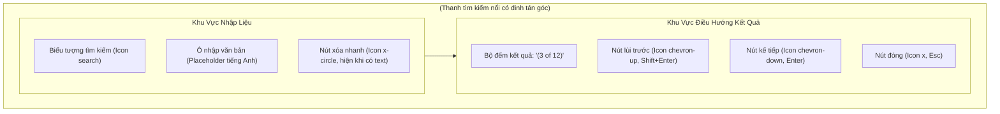

# 08. Thiết Kế Chi Tiết Thanh Tìm Kiếm, Lọc Commit & Điều Hướng Đồ Thị DAG

Tài liệu này đặc tả chi tiết kiến trúc tầng Giao diện (Webview UI), Component thanh tìm kiếm (`SearchFilterBar`), giải thuật bóc tách cú pháp bộ lọc (`searchQuery`), kho trạng thái phản ứng `search.store.ts` bằng Preact Signals, cơ chế Highlight phát quang Neon nút đồ thị và cuộn mượt mà trên bảng ảo hóa Virtualized Table cho **Phase 3.2: Nhóm Việc 4 — Thanh Tìm Kiếm & Lọc Commit Nâng Cao**.

> [!NOTE]
> Mọi nội dung trong tài liệu này tuân thủ nguyên tắc: thiết kế và đặc tả bằng ngôn ngữ tự nhiên (**Design by Word**), tập trung vào giải thuật tìm kiếm chuỗi phi khóa, tương tác phím tắt toàn cục và điều hướng mượt mà; **tuyệt đối không sử dụng mã nguồn mẫu hoặc khối code block dưới bất kỳ hình thức nào**.
>
> Toàn bộ văn bản hiển thị gợi ý (placeholder), nhãn đếm kết quả, chú thích tooltip và thông báo **sử dụng tiếng Anh chuẩn mực làm ngôn ngữ chính thức**. Phần giải nghĩa tiếng Việt trong tài liệu đóng vai trò tham khảo kỹ thuật.
>
> 📌 **Truy vết tiến độ**: [Phase 3.2 Tiến Độ (Nhóm Việc 4)](../../03_progess/phase3/002_phase3_2_3pane_workspace.md#nhóm-việc-4-thanh-tìm-kiếm--lọc-commit-nâng-cao-search--filter-bar).

---

## 1. Tầm Nhìn, Mục Tiêu & Trải Nghiệm Người Dùng

### 1.1. Mục Tiêu Cốt Lõi
1. **Tìm kiếm tức thời trên đồ thị quy mô lớn**: Cho phép lọc và định vị commit trên đồ thị DAG chứa hàng chục nghìn node mà không gây giật lag hay treo luồng chính (Zero Frame Drop).
2. **Kích hoạt nhanh toàn cục (Global Shortcut)**: Bắt tổ hợp phím tắt tiêu chuẩn toàn cầu `Ctrl + F` (trên Windows/Linux) hoặc `Cmd + F` (trên macOS) để mở ngay thanh tìm kiếm và tự động chuyển tiêu điểm nhập liệu từ bất kỳ phân vùng nào trên màn hình.
3. **Phân tích cú pháp tìm kiếm đa năng (Multi-faceted Search Grammar)**: Tự động phân tách từ khóa tự do trong Commit Message, lọc chính xác theo tác giả (`author:`) hoặc lọc theo mã băm (`hash:`).
4. **Điều hướng xoay vòng mượt mà (Smooth Cyclic Navigation)**: Hỗ trợ phím `Enter` (Next) và `Shift + Enter` (Previous) kèm bộ đếm kết quả trực quan `(X of Y)`. Khi chuyển kết quả, bảng ảo hóa tự động cuộn mượt mà đưa commit vào chính giữa vùng nhìn của người dùng (Viewport Center).

### 1.2. Trải Nghiệm Thẩm Mỹ Cyber-Lab
- **Phát quang tím Neon (`#a855f7`)**: Các nút lục giác `HexagonNode` và dòng commit thỏa mãn điều kiện tìm kiếm sẽ bừng sáng viền tím Neon, nút đang được chọn (Active Target) phát xung ánh sáng nhẹ (Neon pulse animation 1.5s chu kỳ).
- **Làm mờ nền tương phản**: Toàn bộ các commit không khớp điều kiện sẽ được giảm nhẹ độ mờ xuống $50\% – 60\%$ (`opacity: 0.55`) để dẫn dắt ánh mắt người dùng tập trung tuyệt đối vào kết quả cần tìm.

---

## 2. Đặc Tả Thuật Toán Phân Tích Cú Pháp Lọc & Đối Chiếu

### 2.1. Quy Chuẩn Ngữ Pháp Tìm Kiếm (Search Grammar Specification)

| Dạng Cú Pháp | Tiền Tố (Prefix) | Ví Dụ Đầu Vào | Phạm Vi Đối Chiếu (Matching Scope) | Quy Tắc So Khớp |
| :--- | :--- | :--- | :--- | :--- |
| **Tìm Kiếm Tự Do** | Không có | `fix auth bug` | Tiêu đề `subject` và mô tả mở rộng `description` của commit | So khớp chuỗi con không phân biệt hoa thường (Case-insensitive substring match). |
| **Lọc Theo Tác Giả** | `author:` | `author:Nam` hoặc `author:lab.vn` | Tên tác giả `authorName` hoặc địa chỉ email `authorEmail` | Trích xuất phần sau dấu hai chấm; so khớp chuỗi con không phân biệt hoa thường trong trường tác giả. |
| **Lọc Theo Mã Băm** | `hash:` | `hash:a1b2c3d` hoặc chuỗi hex 7–40 ký tự | Mã định danh duy nhất `commitHash` | So khớp tiền tố mã hash commit (`commitHash.startsWith(query)`). |
| **Kết Hợp Điều Kiện** | Dấu cách phân cách | `author:Nam fix` | Đồng thời cả hai trường: Tác giả phải là Nam VÀ message phải chứa từ "fix" | Tách chuỗi theo dấu cách thành danh sách các token lọc; áp dụng logic `AND` (tất cả các token đều phải thỏa mãn). |

---

### 2.2. Giải Thuật Bóc Tách Token Cú Pháp Từng Bước (`parseSearchQuery`)

- **Đặc Tả Đầu Vào (Input)**: Chuỗi ký tự thô `rawQuery` do người dùng nhập vào ô input.
- **Đặc Tả Đầu Ra (Output)**: Danh sách các đối tượng Token `Array<SearchToken>`. Mỗi Token gồm:
  - `type`: Thuộc một trong ba kiểu: `"author"`, `"hash"`, hoặc `"free"`.
  - `value`: Chuỗi giá trị cần so khớp (đã chuyển về chữ thường và cắt khoảng trắng).
- **Quy Trình Các Bước Xử Lý**:
  1. *Bước 1 (Chuẩn hóa)*: Cắt tỉa khoảng trắng ở hai đầu chuỗi: `trimmed = rawQuery.trim()`. Nếu chuỗi rỗng, trả về mảng rỗng.
  2. *Bước 2 (Tách từ)*: Tách chuỗi theo một hoặc nhiều khoảng trắng liên tiếp bằng biểu thức chính quy `\s+` thành mảng các từ ngữ (words).
  3. *Bước 3 (Phân loại từng từ)*: Duyệt qua từng từ trong mảng:
     - Nếu từ bắt đầu bằng tiền tố `"author:"`: Cắt bỏ 7 ký tự đầu, lấy phần còn lại chuyển thành chữ thường. Nếu phần giá trị không rỗng, tạo token `{ type: 'author', value: val }`.
     - Nếu từ bắt đầu bằng tiền tố `"hash:"`: Cắt bỏ 5 ký tự đầu, lấy phần còn lại chuyển thành chữ thường. Nếu không rỗng, tạo token `{ type: 'hash', value: val }`.
     - Ngược lại: Nếu từ không rỗng, tạo token `{ type: 'free', value: word.toLowerCase() }`.
  4. *Bước 4 (Trả kết quả)*: Trả về danh sách token đã phân loại.

---

### 2.3. Giải Thuật Đối Chiếu Dòng Commit Từng Bước (`matchesCommit`)

- **Đặc Tả Đầu Vào (Input)**:
  - Một đối tượng commit `CommitRow` (chứa `hash`, `subject`, `description`, `authorName`, `authorEmail`).
  - Danh sách token đã bóc tách `Array<SearchToken>`.
- **Đặc Tả Đầu Ra (Output)**: Giá trị boolean: `true` nếu commit thỏa mãn toàn bộ token; `false` nếu vi phạm bất kỳ token nào.
- **Quy Trình Các Bước Xử Lý**:
  1. *Bước 1 (Kiểm tra rỗng)*: Nếu danh sách token rỗng, trả về `true` (mặc định khớp toàn bộ khi không có query).
  2. *Bước 2 (Chuẩn bị dữ liệu đối chiếu)*:
     - Chuyển `subject` và `description` của commit thành chữ thường: `searchableText = (commit.subject + " " + (commit.description || "")).toLowerCase()`.
     - Chuyển thông tin tác giả thành chữ thường: `authorText = (commit.authorName + " " + (commit.authorEmail || "")).toLowerCase()`.
     - Mã hash chữ thường: `hashText = commit.hash.toLowerCase()`.
  3. *Bước 3 (Kiểm tra logic AND qua từng token)*:
     - Với mỗi token trong danh sách:
       - Nếu `token.type === 'author'`: Kiểm tra nếu `authorText` không chứa `token.value` $\rightarrow$ Trả về `false`.
       - Nếu `token.type === 'hash'`: Kiểm tra nếu `hashText` không bắt đầu bằng `token.value` $\rightarrow$ Trả về `false`.
       - Nếu `token.type === 'free'`: Kiểm tra nếu `searchableText` không chứa `token.value` $\rightarrow$ Trả về `false`.
  4. *Bước 4 (Xác nhận khớp)*: Sau khi duyệt qua tất cả các token mà không vi phạm, trả về `true`.

---

## 3. Đặc Tả Kiến Trúc Giao Diện & Component `SearchFilterBar.tsx`

### 3.1. Bảng Thuộc Tính Props Của `SearchFilterBar`:

| Tên Thuộc Tính | Kiểu Dữ Liệu | Bắt Buộc? | Mặc Định | Ràng Buộc & Mô Tả Ý Nghĩa |
| :--- | :--- | :---: | :---: | :--- |
| `isOpen` | boolean | Có | - | Cờ hiển thị thanh tìm kiếm trên giao diện |
| `query` | string | Có | - | Chuỗi tìm kiếm hiện tại do người dùng nhập |
| `matchCount` | number | Có | - | Tổng số lượng commit khớp điều kiện ($\ge 0$) |
| `currentIndex` | number | Có | - | Vị trí kết quả đang được chọn hiện tại (1-indexed khi hiển thị, 0 nếu không có) |
| `onQueryChange` | (val: string) => void | Có | - | Hàm callback khi người dùng gõ vào ô tìm kiếm |
| `onNext` | () => void | Có | - | Hàm callback chuyển tới kết quả kế tiếp |
| `onPrev` | () => void | Có | - | Hàm callback quay lại kết quả trước đó |
| `onClose` | () => void | Có | - | Hàm callback đóng thanh tìm kiếm và xóa bộ lọc |

---

### 3.2. Bắt Phím Tắt Toàn Cục (Keyboard Shortcuts Matrix)

| Tổ Hợp Phím Tắt | Ngữ Cảnh Kích Hoạt | Hành Động Xử Lý Chi Tiết Từng Bước |
| :--- | :--- | :--- |
| **`Ctrl + F`** (Win/Linux) **`Cmd + F`** (macOS) | Bất kỳ vị trí nào trên Webview | 1. Đặt `isSearchOpen.value = true`. 2. Chờ nhịp render DOM kế tiếp (microtask). 3. Chuyển tiêu điểm (`focus()`) vào ô input tìm kiếm. 4. Bôi đen toàn bộ văn bản hiện có (`select()`) để người dùng có thể gõ đè từ khóa mới ngay lập tức. |
| **`Enter`** | Khi đang focus trong ô input tìm kiếm | Kích hoạt `nextMatch()`: Tăng chỉ số kết quả lên 1 (xoay vòng nếu chạm cuối) và kích hoạt cuộn bảng ảo hóa đến commit đó. |
| **`Shift + Enter`** | Khi đang focus trong ô input tìm kiếm | Kích hoạt `prevMatch()`: Giảm chỉ số kết quả đi 1 (xoay vòng nếu chạm đầu) và kích hoạt cuộn bảng ảo hóa. |
| **`Escape`** | Khi thanh tìm kiếm đang mở | 1. Xóa sạch chuỗi tìm kiếm: `setQuery("")`. 2. Đóng thanh tìm kiếm: `closeSearch()`. 3. Trả tiêu điểm bàn phím về bảng đồ thị commit DAG. |

---

## 4. Quản Lý Trạng Thái Bằng Preact Signals (`search.store.ts`)

### 4.1. Bảng Danh Mục Tín Hiệu Cơ Sở (Base Signals)

| Tên Tín Hiệu | Kiểu Dữ Liệu | Giá Trị Khởi Tạo | Mô Tả Ý Nghĩa |
| :--- | :--- | :---: | :--- |
| `searchQuery` | string | `""` | Chuỗi tìm kiếm hiện tại do người dùng nhập |
| `isSearchOpen` | boolean | `false` | Cờ trạng thái đóng/mở thanh tìm kiếm trên Webview UI |
| `currentMatchIndex` | number | `0` | Chỉ số thứ tự của kết quả đang được focus trong danh sách kết quả khớp (0-indexed) |
| `scrollRequest` | `{ rowIndex: number; timestamp: number } \| null` | `null` | Tín hiệu yêu cầu cuộn bảng ảo hóa đến dòng chỉ định (kèm timestamp để bảo đảm luôn kích hoạt phản ứng mỗi lần phát lệnh) |

---

### 4.2. Bảng Danh Mục Tín Hiệu Dẫn Xuất (Computed Signals)

| Tên Tín Hiệu | Kiểu Dữ Liệu | Công Thức / Logic Tính Toán | Mô Tả Ý Nghĩa |
| :--- | :--- | :--- | :--- |
| `matchingRowIndices` | Mảng số nguyên | Duyệt qua danh sách commit hiện có trong bảng ảo hóa; áp dụng giải thuật `matchesCommit` ở Mục 2.3; thu thập danh sách chỉ số dòng `rowIndex` của toàn bộ các commit thỏa mãn. | Danh sách chỉ số các dòng commit khớp điều kiện tìm kiếm |
| `totalMatches` | number | `matchingRowIndices.value.length` | Tổng số lượng commit tìm thấy |
| `activeCommitHash` | string \| null | Nếu `totalMatches > 0`: Trả về mã hash của commit tại vị trí `matchingRowIndices.value[currentMatchIndex.value]`. Ngược lại `null`. | Mã băm của commit đang được người dùng định vị |
| `counterText` | string | - Nếu `totalMatches === 0`: Nếu có `searchQuery` trả về `"No matches"`, nếu rỗng trả về `""`. - Nếu có kết quả: Trả về `"(" + (currentMatchIndex.value + 1) + " of " + totalMatches + ")"`. | Chuỗi nhãn tiếng Anh hiển thị trên bộ đếm kết quả |

---

### 4.3. Đặc Tả Chi Tiết Input / Output & Các Bước Xử Lý Của Bộ Hàm Điều Phối

Toàn bộ các hàm điều phối của kho trạng thái tìm kiếm tuân thủ chặt chẽ kiến trúc phản ứng vi mô (Fine-grained Reactive Store) của Preact Signals, áp dụng cơ chế cập nhật nguyên tử `batch` để loại trừ hiện tượng vẽ lại màn hình lãng phí, đồng thời xử lý triệt để các trường hợp biên dữ liệu.

---

#### 1. Hàm `setQuery(query: string): void`

- **Mục Tiêu (Goal)**: Tiếp nhận chuỗi tìm kiếm từ người dùng, đồng bộ tín hiệu `searchQuery`, tái kích hoạt giải thuật lọc commit, xác lập lại chỉ số tiêu điểm về kết quả đầu tiên và tự động kích hoạt cuộn bảng ảo hóa đến dòng khớp đầu tiên.
- **Đặc Tả Đầu Vào (Input)**:
  - `query: string`: Chuỗi ký tự thô do người dùng nhập từ ô input của `SearchFilterBar`.
- **Đặc Tả Đầu Ra (Output)**:
  - `void`: Cập nhật trực tiếp vào các tín hiệu phản ứng cơ sở.
- **Điều Kiện Tiên Quyết (Preconditions)**:
  - Kho trạng thái `search.store.ts` đã được khởi tạo.
  - Danh sách commit của bảng ảo hóa đã sẵn sàng trong bộ nhớ Webview.
- **Trạng Thái Sau Thực Thi (Postconditions)**:
  - Tín hiệu `searchQuery.value` nhận giá trị chuỗi mới.
  - Tín hiệu `currentMatchIndex.value` được đặt lại về `0`.
  - Tín hiệu dẫn xuất `matchingRowIndices` phản ứng tự động cập nhật mảng chỉ số dòng thỏa mãn.
  - Nếu có kết quả (`totalMatches.value > 0`), tín hiệu `scrollRequest` được gán để yêu cầu cuộn đến dòng đầu tiên `matchingRowIndices.value[0]`.
- **Xử Lý Trường Hợp Ngoại Lệ & Biên (Edge Cases)**:
  - *Chuỗi nhập trùng giá trị hiện tại*: Nếu `query === searchQuery.value`, dừng thực thi ngay lập tức (Early Return) để tránh tính toán lại và kích hoạt cuộn dư thừa.
  - *Chuỗi rỗng hoặc chỉ toàn khoảng trắng (`query.trim() === ""`)*: Cập nhật `searchQuery.value = query`, `currentMatchIndex.value = 0`. Tín hiệu dẫn xuất `matchingRowIndices` nhận mảng rỗng `[]`, `totalMatches` là 0, `activeCommitHash` là `null`, `counterText` là chuỗi rỗng `""`. Tuyệt đối không phát lệnh cuộn để giữ nguyên vị trí hiện tại của bảng commit.
  - *Không có kết quả khớp (`totalMatches === 0`)*: Không phát lệnh cuộn; nhãn `counterText` tự động chuyển sang `"No matches"`.
- **Quy Trình Các Bước Xử Lý Tuần Tự (Step-by-step Pipeline)**:
  1. *Bước 1 (Kiểm tra tương đương)*: So sánh giá trị chuỗi tham số `query` với `searchQuery.value`. Nếu hai giá trị giống nhau hoàn toàn, kết thúc hàm ngay lập tức.
  2. *Bước 2 (Cập nhật trạng thái nguyên tử)*: Bao bọc trong khối `batch` của `@preact/signals`:
     - 2.1: Gán `searchQuery.value = query`.
     - 2.2: Gán `currentMatchIndex.value = 0`.
  3. *Bước 3 (Đánh giá điều kiện cuộn điều hướng)*:
     - 3.1: Kiểm tra chuỗi đã cắt tỉa `query.trim()`. Nếu rỗng, kết thúc xử lý (không phát lệnh cuộn).
     - 3.2: Kiểm tra số lượng kết quả dẫn xuất `totalMatches.value`. Nếu bằng 0, kết thúc xử lý.
     - 3.3: Nếu `totalMatches.value > 0`, trích xuất chỉ số dòng của kết quả đầu tiên: `targetRowIndex = matchingRowIndices.value[0]`.
  4. *Bước 4 (Phát lệnh cuộn điều phối)*:
     - Gọi hàm điều phối nội bộ `dispatchScrollToRow(targetRowIndex)`, cập nhật tín hiệu `scrollRequest.value = { rowIndex: targetRowIndex, timestamp: Date.now() }` để bảng ảo hóa căn giữa dòng commit mục tiêu.

---

#### 2. Hàm `nextMatch(): void`

- **Mục Tiêu (Goal)**: Chuyển tiêu điểm định vị sang kết quả tìm kiếm kế tiếp theo thứ tự thời gian/dòng bảng, hỗ trợ cơ chế xoay vòng tuần hoàn (Cyclic Step-Forward) từ kết quả cuối cùng quay trở lại kết quả đầu tiên, đồng thời kích hoạt cuộn căn giữa màn hình.
- **Đặc Tả Đầu Vào (Input)**: Không có tham số.
- **Đặc Tả Đầu Ra (Output)**: `void`.
- **Điều Kiện Tiên Quyết (Preconditions)**:
  - Thanh tìm kiếm đang mở hoặc từ khóa tìm kiếm đang có hiệu lực.
- **Trạng Thái Sau Thực Thi (Postconditions)**:
  - `currentMatchIndex.value` được tăng lên 1 (hoặc xoay vòng về 0).
  - `activeCommitHash` phản ánh mã hash mới tương ứng.
  - Nút lục giác `HexagonNode` của commit mới chuyển sang chế độ Neon Pulse hoạt họa.
  - Bảng ảo hóa thực hiện cuộn mượt đưa dòng commit tương ứng vào tâm vùng nhìn.
- **Xử Lý Trường Hợp Ngoại Lệ & Biên (Edge Cases)**:
  - *Không có kết quả nào (`totalMatches.value === 0`)*: Không làm gì cả (No-op), kết thúc ngay.
  - *Chỉ có đúng 1 kết quả duy nhất (`totalMatches.value === 1`)*: Chỉ số `currentMatchIndex.value` giữ nguyên là `0`. Tuy nhiên, vẫn phát lệnh cuộn `dispatchScrollToRow(matchingRowIndices.value[0])` để hỗ trợ trường hợp người dùng đã cuộn tay rời khỏi tầm nhìn và muốn tái căn giữa kết quả duy nhất này.
  - *Chỉ số hiện tại vượt biên*: Nếu do dữ liệu commit thay đổi khiến `currentMatchIndex.value >= totalMatches.value`, tự động kẹp về `0`.
- **Quy Trình Các Bước Xử Lý Tuần Tự (Step-by-step Pipeline)**:
  1. *Bước 1 (Kiểm tra tính sẵn sàng)*: Đọc `count = totalMatches.value`. Nếu `count === 0`, kết thúc hàm.
  2. *Bước 2 (Xử lý trường hợp một kết quả)*: Nếu `count === 1`:
     - 2.1: Giữ nguyên `currentMatchIndex.value = 0`.
     - 2.2: Gọi `dispatchScrollToRow(matchingRowIndices.value[0])`.
     - 2.3: Kết thúc hàm.
  3. *Bước 3 (Tính toán chỉ số xoay vòng tuần hoàn)*: Khi `count > 1`:
     - Áp dụng công thức số học tuần hoàn: `nextIdx = (currentMatchIndex.value + 1) % count`.
  4. *Bước 4 (Cập nhật chỉ số)*: Gán `currentMatchIndex.value = nextIdx`.
  5. *Bước 5 (Trích xuất và phát lệnh cuộn)*:
     - Trích xuất chỉ số dòng mục tiêu: `targetRow = matchingRowIndices.value[nextIdx]`.
     - Gọi `dispatchScrollToRow(targetRow)`.

---

#### 3. Hàm `prevMatch(): void`

- **Mục Tiêu (Goal)**: Chuyển tiêu điểm định vị lùi lại kết quả tìm kiếm trước đó, hỗ trợ xoay vòng tuần hoàn ngược (Cyclic Step-Backward) từ kết quả đầu tiên nhảy xuống kết quả cuối cùng, đồng thời kích hoạt cuộn căn giữa màn hình.
- **Đặc Tả Đầu Vào (Input)**: Không có tham số.
- **Đặc Tả Đầu Ra (Output)**: `void`.
- **Điều Kiện Tiên Quyết (Preconditions)**:
  - Tương tự hàm `nextMatch()`.
- **Trạng Thái Sau Thực Thi (Postconditions)**:
  - `currentMatchIndex.value` giảm đi 1 (hoặc nhảy xuống `totalMatches.value - 1`).
  - Nút commit mới nhận trạng thái phát quang Neon Pulse.
  - Bảng ảo hóa cuộn mượt đưa dòng commit tương ứng vào tâm vùng nhìn.
- **Xử Lý Trường Hợp Ngoại Lệ & Biên (Edge Cases)**:
  - *Không có kết quả (`totalMatches.value === 0`)*: Không làm gì cả (No-op).
  - *Chỉ có 1 kết quả (`totalMatches.value === 1`)*: Giữ nguyên `0` và tái kích hoạt lệnh cuộn căn giữa dòng `matchingRowIndices.value[0]`.
  - *Xoay vòng ngược an toàn tránh số âm*: Cần cộng thêm số lượng tổng `count` trước khi chia lấy dư để bảo đảm chỉ số luôn là số nguyên không âm.
- **Quy Trình Các Bước Xử Lý Tuần Tự (Step-by-step Pipeline)**:
  1. *Bước 1 (Kiểm tra tính sẵn sàng)*: Đọc `count = totalMatches.value`. Nếu `count === 0`, kết thúc hàm.
  2. *Bước 2 (Xử lý trường hợp một kết quả)*: Nếu `count === 1`:
     - 2.1: Giữ nguyên `currentMatchIndex.value = 0`.
     - 2.2: Gọi `dispatchScrollToRow(matchingRowIndices.value[0])`.
     - 2.3: Kết thúc hàm.
  3. *Bước 3 (Tính toán chỉ số xoay vòng ngược an toàn)*: Khi `count > 1`:
     - Áp dụng công thức số học tuần hoàn không âm: `prevIdx = (currentMatchIndex.value - 1 + count) % count`.
  4. *Bước 4 (Cập nhật chỉ số)*: Gán `currentMatchIndex.value = prevIdx`.
  5. *Bước 5 (Trích xuất và phát lệnh cuộn)*:
     - Trích xuất `targetRow = matchingRowIndices.value[prevIdx]`.
     - Gọi `dispatchScrollToRow(targetRow)`.

---

#### 4. Hàm `openSearch(): void`

- **Mục Tiêu (Goal)**: Kích hoạt hiển thị thanh tìm kiếm nổi `SearchFilterBar`, lập lịch chuyển tiêu điểm bàn phím vào ô input, tự động bôi đen toàn bộ từ khóa hiện hữu để người dùng sẵn sàng gõ đè, đồng thời tái căn chỉnh cuộn nếu đang có kết quả lọc.
- **Đặc Tả Đầu Vào (Input)**: Không có tham số.
- **Đặc Tả Đầu Ra (Output)**: `void`.
- **Điều Kiện Tiên Quyết (Preconditions)**:
  - Được kích hoạt thông qua tổ hợp phím tắt toàn cục `Ctrl + F` (trên Windows/Linux), `Cmd + F` (trên macOS), hoặc nút bấm tìm kiếm trên thanh điều hướng.
- **Trạng Thái Sau Thực Thi (Postconditions)**:
  - Tín hiệu `isSearchOpen.value` mang giá trị `true`.
  - Ô input của `SearchFilterBar` nhận được trạng thái `focus()`.
  - Toàn bộ văn bản trong ô input được bôi đen thông qua phương thức `select()`.
- **Xử Lý Trường Hợp Ngoại Lệ & Biên (Edge Cases)**:
  - *Thanh tìm kiếm đã mở sẵn*: Nếu `isSearchOpen.value === true`, chỉ cần thực hiện lại thao tác `focus()` và `select()` mà không phát sinh hiệu ứng mở lại DOM.
  - *DOM Input chưa được mount kịp thời*: Khi `isSearchOpen` vừa đổi từ `false` sang `true`, phần tử `<input>` có thể chưa sẵn sàng trong DOM ở cùng khung hình. Do đó, bắt buộc phải trì hoãn thao tác focus sang nhịp microtask kế tiếp bằng `requestAnimationFrame` hoặc `setTimeout(0)`.
  - *Phần tử input tham chiếu bị null*: Cần kiểm tra an toàn sự tồn tại của DOM element trước khi gọi các hàm tương tác trình duyệt.
- **Quy Trình Các Bước Xử Lý Tuần Tự (Step-by-step Pipeline)**:
  1. *Bước 1 (Kích hoạt cờ hiển thị)*: Gán `isSearchOpen.value = true`.
  2. *Bước 2 (Lập lịch tiêu điểm bất đồng bộ)*: Đăng ký một callback thông qua `requestAnimationFrame` (hoặc `setTimeout(0)`) nhằm bảo đảm trình duyệt đã hoàn tất chu trình Render Tree cho component `SearchFilterBar`.
  3. *Bước 3 (Thao tác phần tử DOM an toàn)*:
     - 3.1: Truy xuất phần tử DOM input thông qua biến tham chiếu `searchInputRef`.
     - 3.2: Nếu tham chiếu tồn tại khác `null`:
       - Gọi phương thức `searchInputRef.focus()` để chiếm quyền điều khiển bàn phím.
       - Gọi phương thức `searchInputRef.select()` để bôi đen toàn bộ chuỗi văn bản đang có sẵn.
  4. *Bước 4 (Tái kích hoạt căn giữa kết quả nếu đã có bộ lọc)*:
     - Nếu `totalMatches.value > 0` và `matchingRowIndices.value.length > 0`:
       - Lấy chỉ số dòng mục tiêu hiện hành: `targetRow = matchingRowIndices.value[currentMatchIndex.value]`.
       - Gọi `dispatchScrollToRow(targetRow)` để tái xác lập tầm nhìn của người dùng.

---

#### 5. Hàm `closeSearch(): void`

- **Mục Tiêu (Goal)**: Đóng thanh tìm kiếm, làm sạch toàn bộ dữ liệu từ khóa tìm kiếm và các chỉ số kết quả, khôi phục độ mờ $100\%$ cho tất cả các nút commit, dọn dẹp viền Neon Pulse và hoàn trả tiêu điểm bàn phím về đồ thị DAG.
- **Đặc Tả Đầu Vào (Input)**: Không có tham số.
- **Đặc Tả Đầu Ra (Output)**: `void`.
- **Điều Kiện Tiên Quyết (Preconditions)**:
  - Được kích hoạt khi người dùng nhấn phím `Escape`, nhấp vào nút đóng (`Icon x`), hoặc hủy bỏ tìm kiếm từ giao diện.
- **Trạng Thái Sau Thực Thi (Postconditions)**:
  - `isSearchOpen.value` mang giá trị `false`.
  - `searchQuery.value` được đặt lại thành chuỗi rỗng `""`.
  - `currentMatchIndex.value` được đặt lại về `0`.
  - `scrollRequest.value` được đặt lại về `null`.
  - Toàn bộ các dòng commit trên bảng ảo hóa trở về trạng thái hiển thị bình thường (`opacity: 1`), loại bỏ hoàn toàn viền tím Neon và hoạt họa phát quang.
  - Tiêu điểm bàn phím được chuyển về container của bảng đồ thị commit DAG.
- **Xử Lý Trường Hợp Ngoại Lệ & Biên (Edge Cases)**:
  - *Hiện tượng kẹt tiêu điểm (Focus Trap)*: Nếu chỉ ẩn component input mà không chuyển tiêu điểm bàn phím đi nơi khác, trình duyệt có thể mất tiêu điểm hoặc chuyển tiêu điểm ra ngoài khung nhìn Webview. Do đó, bắt buộc phải trả tiêu điểm về container bảng đồ thị DAG (`graphContainerRef.focus()`).
- **Quy Trình Các Bước Xử Lý Tuần Tự (Step-by-step Pipeline)**:
  1. *Bước 1 (Làm sạch trạng thái nguyên tử)*: Sử dụng hàm `batch` để đồng bộ cập nhật tất cả các tín hiệu cùng lúc:
     - 1.1: Gán `isSearchOpen.value = false`.
     - 1.2: Gán `searchQuery.value = ""`.
     - 1.3: Gán `currentMatchIndex.value = 0`.
     - 1.4: Gán `scrollRequest.value = null`.
  2. *Bước 2 (Hoàn trả tiêu điểm an toàn)*:
     - 2.1: Truy xuất phần tử DOM container của bảng đồ thị DAG thông qua biến tham chiếu `graphContainerRef`.
     - 2.2: Nếu phần tử tồn tại khác `null`, gọi `graphContainerRef.focus()` để cho phép người dùng tiếp tục thao tác phím mũi tên (`ArrowUp`, `ArrowDown`) trên danh sách commit mà không cần nhấp chuột.

---

#### 6. Hàm `clearQuery(): void`

- **Mục Tiêu (Goal)**: Xóa nhanh nội dung chuỗi tìm kiếm khi người dùng nhấn nút "Xóa nhanh" (`Icon x-circle`), đồng thời duy trì thanh tìm kiếm ở trạng thái mở và giữ nguyên tiêu điểm nhập liệu trong ô input.
- **Đặc Tả Đầu Vào (Input)**: Không có tham số.
- **Đặc Tả Đầu Ra (Output)**: `void`.
- **Điều Kiện Tiên Quyết (Preconditions)**:
  - Ô input đang chứa chuỗi ký tự khác rỗng (`searchQuery.value.length > 0`).
- **Trạng Thái Sau Thực Thi (Postconditions)**:
  - `searchQuery.value` mang giá trị chuỗi rỗng `""`.
  - `currentMatchIndex.value` đặt lại về `0`.
  - `isSearchOpen.value` vẫn duy trì là `true`.
  - Tiêu điểm bàn phím tiếp tục nằm trong ô input.
- **Quy Trình Các Bước Xử Lý Tuần Tự (Step-by-step Pipeline)**:
  1. *Bước 1 (Xóa chuỗi nguyên tử)*: Bao bọc trong `batch`:
     - 1.1: Gán `searchQuery.value = ""`.
     - 1.2: Gán `currentMatchIndex.value = 0`.
     - 1.3: Gán `scrollRequest.value = null`.
  2. *Bước 2 (Duy trì tiêu điểm)*:
     - Truy xuất `searchInputRef`. Nếu tồn tại khác `null`, gọi `searchInputRef.focus()` để người dùng có thể gõ ngay từ khóa tìm kiếm mới mà không bị gián đoạn thao tác.

---

#### 7. Cơ Chế Điều Phối Cuộn Bảng Ảo Hóa Phi Ghép Nối (`Scroll Coordination Pipeline`)

Nhằm bảo đảm tính độc lập hoàn toàn giữa module logic `search.store.ts` và tầng hiển thị DOM của bảng ảo hóa, hệ thống thiết kế cơ chế điều phối cuộn phi ghép nối (Decoupled Scroll Coordination) thông qua tín hiệu phản ứng `scrollRequest`:

1. **Hàm Điều Phối Nội Bộ `dispatchScrollToRow(rowIndex: number): void`**:
   - Nhận tham số `rowIndex: number` đại diện cho chỉ số dòng cần cuộn tới.
   - Gán `scrollRequest.value = { rowIndex, timestamp: Date.now() }`.
   - *Ý nghĩa của trường `timestamp`*: Đảm bảo mỗi lần gọi hàm đều tạo ra một đối tượng tham chiếu mới. Nhờ đó, ngay cả khi người dùng bấm Next liên tục trên cùng một kết quả (trường hợp `totalMatches === 1`), hook phản ứng tại tầng UI vẫn luôn luôn bắt được sự thay đổi và kích hoạt lệnh cuộn tái căn giữa màn hình.
2. **Quy Trình Tiêu Thụ Tín Hiệu Cuộn Phía Component Bảng Ảo Hóa (`VirtualizedTable`)**:
   - Component bảng ảo hóa đăng ký một hiệu ứng phản ứng (`useSignalEffect` hoặc `effect`):
     - Khi `scrollRequest.value !== null`:
       - *Bước 1*: Đọc `targetRowIndex = scrollRequest.value.rowIndex`.
       - *Bước 2*: Áp dụng công thức căn giữa chiều cao dòng $24\text{px}$ chuẩn mực (Mục 5.1):
         $$Y_{\text{scroll}} = \max\left(0, \text{targetRowIndex} \times 24\text{px} - \frac{H_{\text{viewport}}}{2} + 12\text{px}\right)$$
       - *Bước 3*: Gọi phương thức cuộn mượt mà của container bảng ảo hóa: `scrollElement.scrollTo({ top: Y_scroll, behavior: 'smooth' })`.

---

#### 8. Cơ Chế Kẹp Chỉ Số Tự Động Khi Dữ Liệu Commit Biến Động (`Index Clamping & Mutation Sync`)

Khi kho lưu trữ Git phát sinh các biến động ngầm (như đổi nhánh, nạp thêm trang commit mới qua RPC `graph.window`, hoặc nhận commit mới từ Git watcher):

- **Nguy Cơ Lỗi Vượt Biên (Out-of-Bounds Hazard)**: Giả sử người dùng đang chọn kết quả thứ 5 (`currentMatchIndex = 4` trên tổng số 5 kết quả). Khi dữ liệu commit thay đổi, số lượng commit thỏa mãn điều kiện tìm kiếm giảm xuống chỉ còn 2 kết quả (`totalMatches = 2`). Nếu không kẹp chỉ số, việc truy cập `matchingRowIndices.value[4]` sẽ trả về `undefined`, gây sập giao diện hiển thị.
- **Quy Trình Kẹp Chỉ Số Tự Động (Auto-Clamping Pipeline)**:
  1. *Bước 1*: Mỗi khi tín hiệu `matchingRowIndices` tự động tính toán lại mảng kết quả mới:
  2. *Bước 2 (Kiểm tra và kẹp an toàn)*:
     - Nếu `totalMatches.value === 0`: Tự động đặt lại `currentMatchIndex.value = 0`.
     - Nếu `currentMatchIndex.value >= totalMatches.value`: Tự động kẹp giá trị về chỉ số hợp lệ cao nhất:
       $$\text{currentMatchIndex.value} = \text{totalMatches.value} - 1$$
  3. *Bước 3*: Giá trị `activeCommitHash` lập tức được đồng bộ hóa với mã hash tại chỉ số đã kẹp, duy trì tính toàn vẹn trạng thái tuyệt đối.

---

## 5. Tích Hợp Cuộn Bảng Ảo Hóa & Highlight Đồ Thị DAG

### 5.1. Thuật Toán Định Vị Pixel $Y$ & Căn Giữa Màn Hình (Viewport Centering)

1. **Bất biến chiều cao dòng commit**: Mỗi dòng commit trong bảng `CommitTable` có chiều cao cố định chuẩn mực bất biến là $24\text{px}$.
2. **Tọa độ pixel đỉnh của dòng mục tiêu**:
   - $Y_{\text{target}} = \text{targetRowIndex} \times 24\text{px}$.
3. **Công thức căn giữa màn hình (Center-aligned Scroll Target)**:
   - Cho $H_{\text{viewport}}$ là chiều cao vùng nhìn thấy của bảng ảo hóa:
   - $Y_{\text{scroll}} = \max(0, Y_{\text{target}} - \frac{H_{\text{viewport}}}{2} + 12\text{px})$.
4. **Thực thi cuộn mượt**:
   - Gọi phương thức cuộn của container ảo hóa: `scrollElement.scrollTo({ top: Y_scroll, behavior: 'smooth' })`.

---

### 5.2. Quy Chuẩn Highlight Nút Lục Giác `HexagonNode`

1. **Node khớp điều kiện tìm kiếm (Matching Node)**:
   - Viền lục giác: Bừng sáng màu tím Neon `#a855f7` với bộ lọc phát quang: `filter: drop-shadow(0 0 6px rgba(168, 85, 247, 0.8))`.
   - Vầng neon ambient mở rộng bán kính 8px.
2. **Node đang được định vị hiện tại (Active Focused Node)**:
   - Kích hoạt hoạt họa xung ánh sáng Neon (`neon-pulse` animation): Độ sáng biến thiên nhịp nhàng từ $0.8$ đến $1.2$ theo chu kỳ $1.5\text{s}$ hình sin.
   - Viền mở rộng thêm 1px phát quang sắc nét.
3. **Các dòng và node không khớp (Non-matching Rows)**:
   - Giảm độ mờ xuống mức $55\%$ (`opacity: 0.55`) để tạo độ tương phản thị giác mạnh mẽ, giúp người dùng nhận diện ngay các commit thỏa mãn.

---

## 6. Bảng Chuẩn Hóa Văn Bản Tiếng Anh (Search UI Strings Dictionary)

| Phần Tử Giao Diện | Văn Bản Hiển Thị Tiếng Anh (English Display String) | Chú Thích Tooltip |
| :--- | :--- | :--- |
| **Gợi Ý Nhập Liệu (Placeholder)** | `"Find by message, author:name, hash:sha (Ctrl+F)"` | Hướng dẫn cú pháp tìm kiếm |
| **Nút Xóa Nhanh** | Icon x-circle | `"Clear search (Esc)"` |
| **Nút Kết Quả Trước** | Icon chevron-up | `"Previous match (Shift+Enter)"` |
| **Nút Kết Quả Sau** | Icon chevron-down | `"Next match (Enter)"` |
| **Nút Đóng** | Icon x | `"Close search bar (Esc)"` |
| **Nhãn Không Có Kết Quả** | `"No matches"` | Thông báo khi từ khóa không khớp commit nào |
| **Nhãn Đếm Kết Quả** | `"(" + (index + 1) + " of " + total + ")"` | Vị trí kết quả hiện tại trên tổng số |

---

## 7. Ma Trận Kiểm Thử Đơn Vị Song Hành (Unit Testing Matrix)

Mọi tệp kiểm thử cho Nhóm Việc 4 bắt buộc đặt tên với đuôi `*.test.ts`, vận hành độc lập trên runner `vitest`:

| Tệp Kiểm Thử Độc Lập | Module Mục Tiêu | Kịch Bản Kiểm Thử Chi Tiết Bắt Buộc |
| :--- | :--- | :--- |
| `tests/webview/components/search/SearchFilterBar.test.ts` | `SearchFilterBar.tsx` & `search.store.ts` | 1. **Phím tắt toàn cục `Ctrl + F`**: Nhấn tổ hợp phím kích hoạt mở thanh tìm kiếm và chuyển tiêu điểm vào ô input. 2. **Lọc thông điệp tự do**: Nhập từ khóa `"login"`, xác nhận lọc chính xác các commit có tiêu đề hoặc mô tả chứa `"login"` (không phân biệt hoa thường). 3. **Lọc theo tác giả `author:`**: Nhập `"author:Nam"`, xác nhận chỉ lọc các commit có trường author chứa chuỗi `"Nam"`. 4. **Lọc theo mã hash `hash:`**: Nhập `"hash:a1b2"`, xác nhận chỉ lọc các commit có mã hash bắt đầu bằng `"a1b2"`. 5. **Lọc kết hợp nhiều điều kiện**: Nhập `"author:Nam fix"`, xác nhận chỉ các commit vừa có tác giả Nam vừa chứa từ "fix" mới được trả về. 6. **Xoay vòng Next / Prev**: Danh sách có 3 kết quả; bấm `Enter` (Next) tăng từ 1 lên 2, lên 3, rồi xoay vòng về 1; bấm `Shift + Enter` (Prev) xoay vòng ngược lại. 7. **Xử lý biên 1 kết quả duy nhất**: Khi chỉ có 1 kết quả, bấm Next hoặc Prev vẫn kích hoạt lệnh cuộn tái căn giữa. 8. **Xóa nhanh bằng nút Clear**: Nhấn nút Clear xóa chuỗi tìm kiếm, đặt lại chỉ số về 0 nhưng vẫn giữ tiêu điểm trong ô input. 9. **Phím `Esc` đóng tìm kiếm**: Bấm `Esc` làm sạch chuỗi `searchQuery`, đóng thanh tìm kiếm và trả tiêu điểm về container đồ thị DAG. 10. **Tính toán vị trí cuộn & Kẹp chỉ số an toàn**: Kiểm tra hàm cuộn bảng ảo hóa được gọi với đúng tọa độ pixel mục tiêu khi chuyển kết quả, và tự động kẹp chỉ số an toàn khi dữ liệu commit thay đổi. |

---

## 8. Lịch Sử Sửa Đổi Thiết Kế (Revision History)

| Phiên Bản | Ngày | Phân Loại | Người Sửa | Nội Dung Thay Đổi & Căn Nguyên Kỹ Thuật |
| :---: | :---: | :---: | :---: | :--- |
| **v1.0.0** | 2026-10-15 | Tạo mới | AI Architect | Khởi tạo tài liệu đặc tả Search, Filter & DAG Navigation. |
| **v1.1.0** | 2026-10-19 | Rà soát | AI Architect | **Rà soát tính toàn vẹn và độc lập giao diện**: Xác nhận thuật toán tìm kiếm Commit vận hành hoàn toàn trên dữ liệu commit của Webview UI, không phát sinh RPC query bổ sung và bảo đảm tương thích 100% với cấu trúc 3-Pane Workspace sau cập nhật Design 05–07. |
| **v1.2.0** | 2026-10-19 | Cập nhật thiết kế | AI Architect | **Chi tiết hóa toàn diện Mục 4.3**: Bổ sung đặc tả Black-Box chuẩn mực cho từng hàm điều phối (`setQuery`, `nextMatch`, `prevMatch`, `openSearch`, `closeSearch`, `clearQuery`), xử lý toàn diện các trường hợp biên dữ liệu, quy trình tuần tự từng bước chi tiết (step-by-step pipeline), cơ chế điều phối cuộn bảng ảo hóa phi ghép nối (`scrollRequest`) và cơ chế kẹp chỉ số tự động chống lỗi vượt biên (`Index Clamping`). |

