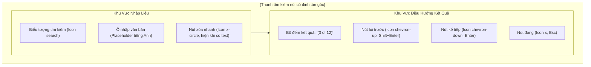

# 08. Thiết Kế Chi Tiết Thanh Tìm Kiếm, Lọc Commit & Điều Hướng Đồ Thị DAG

Tài liệu này đặc tả chi tiết kiến trúc tầng Giao diện (Webview UI), Component thanh tìm kiếm (`SearchFilterBar`), giải thuật bóc tách cú pháp bộ lọc (`searchQuery`), kho trạng thái phản ứng `search.store.ts` bằng Preact Signals, cơ chế Highlight phát quang Neon nút đồ thị và cuộn mượt mà trên bảng ảo hóa Virtualized Table cho **Phase 3.2: Nhóm Việc 4 — Thanh Tìm Kiếm & Lọc Commit Nâng Cao**.

> [!NOTE]
> Mọi nội dung trong tài liệu này tuân thủ nguyên tắc: thiết kế và đặc tả bằng ngôn ngữ tự nhiên (**Design by Word**), tập trung vào giải thuật tìm kiếm chuỗi phi khóa, tương tác phím tắt toàn cục và điều hướng mượt mà; **tuyệt đối không sử dụng mã nguồn mẫu hoặc khối code block dưới bất kỳ hình thức nào**.
>
> Toàn bộ văn bản hiển thị gợi ý (placeholder), nhãn đếm kết quả, chú thích tooltip và thông báo **sử dụng tiếng Anh chuẩn mực làm ngôn ngữ chính thức**. Phần giải nghĩa tiếng Việt trong tài liệu đóng vai trò tham khảo kỹ thuật.
>
> 📌 **Truy vết tiến độ**: [Phase 3.2 Tiến Độ (Nhóm Việc 4)](../../03_progess/phase3/002_phase3_2_3pane_workspace.md#nhóm-việc-4-thanh-tìm-kiếm--lọc-commit-nâng-cao-search--filter-bar).

---

## 1. Tầm Nhìn, Mục Tiêu & Trải Nghiệm Người Dùng

### 1.1. Mục Tiêu Cốt Lõi
1. **Tìm kiếm tức thời trên đồ thị quy mô lớn**: Cho phép lọc và định vị commit trên đồ thị DAG chứa hàng chục nghìn node mà không gây giật lag hay treo luồng chính (Zero Frame Drop).
2. **Kích hoạt nhanh toàn cục (Global Shortcut)**: Bắt tổ hợp phím tắt tiêu chuẩn toàn cầu `Ctrl + F` (trên Windows/Linux) hoặc `Cmd + F` (trên macOS) để mở ngay thanh tìm kiếm và tự động chuyển tiêu điểm nhập liệu từ bất kỳ phân vùng nào trên màn hình.
3. **Phân tích cú pháp tìm kiếm đa năng (Multi-faceted Search Grammar)**: Tự động phân tách từ khóa tự do trong Commit Message, lọc chính xác theo tác giả (`author:`) hoặc lọc theo mã băm (`hash:`).
4. **Điều hướng xoay vòng mượt mà (Smooth Cyclic Navigation)**: Hỗ trợ phím `Enter` (Next) và `Shift + Enter` (Previous) kèm bộ đếm kết quả trực quan `(X of Y)`. Khi chuyển kết quả, bảng ảo hóa tự động cuộn mượt mà đưa commit vào chính giữa vùng nhìn của người dùng (Viewport Center).

### 1.2. Trải Nghiệm Thẩm Mỹ Cyber-Lab
- **Phát quang tím Neon (`#a855f7`)**: Các nút lục giác `HexagonNode` và dòng commit thỏa mãn điều kiện tìm kiếm sẽ bừng sáng viền tím Neon, nút đang được chọn (Active Target) phát xung ánh sáng nhẹ (Neon pulse animation 1.5s chu kỳ).
- **Làm mờ nền tương phản**: Toàn bộ các commit không khớp điều kiện sẽ được giảm nhẹ độ mờ xuống $50\% – 60\%$ (`opacity: 0.55`) để dẫn dắt ánh mắt người dùng tập trung tuyệt đối vào kết quả cần tìm.

---

## 2. Đặc Tả Thuật Toán Phân Tích Cú Pháp Lọc & Đối Chiếu

### 2.1. Quy Chuẩn Ngữ Pháp Tìm Kiếm (Search Grammar Specification)

| Dạng Cú Pháp | Tiền Tố (Prefix) | Ví Dụ Đầu Vào | Phạm Vi Đối Chiếu (Matching Scope) | Quy Tắc So Khớp |
| :--- | :--- | :--- | :--- | :--- |
| **Tìm Kiếm Tự Do** | Không có | `fix auth bug` | Tiêu đề `subject` và mô tả mở rộng `description` của commit | So khớp chuỗi con không phân biệt hoa thường (Case-insensitive substring match). |
| **Lọc Theo Tác Giả** | `author:` | `author:Nam` hoặc `author:lab.vn` | Tên tác giả `authorName` hoặc địa chỉ email `authorEmail` | Trích xuất phần sau dấu hai chấm; so khớp chuỗi con không phân biệt hoa thường trong trường tác giả. |
| **Lọc Theo Mã Băm** | `hash:` | `hash:a1b2c3d` hoặc chuỗi hex 7–40 ký tự | Mã định danh duy nhất `commitHash` | So khớp tiền tố mã hash commit (`commitHash.startsWith(query)`). |
| **Kết Hợp Điều Kiện** | Dấu cách phân cách | `author:Nam fix` | Đồng thời cả hai trường: Tác giả phải là Nam VÀ message phải chứa từ "fix" | Tách chuỗi theo dấu cách thành danh sách các token lọc; áp dụng logic `AND` (tất cả các token đều phải thỏa mãn). |

---

### 2.2. Giải Thuật Bóc Tách Token Cú Pháp Từng Bước (`parseSearchQuery`)

- **Đặc Tả Đầu Vào (Input)**: Chuỗi ký tự thô `rawQuery` do người dùng nhập vào ô input.
- **Đặc Tả Đầu Ra (Output)**: Danh sách các đối tượng Token `Array<SearchToken>`. Mỗi Token gồm:
  - `type`: Thuộc một trong ba kiểu: `"author"`, `"hash"`, hoặc `"free"`.
  - `value`: Chuỗi giá trị cần so khớp (đã chuyển về chữ thường và cắt khoảng trắng).
- **Quy Trình Các Bước Xử Lý**:
  1. *Bước 1 (Chuẩn hóa)*: Cắt tỉa khoảng trắng ở hai đầu chuỗi: `trimmed = rawQuery.trim()`. Nếu chuỗi rỗng, trả về mảng rỗng.
  2. *Bước 2 (Tách từ)*: Tách chuỗi theo một hoặc nhiều khoảng trắng liên tiếp bằng biểu thức chính quy `\s+` thành mảng các từ ngữ (words).
  3. *Bước 3 (Phân loại từng từ)*: Duyệt qua từng từ trong mảng:
     - Nếu từ bắt đầu bằng tiền tố `"author:"`: Cắt bỏ 7 ký tự đầu, lấy phần còn lại chuyển thành chữ thường. Nếu phần giá trị không rỗng, tạo token `{ type: 'author', value: val }`.
     - Nếu từ bắt đầu bằng tiền tố `"hash:"`: Cắt bỏ 5 ký tự đầu, lấy phần còn lại chuyển thành chữ thường. Nếu không rỗng, tạo token `{ type: 'hash', value: val }`.
     - Ngược lại: Nếu từ không rỗng, tạo token `{ type: 'free', value: word.toLowerCase() }`.
  4. *Bước 4 (Trả kết quả)*: Trả về danh sách token đã phân loại.

---

### 2.3. Giải Thuật Đối Chiếu Dòng Commit Từng Bước (`matchesCommit`)

- **Đặc Tả Đầu Vào (Input)**:
  - Một đối tượng commit `CommitRow` (chứa `hash`, `subject`, `description`, `authorName`, `authorEmail`).
  - Danh sách token đã bóc tách `Array<SearchToken>`.
- **Đặc Tả Đầu Ra (Output)**: Giá trị boolean: `true` nếu commit thỏa mãn toàn bộ token; `false` nếu vi phạm bất kỳ token nào.
- **Quy Trình Các Bước Xử Lý**:
  1. *Bước 1 (Kiểm tra rỗng)*: Nếu danh sách token rỗng, trả về `true` (mặc định khớp toàn bộ khi không có query).
  2. *Bước 2 (Chuẩn bị dữ liệu đối chiếu)*:
     - Chuyển `subject` và `description` của commit thành chữ thường: `searchableText = (commit.subject + " " + (commit.description || "")).toLowerCase()`.
     - Chuyển thông tin tác giả thành chữ thường: `authorText = (commit.authorName + " " + (commit.authorEmail || "")).toLowerCase()`.
     - Mã hash chữ thường: `hashText = commit.hash.toLowerCase()`.
  3. *Bước 3 (Kiểm tra logic AND qua từng token)*:
     - Với mỗi token trong danh sách:
       - Nếu `token.type === 'author'`: Kiểm tra nếu `authorText` không chứa `token.value` $\rightarrow$ Trả về `false`.
       - Nếu `token.type === 'hash'`: Kiểm tra nếu `hashText` không bắt đầu bằng `token.value` $\rightarrow$ Trả về `false`.
       - Nếu `token.type === 'free'`: Kiểm tra nếu `searchableText` không chứa `token.value` $\rightarrow$ Trả về `false`.
  4. *Bước 4 (Xác nhận khớp)*: Sau khi duyệt qua tất cả các token mà không vi phạm, trả về `true`.

---

## 3. Đặc Tả Kiến Trúc Giao Diện & Component `SearchFilterBar.tsx`

### 3.1. Bảng Thuộc Tính Props Của `SearchFilterBar`:

| Tên Thuộc Tính | Kiểu Dữ Liệu | Bắt Buộc? | Mặc Định | Ràng Buộc & Mô Tả Ý Nghĩa |
| :--- | :--- | :---: | :---: | :--- |
| `isOpen` | boolean | Có | - | Cờ hiển thị thanh tìm kiếm trên giao diện |
| `query` | string | Có | - | Chuỗi tìm kiếm hiện tại do người dùng nhập |
| `matchCount` | number | Có | - | Tổng số lượng commit khớp điều kiện ($\ge 0$) |
| `currentIndex` | number | Có | - | Vị trí kết quả đang được chọn hiện tại (1-indexed khi hiển thị, 0 nếu không có) |
| `onQueryChange` | (val: string) => void | Có | - | Hàm callback khi người dùng gõ vào ô tìm kiếm |
| `onNext` | () => void | Có | - | Hàm callback chuyển tới kết quả kế tiếp |
| `onPrev` | () => void | Có | - | Hàm callback quay lại kết quả trước đó |
| `onClose` | () => void | Có | - | Hàm callback đóng thanh tìm kiếm và xóa bộ lọc |

---

### 3.2. Bắt Phím Tắt Toàn Cục (Keyboard Shortcuts Matrix)

| Tổ Hợp Phím Tắt | Ngữ Cảnh Kích Hoạt | Hành Động Xử Lý Chi Tiết Từng Bước |
| :--- | :--- | :--- |
| **`Ctrl + F`** (Win/Linux) **`Cmd + F`** (macOS) | Bất kỳ vị trí nào trên Webview | 1. Đặt `isSearchOpen.value = true`. 2. Chờ nhịp render DOM kế tiếp (microtask). 3. Chuyển tiêu điểm (`focus()`) vào ô input tìm kiếm. 4. Bôi đen toàn bộ văn bản hiện có (`select()`) để người dùng có thể gõ đè từ khóa mới ngay lập tức. |
| **`Enter`** | Khi đang focus trong ô input tìm kiếm | Kích hoạt `nextMatch()`: Tăng chỉ số kết quả lên 1 (xoay vòng nếu chạm cuối) và kích hoạt cuộn bảng ảo hóa đến commit đó. |
| **`Shift + Enter`** | Khi đang focus trong ô input tìm kiếm | Kích hoạt `prevMatch()`: Giảm chỉ số kết quả đi 1 (xoay vòng nếu chạm đầu) và kích hoạt cuộn bảng ảo hóa. |
| **`Escape`** | Khi thanh tìm kiếm đang mở | 1. Xóa sạch chuỗi tìm kiếm: `setQuery("")`. 2. Đóng thanh tìm kiếm: `closeSearch()`. 3. Trả tiêu điểm bàn phím về bảng đồ thị commit DAG. |

---

## 4. Quản Lý Trạng Thái Bằng Preact Signals (`search.store.ts`)

### 4.1. Bảng Danh Mục Tín Hiệu Cơ Sở (Base Signals)

| Tên Tín Hiệu | Kiểu Dữ Liệu | Giá Trị Khởi Tạo | Mô Tả Ý Nghĩa |
| :--- | :--- | :---: | :--- |
| `searchQuery` | string | `""` | Chuỗi tìm kiếm hiện tại do người dùng nhập |
| `isSearchOpen` | boolean | `false` | Cờ trạng thái đóng/mở thanh tìm kiếm |
| `currentMatchIndex` | number | `0` | Chỉ số thứ tự của kết quả đang được focus trong danh sách kết quả khớp (0-indexed) |

---

### 4.2. Bảng Danh Mục Tín Hiệu Dẫn Xuất (Computed Signals)

| Tên Tín Hiệu | Kiểu Dữ Liệu | Công Thức / Logic Tính Toán | Mô Tả Ý Nghĩa |
| :--- | :--- | :--- | :--- |
| `matchingRowIndices` | Mảng số nguyên | Duyệt qua danh sách commit hiện có trong bảng ảo hóa; áp dụng giải thuật `matchesCommit` ở Mục 2.3; thu thập danh sách chỉ số dòng `rowIndex` của toàn bộ các commit thỏa mãn. | Danh sách chỉ số các dòng commit khớp điều kiện tìm kiếm |
| `totalMatches` | number | `matchingRowIndices.value.length` | Tổng số lượng commit tìm thấy |
| `activeCommitHash` | string \| null | Nếu `totalMatches > 0`: Trả về mã hash của commit tại vị trí `matchingRowIndices.value[currentMatchIndex.value]`. Ngược lại `null`. | Mã băm của commit đang được người dùng định vị |
| `counterText` | string | - Nếu `totalMatches === 0`: Nếu có `searchQuery` trả về `"No matches"`, nếu rỗng trả về `""`. - Nếu có kết quả: Trả về `"(" + (currentMatchIndex.value + 1) + " of " + totalMatches + ")"`. | Chuỗi nhãn tiếng Anh hiển thị trên bộ đếm kết quả |

---

### 4.3. Đặc Tả Chi Tiết Input / Output & Các Bước Xử Lý Của Bộ Hàm Điều Phối

#### 1. Hàm `setQuery(query: string): void`
- **Đặc Tả Đầu Vào (Input)**: Tham số `query` kiểu chuỗi ký tự.
- **Đặc Tả Đầu Ra (Output)**: Không trả về giá trị (`void`).
- **Quy Trình Các Bước Xử Lý Cụ Thể**:
  1. *Bước 1*: Gán `searchQuery.value = query`.
  2. *Bước 2*: Đặt lại chỉ số focus: `currentMatchIndex.value = 0`.
  3. *Bước 3*: Tín hiệu dẫn xuất `matchingRowIndices` tự động tính toán lại mảng kết quả.
  4. *Bước 4*: Nếu có kết quả (`totalMatches.value > 0`), tự động phát lệnh cuộn bảng ảo hóa đến chỉ số dòng `matchingRowIndices.value[0]`.

---

#### 2. Hàm `nextMatch(): void`
- **Đặc Tả Đầu Vào (Input)**: Không có.
- **Đặc Tả Đầu Ra (Output)**: Không trả về giá trị (`void`).
- **Quy Trình Xoay Vòng Chỉ Số (Cyclic Step-Forward)**:
  1. *Bước 1*: Nếu `totalMatches.value <= 1`, dừng lại không cần chuyển.
  2. *Bước 2 (Tính toán chỉ số xoay vòng)*:
     - `nextIdx = (currentMatchIndex.value + 1) % totalMatches.value`.
  3. *Bước 3*: Gán `currentMatchIndex.value = nextIdx`.
  4. *Bước 4*: Kích hoạt cuộn bảng ảo hóa đến dòng `matchingRowIndices.value[nextIdx]`.

---

#### 3. Hàm `prevMatch(): void`
- **Đặc Tả Đầu Vào (Input)**: Không có.
- **Đặc Tả Đầu Ra (Output)**: Không trả về giá trị (`void`).
- **Quy Trình Xoay Vòng Ngược (Cyclic Step-Backward)**:
  1. *Bước 1*: Nếu `totalMatches.value <= 1`, dừng lại.
  2. *Bước 2 (Tính toán chỉ số xoay vòng lùi)*:
     - `prevIdx = (currentMatchIndex.value - 1 + totalMatches.value) % totalMatches.value`.
  3. *Bước 3*: Gán `currentMatchIndex.value = prevIdx`.
  4. *Bước 4*: Kích hoạt cuộn bảng ảo hóa đến dòng `matchingRowIndices.value[prevIdx]`.

---

#### 4. Hàm `openSearch(): void`
- **Quy trình**: Gán `isSearchOpen.value = true`. Đặt hẹn giờ `setTimeout(0)` để focus và select toàn bộ chữ trong ô input.

#### 5. Hàm `closeSearch(): void`
- **Quy trình**: Gán `searchQuery.value = ""`, `currentMatchIndex.value = 0`, `isSearchOpen.value = false`.

---

## 5. Tích Hợp Cuộn Bảng Ảo Hóa & Highlight Đồ Thị DAG

### 5.1. Thuật Toán Định Vị Pixel $Y$ & Căn Giữa Màn Hình (Viewport Centering)

1. **Bất biến chiều cao dòng commit**: Mỗi dòng commit trong bảng `CommitTable` có chiều cao cố định chuẩn mực bất biến là $24\text{px}$.
2. **Tọa độ pixel đỉnh của dòng mục tiêu**:
   - $Y_{\text{target}} = \text{targetRowIndex} \times 24\text{px}$.
3. **Công thức căn giữa màn hình (Center-aligned Scroll Target)**:
   - Cho $H_{\text{viewport}}$ là chiều cao vùng nhìn thấy của bảng ảo hóa:
   - $Y_{\text{scroll}} = \max(0, Y_{\text{target}} - \frac{H_{\text{viewport}}}{2} + 12\text{px})$.
4. **Thực thi cuộn mượt**:
   - Gọi phương thức cuộn của container ảo hóa: `scrollElement.scrollTo({ top: Y_scroll, behavior: 'smooth' })`.

---

### 5.2. Quy Chuẩn Highlight Nút Lục Giác `HexagonNode`

1. **Node khớp điều kiện tìm kiếm (Matching Node)**:
   - Viền lục giác: Bừng sáng màu tím Neon `#a855f7` với bộ lọc phát quang: `filter: drop-shadow(0 0 6px rgba(168, 85, 247, 0.8))`.
   - Vầng neon ambient mở rộng bán kính 8px.
2. **Node đang được định vị hiện tại (Active Focused Node)**:
   - Kích hoạt hoạt họa xung ánh sáng Neon (`neon-pulse` animation): Độ sáng biến thiên nhịp nhàng từ $0.8$ đến $1.2$ theo chu kỳ $1.5\text{s}$ hình sin.
   - Viền mở rộng thêm 1px phát quang sắc nét.
3. **Các dòng và node không khớp (Non-matching Rows)**:
   - Giảm độ mờ xuống mức $55\%$ (`opacity: 0.55`) để tạo độ tương phản thị giác mạnh mẽ, giúp người dùng nhận diện ngay các commit thỏa mãn.

---

## 6. Bảng Chuẩn Hóa Văn Bản Tiếng Anh (Search UI Strings Dictionary)

| Phần Tử Giao Diện | Văn Bản Hiển Thị Tiếng Anh (English Display String) | Chú Thích Tooltip |
| :--- | :--- | :--- |
| **Gợi Ý Nhập Liệu (Placeholder)** | `"Find by message, author:name, hash:sha (Ctrl+F)"` | Hướng dẫn cú pháp tìm kiếm |
| **Nút Xóa Nhanh** | Icon x-circle | `"Clear search (Esc)"` |
| **Nút Kết Quả Trước** | Icon chevron-up | `"Previous match (Shift+Enter)"` |
| **Nút Kết Quả Sau** | Icon chevron-down | `"Next match (Enter)"` |
| **Nút Đóng** | Icon x | `"Close search bar (Esc)"` |
| **Nhãn Không Có Kết Quả** | `"No matches"` | Thông báo khi từ khóa không khớp commit nào |
| **Nhãn Đếm Kết Quả** | `"(" + (index + 1) + " of " + total + ")"` | Vị trí kết quả hiện tại trên tổng số |

---

## 7. Ma Trận Kiểm Thử Đơn Vị Song Hành (Unit Testing Matrix)

Mọi tệp kiểm thử cho Nhóm Việc 4 bắt buộc đặt tên với đuôi `*.test.ts`, vận hành độc lập trên runner `vitest`:

| Tệp Kiểm Thử Độc Lập | Module Mục Tiêu | Kịch Bản Kiểm Thử Chi Tiết Bắt Buộc |
| :--- | :--- | :--- |
| `tests/webview/components/search/SearchFilterBar.test.ts` | `SearchFilterBar.tsx` & `search.store.ts` | 1. **Phím tắt toàn cục `Ctrl + F`**: Nhấn tổ hợp phím kích hoạt mở thanh tìm kiếm và chuyển tiêu điểm vào ô input. 2. **Lọc thông điệp tự do**: Nhập từ khóa `"login"`, xác nhận lọc chính xác các commit có tiêu đề hoặc mô tả chứa `"login"` (không phân biệt hoa thường). 3. **Lọc theo tác giả `author:`**: Nhập `"author:Nam"`, xác nhận chỉ lọc các commit có trường author chứa chuỗi `"Nam"`. 4. **Lọc theo mã hash `hash:`**: Nhập `"hash:a1b2"`, xác nhận chỉ lọc các commit có mã hash bắt đầu bằng `"a1b2"`. 5. **Lọc kết hợp nhiều điều kiện**: Nhập `"author:Nam fix"`, xác nhận chỉ các commit vừa có tác giả Nam vừa chứa từ "fix" mới được trả về. 6. **Xoay vòng Next / Prev**: Danh sách có 3 kết quả; bấm `Enter` (Next) tăng từ 1 lên 2, lên 3, rồi xoay vòng về 1; bấm `Shift + Enter` (Prev) xoay vòng ngược lại. 7. **Phím `Esc` đóng tìm kiếm**: Bấm `Esc` làm sạch chuỗi `searchQuery`, đóng thanh tìm kiếm và trả tiêu điểm. 8. **Tính toán vị trí cuộn**: Kiểm tra hàm cuộn bảng ảo hóa được gọi với đúng tọa độ pixel mục tiêu khi chuyển kết quả. |
