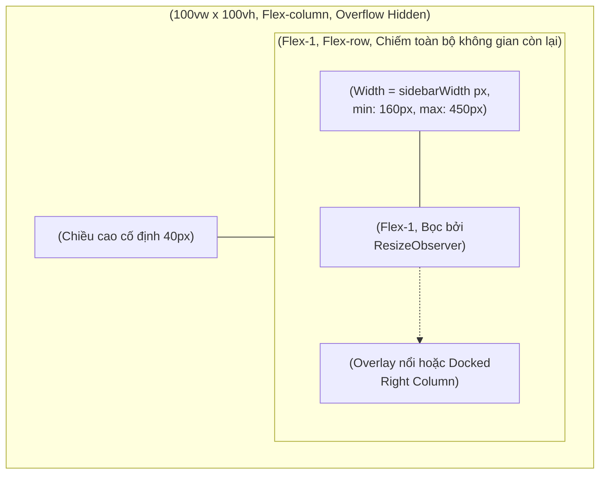
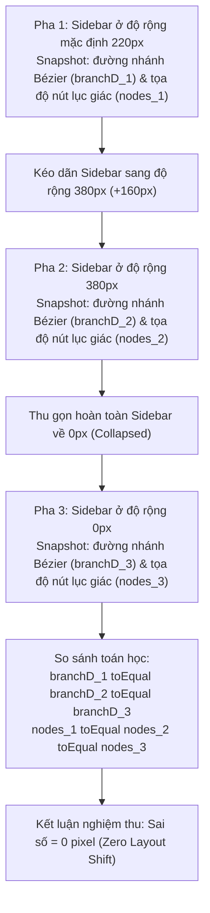

# 09. Thiết Kế Chi Tiết Bố Cục Co Giãn Responsive 3-Pane & Nghiệm Thu Bất Biến Hình Học

Tài liệu này đặc tả chi tiết kiến trúc tầng Giao diện (Webview UI), Component khung bố cục tổng thể 3 phân vùng (`WorkspaceLayout`), cơ chế theo dõi kích thước động qua `ResizeObserver`, và cam kết bảo toàn bất biến hình học tuyệt đối (Zero Layout Shift) cho nhân đồ thị F# Core Engine trong **Phase 3.2: Nhóm Việc 5 — Bố Cục Co Giãn Responsive 3-Pane & Kiểm Thử Nghiệm Thu Hình Học**.

> [!NOTE]
> Mọi nội dung trong tài liệu này tuân thủ nguyên tắc: thiết kế và đặc tả bằng ngôn ngữ tự nhiên (**Design by Word**), tập trung vào kiến trúc bố cục thích ứng, cơ chế điều phối không gian và cam kết không làm sai lệch bất kỳ pixel tọa độ nào của nhân F# Core; **tuyệt đối không sử dụng mã nguồn mẫu hoặc khối code block dưới bất kỳ hình thức nào**.
>
> Toàn bộ tên class layout, token biến CSS và thông báo kiểm định **sử dụng tiếng Anh chuẩn mực làm ngôn ngữ chính thức**. Phần giải nghĩa tiếng Việt trong tài liệu đóng vai trò tham khảo kỹ thuật.
>
> 📌 **Truy vết tiến độ**: [Phase 3.2 Tiến Độ (Nhóm Việc 5)](../../03_progess/phase3/002_phase3_2_3pane_workspace.md#nhóm-việc-5-bố-cục-co-giãn-responsive-3-pane--nghiệm-thu-bất-biến-hình-học).

---

## 1. Tầm Nhìn, Mục Tiêu & Cam Kết Bất Biến Hình Học Tuyệt Đối

### 1.1. Mục Tiêu Cốt Lõi
1. **Hợp nhất không gian làm việc 3 phân vùng (3-Pane Workspace)**: Kết nối liền mạch 3 thành phần giao diện chính thành một thể thống nhất:
   - **Khung Trái (Left Pane)**: Cây điều hướng tài nguyên `<SidebarNavigator />` (chiều rộng $160\text{px} – 450\text{px}$ hoặc thu gọn về $0\text{px}$).
   - **Khung Giữa (Center Pane)**: Bảng đồ thị commit DAG ảo hóa `<CommitTable />` (kết hợp SVG đường cong nhánh Bézier và nút lục giác `HexagonNode`).
   - **Khung Phải / Khung Dưới (Right / Bottom Pane)**: Khu vực Staging hoặc chi tiết commit `<StagingArea />` / `<CommitDetails />` (dạng cột gắn cố định Docked Column hoặc bảng nổi Neon Floating Overlay).
2. **Thích ứng màn hình thông minh (Responsive Breakpoints)**: Tự động chuyển đổi giữa chế độ Docked Column trên màn hình UltraWide ($> 1440\text{px}$), Overlay nổi trên màn hình tiêu chuẩn ($1024\text{px} – 1440\text{px}$), và tự động thu gọn Sidebar trên màn hình hẹp ($< 1024\text{px}$).

### 1.2. Cam Kết Bất Biến Hình Học Đồ Thị Tuyệt Đối (Zero Layout Shift Invariance)
- **Đúc kết từ Nguyên Tắc 3 của Phase 3.1**:
  - Việc mở rộng, thu hẹp hoặc đóng mở hoàn toàn Sidebar bên trái **chỉ được phép thay đổi chiều rộng phần nhìn (Viewport Width) của bảng ảo hóa**, tuyệt đối **không được phép làm thay đổi**:
    1. Tọa độ $Y$ của các dòng commit (chiều cao mỗi dòng cố định bất biến $24\text{px}$).
    2. Tọa độ tâm ($cx, cy$) và hình học 6 đỉnh của các nút lục giác `HexagonNode`.
    3. Đường cong SVG Bézier sinh ra từ nhân F# Core Solver (chuỗi thuộc tính `d`).
    4. Cấu trúc avatar clipPath và vầng neon ambient.
  - Mọi độ lệch hình học đo đạc được trước và sau khi tương tác co giãn phải bằng **0 pixel**.

---

## 2. Đặc Tả Kiến Trúc Bố Cục Responsive 3 Phân Vùng

---

### 2.1. Cấu Trúc Khung Bố Cục `WorkspaceLayout.tsx`

- **Vỏ bọc ngoài cùng (`workspace-layout-root`)**:
  - Chiều rộng: $100\text{vw}$, chiều cao: $100\text{vh}$, `overflow: hidden; display: flex; flex-direction: column`.
  - Phân tầng dọc:
    - *Tầng 1 (Đỉnh)*: Thanh công cụ `<GlobalToolbar />` với chiều cao cố định $40\text{px}$.
    - *Tầng 2 (Thân)*: Khung chứa `<WorkspaceBody />` với thuộc tính `flex: 1; display: flex; flex-direction: row; min-height: 0; position: relative`.

#### Bảng Thuộc Tính Props Của `WorkspaceLayout`:

| Tên Thuộc Tính | Kiểu Dữ Liệu | Bắt Buộc? | Mặc Định | Ràng Buộc & Mô Tả Ý Nghĩa |
| :--- | :--- | :---: | :---: | :--- |
| `sidebar` | Component Con | Có | - | Phần tử cây điều hướng SidebarNavigator bên trái |
| `graph` | Component Con | Có | - | Phần tử bảng ảo hóa đồ thị CommitTable ở giữa |
| `toolbar` | Component Con | Có | - | Phần tử thanh công cụ GlobalToolbar ở đỉnh |
| `inspector` | Component Con \| null | Không | `null` | Phần tử Inspector nổi (StagingArea hoặc CommitDetails) |
| `isSidebarCollapsed` | boolean | Có | - | Cờ trạng thái thu gọn Sidebar |
| `sidebarWidth` | number | Có | - | Độ rộng hiện tại của Sidebar tính theo pixel (kẹp trong $[160, 450]$) |

---

### 2.2. Cơ Chế Theo Dõi Kích Thước Bằng `ResizeObserver` & `requestAnimationFrame`

Để bảo đảm bảng ảo hóa `CommitTable` luôn biết chính xác chiều rộng không gian hiển thị khả dụng mà không gây giật khung hình (Render Thrashing), hệ thống áp dụng giải thuật điều phối kích thước qua `ResizeObserver` kết hợp đệm khung hình `requestAnimationFrame`:

#### Giải Thuật Điều Phối Kích Thước Từng Bước:

1. **Bước 1 (Đăng ký bộ quan sát - Mount Phase)**:
   - Khi Component bố cục được gắn vào cây DOM, khởi tạo một thực thể `ResizeObserver` gắn vào phần tử container cha của `<GraphMainContainer>`.
2. **Bước 2 (Gom cụm sự kiện bằng `requestAnimationFrame`)**:
   - Khi người dùng kéo dãn thanh resizer của Sidebar hoặc thay đổi kích thước cửa sổ VS Code, `ResizeObserver` phát ra các sự kiện thay đổi kích thước liên tục với tần số cao.
   - Thay vì cập nhật trạng thái ngay lập tức trên từng sự kiện, hàm callback đặt một cờ hoạt họa qua `requestAnimationFrame`. Toàn bộ các biến động kích thước trong cùng một khung hình (Frame) được gom lại xử lý đúng một lần duy nhất trước nhịp vẽ kế tiếp của GPU.
3. **Bước 3 (Tính toán và phân phối chiều rộng)**:
   - Lấy chiều rộng mới từ `entry.contentRect.width`.
   - Tính toán chiều rộng khả dụng cho cột thông điệp Commit Subject:
     - Chiều rộng cột Subject = Tổng chiều rộng Viewport $-$ (Chiều rộng cột đồ thị DAG + Chiều rộng cột Thời gian + Chiều rộng cột Tác giả + Chiều rộng cột Hash).
   - Cập nhật biến CSS cấp container `--col-subject-width` để điều khiển hiển thị cắt ngắn văn bản (Ellipsis) bằng GPU mà không làm re-render lại toàn bộ cây DOM của bảng ảo hóa.
4. **Bước 4 (Dọn dẹp khi Unmount)**:
   - Hủy đăng ký `observer.disconnect()` và hủy frame hoạt họa đang chờ (`cancelAnimationFrame`) để ngăn ngừa triệt để rò rỉ bộ nhớ.

---

## 3. Quản Lý Trạng Thái Bố Cục & Ma Trận Ngưỡng Màn Hình

### Bảng Ma Trận Các Ngưỡng Thích Ứng Màn Hình (Responsive Breakpoints Matrix):

| Ngưỡng Độ Rộng (Viewport Width) | Phân Loại Màn Hình | Hành Vi Bố Cục Sidebar | Hành Vi Bố Cục Inspector (Staging/Details) | Trải Nghiệm Người Dùng Mục Tiêu |
| :--- | :--- | :--- | :--- | :--- |
| **Siêu Rộng (> 1440px)** | Màn hình ngoài UltraWide / 4K Desktop | Mở rộng đầy đủ 260px – 320px | Docked Column cố định bên phải (rộng 420px), không che đồ thị | Không gian tối đa: Vừa xem trọn vẹn đồ thị DAG, vừa thao tác Staging cùng lúc. |
| **Tiêu Chuẩn (1024px – 1440px)** | Laptop 14"-16" / Màn hình Full HD | Mở mặc định 220px (có thể kéo dãn) | Overlay nổi lồng trong `CornerCrossFrame` phát sáng Neon, che một phần bảng | Tối ưu diện tích đồ thị; click mở Inspector khi cần thiết. |
| **Thu Nhỏ (< 1024px)** | Màn hình hẹp / Split Editor 2 cột | Tự động thu gọn về 0px (`isCollapsed = true`) | Overlay toàn chiều rộng hoặc Drawer ngăn kéo dưới | Tập trung hoàn toàn vào đồ thị; mở Sidebar qua nút nhanh trên Toolbar. |

---

## 4. Giải Thuật Kiểm Định Bất Biến Hình Học Tuyệt Đối (Zero Layout Shift Algorithm)

Để chứng minh mặt toán học và đồ họa rằng việc co giãn Sidebar không làm xô lệch đồ thị DAG F# Core, bộ kiểm thử tích hợp thực thi giải thuật so sánh snapshot 3 pha:

#### Quy Trình Kiểm Tra Snapshot 3 Pha Chi Tiết:

1. **Trích xuất dữ liệu hình học đường nhánh Bézier (Branch Paths Data)**:
   - Truy vấn toàn bộ các phần tử SVG `<path>` vẽ đường nhánh trên đồ thị DAG.
   - Thu thập mảng các chuỗi thuộc tính `d` đại diện cho các đường cong bậc ba Bézier do F# Core Engine sinh ra.
2. **Trích xuất dữ liệu hình học nút lục giác (Hexagon Nodes Data)**:
   - Truy vấn toàn bộ các nút lục giác `HexagonNode`.
   - Thu thập mảng tọa độ tâm `cx`, `cy` và chuỗi tọa độ 6 đỉnh `points`.
3. **Đối chiếu độ lệch toán học (Delta Calculation)**:
   - So sánh sâu `toEqual` giữa dữ liệu trích xuất ở Pha 1, Pha 2 và Pha 3.
   - Tiêu chuẩn chấp nhận: Độ lệch tuyệt đối của tọa độ $Y$, bán kính bo góc và đường cong Bézier phải chính xác bằng $0\text{px}$.

---

## 5. Bảng Chuẩn Hóa Biến CSS Bố Cục (Layout CSS Variables Dictionary)

Toàn bộ các thông số kích thước của bố cục được điều khiển tập trung qua hệ thống biến CSS cấp root:

| Tên Biến CSS | Giá Trị Mặc Định | Ràng Buộc Kỹ Thuật | Mô Tả Ý Nghĩa Kỹ Thuật |
| :--- | :---: | :---: | :--- |
| `--toolbar-height` | `40px` | Cố định bất biến | Chiều cao cố định của thanh công cụ đỉnh toàn cục |
| `--sidebar-width` | `220px` | Biến thiên | Chiều rộng hiện tại của cây điều hướng Sidebar bên trái |
| `--sidebar-min-width` | `160px` | Cận dưới an toàn | Giới hạn chiều rộng tối thiểu cho phép kéo dãn |
| `--sidebar-max-width` | `450px` | Cận trên an toàn | Giới hạn chiều rộng tối đa cho phép kéo dãn |
| `--col-graph` | Tính theo số lane | Bất biến F# Core | Chiều rộng cột đồ thị SVG do F# Core điều phối |
| `--row-height` | `24px` | Cố định bất biến | Chiều cao chuẩn mực bất biến của từng dòng commit |
| `--inspector-overlay-z` | `40` | Lớp nổi | Chỉ số z-index của bảng Inspector nổi |

---

## 6. Ma Trận Kiểm Thử Đơn Vị Song Hành (Unit Testing Matrix)

Mọi tệp kiểm thử cho Nhóm Việc 5 bắt buộc đặt tên với đuôi `*.test.ts`, vận hành độc lập trên runner `vitest`:

| Tệp Kiểm Thử Độc Lập | Module Mục Tiêu | Kịch Bản Kiểm Thử Chi Tiết Bắt Buộc |
| :--- | :--- | :--- |
| `tests/webview/layout/WorkspaceLayout.geometry.test.ts` | `WorkspaceLayout.tsx` & `CommitTable.tsx` | 1. **Snapshot ban đầu (Sidebar 220px)**: Ghi lại trọn vẹn mảng thuộc tính `d` của đường nhánh Bézier và tọa độ nút lục giác `HexagonNode`. 2. **Mở rộng Sidebar lên 380px**: Cập nhật độ rộng, kích hoạt resize, snapshot lại dữ liệu hình học, assert `toEqual` xác nhận độ lệch bằng 0 pixel. 3. **Thu gọn Sidebar về 0px**: Đặt `isCollapsed = true`, snapshot lại dữ liệu hình học, assert `toEqual` xác nhận độ lệch bằng 0 pixel. 4. **Bảo toàn chiều cao hàng**: Xác nhận mọi dòng bảng `CommitRow` giữ nguyên chiều cao đúng 24px trong suốt quá trình co giãn. |
| `tests/webview/layout/WorkspaceLayout.test.ts` | `WorkspaceLayout.tsx` | 1. **Kết xuất đầy đủ**: Render trọn vẹn 3 phân vùng (Toolbar đỉnh, Sidebar trái, Bảng DAG giữa). 2. **Tương tác thu gọn Sidebar**: Đảo cờ `isSidebarCollapsed`, xác nhận class co về 0px được kích hoạt trên container Sidebar. 3. **ResizeObserver kích hoạt mượt mà**: Mô phỏng thay đổi kích thước container, xác nhận hàm callback cập nhật biến CSS chiều rộng không gian khả dụng. 4. **Hiển thị Inspector Overlay**: Khi có prop `inspector`, render đúng vùng phủ overlay nổi không làm lệch cấu trúc DOM của bảng table. |

---

## 7. Lịch Sử Sửa Đổi Thiết Kế (Revision History)

| Phiên Bản | Ngày | Phân Loại | Người Sửa | Nội Dung Thay Đổi & Căn Nguyên Kỹ Thuật |
| :---: | :---: | :---: | :---: | :--- |
| **v1.0.0** | 2026-10-15 | Tạo mới | AI Architect | Khởi tạo tài liệu đặc tả 3-Pane Workspace Layout & Zero Layout Shift. |
| **v1.1.0** | 2026-10-19 | Rà soát | AI Architect | **Rà soát tính bất biến hình học & tương thích bố cục 3 phân vùng**: Xác nhận tính tương thích hợp đồng giữa các phân vùng sau khi chuẩn hóa `SyncStatusResult` và `StashRecord` ở Design 05–07. Bảo đảm cam kết Zero Layout Shift (sai số 0 pixel trên đồ thị DAG F# Core) được duy trì nguyên vẹn. |

