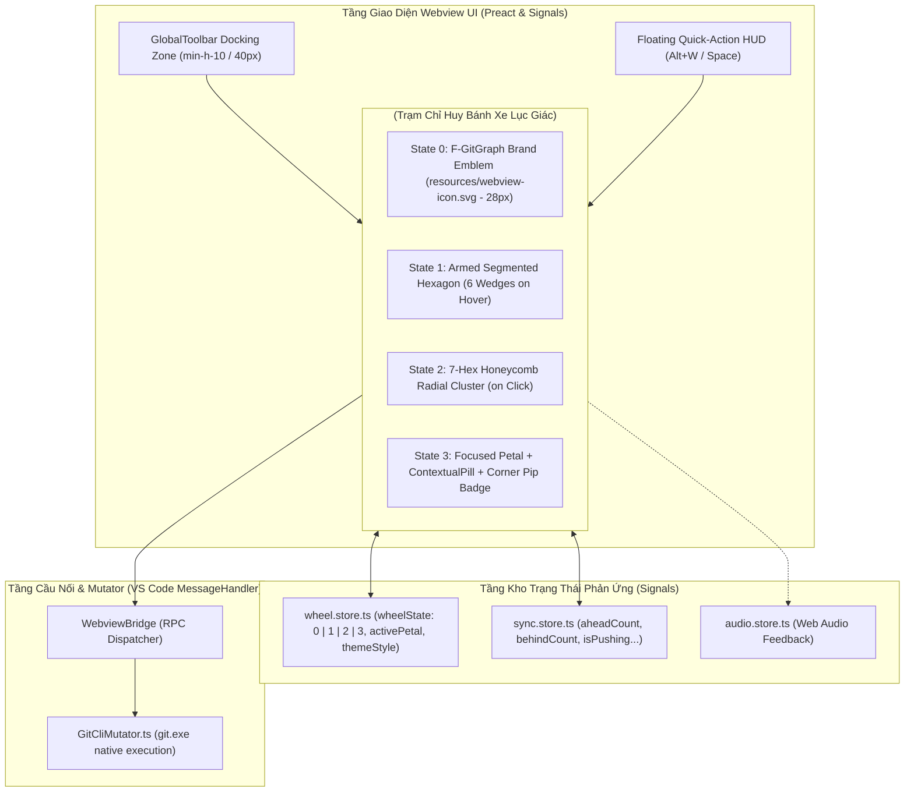
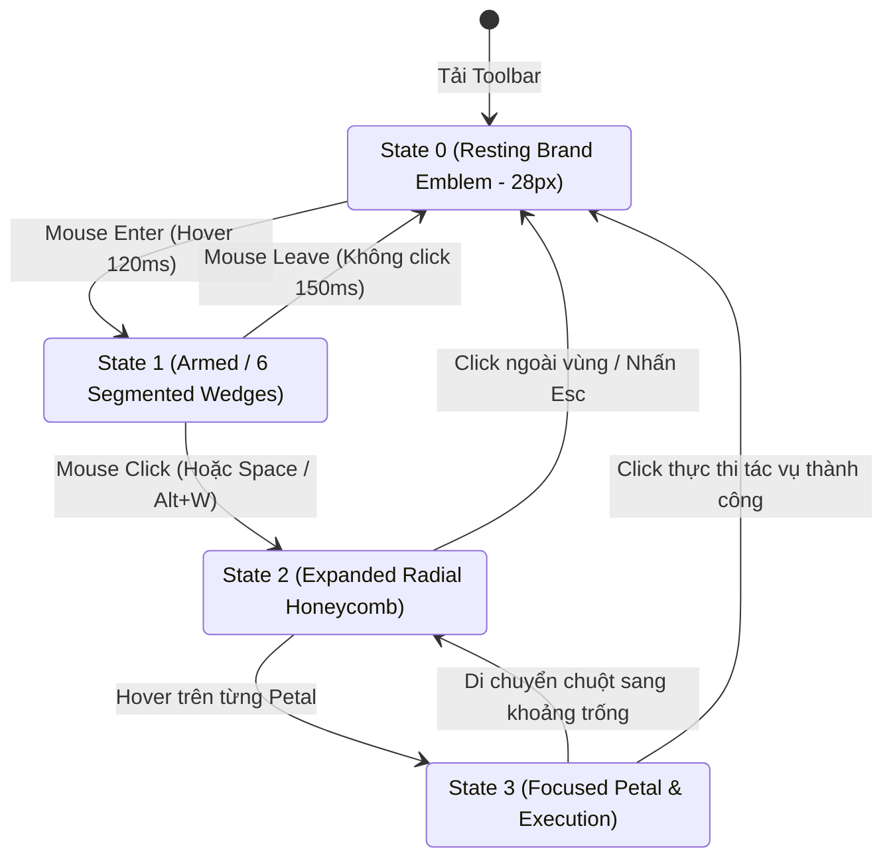
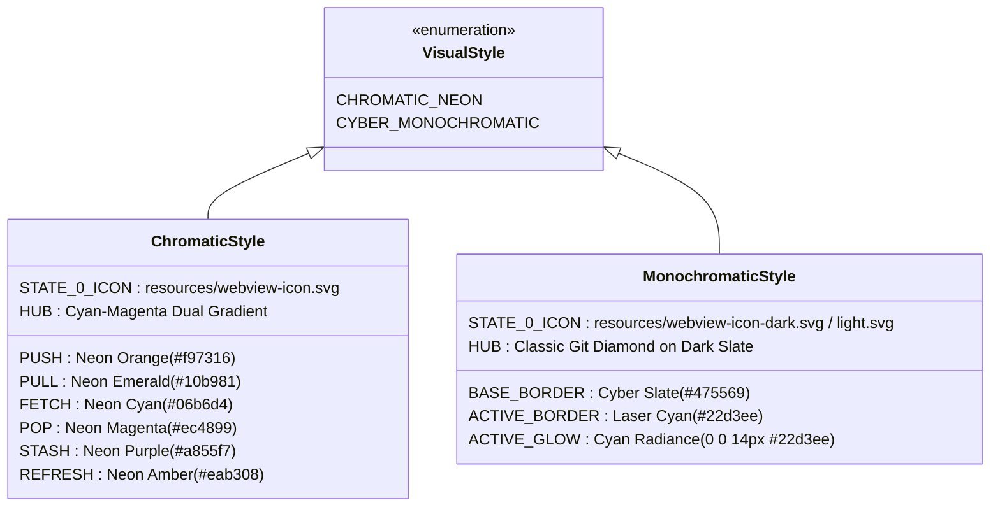
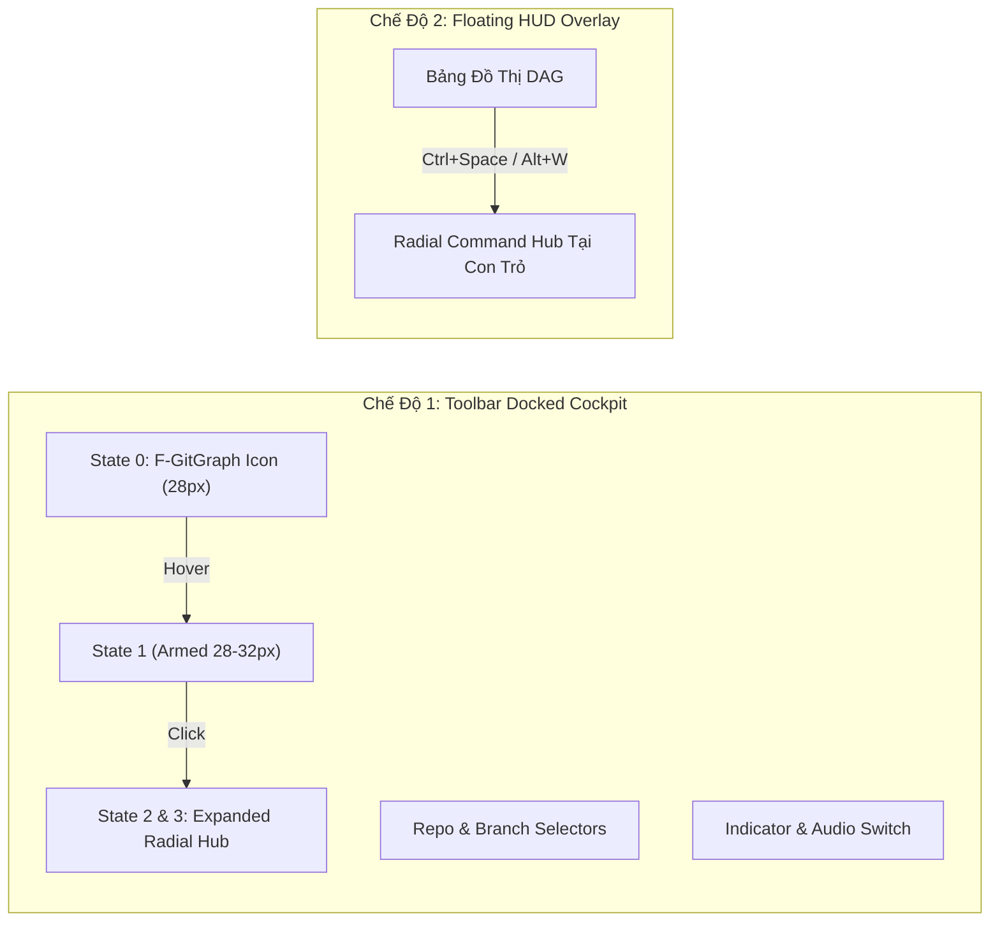

# 10. Thiết Kế Chi Tiết Cyber Hex-Wheel Command Hub & Trải Nghiệm Giao Diện Radial Đột Phá

Tài liệu này đặc tả chi tiết kiến trúc tầng Giao diện (Webview UI), các Component hình học lục giác tổ ong (`HexWheelHub`, `HexagonPetal`, `RadialActionMenu`, `ContextualPill`), chu trình tương tác 4 trạng thái khởi phát từ biểu tượng F-GitGraph (`State 0 → 1 → 2 → 3`), kho trạng thái phản ứng `wheel.store.ts` bằng Preact Signals, hệ thống hoạt ảnh gia tốc hướng tâm, và cơ chế tích hợp không gian làm việc cho **Phase 3.2.UI: Hiện Thực Hóa Concept Menu Bánh Xe Lục Giác & Nâng Tầm Thẩm Mỹ Cyber-Lab**.

> [!IMPORTANT]
> **Quy chuẩn thiết kế áp dụng**: Toàn bộ nội dung tài liệu tuân thủ tuyệt đối [Quy Chuẩn Thiết Kế Kỹ Thuật "Design by Word" (RULES_DESIGN_SPECIFICATION.md)](../RULES_DESIGN_SPECIFICATION.md):
>
> - **Thiết kế bằng ngôn ngữ tự nhiên (Design by Word)**: Toàn bộ thông số hình học, giải thuật tọa độ, luồng tương tác và trạng thái phản ứng được đặc tả bằng văn bản tự nhiên, bảng từ điển dữ liệu, công thức toán học và sơ đồ luồng; **tuyệt đối không sử dụng mã nguồn mẫu hoặc khối code block dưới bất kỳ hình thức nào**.
> - **Tái sử dụng tài nguyên có sẵn**: Sử dụng trực tiếp bộ vector biểu tượng F-GitGraph chính thức từ thư mục `resources/`:
>   - [resources/webview-icon.svg](../../../resources/webview-icon.svg): Biểu tượng F-Branch Cyberpunk Neon đa sắc (Cyan `#00F0FF`, Fuchsia `#FF007F`, Violet `#A855F7`).
>   - [resources/webview-icon-dark.svg](../../../resources/webview-icon-dark.svg): Biểu tượng đơn sắc tương phản cao cho Dark Theme kỹ thuật.
>   - [resources/webview-icon-light.svg](../../../resources/webview-icon-light.svg): Biểu tượng đơn sắc tương phản cao cho Light Theme.
> - **Chuẩn kích thước kế thừa Zero-Distortion**: State 0 kế thừa chính xác chiều cao $28\text{px}$ của các nút hiện tại (`Push`, `Pull`, `Stash`, `Pop`), bảo đảm $100\%$ không làm phình thanh công cụ đỉnh ($40\text{px}$) và không gây xô lệch bố cục dọc (Zero Vertical Shift).
> - **Bảo toàn bất biến hình học tuyệt đối (Zero Layout Shift)**: Cụm điều khiển bánh xe lục giác đóng vai trò là Lớp điều khiển buồng lái (Cockpit HUD Layer / Overlay Wrapper), bảo đảm 100% tọa độ các nút `HexagonNode.tsx`, đường cong Bézier của đồ thị DAG và bảng commit ảo hóa không bị dịch chuyển dù chỉ 1 pixel khi mở hoặc thu gọn menu.
> - **Tài liệu tham chiếu hình ảnh gốc**:
>   - [Concept 1: Phối màu Neon Chromatic Đa Sắc](../../../resources/Concept1_Color.jpg)
>   - [Concept 2: Phối màu Cyber Blue Monochromatic Đơn Sắc Kỹ Thuật](../../../resources/Concept2_Color.jpg)

---

## 1. Tầm Nhìn, Động Lực & Mục Tiêu Cốt Lõi

### 1.1. Động Lực Đổi Mới Giao Diện (Design Rationale)
1. **Thoát khỏi lối mòn "giao diện Git truyền thống"**: Các phần mềm Git phổ biến trên thị trường (như VS Code Git SCM, GitLens, Fork, SourceTree, GitKraken) đều sử dụng thanh công cụ nằm ngang với một chuỗi các nút bấm hình chữ nhật đơn điệu. Dù Phase 3.2 đã hoàn thiện đầy đủ chức năng mạng và quản lý kho, giao diện thanh đỉnh phẳng (`GlobalToolbar`) vẫn mang cảm giác thông thường, chưa tạo được dấu ấn thị giác độc bản.
2. **Kế thừa và thăng hoa ngôn ngữ Lục giác (Hexagonal Cyber-Lab DNA)**: Từ Phase 1, F-GitGraph đã định vị bản sắc hình ảnh cốt lõi xoay quanh hình học Lục giác (`HexagonNode.tsx` cho các commit, đinh tán góc `+` cho khung bo mạch). Việc biến cụm tác vụ mạng trung tâm thành **Trạm chỉ huy Bánh xe Lục giác Hướng tâm (Cyber Hex-Wheel Command Hub)** tạo nên một thể thống nhất hoàn mỹ giữa cây đồ thị và công cụ tương tác.
3. **Triệt tiêu ô nhiễm thị giác thông qua Khám Phá Tiệm Tiến (Progressive Disclosure)**:
   - Nếu thường trực hiển thị 6 cánh hoa hoặc 6 múi nhỏ trên thanh công cụ, các biểu tượng sẽ bị co nhỏ dưới $8\text{px}$, gây vỡ nét điểm ảnh và rối mắt.
   - Bằng cách đưa vào **State 0 (Biểu tượng F-GitGraph độc bản)**, ở trạng thái nghỉ, giao diện cực kỳ tinh gọn, đạt chuẩn chiều cao $28\text{px}$. Chỉ khi người dùng di chuột vào, bánh xe mới "thức tỉnh" (State 1) và bung mở hoàn chỉnh khi click (State 2 $\to$ State 3).
4. **Công thái học vi mô hướng tâm (Radial Fitts' Law Optimization)**: Thay vì phải rà chuột theo một dải ngang dài hàng trăm pixel, giao diện hướng tâm gom toàn bộ 6 tác vụ cốt lõi (`PUSH`, `PULL`, `FETCH`, `POP`, `STASH`, `REFRESH`) về một cụm tổ ong cách đều tâm, rút ngắn quãng đường di chuyển của con trỏ chuột đến mức tối thiểu ($D \approx 76\text{px}$).

### 1.2. Mục Tiêu Cốt Lõi Của Phase 3.2.UI
1. **Hiện thực hóa chu trình 4 trạng thái tương tác hoàn chỉnh**:
   - *State 0: Resting Brand Emblem (Huy hiệu nghỉ mang biểu tượng F-GitGraph - Cao $28\text{px}$)*.
   - *State 1: Armed Iris Preview (Biến hình màng trập 6 múi khi di chuột)*.
   - *State 2: Expanded Honeycomb Hub (Mở bung tổ ong hướng tâm 7 nhân khi nhấp chuột)*.
   - *State 3: Depth of Field Focus (Hội tụ trường nét, làm mờ nền vi mô & Viên nang ngữ cảnh nổi khi chọn tác vụ)*.
2. **Hỗ trợ 2 phong cách thẩm mỹ Cyber-Lab**:
   - *Style 1: Neon Chromatic* (Concept 1: Đa sắc bán dẫn Neon sống động cho từng hành động, tái sử dụng `resources/webview-icon.svg`).
   - *Style 2: Cyber Blue Monochromatic* (Concept 2: Xanh băng tuyết kỹ thuật cao, tinh giản và thanh lịch, tái sử dụng `resources/webview-icon-dark.svg` và `webview-icon-light.svg`).
3. **Phản xạ trạng thái đồng bộ thời gian thực (Zero Latency Sync Reflex)**:
   - State 0 có chấm sáng nhịp thở vi mô (Ambient Pip Dot) khi có commit ahead hoặc behind.
   - State 2 & 3 hiển thị trực tiếp các huy hiệu số đếm (`aheadCount` trên PUSH, `behindCount` trên PULL) ngay trên đỉnh cánh hoa.
   - Kích hoạt hoạt ảnh quét radar (Radar Sweep) hoặc vòng quay laser viền khi tiến trình mạng đang bận (`isPushing`, `isPulling`, `isFetching`).
4. **Tích hợp hai chế độ hiển thị linh hoạt**:
   - *Chế độ Docked (Thanh đỉnh buồng lái)*: Thay thế dải nút phẳng tại `GlobalToolbar.tsx`.
   - *Chế độ Floating HUD (Trạm nổi)*: Có thể triệu hồi ngay tại vị trí con trỏ chuột trên đồ thị bằng phím tắt nhanh (`Space` hoặc `Alt + W`).

---

## 2. Đặc Tả Kiến Trúc Giao Diện & Mô Hình Phân Tầng

---

## 3. Đặc Tả Hình Học Lục Giác & Thuật Toán Tọa Độ Tổ Ong (Honeycomb Geometry)

### 3.1. Kế Thừa Kích Thước Box-Model Của Toolbar Hiện Tại
Qua đo đạc thực tế tại mã nguồn:
- Thanh công cụ đỉnh `<header>` mang chiều cao `min-h-10` = **$40\text{px}$**, đệm trên/dưới `py-1` ($4\text{px} \times 2 = 8\text{px}$) và viền đáy $1\text{px}$.
- Khoảng trống chiều cao khả dụng tuyệt đối: $40\text{px} - (8\text{px} + 1\text{px}) = \mathbf{31\text{px}}$.
- Các nút hiện tại (`Push`, `Pull`, `Stash`, `Pop`) có chiều cao rendered thực tế là **$28\text{px}$** (Icon $16\text{px}$ + đệm $8\text{px}$ + viền $2\text{px}$ + line-height).
- Do đó, **State 0 (F-GitGraph Emblem)** được ấn định chiều cao cơ sở chính xác là **$28\text{px}$** (Bán kính $R = 14\text{px}$), tạo nên sự thẳng hàng tuyệt đối với toàn bộ các phần tử lân cận.

### 3.2. Hình Học Lục Giác Đỉnh Nhọn (Pointy-Topped Hexagon)
Cụm bánh xe hành động sử dụng hoàn toàn cấu trúc **Lục giác đỉnh nhọn (Pointy-Topped Regular Hexagon)** với trục đối xứng thẳng đứng đi qua đỉnh trên và đỉnh dưới, đồng bộ với quy chuẩn hình học `HexagonNode.tsx` của Phase 1.

Công thức tính tọa độ 6 đỉnh của một lục giác đều tâm $(C_x, C_y)$ và bán kính ngoại tiếp $R$:
- Đỉnh 1 (Đỉnh Bắc): $(C_x, C_y - R)$
- Đỉnh 2 (Đông Bắc): $(C_x + R \cdot \frac{\sqrt{3}}{2}, C_y - \frac{R}{2}) \approx (C_x + 0.866025 \cdot R, C_y - 0.5 \cdot R)$
- Đỉnh 3 (Đông Nam): $(C_x + R \cdot \frac{\sqrt{3}}{2}, C_y + \frac{R}{2}) \approx (C_x + 0.866025 \cdot R, C_y + 0.5 \cdot R)$
- Đỉnh 4 (Đỉnh Nam): $(C_x, C_y + R)$
- Đỉnh 5 (Tây Nam): $(C_x - R \cdot \frac{\sqrt{3}}{2}, C_y + \frac{R}{2}) \approx (C_x - 0.866025 \cdot R, C_y + 0.5 \cdot R)$
- Đỉnh 6 (Tây Bắc): $(C_x - R \cdot \frac{\sqrt{3}}{2}, C_y - \frac{R}{2}) \approx (C_x - 0.866025 \cdot R, C_y - 0.5 \cdot R)$

### 3.3. Bố Cục Tọa Độ Cụm Tổ Ong 7 Nhân (7-Hex Cluster Layout Ở State 2 & 3)
Cụm bánh xe bung rộng bao gồm **1 Nhân trung tâm (Central Core Hub)** và **6 Cánh hoa vệ tinh (Satellite Action Petals)**.

Các thông số kích thước cơ sở:
- Bán kính ngoại tiếp Nhân trung tâm: $R_{\text{hub}} = 38\text{px}$.
- Bán kính ngoại tiếp mỗi Cánh hoa: $R_{\text{petal}} = 34\text{px}$.
- Khoảng cách quỹ đạo từ tâm trung tâm đến tâm các cánh hoa ($D_{\text{orbit}}$):
  $$D_{\text{orbit}} = 76\text{px}$$
  *(Bảo đảm khe hở kỹ thuật an toàn giữa các mép lục giác là $8\text{px}$, chống dính viền và tạo hiệu ứng thở thẩm mỹ).*

#### Bảng Tọa Độ & Góc Định Hướng Của 6 Cánh Hoa (Hệ Tọa Độ Gốc Tại Tâm Hub $(0, 0)$):

| Vị Trí Cánh Hoa | Tác Vụ Git | Góc Pha $\theta$ | Tọa Độ Tâm $\Delta X$ | Tọa Độ Tâm $\Delta Y$ | Hướng Mặt Đồng Hồ | Ý Nghĩa Chức Năng |
| :--- | :--- | :---: | :---: | :---: | :---: | :--- |
| **Petal 1** | `PUSH` | $270^\circ$ (hoặc $-90^\circ$) | $0\text{px}$ | $-76\text{px}$ | 12 Giờ (Bắc) | Đẩy commit cục bộ lên upstream |
| **Petal 2** | `PULL` | $330^\circ$ (hoặc $-30^\circ$) | $+65.82\text{px}$ | $-38\text{px}$ | 2 Giờ (Đông Bắc) | Kéo commit từ upstream về local |
| **Petal 3** | `FETCH` | $30^\circ$ | $+65.82\text{px}$ | $+38\text{px}$ | 4 Giờ (Đông Nam) | Cập nhật refs và metadata từ remote |
| **Petal 4** | `POP` | $90^\circ$ | $0\text{px}$ | $+76\text{px}$ | 6 Giờ (Nam) | Phục hồi và giải phóng stash gần nhất |
| **Petal 5** | `STASH` | $150^\circ$ | $-65.82\text{px}$ | $+38\text{px}$ | 8 Giờ (Tây Nam) | Cất giữ working tree vào ngăn xếp |
| **Petal 6** | `REFRESH` | $210^\circ$ | $-65.82\text{px}$ | $-38\text{px}$ | 10 Giờ (Tây Bắc) | Nạp lại đồ thị DAG và trạng thái kho |

---

## 4. Đặc Tả Chu Trình 4 Giai Đoạn Tương Tác Cốt Lõi (4-State Interaction Lifecycle)

---

### 4.1. Trạng Thái 0: Biểu Tượng Nghỉ Buồng Lái (State 0: Resting Brand Emblem)
- **Vị trí**: Nằm cố định tại góc trái thanh công cụ đỉnh `GlobalToolbar.tsx`.
- **Kích thước bao ngoài**: Chiều rộng $28\text{px}$, chiều cao đúng **$28\text{px}$** (bán kính $R = 14\text{px}$). Thẳng hàng $100\%$ với các dropdown bộ chọn kho và nhánh.
- **Tài nguyên tái sử dụng**:
  - Tích hợp trực tiếp vector SVG từ `resources/webview-icon.svg` (hoặc bản đơn sắc `webview-icon-dark.svg` / `webview-icon-light.svg` theo theme).
  - Biểu tượng thân cây Git (Trunk) màu Cyan và các nhánh tính năng màu Fuchsia/Violet được bao bọc trong một khung viền lục giác mỏng nhẹ ($1\text{px}$).
- **Chỉ báo nhịp thở tinh tế (Ambient Pip Dot)**:
  - Khi kho ở trạng thái sạch và đồng bộ hoàn hảo: Viền lục giác giữ độ mờ tĩnh $0.6$.
  - Khi có `aheadCount > 0`: Một chấm sáng tròn vi mô ($4\text{px}$) màu Cam Neon nhấp nháy thở chậm (Pulsing breath 2.4s) ở góc đỉnh Bắc ($12\text{h}$).
  - Khi có `behindCount > 0`: Một chấm sáng tròn vi mô màu Xanh Lục Neon nhấp nháy thở chậm ở góc đỉnh Đông Bắc ($2\text{h}$).
  - Khi tiến trình mạng đang chạy (`isNetworkBusy === true`): Khung viền ngoài xoay vệt sáng sao chổi đều đặn.
- **Tương tác kích hoạt**:
  - Khi người dùng rê chuột vào vùng biểu tượng (`mouseenter`): Tự động kích hoạt chuyển đổi sang State 1.

---

### 4.2. Trạng Thái 1: Màng Trập Sẵn Sàng (State 1: Armed Iris Preview)
- **Mục đích**: Cung cấp tín hiệu nhận biết trực giác (Affordance) cho người dùng biết đây là một bánh xe hành động tương tác chứ không chỉ là logo tĩnh.
- **Hoạt ảnh màng trập (Iris Morphing Transition)**:
  - Khi chuột vừa chạm vào State 0, biểu tượng F-GitGraph thực hiện hoạt ảnh xoay nhẹ $30^\circ$ và phân rã thành 6 múi rẻ quạt lục giác (Radial Wedges) tương ứng với 6 tác vụ:
    $$\text{Thời gian chuyển đổi} = 120\text{ms} \quad (\text{cubic-bezier}(0.2, 0, 0, 1))$$
  - Mỗi múi rẻ quạt nhận một vạch màu Neon vi mô tương ứng với tác vụ tương lai (Cam Push, Xanh Pull, Xanh lơ Fetch, Hồng Pop, Tím Stash, Vàng Refresh).
  - Kích hoạt âm thanh xúc giác vi mô cực êm: `micro_haptic_tick` ($6\text{ms}$, tần số $1400\text{Hz}$).
- **Hành vi rời chuột (Mouse Leave)**:
  - Nếu người dùng di chuyển con trỏ chuột ra khỏi vùng biểu tượng mà không nhấp chuột: Bánh xe tự động co lại về State 0 trong $150\text{ms}$ một cách êm ái, hoàn toàn không gây cản trở tầm nhìn.
- **Tương tác click**:
  - Nhấp chuột trái vào State 1: Kích hoạt bung mở toàn diện sang State 2.

---

### 4.3. Trạng Thái 2: Mở Rộng Hướng Tâm (State 2: Expanded Active Radial Honeycomb)
- **Mục đích**: Trưng bày trọn vẹn trạm chỉ huy buồng lái gồm 1 Nhân trung tâm và 6 Cánh hoa vệ tinh với đầy đủ nhãn văn bản và biểu tượng trực quan.
- **Hoạt ảnh bung nở lò xo (Radial Bloom Spring Transition)**:
  - 6 cánh hoa lục giác ($R=34\text{px}$) xuất phát từ tọa độ tâm $(0, 0)$ và phóng ra các tọa độ quỹ đạo $(\Delta X, \Delta Y)$ cách tâm $D=76\text{px}$:
    $$\text{Timing Function} = \text{cubic-bezier}(0.34, 1.56, 0.64, 1.0)$$
    $$\text{Duration} = 220\text{ms}$$
  - Đi kèm với chuyển động bay là hoạt ảnh phóng to tỉ lệ (`scale: 0.4` $\to$ `scale: 1.0`) và độ mờ (`opacity: 0` $\to$ `opacity: 1.0`).
- **Lớp làm mờ nền vi mô (Micro Backdrop Scrim)**:
  - Lớp phủ bán mờ kỹ thuật (`backdrop-filter: blur(6px)`, nền `rgba(15, 23, 42, 0.45)`) tự động kích hoạt phía dưới bánh xe, tách biệt trạm điều khiển khỏi các nút đồ thị bên dưới mà không che khuất hoàn toàn ngữ cảnh làm việc.
- **Nhân trung tâm (Central Core Hub)**:
  - Mang biểu tượng F-GitGraph phóng lớn ($R_{\text{hub}} = 38\text{px}$) với vòng viền phát quang đôi. Nhấp chuột vào tâm sẽ thu gọn bánh xe thẳng về State 0.
- **Giữ trạng thái cố định (Pinned State)**:
  - Bánh xe giữ nguyên vị trí bung mở để người dùng thoải mái di chuột chọn lựa mà không sợ bị biến mất bất ngờ.

---

### 4.4. Trạng Thái 3: Tương Tác Di Chuột & Hội Tụ Trường Nét (State 3: Depth of Field Focus & Execution)
- **Hiệu ứng hội tụ trường nét (Depth of Field Dimming)**:
  - Khi người dùng di chuyển con trỏ chuột vào bất kỳ Cánh hoa nào (ví dụ: `PULL`):
    - Cánh hoa đang được hover: Nhận trạng thái tiêu điểm tối cao. Tăng độ sáng viền Neon lên cực đại, kích hoạt vầng quang bao phủ dày tỏa rộng:
      $$\text{Filter} = \text{drop-shadow}(0\text{px } 0\text{px } 12\text{px } \text{var(--petal-neon-glow)})$$
      Thân cánh hoa phủ một lớp nền dốc xuyên thấu nhẹ cùng tone màu với độ đục $18\%$.
    - 5 Cánh hoa còn lại và Nhân trung tâm: Tự động giảm độ mờ đồng loạt xuống:
      $$\text{Opacity} = 0.28$$
      Đồng thời giảm độ bão hòa màu (`filter: saturate(0.5)`). Hiệu ứng này triệt tiêu hoàn toàn sự phân tâm thị giác, giúp người dùng tập trung $100\%$ vào tác vụ đã chọn.
- **Huy hiệu số đếm gắn đỉnh cánh hoa (Corner Pip Badge)**:
  - Tại cánh hoa `PULL`: Nếu `behindCount > 0`, hiển thị viên nang thu nhỏ gắn cố định ở góc đỉnh trên bên phải cánh hoa mang ký tự `↓ N` (nền xanh lá neon, chữ đen hoặc trắng tương phản cao).
  - Tại cánh hoa `PUSH`: Nếu `aheadCount > 0`, hiển thị viên nang mang ký tự `↑ N` hoặc `+N` (nền cam neon).
- **Viên nang ngữ cảnh động nổi (Contextual Status Floating Pill)**:
  - Một thanh thẻ thông tin kỹ thuật hình viên nang (Capsule Pill) nổi lên tức thì ngay bên cạnh cánh hoa được hover (cách mép ngoài cánh hoa $12\text{px}$):
    - Khi hover `PULL`: Hiển thị viên nang màu xanh lục: `↓ 3 commits to pull` (hoặc `Working tree up to date`).
    - Khi hover `PUSH`: Hiển thị viên nang màu cam: `↑ 2 commits to push`.
    - Khi hover `FETCH`: Hiển thị viên nang màu xanh lơ: `Fetch all remotes (origin, upstream)`.
    - Khi hover `STASH`: Hiển thị viên nang màu tím: `Save uncommitted changes to stash stack`.
    - Khi hover `POP`: Hiển thị viên nang màu hồng sen: `Apply and drop latest stash@{0}`.
    - Khi hover `REFRESH`: Hiển thị viên nang màu vàng hổ phách: `Reload commit DAG & graph view`.
- **Hành động phân nhánh phụ qua Menu Ngữ Cảnh (Secondary Context Actions)**:
  - Nhấp chuột phải (Right-Click) trên cánh hoa `PULL`: Hiển thị mini-popover tùy chọn:
    - `Pull (Merge)`: Kéo và tạo commit hòa nhập mặc định.
    - `Pull (Rebase)`: Kéo và áp dụng lại commit cục bộ trên đỉnh nhánh remote.
  - Nhấp chuột phải trên cánh hoa `PUSH`: Hiển thị tùy chọn:
    - `Push Standard`: Đẩy commit an toàn thông thường.
    - `Force Push (with lease)`: Đẩy đè có kiểm tra an toàn commit remote.
- **Thực thi và Tự động đóng an toàn (Execution & Auto-Collapse)**:
  - Nhấp chuột trái vào cánh hoa: Thực thi ngay hành động Git tương ứng, phát âm thanh xác nhận và tự động thu gọn thẳng về State 0 trong $160\text{ms}$.
  - Nhấp chuột ra ngoài phạm vi bánh xe (Click-Outside): Tự động co lại về State 0.
  - Nhấn phím `Esc`: Lập tức thu gọn về State 0 và trả tiêu điểm về dòng commit trên đồ thị.

---

## 5. Đặc Tả 2 Phong Cách Thẩm Mỹ Cyber-Lab (Visual Themes & Design Tokens)

Hệ thống hỗ trợ 2 phong cách thẩm mỹ độc lập, có thể cấu hình linh hoạt trong thiết lập người dùng `f-gitgraph.ui.wheelStyle`:

---

### 5.1. Phong Cách 1: Phối Màu Neon Chromatic Đa Sắc (Concept 1 Reference)
Tái hiện trung thực bản vẽ [Concept 1](../../../resources/Concept1_Color.jpg). Tái sử dụng vector [resources/webview-icon.svg](../../../resources/webview-icon.svg):

| Tác Vụ Cánh Hoa | Biểu Tượng Vector | Mã Màu Viền Neon | Mã Màu Nền Hover (18% Opacity) | Màu Vầng Quang Drop-Shadow | Màu Huy Hiệu & Tooltip Pill |
| :--- | :--- | :---: | :---: | :---: | :---: |
| **STATE 0 (Rest)** | Logo F-GitGraph (`webview-icon.svg`) | `#a855f7` (Ambient) | `transparent` | `rgba(168, 85, 247, 0.4)` | Viền $28\text{px}$, nhịp thở $2.4\text{s}$ |
| **PUSH** | Mũi tên vút lên (`ArrowUp`) | `#f97316` (Orange-500) | `rgba(249, 115, 22, 0.18)` | `rgba(249, 115, 22, 0.7)` | Nền `#f97316`, chữ `#ffffff` |
| **PULL** | Mũi tên kéo xuống (`ArrowDown`) | `#10b981` (Emerald-500) | `rgba(16, 185, 129, 0.18)` | `rgba(16, 185, 129, 0.75)` | Nền `#10b981`, chữ `#ffffff` |
| **FETCH** | Vòng radar đồng tâm (`RadarTarget`) | `#06b6d4` (Cyan-500) | `rgba(6, 182, 212, 0.18)` | `rgba(6, 182, 212, 0.7)` | Nền `#06b6d4`, chữ `#ffffff` |
| **POP** | Mũi tên nhấc ra từ khay (`BoxUnpack`) | `#ec4899` (Pink-500) | `rgba(236, 72, 153, 0.18)` | `rgba(236, 72, 153, 0.7)` | Nền `#ec4899`, chữ `#ffffff` |
| **STASH** | Thùng dữ liệu 3D (`PackageBox`) | `#a855f7` (Purple-500) | `rgba(168, 85, 247, 0.18)` | `rgba(168, 85, 247, 0.7)` | Nền `#a855f7`, chữ `#ffffff` |
| **REFRESH** | Vòng cung xoay (`SyncCycle`) | `#eab308` (Yellow-500) | `rgba(234, 179, 8, 0.18)` | `rgba(234, 179, 8, 0.7)` | Nền `#eab308`, chữ `#000000` |
| **CENTRAL HUB**| Logo Git nhánh chuyển sắc (`webview-icon.svg`) | `#06b6d4` $\to$ `#ec4899` | `rgba(15, 23, 42, 0.85)` | `rgba(6, 182, 212, 0.4)` | Viền đôi bán dẫn hai màu |

---

### 5.2. Phong Cách 2: Phối Màu Cyber Blue Monochromatic Đơn Sắc (Concept 2 Reference)
Tái hiện trung thực bản vẽ [Concept 2](../../../resources/Concept2_Color.jpg). Tái sử dụng vector [resources/webview-icon-dark.svg](../../../resources/webview-icon-dark.svg) và [resources/webview-icon-light.svg](../../../resources/webview-icon-light.svg):
- State 0: Biểu tượng F-GitGraph đơn sắc viền kim loại tối `Steel Slate` (`#475569` trên Dark Mode hoặc `#94a3b8` trên Light Mode).
- Ở trạng thái tĩnh (Rest/Expanded): Toàn bộ các cánh hoa và nhân trung tâm mang viền kim loại `Steel Slate`, thân cánh hoa có màu xám than bán mờ kỹ thuật (`#1e293b`).
- Ở trạng thái Hover (State 3): Cánh hoa được chọn bùng nổ vầng quang ánh sáng **Xanh Băng Tuyết Laser Cyan (`#22d3ee`)**, với hiệu ứng phát quang cường độ cao (`drop-shadow(0 0 14px rgba(34, 211, 238, 0.85))`).
- Toàn bộ các viên nang Contextual Pill và huy hiệu số đếm đều sử dụng tone Cyan kỹ thuật đồng bộ, tạo nên vẻ đẹp lạnh lùng, chính xác của bảng điều khiển vi điện tử.

---

## 6. Tích Hợp Không Gian Làm Việc & Kiến Trúc Buồng Lái (Workspace Integration)

### 6.1. Chế Độ 1: Tích Hợp Đỉnh Buồng Lái (`Toolbar Docked Cockpit`)
- **Vị trí**: Thay thế cụm 6 nút bấm phẳng dài dòng tại cụm bên trái (`toolbar-actions-left`) của `GlobalToolbar.tsx`.
- **Cấu trúc**:
  - Tại vị trí cũ của dải nút: Đặt component `HexWheelDockTrigger.tsx` (State 0: F-GitGraph Emblem $28\text{px} \times 28\text{px}$).
  - Bên cạnh Emblem: Đặt một văn bản chỉ báo trạng thái đồng bộ ngắn gọn kết nối với tín hiệu `syncStatusText` (ví dụ: `"3 ahead, 1 behind"` hoặc `"Up to date"`).
  - Khi hover: Chuyển State 1. Khi click: Bánh xe State 2 bung nở theo chiều hướng tâm ngay tại điểm neo cố định, đè nhẹ lên phần đầu của đồ thị bằng lớp phủ kính mờ `backdrop-filter: blur(8px)`.
- **Lợi ích**: Giữ cho thanh công cụ đỉnh cực kỳ thoáng mắt, chiều cao giữ nguyên $40\text{px}$, tăng tối đa không gian bề ngang cho các bộ chọn kho Repo và nhánh Branch khi thu nhỏ cửa sổ VS Code.

### 6.2. Chế Độ 2: Trạm Nổi Tác Vụ Nhanh (`Floating Quick-Action HUD`)
- **Triệu hồi bằng phím tắt**: Khi người dùng đang chọn một commit trên đồ thị hoặc đang rê chuột trong vùng đồ thị DAG, nhấn phím `Alt + W` hoặc `Ctrl + Space`.
- **Vị trí hiển thị**: Tâm của Bánh xe Lục giác tự động căn chỉnh ngay tại tọa độ hiện tại của con trỏ chuột $(X_{\text{mouse}}, Y_{\text{mouse}})$. Bánh xe mở thẳng vào State 2 (Expanded).
- **Thuật toán chống tràn màn hình (Boundary Collision Clamp)**:
  - Bán kính hoạt động tối đa của Bánh xe bao gồm cả Contextual Pill là $R_{\text{max}} = 160\text{px}$.
  - Tọa độ tâm $(C_x, C_y)$ được giới hạn trong khung nhìn:
    $$C_x = \max(R_{\text{max}}, \min(\text{ViewportWidth} - R_{\text{max}}, X_{\text{mouse}}))$$
    $$C_y = \max(R_{\text{max}}, \min(\text{ViewportHeight} - R_{\text{max}}, Y_{\text{mouse}}))$$
  - Bảo đảm bánh xe và các viên nang thông tin không bao giờ bị cắt cụt khỏi mép cửa sổ.

---

## 7. Đặc Tả Tầng Dữ Liệu & Kho Trạng Thái Phản Ứng (`wheel.store.ts`)

Mọi hoạt động chuyển trạng thái `State 0 → 1 → 2 → 3`, tương tác hover và chuyển đổi phong cách của Bánh xe Lục giác được quản lý tập trung bằng Preact Signals trong `src/webview/lib/stores/wheel.store.ts`.

### 7.1. Bảng Từ Điển Tín Hiệu (Signal Dictionary):

| Tên Tín Hiệu | Kiểu Dữ Liệu | Giá Trị Khởi Tạo | Ý Nghĩa Kỹ Thuật |
| :--- | :--- | :---: | :--- |
| `wheelStage` | `0` \| `1` \| `2` \| `3` | `0` | Trạng thái vòng đời 4 giai đoạn của bánh xe điều khiển |
| `activePetal` | `PetalActionId` \| `null` | `null` | Định danh cánh hoa đang nhận tiêu điểm hover chuột |
| `wheelStyle` | `"chromatic"` \| `"monochromatic"` | `"chromatic"` | Phong cách thẩm mỹ hiển thị (đọc từ cấu hình người dùng) |
| `wheelDisplayMode` | `"docked"` \| `"floating"` | `"docked"` | Chế độ hiển thị của bánh xe |
| `floatingOrigin` | `{ x: number; y: number }` | `{ x: 0, y: 0 }` | Tọa độ điểm neo tâm bánh xe khi ở chế độ Floating HUD |
| `isSecondaryMenuOpen`| `boolean` | `false` | Đánh dấu menu ngữ cảnh phân nhánh (Pull/Push options) đang mở |

Trong đó, kiểu `PetalActionId` được định nghĩa là tập hợp chuỗi:
`"push" | "pull" | "fetch" | "pop" | "stash" | "refresh"`

### 7.2. Tín Hiệu Dẫn Xuất (Computed Signals):
1. `isWheelArmed`: Trả về `true` khi `wheelStage.value === 1`.
2. `isWheelExpanded`: Trả về `true` khi `wheelStage.value >= 2`.
3. `isPetalDimmed(id)`: Hàm tính toán trả về `true` khi `wheelStage.value === 3` và có một cánh hoa khác đang được hover (`activePetal.value !== null && activePetal.value !== id`).
4. `activePetalTooltip`: Trích xuất chuỗi thông báo ngữ cảnh chi tiết cho cánh hoa đang active dựa trên dữ liệu từ `sync.store.ts`.

### 7.3. Bộ Điều Phối Hành Động (Action Dispatchers):
- `armWheel()`: Chuyển `wheelStage` từ `0` sang `1`, kích hoạt âm thanh vi mô `micro_haptic_tick`.
- `disarmWheel()`: Chuyển `wheelStage` từ `1` về `0` khi chuột rời khỏi vùng kích hoạt.
- `openWheel(origin?: { x: number; y: number })`: Chuyển `wheelStage` sang `2`, thiết lập tọa độ neo, kích hoạt âm thanh vi mô `iris_shutter_open`.
- `closeWheel()`: Đặt lại `activePetal = null`, `isSecondaryMenuOpen = false`, chuyển `wheelStage` về `0`, kích hoạt âm thanh `iris_shutter_close`.
- `focusPetal(id: PetalActionId | null)`:
  - Nếu `id !== null`: Đặt `wheelStage = 3`, cập nhật `activePetal`, kích hoạt âm thanh `petal.hover`.
  - Nếu `id === null`: Đặt `wheelStage = 2`, `activePetal = null`.
- `executePetalAction(id: PetalActionId)`:
  - Nếu `id === "push"`: Gọi hàm `push()` từ `sync.store.ts`.
  - Nếu `id === "pull"`: Gọi hàm `pull("merge")` từ `sync.store.ts`.
  - Nếu `id === "fetch"`: Gọi hàm `fetch(true)` từ `sync.store.ts`.
  - Nếu `id === "stash"`: Gọi hàm `stash()` từ `sync.store.ts`.
  - Nếu `id === "pop"`: Gọi hàm `pop()` từ `sync.store.ts`.
  - Nếu `id === "refresh"`: Gọi hàm `refresh()` từ `actions.ts`.
  - Tự động đóng bánh xe (`closeWheel()`, đưa về State 0) sau khi phát lệnh thành công.

---

## 8. Lớp Trải Nghiệm Cảm Giác Âm Học Vi Mô Cyber-Lab (Audio Sensory Layer)

Tích hợp trực tiếp với Bộ tổng hợp sóng âm Web Audio Engine không tệp tin ngoại vi đã được đặc tả tại [04. Thiết Kế Phản Hồi Âm Thanh (04_Audio_Feedback_And_Sound_Design.md)](04_Audio_Feedback_And_Sound_Design.md):

| Sự Kiện Bánh Xe | Tên Hiệu Ứng Âm Thanh | Đặc Tính Sóng Âm Kỹ Thuật | Ý Nghĩa Trải Nghiệm |
| :--- | :--- | :--- | :--- |
| **Thức tỉnh màng trập (`State 0 → 1`)** | `micro_haptic_tick` | Xung xung lực siêu ngắn $6\text{ms}$ ở tần số $1400\text{Hz}$ với độ suy giảm cực nhanh (Decay $4\text{ms}$). | Phản hồi xúc giác vi mô như chạm tay vào mặt kính bán dẫn. |
| **Bung mở bánh xe (`State 1 → 2`)** | `iris_shutter_open` | Quét tần số tăng dần từ $380\text{Hz} \to 760\text{Hz}$ trong $70\text{ms}$, sóng sin mịn kết hợp xung tam giác biên độ cực nhỏ (Gain: 0.12). | Cảm giác màng trập cơ khí ống kính máy ảnh mở rộng. |
| **Thu gọn bánh xe (`State 2/3 → 0`)** | `iris_shutter_close` | Quét tần số giảm dần từ $620\text{Hz} \to 240\text{Hz}$ trong $55\text{ms}$, kết thúc bằng xung trầm ấm nhẹ. | Cảm giác đóng buồng lái êm ái, bảo toàn năng lượng. |
| **Di chuột qua cánh hoa (`State 3`)** | `petal_hover_tick` | Xung tần số cao $1600\text{Hz}$ trong $4\text{ms}$, độ suy giảm $2\text{ms}$. | Cảm giác rà chuột qua các nút cảm ứng nhạy bén. |
| **Thực thi lệnh mạng (`executePetalAction`)** | Kế thừa âm thanh Phase 3.1 | `push.success`, `pull.success`, hoặc `file.stage` tùy thuộc vào tác vụ được kích hoạt. | Thăng hoa cảm giác hoàn thành tác vụ kỹ thuật. |

---

## 9. Ma Trận Kiểm Thử Đơn Vị Song Hành (Parallel Unit Testing Matrix)

Mọi component và logic toán học của Phase 3.2.UI bắt buộc có bộ kiểm thử tự động đi kèm theo tiêu chuẩn TDD:

| Hạng Mục Kiểm Thử | Tệp Kiểm Thử Tương Ứng | Kịch Bản Kiểm Thử Bắt Buộc | Tiêu Chí Nghiệm Thu Đạt Chuẩn (Pass Criteria) |
| :--- | :--- | :--- | :--- |
| **Giải thuật hình học lục giác** | `tests/webview/geometry/hexagon.test.ts` | 1. Tính toán 6 đỉnh lục giác đều với bán kính $R=14\text{px}$ (State 0: cao $28\text{px}$) và $R=34\text{px}$ (Cánh hoa). 2. Kiểm tra tính đối xứng qua trục tung và trục hoành. 3. Kiểm tra tính toán tọa độ 6 cánh hoa ở khoảng cách quỹ đạo $D=76\text{px}$. | Sai số tọa độ $\le 0.0001\text{px}$. Không có giá trị NaN hoặc Infinite. Chiều cao State 0 đúng bằng $28\text{px}$. |
| **Kho trạng thái `wheel.store`** | `tests/webview/stores/wheelStore.test.ts` | 1. Chuyển đổi trạng thái `State 0 → 1 → 2 → 3`. 2. Co lại từ 1 về 0 khi `disarmWheel`. 3. Tính toán `isPetalDimmed` đúng khi hover petal. 4. Điều phối lệnh gọi mutator tương ứng khi kích hoạt cánh hoa và tự động quay về State 0. | Tín hiệu phản ứng ngay lập tức. Mutator được gọi đúng 1 lần với tham số chuẩn. |
| **Component `HexWheelHub`** | `tests/webview/components/HexWheelHub.test.ts` | 1. Render State 0 (Emblem $28\text{px}$) sử dụng đúng vector từ `resources/webview-icon.svg`. 2. Hover chuyển sang State 1 tạo 6 múi rẻ quạt. 3. Click chuyển sang State 2 tạo đủ 7 nút lục giác tổ ong. 4. Hover cánh hoa `PULL` chuyển State 3 làm mờ 5 cánh hoa còn lại về $0.28$. | Cây DOM cấu trúc chuẩn, các lớp CSS phát quang Neon áp dụng chính xác. |
| **Viên nang `ContextualPill`** | `tests/webview/components/ContextualPill.test.ts` | 1. Không render ở State 0, 1, hoặc 2. 2. Render ở State 3 hiển thị đúng số đếm ahead/behind khi hover PUSH/PULL. 3. Định dạng văn bản tiếng Anh chuẩn mực. | Văn bản phản ánh trung thực giá trị của `sync.store.ts`. |
| **Phím tắt & Trợ năng** | `tests/webview/components/WheelAccessibility.test.ts` | 1. Nhấn phím `Space` hoặc `Alt + W` mở bung thẳng State 2. 2. Nhấn phím `Esc` khi đang mở sẽ thu gọn ngay lập tức về State 0. 3. Nhấn `Tab` hoặc các phím mũi tên chuyển tiêu điểm tuần tự qua 6 cánh hoa. | Người dùng bàn phím có thể kích hoạt toàn bộ 6 tác vụ mà không cần chuột. |
| **Bất biến hình học DAG** | `tests/webview/layout/zeroLayoutShift.test.ts` | 1. Đo lường tọa độ của 100 nút commit `HexagonNode` trên bảng đồ thị trước khi tương tác bánh xe. 2. Kích hoạt State 0, State 1, State 2, State 3. 3. Thu gọn bánh xe về State 0. | Độ lệch tọa độ $\Delta X = 0\text{px}$ và $\Delta Y = 0\text{px}$ cho toàn bộ các nút đồ thị (Zero Layout Shift Guarantee). |

---

## 10. Phân Rã Đầu Việc Hợp Đồng Hộp Đen (Contract-First Black-Box Tasks)

Dưới đây là danh mục 4 nhóm công việc nguyên tử sẵn sàng đưa vào triển khai mã nguồn:

### Nhóm Việc 1: Bộ Thư Viện Hình Học Lục Giác & Component Nguyên Tử State 0 / 1
- **Mục tiêu**: Xây dựng thuật toán tọa độ lục giác và các component đồ họa SVG cơ sở kế thừa `resources/webview-icon.svg`.
- **Đầu vào (Input)**:
  - `center`: Cặp tọa độ `{ x: number; y: number }`.
  - `radius`: Bán kính số nguyên ($14\text{px}$ cho State 0, $34\text{px}, 38\text{px}$ cho State 2).
  - Tệp vector: `resources/webview-icon.svg`, `webview-icon-dark.svg`, `webview-icon-light.svg`.
- **Đầu ra (Output)**:
  - Chuỗi SVG Polygon Points hợp lệ.
  - Các component: `HexagonShape.tsx`, `HexWheelBrandEmblem.tsx` (State 0 cao $28\text{px}$), `HexagonPetal.tsx`, `ContextualPill.tsx`.
- **Chỉ định thiết kế**: Mục 3, 4.1, và 4.2 của tài liệu này.

### Nhóm Việc 2: Kho Trạng Thái Phản Ứng `wheel.store.ts` & Lớp Âm Học
- **Mục tiêu**: Quản lý vòng đời chu trình 4 giai đoạn (`State 0 → 1 → 2 → 3`) của bánh xe và liên kết với `sync.store.ts`.
- **Đầu vào (Input)**: Sự kiện tương tác chuột (mouseenter, mouseleave, click) và phím tắt (`Alt + W`, `Esc`).
- **Đầu ra (Output)**: Tín hiệu `wheelStage`, `activePetal`, `isPetalDimmed`, các hàm dispatch hành động mạng đưa về State 0.
- **Chỉ định thiết kế**: Mục 4 và Mục 7 của tài liệu này.

### Nhóm Việc 3: Component Trạm Chỉ Huy `HexWheelHub.tsx` & Hoạt Ảnh Hướng Tâm
- **Mục tiêu**: Ghép nối 7 nhân lục giác thành bàn điều khiển buồng lái hoàn chỉnh với hoạt ảnh gia tốc hướng tâm, lớp kính mờ và hội tụ trường nét State 3.
- **Đầu vào (Input)**: Danh sách 6 cánh hoa và cấu hình phong cách (`chromatic` hoặc `monochromatic`).
- **Đầu ra (Output)**: Component `HexWheelHub.tsx` với hoạt ảnh mượt mà 60 FPS, hỗ trợ cả 2 chế độ Docked và Floating.
- **Chỉ định thiết kế**: Mục 4.3, 4.4, và 5 của tài liệu này.

### Nhóm Việc 4: Tích Hợp `GlobalToolbar.tsx`, Phím Tắt & Cấu Hình VS Code
- **Mục tiêu**: Tích hợp `HexWheelDockTrigger` (State 0) vào thanh đỉnh, dọn dẹp các nút phẳng cũ, bổ sung cấu hình trong `package.json`.
- **Đầu vào (Input)**: `GlobalToolbar.tsx`, file cài đặt `package.json` (`f-gitgraph.ui.wheelStyle`).
- **Đầu ra (Output)**: Giao diện thanh đỉnh mới tinh gọn, bàn điều khiển buồng lái sẵn sàng hoạt động.
- **Chỉ định thiết kế**: Mục 6 và Mục 9 của tài liệu này.

---

## 11. Bảng Tiêu Chí Đánh Giá Chất Lượng Trước Khi Dev (12-Point Checklist)

Trước khi bàn giao tài liệu này cho kỹ sư hoặc AI coder tiến hành triển khai mã nguồn, bắt buộc đối soát và xác nhận 12 tiêu chí nghiệm thu chất lượng:

- [x] **Tiêu chí 1**: Tuyệt đối không chứa bất kỳ đoạn mã nguồn mẫu hoặc pseudo-code nào trong tài liệu (Design by Word).
- [x] **Tiêu chí 2**: Tầng Webview UI hoàn toàn không chứa lệnh gọi hệ điều hành, `fs`, hay `child_process`.
- [x] **Tiêu chí 3**: 100% tác vụ thay đổi kho (push, pull, stash, pop) được ủy thác cho `GitCliMutator.ts` chạy `git.exe` nguyên bản.
- [x] **Tiêu chí 4**: Toàn bộ nhãn nút, tooltip và thông báo hiển thị bằng tiếng Anh chuẩn mực.
- [x] **Tiêu chí 5**: Định nghĩa đầy đủ hợp đồng dữ liệu cho các tín hiệu trong `wheel.store.ts` bao gồm chu trình 4 giai đoạn (`0, 1, 2, 3`).
- [x] **Tiêu chí 6**: Phân định rạch ròi giữa tín hiệu cơ sở (`signal`) và tín hiệu dẫn xuất (`computed`).
- [x] **Tiêu chí 7**: Đặc tả đầy đủ mã màu và vầng quang phát sáng Neon cho cả 2 phong cách (Chromatic & Monochromatic), tái sử dụng vector từ `resources/`.
- [x] **Tiêu chí 8**: Cơ chế hội tụ trường nét (Depth of Field Dimming 0.28) và hover-to-reveal được mô tả chi tiết từng bước.
- [x] **Tiêu chí 9**: Bất biến hình học đồ thị DAG (`HexagonNode.tsx`, tọa độ Bézier) được cam kết bảo toàn 100% (Zero Layout Shift). Chiều cao State 0 đạt đúng $28\text{px}$ chuẩn nút.
- [x] **Tiêu chí 10**: Ma trận kiểm thử đơn vị song hành bao phủ đầy đủ kịch bản hình học, trạng thái, phím tắt và theme.
- [x] **Tiêu chí 11**: 100% đầu việc được chia nhỏ dưới dạng hợp đồng hộp đen có Input và Output định kiểu rõ ràng.
- [x] **Tiêu chí 12**: Cổng xác minh thiết kế (Design Verification Gate) thông qua trọn vẹn.

---

## 12. Phụ Lục Bổ Sung: Chuẩn Hóa Tương Tác Hai Tầng (Hướng B) & Lộ Trình Xem Trước Commit Đồng Bộ

Phần phụ lục này bổ sung chuẩn tương tác nâng cao cho chu trình 4 trạng thái, giải quyết triệt để sự chồng chéo nhận thức giữa State 1 và State 2 mà vẫn bảo toàn 100% kiến trúc hình học đã định hình.

### 12.1. Thiết Kế Tương Tác Hai Tầng Của Hướng B (Dual-Mode Radial Interaction)

Nhằm tối ưu hóa công thái học và phân định rạch ròi mục đích sử dụng giữa hai trạng thái:

1. **Tầng 1: Thao Tác Nhanh Trực Tiếp Tại State 1 (Quick Micro-Actions Cho Pro Users)**
   - Ở State 1 (Armed Iris Preview), 6 icon lục giác vệ tinh nhỏ ($R_{\text{node}} = 13\text{px}$) nằm trên quỹ đạo $D_{\text{orbit}} = 30\text{px}$ được mở khóa khả năng nhận tương tác con trỏ.
   - Khi người dùng di chuột vào từng icon nhỏ: Icon đó tăng sáng viền Neon đặc trưng của tác vụ (Micro Neon Glow). Tuyệt đối **không hiển thị tooltip văn bản**, giữ trọn vẹn phong cách Cyber-Lab tối giản và không gây vướng mắt cho người dùng chuyên nghiệp (Pro Users) đã nắm rõ biểu tượng.
   - Nhấp chuột trái trực tiếp lên bất kỳ icon nhỏ nào trong 6 vệ tinh: Hệ thống lập tức kích hoạt hành động Git tương ứng, bỏ qua bước trung gian và tự động co thẳng về State 0 trong $160\text{ms}$.
   - Luồng này phục vụ tối đa cho người dùng thành thạo, cho phép thực hiện thao tác Git chỉ với một cú nhấp chuột duy nhất từ thanh công cụ đỉnh.

2. **Tầng 2: Cửa Ngõ Mở Buồng Lái Đầy Đủ (Full Cockpit Entryway)**
   - Logo F-GitGraph nằm tại tâm của State 1 ($R_{\text{emblem}} = 14\text{px}$) đóng vai trò là công tắc kích hoạt trạm chỉ huy toàn diện.
   - Chỉ khi người dùng nhấp chuột trái vào chính xác biểu tượng Logo ở trung tâm: Hệ thống mới kích hoạt bung nở sang State 2 (Expanded Honeycomb Hub).
   - Khi đó, tấm màn mờ (Scrim) toàn màn hình phủ xuống, cụm tổ ong 7 nhân lớn ($D = 76\text{px}$, $R = 34\text{px}$) xuất hiện với đầy đủ nhãn văn bản, huy hiệu số đếm, viên nang ngữ cảnh động (State 3) và menu phân nhánh chuột phải (Merge / Rebase, Force Push).

3. **Bảo Đảm An Toàn Vùng Chạm (Hitbox Isolation Guarantee)**
   - Khoảng cách từ tâm đến mép ngoài của Logo trung tâm là $14\text{px}$.
   - Vị trí mép trong gần nhất của 6 node vệ tinh là $30\text{px} - 13\text{px} = 17\text{px}$.
   - Tồn tại một khoảng đệm an toàn cách ly tuyệt đối rộng $3\text{px}$ giữa Logo tâm và các cánh vệ tinh, bảo đảm $100\%$ không xảy ra hiện tượng click nhầm giữa việc mở buồng lái và thực thi lệnh nhanh.

---

### 12.2. Lộ Trình Mở Rộng: Tách Thành Phase Riêng (Sync Commit List Inspector)

Ý tưởng hiển thị danh sách commit trước khi Push hoặc Pull (tương tự các Git Client cao cấp) đã được tách thành một giai đoạn thiết kế độc lập riêng biệt tiếp nối sau Radial Command Hub:
👉 **Xem tài liệu thiết kế chuyên biệt**: [11. Thiết Kế Bảng Xem Trước Danh Sách Commit Đồng Bộ (Sync Commit List Inspector Flyout)](./11_Sync_Commit_List_Inspector_Design.md).

