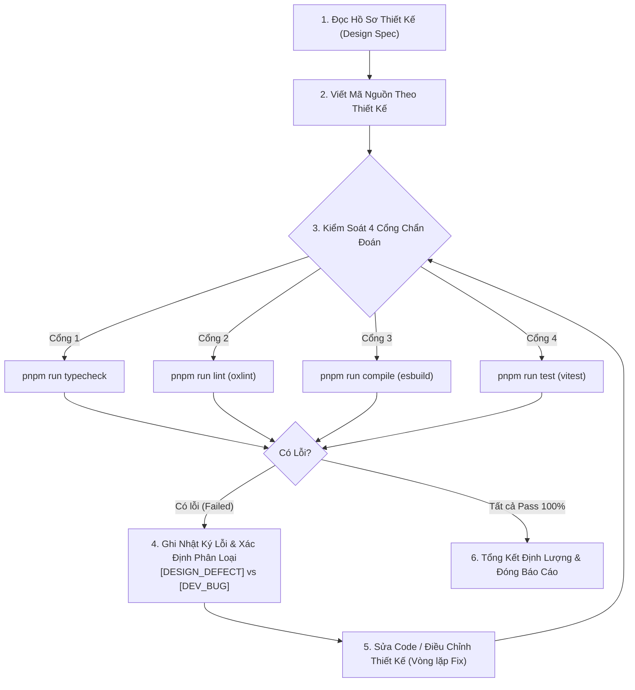

# Quy Chuẩn Ghi Báo Cáo Lỗi Biên Dịch & Thống Kê Tỷ Lệ Lỗi Thiết Kế vs Bug Dev

> **Mã quy chuẩn**: RULE-COMPILATION-DEFECT-TRACKING  
> **Tài liệu gốc**: [.agents/rules/compilation_error_reporting.md](../../.agents/rules/compilation_error_reporting.md)  
> **Áp dụng từ**: Phase 3.1 — Nhóm Việc 2 (Triển Khai Các Khối Giao Diện Cơ Bản) và toàn bộ các nhóm việc tiếp theo  
> **Mục tiêu**: Chuẩn hóa việc ghi vết lỗi biên dịch/kiểm thử cho từng module, thống kê định lượng tỷ lệ lỗi do thiết kế (`[DESIGN_DEFECT]`) và tỷ lệ bug khi lập trình (`[DEV_BUG]`) khi sử dụng AI thiết kế và triển khai.

---

## 1. Nguyên Tắc Cốt Lõi & Mục Đích

1. **Minh bạch hóa chất lượng AI**: Đo lường định lượng mức độ hoàn thiện của hồ sơ thiết kế kỹ thuật (Design Specs do AI lập) đối chiếu với thực tế triển khai (Implementation do AI/Dev viết mã nguồn).
2. **Không bỏ sót chu kỳ**: Mọi lần chạy biên dịch/kiểm thử phát sinh lỗi (kể từ lần đầu tiên sau khi viết code theo thiết kế) đều phải được ghi vết theo từng chu kỳ (Iteration / Fix Cycle) cho đến khi đạt trạng thái 100% sạch lỗi.
3. **Phân loại trung thực căn nguyên gốc**: Bắt buộc chỉ rõ lỗi bắt nguồn từ đâu:
   - Thiết kế thiếu/sai/mâu thuẫn (`[DESIGN_DEFECT]`).
   - Hay do lập trình viên/AI viết code sai cú pháp, sai kiểu, sót logic (`[DEV_BUG]`).
   - Hay do môi trường/công cụ (`[ENV_TOOL_ISSUE]`).

---

## 2. Quy Trình 5 Cổng Kiểm Soát (5-Gate Diagnostic Workflow)

Khi thực hiện bất kỳ nhiệm vụ hoặc module con nào (ví dụ: Task 2.1 `CornerCrossFrame`, Task 2.2 `StagingFileItem`, Task 2.3 `DiscardConfirmModal`, Task 2.4 Tests...), bắt buộc tuân thủ quy trình sau:



### Chi tiết 4 cổng chẩn đoán:

1. **Cổng 1 (TypeScript Typecheck)**: `pnpm run typecheck`  
   _Kiểm tra tính toàn vẹn kiểu dữ liệu trên toàn bộ workspace (`.`, `src/webview`, `tests`, `tests/webview`, `tests-e2e`)._
2. **Cổng 2 (Linter)**: `pnpm run lint`  
   _Kiểm tra quy chuẩn mã nguồn bằng `oxlint`, không để lọt unused variable, invalid regex, syntax smell._
3. **Cổng 3 (Bundler/Compile)**: `pnpm run compile`  
   _Đóng gói bằng `node esbuild.js`, xác nhận giải quyết đầy đủ import/export, CSS asset và binary path._
4. **Cổng 4 (Unit/Integration Test)**: `pnpm run test` (hoặc lệnh test chuyên biệt của module)  
   _Xác nhận tất cả test assertions đều pass trên runner `vitest`._

---

## 3. Quy Chuẩn Phân Loại Căn Nguyên Lỗi (Root Cause Taxonomy)

Mỗi lỗi phát sinh khi biên dịch hoặc chạy test phải được gắn chính xác 1 trong 3 nhãn sau:

### 3.1. `[DESIGN_DEFECT]` — Lỗi Do Thiết Kế

- **Định nghĩa**: Lỗi xảy ra do tài liệu thiết kế đặc tả sai, thiếu sót, mâu thuẫn giữa các tài liệu, hoặc không khả thi về mặt kỹ thuật, dẫn đến việc **bắt buộc phải sửa lại tài liệu thiết kế hoặc hợp đồng giao tiếp (Contracts/APIs)**.
- **Các trường hợp điển hình**:
  - Đặc tả sai kiểu dữ liệu hoặc thiếu trường dữ liệu trong hợp đồng RPC (ví dụ: thiết kế chỉ có `{ filePath }` nhưng logic thực tế bắt buộc có `{ repoPath, filePath }`).
  - Mâu thuẫn giữa 2 tài liệu thiết kế (ví dụ: tài liệu UI yêu cầu token màu Neon tím `#a855f7`, nhưng tài liệu Design System lại ghi là `#8b5cf6`).
  - Đặc tả luồng xử lý bất khả thi (ví dụ: yêu cầu synchronous call trên một API bắt buộc asynchronous của VS Code).
  - Thiếu quy định về trường hợp biên (edge cases) dẫn đến test failure hợp lệ đòi hỏi phải bổ sung đặc tả thiết kế.
  - Thiết kế quy định cấu trúc Component/State không tương thích với framework (ví dụ: vi phạm nguyên lý phản ứng của Preact Signals).
- **Hành động bắt buộc đi kèm**: Khi có lỗi này, người triển khai **phải cập nhật trực tiếp tài liệu thiết kế** trong `docs/02_design/` và ghi chú phần sửa đổi vào Báo cáo.

---

### 3.2. `[DEV_BUG]` — Lỗi Do Lập Trình / Triển Khai

- **Định nghĩa**: Thiết kế ban đầu hoàn toàn đúng, đủ và khả thi, nhưng trong quá trình lập trình (do AI hoặc dev), mã nguồn được viết sai cú pháp, nhầm kiểu, quên import, hoặc logic cài đặt sai so với đặc tả.
- **Các trường hợp điển hình**:
  - Gõ sai tên biến, tên hàm, import nhầm đường dẫn tương đối.
  - TypeScript báo lỗi type mismatch do dev ép kiểu sai hoặc chưa xử lý trường hợp `undefined/null`.
  - Vi phạm quy tắc của linter (`oxlint`), ví dụ: khai báo biến không dùng, cấu trúc rẽ nhánh thừa.
  - Esbuild báo lỗi cú pháp JSX/TSX hoặc cấu hình đóng gói.
  - Viết code không đúng theo từng bước đã nêu trong thiết kế (ví dụ: quên truyền cờ `--` trong lệnh git CLI).
  - Viết unit test mock dữ liệu sai làm test fail dù code logic đúng.
- **Hành động đi kèm**: Sửa trực tiếp trong mã nguồn, không được thay đổi tài liệu thiết kế.

---

### 3.3. `[ENV_TOOL_ISSUE]` — Lỗi Do Môi Trường / Công Cụ

- **Định nghĩa**: Lỗi không xuất phát từ thiết kế và cũng không xuất phát từ logic code, mà do đặc thù môi trường HĐH, runner, timeout phần cứng, hoặc file lock độc quyền (ví dụ: sự cố `hookTimeout 10s` trên Windows do độ trễ `CreateProcess`).
- **Quy tắc tính toán**: Nhóm lỗi này được ghi nhận riêng và **loại trừ** khỏi mẫu số khi tính tỷ lệ chất lượng giữa AI Thiết kế vs AI Dev, tránh làm sai lệch số liệu thống kê.

---

## 4. Công Thức Đo Đạc & Thống Kê Định Lượng

Để trả lời chính xác câu hỏi: _"Sau khi sử dụng AI thiết kế và triển khai thì tỷ lệ lỗi phải sửa của thiết kế và tỷ lệ bug khi dev là bao nhiêu?"_, áp dụng các công thức sau:

### 4.1. Tổng số lỗi kỹ thuật ($E_{total}$)

$$E_{total} = E_{design} + E_{dev}$$
_(Trong đó $E_{design}$ là tổng lỗi `[DESIGN_DEFECT]`, $E_{dev}$ là tổng lỗi `[DEV_BUG]`)._

### 4.2. Tỷ lệ lỗi do thiết kế (Design Defect Rate - DDR)

$$DDR = \frac{E_{design}}{E_{total}} \times 100\%$$

- **Ý nghĩa**: Phản ánh tỷ lệ phần trăm các vấn đề phát sinh bắt nguồn từ việc AI thiết kế chưa bao quát, thiếu sót hoặc mâu thuẫn đặc tả.

### 4.3. Tỷ lệ bug khi dev (Implementation Bug Rate - IBR)

$$IBR = \frac{E_{dev}}{E_{total}} \times 100\%$$

- **Ý nghĩa**: Phản ánh tỷ lệ phần trăm các lỗi do quá trình triển khai mã nguồn (AI coder/dev) gây ra trên nền một thiết kế đã có.

### 4.4. Số chu kỳ sửa lỗi trung bình (Average Fix Iterations to Clean - AFC)

$$AFC = \frac{\sum_{i=1}^{N} \text{FixCycles}_i}{N}$$

- **Ý nghĩa**: Trung bình một module/thành phần cần bao nhiêu chu kỳ biên dịch và sửa chữa lặp lại (Fix Cycles) để chuyển từ trạng thái lỗi sang hoàn toàn sạch lỗi.

### 4.5. Tỷ lệ thiết kế đúng ngay từ đầu (Design First-Time-Right Rate - DFTR)

$$DFTR = \frac{N_{perfect\_design}}{N} \times 100\%$$

- **Ý nghĩa**: Tỷ lệ phần trăm các thành phần được triển khai thành công 100% mà không cần phải điều chỉnh bất kỳ dòng thiết kế nào ($E_{design} = 0$).

---

## 5. Mẫu Bảng Báo Cáo Chuẩn Cho Từng Nhiệm Vụ (Report Template)

Mỗi nhiệm vụ trong nhóm việc khi hoàn tất (ví dụ trong `docs/04_reports/phase3/...`) bắt buộc phải có chương thống kê lỗi biên dịch theo biểu mẫu chuẩn sau:

### 📝 Mẫu Markdown Bảng Ghi Vết Lỗi:

```markdown
### X. Nhật Ký Lỗi Biên Dịch & Chẩn Đoán (Compilation & Diagnostic Error Log)

| STT | Chu Kỳ (Cycle) | Tệp Tin Tác Động  | Cổng Phát Hiện | Mã Lỗi / Thông Điệp Tóm Tắt                           |     Phân Loại     | Nguyên Nhân Gốc                                   | Giải Pháp Đã Sửa                              | Kết Quả Sau Sửa |
| :-: | :------------: | :---------------- | :------------: | :---------------------------------------------------- | :---------------: | :------------------------------------------------ | :-------------------------------------------- | :-------------: |
|  1  |     Vòng 1     | `src/.../Foo.tsx` |   Typecheck    | `TS2322: Type 'string' is not assignable to 'number'` |    `[DEV_BUG]`    | AI viết nhầm kiểu props trong component           | Sửa kiểu props thành `number`                 | ✅ Đã khắc phục |
|  2  |     Vòng 1     | `src/.../Bar.ts`  |   Unit Test    | `AssertionError: expected 'active' but got 'idle'`    | `[DESIGN_DEFECT]` | Thiết kế quy định sai trạng thái mặc định ban đầu | Cập nhật file thiết kế `02_...md` và sửa code | ✅ Đã khắc phục |
|  3  |     Vòng 2     | `src/.../Foo.tsx` |      Lint      | `oxlint: no-unused-vars 'tempVar'`                    |    `[DEV_BUG]`    | Quên xóa biến debug khi dev                       | Xóa biến thừa                                 | ✅ Đã khắc phục |

---

### X.1. Bảng Thống Kê Định Lượng (Defect & Reliability Metrics)

| Chỉ Số Định Lượng                         |   Ký Hiệu    | Giá Trị Thực Tế | Ghi Chú / Đánh Giá                                   |
| :---------------------------------------- | :----------: | :-------------: | :--------------------------------------------------- |
| **Tổng số chu kỳ sửa lỗi (Fix Cycles)**   |     $C$      |   **2 vòng**    | Vòng 1 (2 lỗi) → Vòng 2 (1 lỗi) → Sạch lỗi           |
| **Tổng số lỗi kỹ thuật**                  | $E_{total}$  |    **3 lỗi**    | $E_{design} + E_{dev}$                               |
| **Số lỗi do Thiết Kế**                    | $E_{design}$ |    **1 lỗi**    | Yêu cầu cập nhật tài liệu thiết kế                   |
| **Số lỗi do Triển Khai (Bug Dev)**        |  $E_{dev}$   |    **2 lỗi**    | Cú pháp, type, biến thừa                             |
| **Số sự cố Môi Trường/Tool**              |  $E_{env}$   |   **0 sự cố**   | Loại trừ khỏi tỷ lệ                                  |
| **TỶ LỆ LỖI PHẢI SỬA CỦA THIẾT KẾ (DDR)** |  **$DDR$**   |    **33.3%**    | $\frac{1}{3} \times 100\%$                           |
| **TỶ LỆ BUG KHI DEV (IBR)**               |  **$IBR$**   |    **66.7%**    | $\frac{2}{3} \times 100\%$                           |
| **Trạng thái cổng chẩn đoán cuối cùng**   |      -       |  **100% PASS**  | Typecheck: OK \| Lint: OK \| Compile: OK \| Test: OK |
```

---

## 6. Trách Nhiệm Của AI Agent Khi Thực Hiện Nhiệm Vụ

Khi AI Agent thực hiện các nhiệm vụ từ Nhóm Việc 2 trở đi:

1. **Tuyệt đối không bỏ qua lỗi ngầm**: Khi chạy `typecheck`, `lint`, `compile` hoặc `test` mà có lỗi, không được tự ý sửa âm thầm rồi báo cáo là "không có lỗi".
2. **Ghi vết từng chu kỳ**: Lần chạy đầu tiên có bao nhiêu lỗi phải liệt kê trung thực vào bảng nhật ký (Vòng 1). Sau khi sửa và chạy lại, nếu phát sinh lỗi mới hoặc còn sót lỗi thì ghi tiếp vào Vòng 2.
3. **Tuân thủ phân định trách nhiệm**:
   - Nếu lỗi do code chưa khéo, quên import, sai cú pháp: Nhận là `[DEV_BUG]`.
   - Nếu phát hiện thiết kế thiếu logic, mâu thuẫn đặc tả: Nhận là `[DESIGN_DEFECT]`, đồng thời chủ động cập nhật tệp thiết kế tham chiếu trong `docs/02_design/` để giữ tính đồng nhất của hệ thống tài liệu.
4. **Vị trí lưu báo cáo**: Mọi báo cáo kết quả của từng Nhóm việc phải được lưu trữ đúng quy chuẩn tại thư mục `docs/04_reports/phase3/`.
